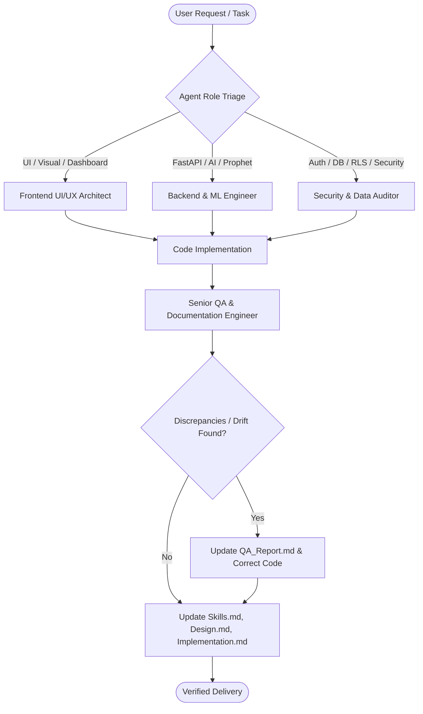

# CLAUDE.md: Project Architecture, Agent Specifications & Development Guide

> **Single Source of Truth for Claude**: This document establishes the foundational architecture, engineering roles, strict domain constraints, security mandates, and development workflows for the **Buck: Finance & Expenses Tracker** repository.

---

## 1. Project Overview & System Architecture

**Buck** is an intelligent, cross-platform personal finance management ecosystem engineered to give users complete visibility over cash flow through automated receipt scanning, AI expense classification, multi-wallet tracking, goal savings, and time-series spending forecasting.

### Tech Stack Matrix

| Tier | Technology | Purpose / Scope | Location in Repo |
|---|---|---|---|
| **Web Frontend** | Next.js 15 (App Router), React 19, TypeScript 5, Tailwind / CSS Modules, Framer Motion | Web client dashboard, responsive modals, client caching | `buck/src/app/`, `buck/src/component/` |
| **Mobile Client** | Flutter / Dart (Cross-platform Android 8.0+ & iOS 13.0+) | Mobile client, native camera hardware, on-device Edge ML OCR | Mobile repository |
| **Database & Auth** | Supabase Cloud (PostgreSQL 15+, GoTrue Auth, PostgREST, Realtime) | Relational persistence, kernel-level RLS, SSR session management | `buck/supabase/`, `buck/src/utils/` |
| **Next.js API Layer** | Next.js Route Handlers (Edge / Node runtimes) | Auth resets, account deletion grace period, SSR proxy, admin endpoints | `buck/src/app/api/` |
| **AI / ML Microservice** | Python 3.10+, FastAPI, Uvicorn, LLaMA 3.3 70B Turbo (Together AI), Facebook Prophet | Zero-shot 17-category classification, 2-sentence saving advice, additive regression forecasting | `buck/BuckAI_Backend/` |

---

## 2. Multi-Agent Roles & Operational Boundaries (from `Agents.md`)

Claude must adhere to the role boundaries defined in [`Agents.md`](file:///d:/VS%20Code/Buck-Budget-Tracker/Buck-Web-Application/AGENTS.md):



### 2.1 Senior QA & Documentation Engineer
- **Responsibilities**: Maintains single source of truth across all Markdown specs ([`Agents.md`](file:///d:/VS%20Code/Buck-Budget-Tracker/Buck-Web-Application/AGENTS.md), [`Skills.md`](file:///d:/VS%20Code/Buck-Budget-Tracker/Buck-Web-Application/Skills.md), [`Design.md`](file:///d:/VS%20Code/Buck-Budget-Tracker/Buck-Web-Application/Design.md), [`Implementation.md`](file:///d:/VS%20Code/Buck-Budget-Tracker/Buck-Web-Application/Implementation.md), [`QA_Report.md`](file:///d:/VS%20Code/Buck-Budget-Tracker/Buck-Web-Application/QA_Report.md)).
- **Zero Hallucination Policy**: Every documented feature, signature, and constraint must be traceable to concrete lines in the codebase. Never document planned/speculative features as existing implementation.
- **Proactive Defect Logging**: Immediately catalog any bug, race condition, missing endpoint, or security flaw in [`QA_Report.md`](file:///d:/VS%20Code/Buck-Budget-Tracker/Buck-Web-Application/QA_Report.md).

### 2.2 Frontend UI/UX Architect
- **Responsibilities**: User-facing components, design tokens, responsive layouts, client cache synchronization, and Framer Motion visual interactions.
- **Client Cache Rule**: High-frequency dashboard navigation must utilize [`FinancialContext.tsx`](file:///d:/VS%20Code/Buck-Budget-Tracker/Buck-Web-Application/buck/src/context/FinancialContext.tsx) to prevent redundant database fetches.
- **Modal Bounds Standard**: All desktop modals must conform to `width: min(880px, 100%)` and `max-height: min(82dvh, 760px)`.
- **1:1 Skeletal Loading Parity Policy**: Loading skeletons in [`DashboardSkeletons.tsx`](file:///d:/VS%20Code/Buck-Budget-Tracker/Buck-Web-Application/buck/src/component/DashboardSkeletons.tsx) must have 1:1 layout, geometry, card anatomy, and toolbar parity with rendered screens (especially Expenses and Wallets) to eliminate Cumulative Layout Shift (CLS).

### 2.3 Backend & ML Engineer
- **Responsibilities**: Python FastAPI microservice ([`buck/BuckAI_Backend/main.py`](file:///d:/VS%20Code/Buck-Budget-Tracker/Buck-Web-Application/buck/BuckAI_Backend/main.py)), AI inference models ([`ai_models.py`](file:///d:/VS%20Code/Buck-Budget-Tracker/Buck-Web-Application/buck/BuckAI_Backend/ai_models.py)), and Next.js backend API routes ([`buck/src/app/api/`](file:///d:/VS%20Code/Buck-Budget-Tracker/Buck-Web-Application/buck/src/app/api/)).
- **AI Output Sanitization**: Strip `<think>` tags and reasoning noise using `clean_llama_output`.
- **Currency Standard**: All monetary calculations and prompt outputs must use Philippine Peso (`PHP` / `₱`) with 2 decimal precision.
- **State Synchronization**: Prevent in-memory cache drift between FastAPI memory and Supabase PostgreSQL.

### 2.4 Security & Data Auditor
- **Responsibilities**: Supabase schema integrity, RLS policies, SSR auth lifecycles, cryptographic token handling, session activity cookies, and compliance purge workflows.
- **Secret Isolation**: Never expose `SUPABASE_SERVICE_ROLE_KEY`, `AUTH_RATE_LIMIT_SECRET`, `SESSION_COOKIE_SECRET`, or `ACCOUNT_PURGE_SECRET` to client-side code (`NEXT_PUBLIC_`).
- **Kernel Row Isolation**: All direct database operations from the client must strictly enforce PostgreSQL Row-Level Security (`auth.uid() = user_id`).
- **Endpoint Authorization**: All administrative and purge routes must validate authorization headers and session roles before executing.

---

## 3. Core Functional Requirements & Domain Constraints (SRS / SDD Alignment)

### 3.1 Monetary Standard & Decimal Precision
- **Official Currency**: Philippine Peso (`PHP` / `₱`).
- **Numeric Precision**: Strictly `numeric(14, 2)` across database schemas, TypeScript interfaces, and API payloads.

### 3.2 Standard 17 Expense Categories
All categorization logic (zero-shot NLP, database seeds, and UI filters) must strictly map to these 17 canonical categories:
1. `Food`
2. `Fare`
3. `Gas Money`
4. `Video Games`
5. `Shopping`
6. `Bills`
7. `Education`
8. `Electronics`
9. `Entertainment`
10. `Health`
11. `Home`
12. `Insurance`
13. `Social`
14. `Sport`
15. `Tax`
16. `Telephone`
17. `Transportation`

### 3.3 Mobile-Exclusive OCR Receipt Scanning
- **Hardware Integration**: Exclusive to Flutter mobile client via native device camera.
- **Performance Benchmark**: Image text extraction completed in `<1.5s` on-device.
- **Pipeline**: Greyscale → Contrast Enhancement → Adaptive Gaussian Binarization → Tokenization.
- **12% EVAT Mathematical Isolation**: Isolates 12% Electronic Value Added Tax (EVAT) and service charges from the net total payable.
- **Human-in-the-Loop Verification**: Parsed merchant, date, and amount must be reviewed in an editable verification modal before committing to the database.

### 3.4 AI Spending Forecast (Prophet Model)
- **Algorithm**: Additive time-series regression model using Facebook Prophet.
- **Confidence Intervals**: 80% upper and lower statistical confidence bounds.
- **Anomaly Exclusion**: Any transaction flagged with `is_emergency = TRUE` must be excluded from baseline trend calculations.
- **Outputs**: Projected month-end cash flow, estimated surplus/deficit, and daily burn trajectory.

### 3.5 AI Financial Advisor & Attitude Multipliers
- **Sentence Constraint**: Advice generated by LLaMA 3.3 70B Turbo must be **strictly two sentences** long.
- **Actionable Currency**: Must recommend explicit numeric adjustments in Philippine Peso (`₱`).
- **Saving Attitude Multipliers**:
  - **Normal**: `1.0x` baseline multiplier.
  - **Moderate**: `0.80x` expense target / `1.15x` savings target.
  - **Aggressive**: `0.60x` expense target / `1.30x` savings target.
- **Velocity Tracking**: Recalibrated dynamically against 14-day, 30-day, and 60-day moving average spending velocity.

### 3.6 Multi-Wallet Ledger & Atomic Transfers
- **Wallet Architecture**: Liquid wallets (`Cash`, `Bank`, `E-Wallet`).
- **Atomic Operations**: Inter-wallet transfers must execute via the `transfer_funds_atomic` PostgreSQL stored procedure (source debit + target credit executed in a single atomic transaction).
- **Soft Deletion**: Wallets are archived via `deleted_at = now()` to maintain historical transaction integrity.

### 3.7 Budget Limits & Visual Thresholds
- **Caution Threshold (Amber)**: Triggered at `80%` budget consumption.
- **Critical Threshold (Crimson)**: Triggered at `100%` budget consumption.

### 3.8 Security, Authentication & Session Lifecycle
- **Inactivity Timeout**: Active sessions automatically expire after **30 minutes of user inactivity**.
- **Cross-Tab Synchronization**: Inactivity timers and logout events sync across browser tabs via `BroadcastChannel` or `localStorage` events.
- **Cryptographic Password Reset**: Enforced via single-use cryptographic tokens with IP and email sliding-window rate limiting in `auth_security_events`.
- **10-Day Account Deletion Grace Period**:
  - Request marks account with `is_deleted = TRUE` and `grace_period_expires_at = NOW() + INTERVAL '10 days'`.
  - User can restore account within 10 days by logging in and clicking "Recover Account".
  - Scheduled cron worker (`/api/account/deletion/purge`) permanently purges expired accounts.
- **Data at Rest & Transit**: TLS 1.3 in transit, AES-256 at rest, bcrypt password hashing.

### 3.9 Brand Design Tokens (Warm Espresso & Buck Orange)
All UI components, charts, and styling must adhere to the design system tokens:
- **Buck Orange (Primary Accent)**: `#F47536`
- **Buck Gold (Secondary Accent)**: `#FFC547`
- **Buck Coral / Crimson (Alert / Danger)**: `#FF3838`
- **Neutral Cream / Sand (Background & Surfaces)**: `#FFF1D8`
- **Dark Roast Espresso (High Contrast Text & Dark Elements)**: `#120D0A`

### 3.10 Project Schedule Boundary
- **Lifecycle Cap**: All planning, roadmaps, and Gantt charts must conform strictly to a **9-week project lifecycle** (never 12+ weeks). The authoritative Gantt chart is located at [`docs/Buck_Project_Schedule_Gantt_Chart.xlsx`](file:///d:/VS%20Code/Buck-Budget-Tracker/Buck-Web-Application/docs/Buck_Project_Schedule_Gantt_Chart.xlsx).

---

## 4. Repository Structure & Key File Map

```
Buck-Web-Application/
├── Claude.md                           # This guide for Claude
├── Agents.md                           # Agent definitions and operational workflows
├── Skills.md                           # Full catalog of database methods & API endpoints
├── Design.md                           # Detailed system architecture, ERDs, and design specs
├── Implementation.md                   # Implementation progress and sprint deliverables
├── QA_Report.md                        # Active defect catalog, test logs, and audit trails
├── docs/
│   └── Buck_Project_Schedule_Gantt_Chart.xlsx  # 9-week project schedule with status dropdowns
└── buck/                               # Core Next.js Web Application & Backend
    ├── package.json                    # Next.js 15, React 19, Supabase SSR dependencies
    ├── next.config.ts                  # Next.js configuration
    ├── tsconfig.json                   # TypeScript configuration
    ├── BuckAI_Backend/                 # Python FastAPI AI Microservice
    │   ├── main.py                     # FastAPI endpoints (categorization, advice, forecast)
    │   ├── ai_models.py                # LLaMA 3.3 Together AI & Prophet models
    │   └── requirements.txt            # Python dependencies
    ├── supabase/
    │   └── migrations/                 # PostgreSQL schema DDL, RLS policies, stored procedures
    └── src/
        ├── middleware.ts               # SSR session authentication & route protection
        ├── app/
        │   ├── globals.css             # Design tokens, typography, root variables
        │   ├── dashboard/              # Protected dashboard route segments
        │   │   ├── home/page.tsx       # Primary dashboard overview & net worth
        │   │   ├── expenses/page.tsx   # Transaction management & category breakdown
        │   │   ├── wallet/page.tsx     # Multi-wallet management & inter-wallet transfers
        │   │   ├── goals/page.tsx      # Savings goals & fund allocations
        │   │   ├── statistics/page.tsx # Cash flow charts & spending velocity analytics
        │   │   ├── settings/page.tsx   # Profile, saving attitude, theme & account deletion
        │   │   └── admin/page.tsx      # System health, audit logs, and feedback triage
        │   └── api/                    # Server-side route handlers
        │       ├── auth/               # Password reset and session sign-out
        │       ├── account/deletion/   # Deletion request, confirmation, recover, and purge
        │       ├── advisor/route.ts    # AI Financial advisor gateway
        │       ├── forecast/route.ts   # Time-series forecasting gateway
        │       └── admin/              # Supabase & Vercel telemetry
        ├── component/
        │   ├── dashboard.css           # Dashboard layout & widget styles
        │   ├── DashboardSkeletons.tsx  # 1:1 Parity skeletons for zero CLS
        │   ├── SessionManager.tsx      # 30-min idle timer & cross-tab sync
        │   └── ...                     # Modals, charts, inputs, cards
        ├── context/
        │   ├── FinancialContext.tsx    # Global financial state & cache definitions
        │   └── FinancialProvider.tsx   # Context provider wrapping dashboard routes
        ├── hooks/
        │   └── usePointerGradient.ts   # Interactive cursor lighting for cards/modals
        └── utils/
            ├── supabaseClient.ts       # Browser Supabase client
            ├── supabaseServer.ts       # SSR Supabase client (cookies)
            └── supabaseData.ts         # Centralized data access layer (profiles, wallets, expenses)
```

---

## 5. Development & Testing Commands

### 5.1 Next.js Web Application (`buck/`)

```bash
# Navigate to web application directory
cd buck

# Install dependencies
npm install

# Start development server with Turbopack (default port: 3000)
npm run dev

# Run TypeScript type check and build production bundle
npm run build

# Start production server
npm run start

# Run ESLint validation
npm run lint
```

### 5.2 Python FastAPI AI Microservice (`buck/BuckAI_Backend/`)

```bash
# Navigate to AI backend directory
cd buck/BuckAI_Backend

# Create and activate virtual environment
python -m venv venv
.\venv\Scripts\activate      # Windows
source venv/bin/activate     # macOS/Linux

# Install dependencies
pip install -r requirements.txt

# Start FastAPI server with live reload (port 8000)
uvicorn main:app --reload --port 8000
```

---

## 6. Coding Standards & Implementation Rules for Claude

1. **Strict TypeScript & React 19 Standards**:
   - Never use `any` unless wrapping opaque third-party library internals; define explicit TypeScript interfaces for all database rows, forms, and API payloads.
   - Use React 19 hooks correctly; avoid mutating state directly.

2. **Zero Layout Shift (CLS) Mandate**:
   - Any modifications to dashboard views ([`expenses/page.tsx`](file:///d:/VS%20Code/Buck-Budget-Tracker/Buck-Web-Application/buck/src/app/dashboard/expenses/page.tsx), [`wallet/page.tsx`](file:///d:/VS%20Code/Buck-Budget-Tracker/Buck-Web-Application/buck/src/app/dashboard/wallet/page.tsx), etc.) must be reflected 1:1 in [`DashboardSkeletons.tsx`](file:///d:/VS%20Code/Buck-Budget-Tracker/Buck-Web-Application/buck/src/component/DashboardSkeletons.tsx). Skeletons must mirror exact card anatomy, toolbar button counts, and grid geometry.

3. **Data Layer Discipline**:
   - Always route database interactions through [`buck/src/utils/supabaseData.ts`](file:///d:/VS%20Code/Buck-Budget-Tracker/Buck-Web-Application/buck/src/utils/supabaseData.ts) or [`FinancialContext.tsx`](file:///d:/VS%20Code/Buck-Budget-Tracker/Buck-Web-Application/buck/src/context/FinancialContext.tsx). Do not write inline ad-hoc Supabase queries directly inside components.
   - When deleting an expense that deducted a wallet, always call `deleteExpenseAndRestoreWallet` to maintain accounting balance integrity.

4. **Database Migration Safety**:
   - Any schema changes must be written as reversible, timestamped SQL files under `buck/supabase/migrations/`.
   - Always include corresponding Row-Level Security policies enforcing `auth.uid() = user_id`.

5. **AI Prompt Engineering & Response Sanitation**:
   - Always strip thinking tokens (`<think>...</think>`) before parsing model outputs.
   - Ensure the AI advisor strictly adheres to the 2-sentence constraint with explicit numeric PHP recommendations.
   - Sanitize all PII (emails, phone numbers, account numbers) using regex scrubber before sending transaction context to LLMs.
