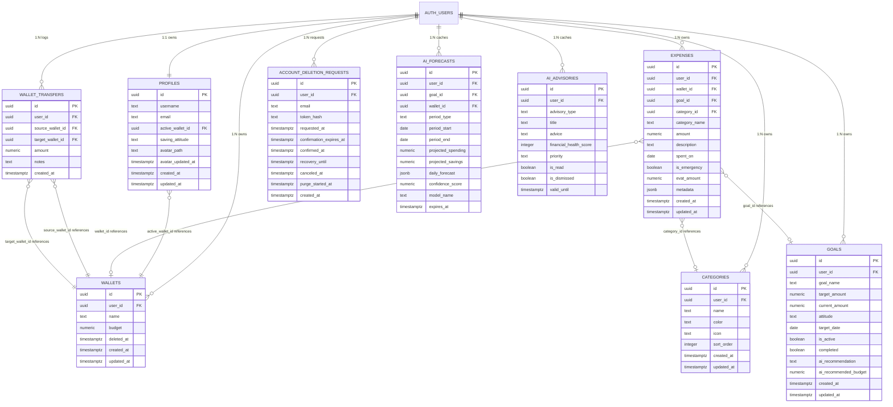
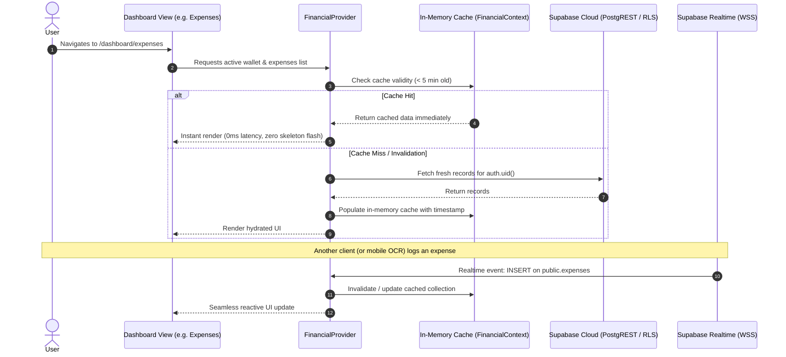
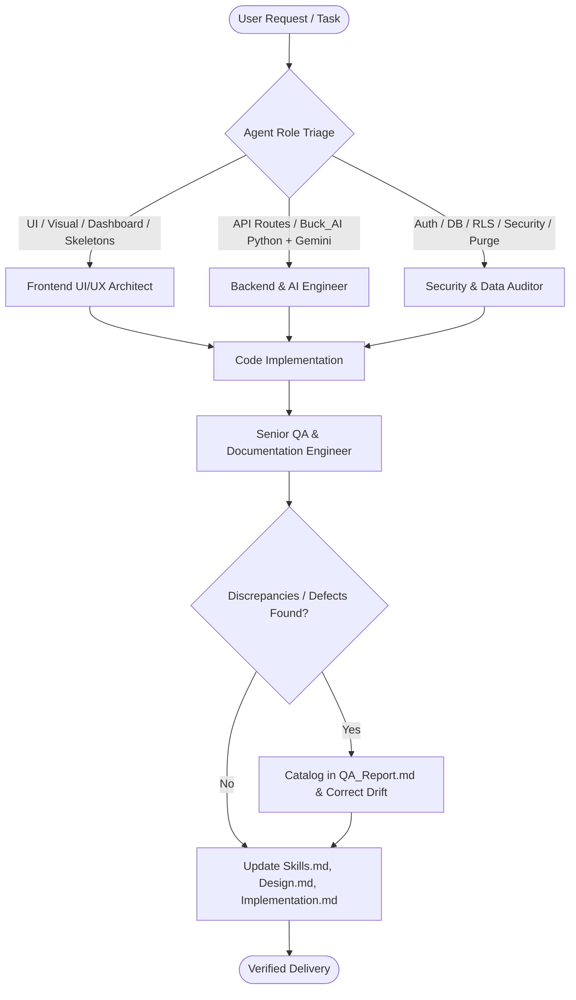

# CLAUDE.md: Project Architecture, System Overview & Engineering Guide

> **Single Source of Truth for Claude**: This document establishes the foundational architecture, system overview, structural decomposition of the entire project, engineering roles, domain constraints, security mandates, and development workflows for the **Buck: Finance & Expenses Tracker** repository.

---

## 1. System Overview

### 1.1 Project Purpose & Problem Statement
**Buck** directly resolves personal financial management challenges faced by individuals—including students, teachers, employees, freelancers, and seniors—who operate under rising living costs, irregular allowances/income, and limited budgeting literacy. Traditional financial logging tools suffer from tedious manual entry, lack of contextual local tax parsing, absent predictive analytics, and generic financial advice.

Buck provides an intelligent, accessible, cross-platform personal finance ecosystem combining:
- **Instant Mobile Receipt Scanning**: Native on-device OCR with automatic 12% EVAT mathematical isolation.
- **Automated AI Categorization**: Zero-shot NLP classification into 17 standard expense categories.
- **AI Forecaster**: A dedicated specialist that projects day-by-day spending ranges, month-end totals and goal timing from a per-user model, explained in a warm, plain voice by open models on Groq (ADR-053).
- **Attitude-Calibrated AI Financial Advisor**: Concise, actionable guidance with sourced ₱ figures, tailored to user-selected saving attitudes (Normal, Moderate, Aggressive).
- **Multi-Wallet Net Worth Oversight**: Liquid wallet management with atomic inter-wallet transfers.
- **Robust Security & Privacy**: Kernel-level PostgreSQL Row-Level Security (RLS), 30-minute inactivity session expiration with cross-tab synchronization, and a 10-day soft account deletion recovery window.

### 1.2 Target Audience & Scope Boundaries
- **Primary Audience**: Individual consumers in the Philippines and global users seeking granular personal cash flow control.
- **Currency Standard**: Philippine Peso (`PHP` / `₱`) with strict `numeric(14, 2)` decimal precision.
- **Explicit Scope Exclusions**: Multi-tenant enterprise corporate accounting, B2B billing systems, automated bank API syncing (Open Banking / Plaid), and stock/cryptocurrency trading platforms are strictly excluded from project scope.

### 1.3 Major Capabilities Matrix

| Functional Module | Primary Platform | Technical Implementation | Key Performance / Domain Benchmark |
|---|---|---|---|
| **Expense & Income Logging** | Web & Mobile | Supabase PostgREST & atomic balance triggers | Dual-entry accounting, `numeric(14,2)` in PHP |
| **Receipt Scanning** | Mobile-Exclusive | Flutter Edge ML Kit Vision OCR | On-device text extraction in `<1.5s`, 12% EVAT separation |
| **AI Expense Classification** | Web & Mobile | `Buck_AI/BuckAI_Advisor` auto-categorize (`POST /advisor/categorize`, Gemini) | Part of the AI Financial Advisor module; enum-constrained to the user's own categories, 25 per request |
| **Multi-Wallet Ledger** | Web & Mobile | PostgreSQL `transfer_funds_atomic` stored procedure | Atomic debit/credit, soft deletion (`deleted_at`) |
| **Budget Tracking & Alerts** | Web & Mobile | Category & Wallet budget progress evaluators | 80% Caution Alert (Amber), 100% Critical Alert (Crimson) |
| **AI Forecaster** | Web & Mobile | `Buck_AI/BuckAI_Forecast` (Python, numpy + Groq) | Per-user model fitted per request: day-by-day P10/P50/P90 up to 60 days, per category and wallet; Groq (gpt-oss / Llama) explains; rule engine is the fallback |
| **AI Financial Advisor** | Web & Mobile | `Buck_AI/BuckAI_Advisor` (Python FastAPI, Gemini Flash) | Advice saved in `ai_advisories`, regenerated only when the data materially changes; chat and goal tips; sourced PHP figures with named periods, attitude multipliers |
| **Financial Goals** | Web & Mobile | Goal tracking & wallet fund allocation triggers | Completion pacing, days remaining, celebratory feedback |
| **Analytics & Reports** | Web & Mobile | Chart.js & Framer Motion data visualizers | Category donut (Top-4 + Others cap), daily bars, velocity |
| **Auth & Account Lifecycle** | Web & Mobile | Supabase GoTrue, SSR Cookies, HMAC session tokens | 30-min idle timeout, cross-tab sync, 10-day deletion recovery |

---

## 2. High-Level System Architecture

Buck is architected as a decoupled, multi-tier system where independent Web and Mobile presentation clients share a single, unified Supabase PostgreSQL cloud database, while AI runs in a dedicated Python service, `Buck_AI` (FastAPI + Google Gemini Flash), shared by web and mobile.

```mermaid
flowchart TD
    %% Styling Classes
    classDef client fill:#f8fafc,stroke:#3b82f6,stroke-width:2px,color:#0f172a
    classDef gateway fill:#f0fdf4,stroke:#22c55e,stroke-width:2px,color:#0f172a
    classDef service fill:#fff7ed,stroke:#f97316,stroke-width:2px,color:#0f172a
    classDef database fill:#eff6ff,stroke:#6366f1,stroke-width:2px,color:#0f172a
    classDef external fill:#fdf4ff,stroke:#d946ef,stroke-width:2px,color:#0f172a

    %% Presentation Tier
    subgraph PresentationTier ["1. Presentation Tier (Independent Clients)"]
        direction LR
        WebClient["🌐 Next.js 15 Web Client\n(App Router / React 19 / Vercel)\n- SSR Auth Gatekeeping\n- In-Memory FinancialContext Cache\n- Framer Motion & Responsive Dashboards"]:::client
        MobileClient["📱 Flutter Mobile Client\n(Dart / iOS 13+ & Android 8+)\n- Native Camera Viewfinder\n- On-Device Edge ML Vision OCR\n- SQLite Local Offline Cache"]:::client
    end

    %% Application & Service Tier
    subgraph ApplicationServiceTier ["2. Application & Service Tier (Cloud Hosted)"]
        direction LR
        NextServer["⚡ Next.js Server Layer (Node/Edge)\n- Middleware SSR Auth Guard\n- HMAC Session Activity Cookie\n- Route Handlers (/api/auth, /api/account)\n- Admin Telemetry Gateways"]:::service
        BuckAI["🧠 Buck_AI (Python FastAPI on Vercel)\n- BuckAI_Advisor: saved, self-updating advice + chat\n- BuckAI_Forecast: per-user forecast + explanation"]:::service
        SupabaseGateway["🛡️ Supabase Managed Gateway\n- GoTrue Auth Engine (JWT / Cookies)\n- PostgREST Data Engine (REST APIs)\n- Realtime Replication Engine (WSS)"]:::gateway
    end

    %% External ML Providers
    subgraph ExternalServices ["External Cloud AI Engines"]
        Gemini["🤖 Google Gemini API\n(Gemini Flash, server-side key)"]:::external
    end

    %% Data Persistence Tier
    subgraph DataPersistenceTier ["3. Data Persistence Tier (Single Source of Truth)"]
        PostgreSQL[("🐘 Supabase PostgreSQL 15 Database\n- Kernel-Level Row-Level Security (RLS)\n- Numeric(14,2) Precision Enforced\n- Stored Procedures (transfer_funds_atomic)\n- Storage Bucket: profile-avatars\n- Automated Daily PITR Backups"):::database
    end

    %% Protocol Interconnections
    WebClient <-->|"HTTPS (REST) & Cookies"| NextServer
    WebClient <-->|"HTTPS (REST) & WSS (Realtime)"| SupabaseGateway
    MobileClient <-->|"HTTPS (REST) & WSS (Realtime)"| SupabaseGateway

    WebClient -.->|"HTTPS + Supabase JWT"| BuckAI
    MobileClient -.->|"HTTPS + Supabase JWT"| BuckAI
    BuckAI <-->|"PostgREST as the user (RLS)"| SupabaseGateway
    BuckAI -.->|"PII-Sanitized, Grounded Prompts + Tool Calls"| Gemini

    NextServer <-->|"PostgreSQL Wire / PostgREST (Admin Role)"| PostgreSQL
    SupabaseGateway <-->|"PostgreSQL Wire Protocol (Port 5432)"| PostgreSQL
```

### 2.1 Presentation Tier
1. **Next.js 15 Web Client**:
   - Implements React 19 Server Components and Client Components within the App Router (`buck/src/app/`).
   - Utilizes [`FinancialContext.tsx`](file:///d:/VS%20Code/Buck-Budget-Tracker/Buck-Web-Application/buck/src/context/FinancialContext.tsx) to provide high-speed in-memory client data caching with Supabase Realtime synchronization, eliminating repeated table fetches during navigation.
   - Enforces responsive modal bounds (`width: min(880px, 100%)`, max-height `min(82dvh, 760px)`) and strict **1:1 Skeletal Loading Parity** ([`DashboardSkeletons.tsx`](file:///d:/VS%20Code/Buck-Budget-Tracker/Buck-Web-Application/buck/src/component/DashboardSkeletons.tsx)) for zero Cumulative Layout Shift (CLS).
2. **Flutter Mobile Client**:
   - Independent cross-platform client (Android 8.0+ and iOS 13.0+) adhering to the BLoC state pattern.
   - Interfaces directly with native device camera hardware for high-resolution receipt capture.
   - Runs local image preprocessing (greyscale conversion, contrast stretching, adaptive Gaussian binarization) and edge vision OCR text extraction in `<1.5s` on-device without cloud latency.
   - Caches transactions locally in SQLite for graceful offline operation during connectivity drops.

### 2.2 Application & Service Tier
1. **Supabase Managed Cloud Gateway**:
   - **GoTrue Auth**: Handles cryptographic user registration, session token issuance, and password verification.
   - **PostgREST Engine**: Exposes auto-generated, performant RESTful APIs directly over PostgreSQL tables, evaluating Row-Level Security (RLS) on every transaction.
   - **Realtime Engine**: Broadcasts database mutations over secure WebSockets (`wss://`) on Port 443 to connected clients.
2. **Next.js Server & Route Handlers (`buck/src/app/api/`)**:
   - **Middleware Guard (`buck/src/middleware.ts`)**: Evaluates SSR auth cookies and verifies HMAC-SHA256 activity signatures before allowing navigation into protected `/dashboard/*` routes.
   - **Auth & Account Lifecycle Routes**: Manages rate-limited password reset requests (`/api/auth/password-reset`), 10-day deletion requests and confirmation tokens (`/api/account/deletion/*`), and cron-based purge execution.
   - **Admin Telemetry Gateways**: Proxies authenticated system telemetry from the Supabase Management API (`/api/admin/supabase`) and Vercel Deployment API (`/api/admin/vercel`).
3. **Buck_AI: Python FastAPI service on Google Gemini Flash (`Buck_AI/`, its own Vercel project)** (ADR-043):
   - Two AIs, one per job: **`BuckAI_Advisor`** (AI Financial Advisor, live) and **`BuckAI_Forecast`** (AI Forecaster, live, ADR-052). `shared/` holds config, auth, Supabase, the Gemini client (Advisor), the Groq client (Forecaster) and safety.
   - Web and mobile call the same API with the user's **Supabase access token**, not an API key. The service verifies it with Supabase Auth and queries Supabase *as the user*, so RLS applies and no service-role key is needed. `GEMINI_API_KEY` exists only in the Buck_AI environment.
   - Advice is saved in `ai_advisories` with a data fingerprint. It is served from the database while the data is unchanged and regenerated when it moves materially. See [`Buck_AI/README.md`](file:///d:/VS%20Code/Buck-Budget-Tracker/Buck-Web-Application/Buck_AI/README.md).

### 2.3 Data Persistence Tier
- **Single Source of Truth**: Both the Next.js web application and Flutter mobile app communicate with the exact same Supabase PostgreSQL 15 database instance. Any receipt logged on mobile is instantaneously visible on the web dashboard.
- **Kernel-Level Access Control**: Row-Level Security (RLS) is applied to all public tables, strictly enforcing `auth.uid() = user_id`.
- **Atomic Financial Transactions**: Inter-wallet fund transfers and expense deletions are governed by database transactions and stored procedures (`transfer_funds_atomic`), guaranteeing zero balance desynchronization.

### 2.4 Network Protocols & Communications
- **Public Transport**: Enforces HTTPS (TLS 1.3) and WebSockets Secure (`wss://`) over **Port 443**.
- **Internal Database Connection**: PostgreSQL wire protocol over **Port 5432** (connection pooled via Supavisor / PgBouncer).
- **Zero PII Transmission**: Transaction descriptions sent to external AI engines are pre-filtered via regex scrubbers to strip phone numbers, emails, and account identifiers.

---

## 3. Structural Overview of the Entire Project

### 3.1 Subsystems Decomposition (The 10 Canonical Modules)

The system is decomposed into 10 cohesive, traceable subsystems aligned with the SRS, SDD, and SPMP:

```
┌─────────────────────────────────────────────────────────────────────────────────────────┐
│                                   BUCK ECOSYSTEM                                        │
├──────────────────────────┬──────────────────────────┬───────────────────────────────────┤
│ Core Financial Subsystem │ Machine Learning & Vision│ Governance & Platform Subsystem   │
├──────────────────────────┼──────────────────────────┼───────────────────────────────────┤
│ 1. Expense/Income Log    │ 2. Mobile Edge OCR       │ 8. Financial Goals & Pacing       │
│ 4. Multi-Wallet Ledger   │ 3. 17-Cat AI Classifier  │ 9. Analytics & Cash Flow Reports  │
│ 5. Budgets & Alerting    │ 6. AI Forecaster         │ 10. Auth & 10-Day Account Grace   │
│                          │ 7. AI Financial Advisor  │                                   │
└──────────────────────────┴──────────────────────────┴───────────────────────────────────┘
```

1. **Expense & Income Management Subsystem (MOD-01)**:
   - Records transactions in Philippine Peso (`numeric(14,2)`), atomically updates originating wallet balances, and provides multi-parameter filtering (date range, wallet, category).
2. **Mobile OCR Receipt Scanning Subsystem (MOD-02)**:
   - Mobile camera viewfinder, edge binarization, on-device OCR text extraction, 12% EVAT mathematical isolation, and human-in-the-loop review modal.
3. **Automated AI Expense Categorization Subsystem (MOD-03)**:
   - Zero-shot classification prompt mapping arbitrary transaction descriptions into the 17 canonical categories with client-side override.
4. **Multi-Wallet & Financial Accounts Subsystem (MOD-04)**:
   - Manages multiple liquid accounts (`Cash`, `Bank`, `E-Wallet`), aggregates total net worth, and executes atomic inter-wallet transfers via `transfer_funds_atomic`.
5. **Budget Management & Alert Subsystem (MOD-05)**:
   - Monthly category and wallet budgets, dynamic progress gauges, and threshold triggers: **80% Caution Alert (Amber)** and **100% Critical Limit Alert (Crimson)**.
6. **Spending Forecasting & Trend Analysis Subsystem (MOD-06)**:
   - The **AI Forecaster** (`Buck_AI/BuckAI_Forecast`, ADR-052): a separate AI from the Advisor. A per-user model fitted on each request projects day-by-day spending ranges (30 or 60 days) per category and wallet; Groq explains the numbers (ADR-053). The web rule engine (`/api/forecast`) is the fallback; goal charts still use plain math (`utils/goalForecast.ts`).
7. **AI Financial Advisor & Recommendation Subsystem (MOD-07)**:
   - The **AI Financial Advisor** (`Buck_AI/BuckAI_Advisor`, Gemini): saved advice that updates itself with the data, streaming chat with read-only data tools, goal tips, and AI auto-categorize. Lengths: suggestion 1 sentence (this week's step), detailed analysis 3–5 sentences, wallet advice 1–2 sentences, goal tips 2 sentences; every ₱ figure names its period and comes from the deterministic plan. Amounts are scaled by saving attitude (Normal 1.0x, Moderate 0.80x/1.15x, Aggressive 0.60x/1.30x).
8. **Financial Goals & Target Savings Subsystem (MOD-08)**:
   - Dedicated goal tracking with target amounts, target completion dates, wallet fund allocations, and completion pacing indicators.
9. **Analytics, Statistics & Reports Subsystem (MOD-09)**:
   - Interactive data visualizations: Category Breakdown donut (Top-4 categories + aggregated 5th "Others" slice cap), 7-day daily spend bar charts, and moving average spending velocity.
10. **Authentication, Identity & Account Lifecycle Subsystem (MOD-10)**:
    - User registration, SSR session cookie validation, 30-minute inactivity timeout synchronized across tabs via `BroadcastChannel`, cryptographic password resets, and 10-day soft account deletion recovery window.

---

### 3.2 Database Entity Relationship & Schema Design



#### Core Schema Rules & Integrity Triggers:
1. **Precision Standard**: Every currency column (`wallets.budget`, `expenses.amount`, `goals.target_amount`, `wallet_transfers.amount`) is strictly `numeric(14, 2) check (value >= 0)`.
2. **Referential Ownership Triggers**:
   - `ensure_expense_relations_owner`: Validates that `wallet_id`, `goal_id`, and `category_id` in any transaction record belong to the same `user_id`.
   - `ensure_profile_active_wallet_owner`: Prohibits assigning an `active_wallet_id` that belongs to another account.
3. **Soft-Deletion Preservation**: `wallets.deleted_at` allows wallets to be archived without breaking historical transactions or violating foreign keys.
4. **Single Active Goal Enforcement**: A partial unique index (`goals_one_active_goal_per_user_idx`) ensures that only one goal per user can have `is_active = true`.

---

### 3.3 Detailed Repository Directory & File Anatomy

```
d:/VS Code/Buck-Budget-Tracker/Buck-Web-Application/
├── Claude.md                           # Master Claude Architecture & Engineering Guide (Single Source of Truth)
├── Agents.md                           # Multi-agent roles, operational scopes, and lifecycle rules
├── README.md                           # Project onboarding and developer quick-start
│
├── docs/                               # All project documentation (map: docs/README.md)
│   ├── README.md                       # Documentation map: which doc answers what
│   ├── Skills.md                       # Function catalog: Supabase data layer, API routes, Buck_AI endpoints, hooks
│   ├── Design.md                       # Architecture, ERDs, data flows, ADR-001 to ADR-052
│   ├── Implementation.md               # Setup, environment variables, execution logic, constraints
│   ├── QA_Report.md                    # Defect catalog, security audit, test strategy
│   ├── requirements/                   # SRS.md, Buck_SRS.docx
│   ├── project/                        # Buck_Project_Schedule_Gantt_Chart.xlsx (9-week schedule)
│   └── guides/                         # frontend/ change notes, supabase/ e-mail templates
│
├── Buck_AI/                            # Python FastAPI + Gemini AI service (see Buck_AI/README.md)
│
└── buck/                               # Core Next.js Web Application & Backend Subsystem
    ├── CLAUDE.md                       # Subdirectory Claude reference mirror
    ├── package.json                    # Next.js 15, React 19, Supabase SSR, Framer Motion dependencies
    ├── next.config.ts                  # Next.js runtime configuration
    ├── tsconfig.json                   # TypeScript compiler configuration
    ├── vercel.json                     # Vercel deployment & security headers configuration
    │
    ├── supabase/                       # Database Persistence Subsystem
    │   └── migrations/                 # Versioned SQL migrations (DDL, RLS policies, stored procedures)
    │       ├── 202606010000_initial_schema.sql
    │       ├── 202606140001_security_and_policy_hardening.sql
    │       └── 202609200001_transfer_funds_atomic.sql
    │
    └── src/                            # Application Source Code
        ├── middleware.ts               # SSR route gatekeeper, session freshness validation & HMAC cookie signing
        │
        ├── app/                        # Next.js 15 App Router
        │   ├── globals.css             # CSS design tokens, typography, root variables, scrollbar styling
        │   ├── layout.tsx              # Root HTML layout wrapping ToastProvider, AuthGuard, and SessionManager
        │   ├── page.tsx                # Public landing page with features showcase and auth entry
        │   │
        │   ├── dashboard/              # Authenticated Dashboard Route Segments
        │   │   ├── layout.tsx          # Dashboard layout wrapping FinancialProvider and navigation chrome
        │   │   ├── home/               # Overview view: Net worth, WeeklyPieChart, 7-day bars, AI placeholder
        │   │   ├── expenses/           # Transaction view: ExpenseKPICards, CategoryVisualizer, table/filter
        │   │   ├── wallet/             # Multi-wallet view: Active cards, inter-wallet transfer modal, history
        │   │   ├── goals/              # Savings view: Goal list, funding allocation, progress indicators
        │   │   ├── statistics/         # Analytics view: Cash flow velocity, category spending breakdown
        │   │   ├── settings/           # Profile view: Attitude selector, dark/light theme, account deletion
        │   │   ├── admin/              # Admin view: System telemetry, Supabase/Vercel status, feedback triage
        │   │   ├── financial-advisor/  # Dedicated AI Advisor recommendation view
        │   │   └── forecast/           # Dedicated AI Time-Series spending forecast view
        │   │
        │   └── api/                    # Server-Side API Route Handlers
        │       ├── auth/               # /api/auth/password-reset (rate-limited), /api/auth/sign-out
        │       ├── account/deletion/   # /request, /recover, and cron-triggered /purge endpoints
        │       ├── advisor/route.ts    # AI Advisor recommendation proxy endpoint
        │       ├── forecast/route.ts   # Time-series spending forecasting proxy endpoint
        │       └── admin/              # Supabase management and Vercel telemetry proxy routes
        │
        ├── component/                  # Reusable UI Components & Widgets
        │   ├── dashboard.css           # Global dashboard layout, card styling, and grid rules
        │   ├── DashboardClientLayout.tsx # Responsive desktop/mobile navigation shell
        │   ├── DashboardSkeletons.tsx  # 1:1 Parity skeletons for zero CLS (Expenses, Wallets, Home, etc.)
        │   ├── SessionManager.tsx      # 30-min idle timeout detector & BroadcastChannel cross-tab synchronizer
        │   ├── ExpenseKPICards.tsx     # KPI metrics: Wallet capacity meter, cumulative stats, benchmark track
        │   ├── ExpenseCategoryVisualizer.tsx # Proportional category allocation bar & filter chip pills
        │   ├── WeeklyPieChart.tsx      # Donut chart with Top-4 + Others 5-slice cap and interpretation card
        │   ├── AIAdvisorPlaceholderCard.tsx # Shimmering Generative AI status card with telemetry chips
        │   └── toast/                  # Global Toaster Subsystem
        │       ├── ToastContext.tsx    # Toast provider and dispatch hooks (toast.success, toast.error, etc.)
        │       ├── Toaster.tsx         # Framer Motion animated viewport container (max 4 concurrent items)
        │       ├── ToastItem.tsx       # Accessible notification item with animated countdown progress bar
        │       └── toast.module.css    # Toast token styling, glassmorphism, and responsive positioning
        │
        ├── context/                    # React Context & Client Cache State
        │   ├── FinancialContext.tsx    # State signatures, types, and DashboardDataCache cache layer
        │   └── FinancialProvider.tsx   # Global provider orchestrating data fetching and realtime subscriptions
        │
        ├── hooks/                      # Custom React Hooks
        │   └── usePointerGradient.ts   # Interactive mouse pointer radial gradient lighting for cards/modals
        │
        └── utils/                      # Data Services, Clients & Helpers
            ├── supabaseClient.ts       # Browser-side Supabase client singleton
            ├── supabaseServer.ts       # Server-side Supabase client with cookie forwarding
            ├── supabaseData.ts         # Centralized data access layer (profiles, wallets, expenses, goals, feedback)
            ├── sessionActivity.ts      # HMAC cookie signing and session activity validation utilities
            └── formatters.ts           # Standardized Philippine Peso currency (`₱`) and date formatters
```

---

### 3.4 Client State Caching & Synchronization Flow



---

## 4. Multi-Agent Roles & Operational Boundaries (from `Agents.md`)

When executing pairs programming, code reviews, and architectural changes, Claude must operate within the specific agent roles defined in [`Agents.md`](file:///d:/VS%20Code/Buck-Budget-Tracker/Buck-Web-Application/Agents.md):



### 4.1 Senior QA & Documentation Engineer
- **Responsibilities**: Maintains single source of truth across all Markdown specs ([`Agents.md`](file:///d:/VS%20Code/Buck-Budget-Tracker/Buck-Web-Application/Agents.md), [`Skills.md`](file:///d:/VS%20Code/Buck-Budget-Tracker/Buck-Web-Application/docs/Skills.md), [`Design.md`](file:///d:/VS%20Code/Buck-Budget-Tracker/Buck-Web-Application/docs/Design.md), [`Implementation.md`](file:///d:/VS%20Code/Buck-Budget-Tracker/Buck-Web-Application/docs/Implementation.md), [`QA_Report.md`](file:///d:/VS%20Code/Buck-Budget-Tracker/Buck-Web-Application/docs/QA_Report.md)).
- **Zero Hallucination Policy**: Every documented signature, column, and constraint must be traceable to concrete lines in the repository.
- **Proactive Defect Logging**: Immediately catalog any bug, race condition, missing endpoint, or security flaw in [`QA_Report.md`](file:///d:/VS%20Code/Buck-Budget-Tracker/Buck-Web-Application/docs/QA_Report.md).

### 4.2 Frontend UI/UX Architect
- **Responsibilities**: Next.js App Router, Framer Motion, CSS Design Tokens, responsive modal bounds, and client caching.
- **Client Cache Rule**: High-frequency dashboard navigation must utilize [`FinancialContext.tsx`](file:///d:/VS%20Code/Buck-Budget-Tracker/Buck-Web-Application/buck/src/context/FinancialContext.tsx) to prevent redundant database queries.
- **Modal Bounds Standard**: All desktop modals must conform to `width: min(880px, 100%)` and `max-height: min(82dvh, 760px)`.
- **Dropdown Standard (ADR-040)**: Every dropdown uses `@/component/CustomSelect` (no native `<select>`). Option items are regular weight (`400`); the selected option is `500` and marked by colour and background, never bold; the trigger is `600`. Toolbar filters and sorts pass `fit` so the trigger sizes to its longest option and never truncates labels with "…". Do not give them fixed widths.
- **Deletion Standard (ADR-041)**: Every user-facing delete uses `@/component/DangerDeleteDialog`, a three-step GitHub-style flow: (1) a warning plus slide-to-delete, (2) a red "I understand, continue" button or Cancel, (3) typing the item's exact name to enable the final red Delete. Never use `window.confirm` or a single-click confirm. Destructive buttons are always red-tinted with hit targets of at least 36px. Settings account deletion keeps its stronger flow (DELETE, password, email confirmation, 10-day recovery).
- **1:1 Skeletal Loading Parity Policy**: Loading skeletons in [`DashboardSkeletons.tsx`](file:///d:/VS%20Code/Buck-Budget-Tracker/Buck-Web-Application/buck/src/component/DashboardSkeletons.tsx) must have 1:1 layout, geometry, card anatomy, and toolbar parity with rendered screens (especially Expenses and Wallets) to eliminate Cumulative Layout Shift (CLS).

### 4.3 Backend & ML Engineer
- **Responsibilities**: The Python [`Buck_AI/`](file:///d:/VS%20Code/Buck-Budget-Tracker/Buck-Web-Application/Buck_AI/) service (`BuckAI_Advisor`, `BuckAI_Forecast`, `shared`) and the Next.js API routes ([`buck/src/app/api/`](file:///d:/VS%20Code/Buck-Budget-Tracker/Buck-Web-Application/buck/src/app/api/)).
- **Specialist Separation**: The AI Financial Advisor and the AI Forecaster are two different AIs with different jobs. Keep their prompts, tools and UI separate; they share only `Buck_AI/shared/`.
- **AI Output Sanitization**: Drop Gemini thought parts (`part.thought`), validate structured output against its JSON schema, and pass free text through `shared/safety.py#clean_text`.
- **Currency Standard**: All monetary calculations and prompt outputs must use Philippine Peso (`PHP` / `₱`) with 2 decimal precision.
- **Statelessness**: AI routes keep no conversation state; every request reloads the user's data from Supabase.

### 4.4 Security & Data Auditor
- **Responsibilities**: Supabase schema integrity, RLS policies, SSR auth lifecycles, cryptographic token handling, session activity cookies, and compliance purge workflows.
- **Secret Isolation**: Never expose `SUPABASE_SERVICE_ROLE_KEY`, `AUTH_RATE_LIMIT_SECRET`, `SESSION_COOKIE_SECRET`, `ACCOUNT_PURGE_SECRET`, or `MFA_RECOVERY_SECRET` to client-side code (`NEXT_PUBLIC_`).
- **Kernel Row Isolation**: All direct database operations from the client must strictly enforce PostgreSQL Row-Level Security (`auth.uid() = user_id`).
- **Endpoint Authorization**: All administrative and purge routes must validate authorization headers and session roles before executing.

---

## 5. Architectural Decision Records (ADRs) Quick Reference

| ADR | Title | Core Architectural Decision |
|---|---|---|
| **ADR-001** | SSR Authentication & HMAC Cookies | `@supabase/ssr` combined with HMAC-SHA256 session activity cookies in `middleware.ts`. |
| **ADR-002** | In-Memory Client Cache (`FinancialContext`) | Timestamped in-memory caching for dashboard data with Supabase Realtime invalidation. |
| **ADR-003** | Soft-Deletion for Multi-Wallet Management | Added `wallets.deleted_at` to preserve historical transaction referential integrity. |
| **ADR-004** | Decoupled Python FastAPI Microservice | *Superseded by ADR-043* (service removed). |
| **ADR-043** | Buck_AI: Python + Gemini, Two AIs | `Buck_AI/` FastAPI on Vercel with `BuckAI_Advisor` (saved, fingerprint-refreshed advice) and `BuckAI_Forecast` (ADR-052); Supabase-JWT auth for web and mobile; queries run under RLS. |
| **ADR-048** | Optional 2FA (TOTP), Passkeys & Recovery | `private.mfa_satisfied()` in RESTRICTIVE RLS + middleware/`apiAuth` + Buck_AI gate; backup codes and 24 h e-mail recovery under `/api/auth/mfa/*`; UI is a handoff. |
| **ADR-049** | Connected Apps (OAuth 2.1 Server) | App tokens (`client_id` claim) are read-only via RESTRICTIVE RLS and refused by `/api/*` and Buck_AI; approval via `/api/oauth/authorizations/[id]/consent` records a 2FA-verified grant that `mfa_satisfied()` requires for 2FA users. |
| **ADR-050** | Buck MCP Server | `/api/mcp` (Next.js, `@modelcontextprotocol/server`, stateless): 7 read-only tools for connected AI agents; RFC 9728 metadata points to Supabase Auth; queries run under RLS with the app's token; no Gemini. |
| **ADR-051** | Connected-App Logo Proxy | Logos load only from `GET /api/oauth/app-logo?client_id=<uuid>` (2FA web session): `logo_uri` looked up server-side, https + public IPs only (checked at connect), PNG/JPEG/WebP/GIF sniffed, 256 KB, 5 s, `nosniff`, private 1-day cache. CSP `img-src` stays closed to third-party hosts. |
| **ADR-052** | AI Forecaster | No trained model: per-user intermittent-demand model (weekday, payday, recurring) fitted per request, 1,000 Monte Carlo paths → P10/P50/P90, window picked by a 14-day backtest that also sets confidence. `GET /forecast` = numbers now; `POST /forecast/explain` = AI text, saved in `ai_forecasts`. |
| **ADR-053** | Forecaster Explanation on Groq | The Forecaster's text moves from Gemini to Groq (`openai/gpt-oss-120b` → `llama-3.3-70b-versatile` → `openai/gpt-oss-20b`, `shared/groq.py`): free with no billing account, ~1 s, strict JSON schema; warm, no-jargon voice. Advisor stays on Gemini. `GROQ_API_KEY` lives only in Buck_AI. |
| **ADR-005** | Zero-Knowledge Password Reset Rate Limiting | Rate limiting tracked via SHA-256 HMAC hashes in `auth_security_events` (zero plaintext PII). |
| **ADR-006** | Database Policy Consolidation & Hardening | Applied `(select auth.uid())` initplan caching and revoked trigger execution from public roles. |
| **ADR-007** | Weekly Spending Donut with 5-Slice Cap | Donut chart capped at Top-4 categories + 5th "Others" slice, paired with contextual interpretation card. |
| **ADR-008** | Expenses Tab KPI Overhaul | Introduced `ExpenseKPICards` (capacity bar, sparkline stats) and `ExpenseCategoryVisualizer`. |
| **ADR-009** | Symmetrical Wallet Card Refactor | Standardized wallet cards to strictly two 50%/50% action buttons (`[Edit]`, `[Delete]`) and emerald active status badge. |
| **ADR-010** | Category Breakdown Timeframe Filter & AI Card | Segmented filter (`[All Time] [This Month] [This Week]`) and `AIAdvisorPlaceholderCard.tsx`. |
| **ADR-011** | Global Modular Toaster Architecture | Unified token-driven toast system (`buck/src/component/toast/`), completely removing native `alert()` calls. |
| **ADR-012** | 1:1 Skeletal Loading Parity Standard | Mandatory anatomical parity in `DashboardSkeletons.tsx` matching live cards for zero CLS. |
| **ADR-013** | Typographic Hierarchy Audit & Font Softening | Balanced heavy weights (`800`/`900` down to `600`/`650`/`700`), grouped card titles, and normalized margins. |

---

## 6. Core Domain Requirements & Technical Constraints

### 6.1 Monetary Standard & Numeric Precision
- **Official Currency**: Philippine Peso (`PHP` / `₱`).
- **Precision**: Strictly `numeric(14, 2)` across database DDL, TypeScript interfaces, and API payloads.

### 6.2 Categories: 17 Default Expense Categories + User-Managed (ADR-042)
Categories are **fully custom per user**. Every new account is seeded with these 17 default expense categories (plus the `Uncategorized` fallback):
1. `Food` | 2. `Fare` | 3. `Gas Money` | 4. `Video Games` | 5. `Shopping` | 6. `Bills` | 7. `Education` | 8. `Electronics` | 9. `Entertainment` | 10. `Health` | 11. `Home` | 12. `Insurance` | 13. `Social` | 14. `Sport` | 15. `Tax` | 16. `Telephone` | 17. `Transportation`

Each account also gets 7 default income categories: `Salary`, `Allowance`, `Freelance`, `Business`, `Investment`, `Gift`, `Other` (fallback).
- Users add, rename and delete categories on the **Categories** tab (`categories.kind = 'expense' | 'income'`). The fallbacks `Uncategorized` (expense) and `Other` (income) are protected.
- AI classification is part of the **AI Financial Advisor** module (`Buck_AI/BuckAI_Advisor/categorize.py`). It must choose from the **user's own** categories (read under RLS; Gemini output is an enum of them). Anything that doesn't fit stays in the fallback.

### 6.3 Mobile OCR Receipt Scanning
- Exclusive to the Flutter mobile application via native camera hardware.
- On-device Edge ML Vision extraction executed in `<1.5s`.
- 12% EVAT mathematical isolation separating tax and service fees from the net total payable.
- Human-in-the-loop editable verification modal before saving.

### 6.4 AI Forecaster
- A separate Gemini Flash specialist from the Advisor: it projects, it does not coach.
- Numbers are deterministic (`BuckAI_Forecast/model.py`): a per-user model fitted on each request (window chosen from 14/30/60 days by backtest), 1,000 simulated futures for P10/P50/P90 ranges, attitude target line (`SPEND_MULTIPLIER`) and goal timing. Groq only explains them in a warm, plain voice, stating the window used and a range.
- `GET /forecast` returns numbers at once; `POST /forecast/explain` writes and saves the explanation. Never make the numbers wait for the AI.
- Emergency exclusion: `expenses.metadata.is_emergency` and per-category outliers are left out of the baseline and listed. A real `is_emergency` column with a UI toggle is still open (QA BUG-031).

### 6.5 AI Financial Advisor & Attitude Multipliers
- Card lengths: **suggestion 1 sentence** (this week's step), **Detailed Analysis 3–5 sentences**, **wallet advice 1–2 sentences**, **goal tips 2 sentences**.
- Numbers come from the deterministic plan (`Buck_AI/BuckAI_Advisor/plan.py`): typical daily spending (last 30 days ÷ 30), daily spending cap (× spend multiplier), required goal pace per week, affordable saving per week, and the recommended weekly saving (required × savings multiplier, capped at affordable). Gemini quotes them and names each period; it never invents targets or asks to move the whole remaining goal at once.
- Recommendations must include explicit numeric amounts in Philippine Peso (`₱`).
- Attitude multipliers:
  - **Normal**: `1.0x` baseline multiplier.
  - **Moderate**: `0.80x` expense target / `1.15x` savings target.
  - **Aggressive**: `0.60x` expense target / `1.30x` savings target.
- Recalibrated dynamically against 14-day, 30-day, and 60-day moving average spending velocity.

### 6.6 Security, Session & Deletion Lifecycle
- **Optional 2FA (ADR-048)**: authenticator-app TOTP, plus passkey sign-in. One rule everywhere: `satisfied = aal2 OR no verified factor` (`private.mfa_satisfied()` in RESTRICTIVE RLS, `utils/mfa/assurance.ts` in middleware/routes, `Buck_AI/shared/auth.py`). Passkey sign-in alone is aal1 and does not satisfy it. Recovery: second app, 10 hashed backup codes, or e-mail link with a 24 h cool-off. Use `getRequestUserId`/`getRequestAuth` (`utils/apiAuth.ts`) in routes; never read data for an unsatisfied session.
- **Connected apps (ADR-049)**: Supabase OAuth 2.1 server for AI agents/MCP and other apps. App tokens are read-only, can't call Buck routes or Buck_AI, and for 2FA users only work after approval through Buck's consent route. Consent page: `/oauth/consent`. App logos come through Buck's same-origin proxy (ADR-051), never straight from the app's host.
- **Inactivity Timeout**: Automatic logout after **30 minutes of user inactivity**.
- **Cross-Tab Synchronization**: Inactivity timer and logout events synchronized across tabs via `BroadcastChannel` or `localStorage`.
- **10-Day Account Deletion Grace Period**:
  - Request marks account with `is_deleted = TRUE` and `grace_period_expires_at = NOW() + INTERVAL '10 days'`.
  - User can restore the account within 10 days by authenticating and selecting "Recover Account".
  - Expired accounts are permanently purged by the background worker (`/api/account/deletion/purge`).

### 6.7 Brand Design System Tokens
- **Buck Orange (Primary Brand Accent)**: `#F47536`
- **Buck Gold (Secondary Accent)**: `#FFC547`
- **Buck Coral / Crimson (Alert / Overbudget / Danger)**: `#FF3838`
- **Neutral Cream / Sand (Backgrounds & Soft Surfaces)**: `#FFF1D8`
- **Dark Roast Espresso (High Contrast Text & Dark Accents)**: `#120D0A`

### 6.8 Project Schedule Boundary
- All project planning, roadmaps, and sprint deliverables must strictly adhere to a **9-week project lifecycle** (never 12+ weeks). The authoritative tracking sheet is [`docs/project/Buck_Project_Schedule_Gantt_Chart.xlsx`](file:///d:/VS%20Code/Buck-Budget-Tracker/Buck-Web-Application/docs/project/Buck_Project_Schedule_Gantt_Chart.xlsx).

---

## 7. Development, Build & Testing Workflows

### 7.1 Web Application (`buck/`)

```bash
# Navigate to web application directory
cd buck

# Install dependencies
npm install

# Start development server with Turbopack (http://localhost:3000)
npm run dev

# Run TypeScript compiler type-check and Next.js production build
npm run build

# Start production server
npm run start

# Lint (ESLint 9 + Next + jsx-a11y, ADR-044), type-check, unit tests
npm run lint
npm run typecheck
npm test
```

### 7.2 Buck_AI (Python + Gemini)

```bash
cd Buck_AI
python -m venv .venv
.venv\Scripts\activate            # Windows
pip install -r requirements-dev.txt
copy .env.example .env            # GEMINI_API_KEY, SUPABASE_URL, SUPABASE_ANON_KEY, ALLOWED_ORIGINS
uvicorn main:app --reload --port 8000
python -m unittest -v             # offline tests
```

The web app reads `NEXT_PUBLIC_BUCK_AI_URL` (default `http://localhost:8000`). Runs at ₱0: Gemini API free tier (no billing account, so over-quota calls get 429 and the Advisor serves rule-based advice), Vercel Hobby for both projects, Supabase Free.

---

## 8. Coding Standards & Quality Assurance Mandate for Claude

1. **Strict TypeScript & React 19 Discipline**:
   - Zero tolerance for unchecked `any` types; define explicit TypeScript interfaces for all database rows, forms, and API payloads.
   - Never mutate React state directly; use functional state updaters and immutable array/object operations.

2. **Zero Layout Shift (CLS) Mandate**:
   - Any modifications to dashboard views ([`expenses/page.tsx`](file:///d:/VS%20Code/Buck-Budget-Tracker/Buck-Web-Application/buck/src/app/dashboard/expenses/page.tsx), [`wallet/page.tsx`](file:///d:/VS%20Code/Buck-Budget-Tracker/Buck-Web-Application/buck/src/app/dashboard/wallet/page.tsx), etc.) must be reflected 1:1 in [`DashboardSkeletons.tsx`](file:///d:/VS%20Code/Buck-Budget-Tracker/Buck-Web-Application/buck/src/component/DashboardSkeletons.tsx). Skeletons must mirror exact card anatomy, toolbar button counts, and grid geometry.

3. **Data Layer Discipline**:
   - Always route database interactions through [`buck/src/utils/supabaseData.ts`](file:///d:/VS%20Code/Buck-Budget-Tracker/Buck-Web-Application/buck/src/utils/supabaseData.ts) or [`FinancialContext.tsx`](file:///d:/VS%20Code/Buck-Budget-Tracker/Buck-Web-Application/buck/src/context/FinancialContext.tsx). Never write inline ad-hoc Supabase queries directly inside components.
   - When deleting an expense that deducted a wallet, always call `deleteExpenseAndRestoreWallet` to maintain accounting balance integrity.

4. **Database Migration Safety**:
   - Any schema changes must be written as reversible, timestamped SQL files under `buck/supabase/migrations/`.
   - Always include corresponding Row-Level Security policies enforcing `auth.uid() = user_id`.

5. **AI Prompt Engineering & Response Sanitation**:
   - Never surface Gemini thought parts; constrain structured outputs with a JSON schema and re-validate them.
   - Keep the Advisor's card lengths (suggestion 1, analysis 3–5, wallet 1–2, tips 2 sentences) with explicit ₱ figures that name their period and come from `plan.py`.
   - Sanitize all PII (emails, phone numbers, account numbers) with `clean_text` / `scrub_pii` (`Buck_AI/shared/safety.py`) before any text reaches Gemini, and keep user data inside the `<financial_data>` fence.
