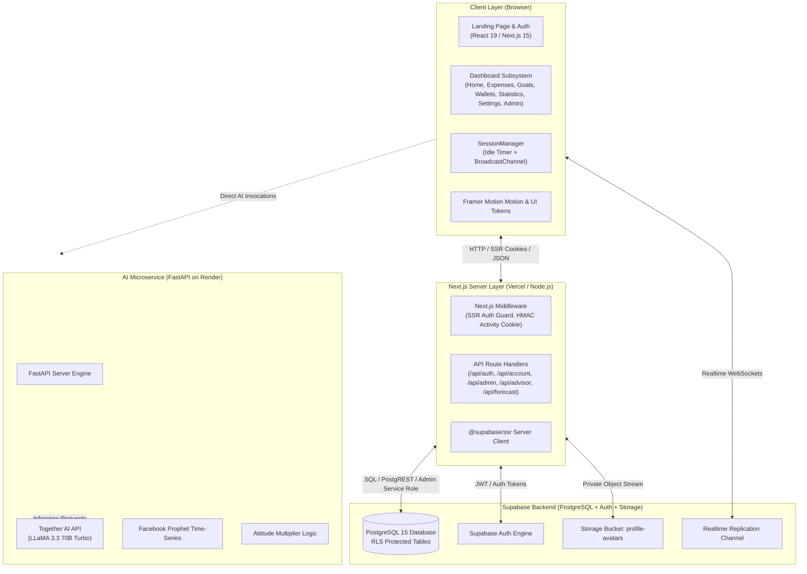
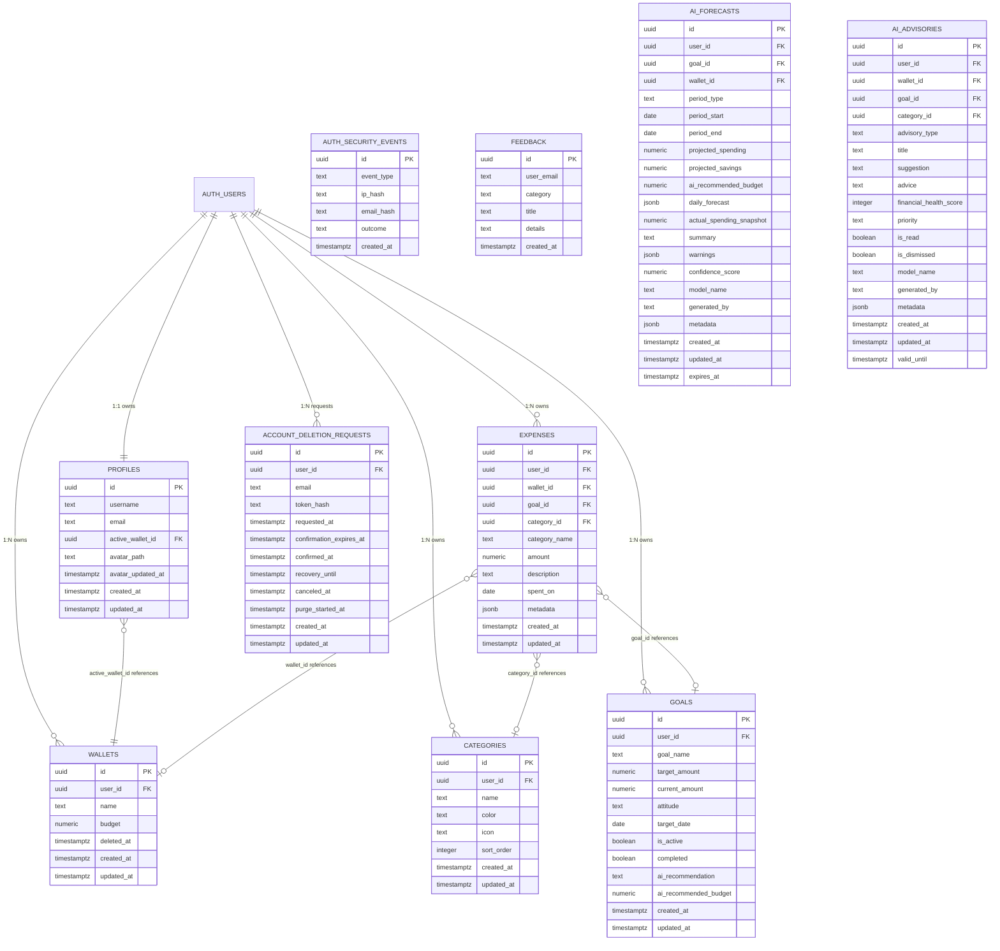
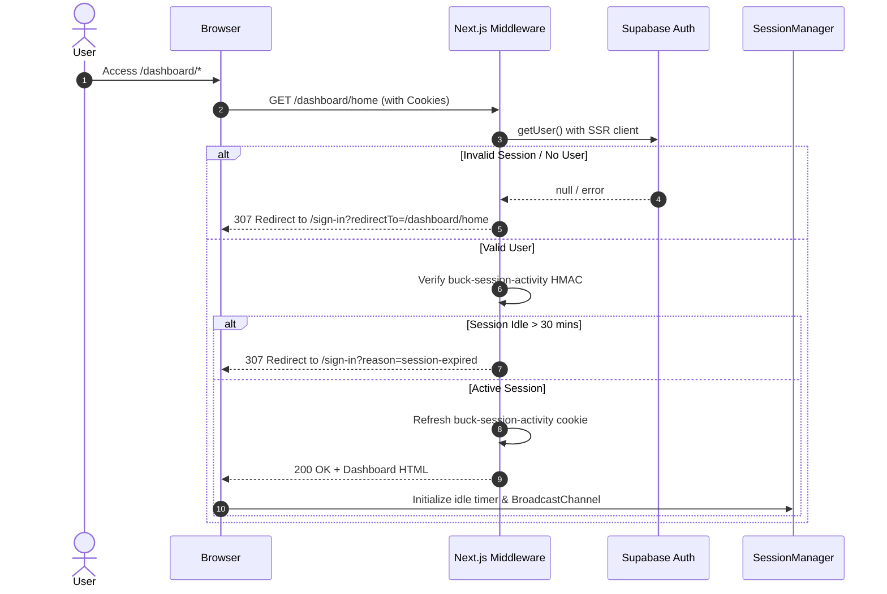
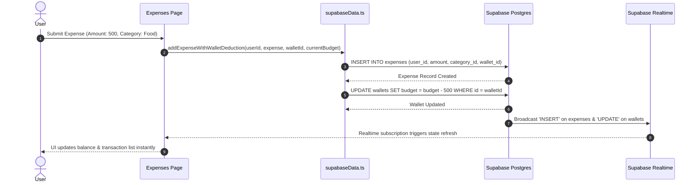

# Design.md: System Architecture, Data Models & ADRs

This document defines the high-level architecture, database schemas, interaction workflows, directory structure, and Architectural Decision Records (ADRs) for the **Buck Budget Tracker Web Application**.

---

## 1. High-Level System Architecture



---

## 2. Database Schemas & Entity Relationships



### Table Definitions & Constraints

1. **`public.profiles`**:
   - `id`: Primary key referencing `auth.users(id)` `ON DELETE CASCADE`.
   - `active_wallet_id`: Foreign key to `public.wallets(id)` `ON DELETE SET NULL`.
   - Trigger `ensure_profile_active_wallet_owner`: Verifies assigned wallet belongs to profile owner.
2. **`public.wallets`**:
   - `budget`: `numeric(14, 2) check (budget >= 0)`.
   - `deleted_at`: Supports soft deletion without violating historical expense foreign keys.
3. **`public.categories`**:
   - Unique index `categories_user_id_lower_name_key` prevents duplicate category names per user.
4. **`public.goals`**:
   - Partial unique index `goals_one_active_goal_per_user_idx` ensures only one goal per user has `is_active = true`.
5. **`public.expenses`**:
   - Trigger `ensure_expense_relations_owner`: Enforces that `wallet_id`, `goal_id`, and `category_id` belong to the same `user_id`.
6. **`public.account_deletion_requests`**:
   - Enforces 10-day recovery window with email confirmation token. Partial index `account_deletion_one_open_request_per_user_idx`.
7. **`public.auth_security_events`**:
   - Private logging table with zero raw IP or email storage. Access revoked from `anon` and `authenticated`.
8. **`public.ai_forecasts`**:
   - Trigger `ensure_ai_forecast_relations_owner`: Enforces that referenced `goal_id` and `wallet_id` belong to the same `user_id`.
   - Stores time-series daily breakdown and projected savings under strict RLS isolation.
9. **`public.ai_advisories`**:
   - Trigger `ensure_ai_advisory_relations_owner`: Enforces that referenced `goal_id`, `wallet_id`, and `category_id` belong to the same `user_id`.
   - Tracks actionable advice, financial health scores, priority levels, and unread/dismissed state under strict RLS isolation.

---

## 3. Core System Data Flows

### 3.1 Authentication & Session Security Flow



### 3.2 Expense Logging & Wallet Deduction Flow



---

## 4. Directory Structure

```
Buck-Web-Application/
├── Agents.md                   # AI agent roles and collaboration boundaries
├── Skills.md                   # Machine-readable function and API catalog
├── Design.md                   # Architecture, schemas, flows, and ADRs
├── Implementation.md           # Setup, runtime configs, and execution logic
├── QA_Report.md                # Quality audit, defects, and security tracking
├── README.md                   # Repository overview and entry guide
├── buck/                       # Next.js 15 Web Application
│   ├── docs/                   # Domain-specific UI/Auth documentation
│   ├── public/                 # Static assets (images, SVGs, audio)
│   ├── supabase/
│   │   └── migrations/         # PostgreSQL schema migrations
│   ├── src/
│   │   ├── app/                # Next.js App Router (pages & API routes)
│   │   │   ├── api/            # Server Route Handlers
│   │   │   ├── dashboard/      # Authenticated views (home, expenses, goals, etc.)
│   │   │   ├── globals.css     # Global CSS design tokens
│   │   │   ├── layout.tsx      # Root layout
│   │   │   └── page.tsx        # Public landing page
│   │   ├── component/          # Shared components (AuthGuard, SessionManager, Header)
│   │   ├── constants/          # Static copy and legal text
│   │   ├── context/            # Global React state (FinancialContext, UserContext)
│   │   ├── hooks/              # Reusable React hooks
│   │   ├── middleware.ts       # SSR authentication and session HMAC gatekeeper
│   │   └── utils/              # Data services, Supabase clients, formatters
│   └── package.json            # Node.js dependencies and scripts
```

---

## 5. Architectural Decision Records (ADRs)

### ADR-001: Supabase SSR Authentication with HMAC-Signed Activity Cookies
- **Context**: The app requires robust authentication across server components, route handlers, and client pages while enforcing strict idle timeouts.
- **Decision**: Implemented `@supabase/ssr` with Next.js `middleware.ts`. Session freshness is validated via an HMAC-SHA256 signed `buck-session-activity` cookie.
- **Consequences**: Provides seamless server-side route protection without relying on client hydration, preventing unauthorized content flashing.

### ADR-002: In-Memory Client State Caching via `FinancialContext`
- **Context**: Switching between dashboard tabs previously triggered repeated full-table queries, causing skeleton flashes and latency.
- **Decision**: Implemented `DashboardDataCache` in `FinancialContext.tsx` with timestamps. Data is held in memory during the session and updated in background via Supabase Realtime subscriptions.
- **Consequences**: Instantaneous navigation between tabs. Memory is securely cleared upon browser reload or logout.

### ADR-003: Soft-Deletion for Multi-Wallet Management
- **Context**: Hard deleting a wallet deletes or nullifies associated historical expense records, corrupting financial reporting.
- **Decision**: Added `deleted_at timestamptz` to `public.wallets`. The UI hides soft-deleted wallets from active selectors while preserving them in history.
- **Consequences**: Maintains full referential integrity and historical reporting accuracy across all expense records.

### ADR-004: Decoupled FastAPI Microservice for AI & ML Inference
- **Context**: Running complex Python time-series models (Prophet) and LLM prompt orchestrations directly in Node.js serverless functions is computationally heavy.
- **Decision**: Decoupled AI inference into a dedicated Python FastAPI service running on Render.
- **Consequences**: Enables Python ML library execution; however, requires rigorous cross-service contract synchronization (see [`QA_Report.md`](file:///d:/VS%20Code/Buck-Budget-Tracker/Buck-Web-Application/QA_Report.md)).

### ADR-005: Zero-Knowledge Password Reset Rate Limiting
- **Context**: Reset endpoints must prevent brute-force attacks without storing plaintext user emails or IP addresses.
- **Decision**: Implemented `auth_security_events` table storing SHA-256 HMAC hashes derived from server-side secrets.
- **Consequences**: Complies with privacy standards while effectively enforcing sliding-window rate limits.

### ADR-006: Database Policy Consolidation & Function Security Hardening
- **Context**: Multiple legacy RLS policies led to duplicate evaluations, sub-optimal auth function queries per row, and trigger functions were exposed to unauthenticated public RPC calls.
- **Decision**: Applied migration `202606140001_security_and_policy_hardening.sql`: revoked direct execute on trigger/definer functions from `PUBLIC, anon, authenticated`, fixed function `search_path = public`, consolidated duplicate RLS policies with `(select auth.uid())` initplan caching, and added covering indexes on foreign keys.
- **Consequences**: Eliminates database linter security advisories, prevents unauthorized RPC trigger execution, and enhances query throughput at scale.

### ADR-007: Home Dashboard Weekly Spending Pie Graph with Top-4 + Others Cap & Interpretation Card
- **Context**: The previous Weekly Spending widget only presented an aggregate total in an orange ring, providing no categorical breakdown of where weekly funds were deployed.
- **Decision**: Replaced the static ring with `WeeklyPieChart.tsx` displaying category shares capped at a maximum of 5 elements (Top 4 categories + an aggregated 5th "Others" slice). Introduced a dedicated `WeeklyInterpretationCard.tsx` directly beneath the weekly overview that algorithmically analyzes category concentration, daily pacing, and wallet utilization in Philippine Peso (PHP).
- **Consequences**: Delivers instant categorical visibility, limits chart clutter to exactly 5 slices per UI/UX principles, and provides contextual, actionable financial interpretation for the user.

### ADR-008: Expenses Tab KPI Data Visualization & Category Allocation UX Overhaul
- **Context**: The Expenses page previously rendered static typography for top KPI metrics (Wallet left, Total tracked, Average expense) without graphical progress indicators, spending velocity metrics, or category filtering controls.
- **Decision**: Overhauled the Expenses dashboard (`app/dashboard/expenses/page.tsx`):
  1. Replaced static stats with `ExpenseKPICards.tsx` featuring:
     - **Wallet Balance**: Dynamic multi-stage capacity progress bar (`percentRemaining`), health badges (Healthy, Caution, Critical, Depleted), and available vs. spent breakdown.
     - **Total Tracked**: 7-day micro-bar sparkline histogram displaying daily spend distribution alongside monthly velocity.
     - **Average Expense**: Range benchmark track locating the average pin between minimum and maximum transaction extremes with top single expense highlights.
  2. Implemented `ExpenseCategoryVisualizer.tsx`: A proportional multi-segmented category allocation bar and interactive category filter chips.
  3. Upgraded the transaction workflow: Quick amount preset chips (+50, +100, +200, +500, +1000), overbudget warning indicators, a search and sorting toolbar, color-coded category theme badges with icons, and Framer Motion animated list transitions.
  4. Synchronized `DashboardSkeletons.tsx` (`ExpensesSkeleton`) for zero layout shift during hydration.
### ADR-009: Wallet Screen Dropdown Repair, Toolbar Alignment & Symmetrical Card Refactor
- **Context**: The Wallet screen (`app/dashboard/wallet/page.tsx`) suffered from UI styling defects: nested rectangular border artifacts on sort/filter dropdowns due to conflicting `.wallet-filter-select` CSS wrappers, search inputs floating out of order or hidden behind collapsing triggers, and asymmetric card button layouts (inactive wallets displayed 3 bottom buttons while active wallets displayed 2). The solid orange active badge was visually indistinguishable from action buttons.
- **Decision**: Refactored the Wallet page and styles (`buck/src/app/dashboard/settings/style.css`):
  1. **Repaired Dropdown UI & Toolbar**: Eliminated double-border nesting artifacts by removing conflicting outer container classes on `CustomSelect`. Aligned the search bar with its left-integrated `FaSearch` icon directly to the left of the dropdown across both Active Wallets and History panels (`[Search Bar] [Dropdown]`).
  2. **Uniform Card Structure**:
     - **Top-Right Header**: Inactive wallets feature a dedicated `Set Active` outline pill button, while the active wallet renders an **Active Status Pillbox**.
     - **Bottom Actions**: Standardized across ALL cards to strictly two 50%/50% symmetrical buttons (`[Edit]` and `[Delete]`), eliminating the previous 3-vs-2 button asymmetry.
  3. **Distinct Active Pillbox Palette**: Styled the active status pillbox in a subtle emerald-mint tint (`rgba(16, 185, 129, 0.14)` border & background with `#047857` / `#34d399` text) to clearly signify non-clickable active status while adhering to the app's established health palette.
  4. **Skeletal Loading Synchronization**: Updated `DashboardSkeletons.tsx` (`WalletSkeleton`) to match the new toolbar and symmetrical card structure.
- **Consequences**: Resolves all visual clipping and layout defects, provides predictable symmetric card interactions, and achieves uniform scaling across desktop and mobile.

### ADR-010: Home Dashboard Category Breakdown Timeframe Filter, Layout Reordering & AI Financial Advisor Placeholder Card
- **Context**: The Category Breakdown pie graph previously filtered solely on `getWeeklyExpenses()`, causing it to collapse into a single category ("Food" 100%) when expenses recorded within the 7-day calendar week were only food, despite the user having rich historical data across Bills, Shopping, Transportation, etc. Card ordering had Financial Summary below the rule-based interpretation card. Furthermore, the user emphasized that insights should be AI-driven, requesting an AI Financial Advisor placeholder card until the ML backend is fully coupled.
- **Decision**:
  1. **Timeframe Filter on Category Breakdown**: Added segmented pill buttons (`[All Time] [This Month] [This Week]`) directly in the card header, defaulting to `All Time`. This immediately surfaces the user's full multi-category distribution with 5 elements (Top 4 categories + an aggregated 5th "Others" slice), while allowing one-click inspection of monthly and weekly scopes. Normalized date parsing to midday local time to eliminate timezone boundary shifts.
  2. **Section Reordering**: Reorganized the Home dashboard layout:
     - **Row 1**: Category Breakdown Pie Graph (`.spending-card`) & Weekly Expenses by Day Bar Graph (`.graph-card`).
     - **Row 2**: Categories Financial Summary (`.summary-card`) - moved directly beneath the graph cards.
     - **Row 3**: AI Financial Advisor Card (`AIAdvisorPlaceholderCard.tsx`).
  3. **AI Financial Advisor Placeholder Card**: Designed and implemented `AIAdvisorPlaceholderCard.tsx` featuring:
     - Architectural telemetry chips showcasing LLaMA 3.3 70B Turbo, Prophet Time-Series, and PHP currency heuristics.
     - 3 preview capability cards: Runaway Category Alerts, Autonomous Goal Contribution Pacing, and Concise 2-Sentence Micro-Advisories.
     - Shimmering Generative AI calibration banner with a pulsing status indicator displaying ingested telemetry event counts.
  4. **Skeleton Hierarchy Sync**: Updated `HomeSkeleton` in `DashboardSkeletons.tsx` to maintain exact layout parity during data loading.
- **Consequences**: Eliminates single-category pie chart collapse, ensures correct visual representation of the 5-slice cap, positions Financial Summary logically above the AI section, and provides a sleek generative AI experience for future ML model coupling.

### ADR-011: Global Toaster Architecture, System-Wide Status Reporting & Project Design Uniformity
- **Context**: Feedback mechanisms across the application were fragmented. Critical user actions frequently relied on disruptive, synchronous browser `alert()` popups (e.g., in `authentication.tsx`, `dashboardheader.tsx`, `goals/page.tsx`) or silent failures/logs (in `settings/page.tsx`), harming UX and mobile responsiveness. Furthermore, previous notifications lacked visual consistency with the core Buck design language (`globals.css` / `dashboard.css`), missing smooth countdown progress bars, dark/light theme elevation, and flexible stacking controls.
- **Decision**:
  1. **Modular Global Architecture (`buck/src/component/toast/`)**: Built a unified, self-contained toast notification subsystem:
     - `toast.module.css`: Token-driven styling conforming to `--buck-surface`, `--buck-ink`, `--buck-line`, signature top gradient accents (emerald for success, ruby for error, amber for warning, orange-gold for info, shimmering violet for loading), glassmorphism (`backdrop-filter: blur(16px)`), elevated drop shadows, and responsive top-center realignment on mobile (`max-width: calc(100vw - 32px)`).
     - `ToastItem.tsx`: Framer Motion spring physics entrance/exit, status-tinted circular icons (`FaCheckCircle`, `FaExclamationCircle`, `FaExclamationTriangle`, `FaInfoCircle`, `FaSpinner`), pause-on-hover interaction with elapsed time tracking, and animated countdown progress bar.
     - `Toaster.tsx`: Dedicated viewport container using Framer Motion `popLayout` with a configurable stack limit (max 4 concurrent notifications) to avoid screen clutter.
     - `ToastContext.tsx` & `index.ts`: Central provider and hooks supporting dual dispatch styles: traditional `toast(message, type, options)` and fluent API `toast.success()`, `toast.error()`, `toast.warning()`, `toast.info()`, `toast.loading()`, `toast.dismiss()`, alongside an event bus for calling toasts outside React render trees.
  2. **Complete Native Alert Elimination**:
     - Removed all 5 synchronous browser `alert()` popups in `authentication.tsx` during validation and sign-up submission, replacing them with formatted error and warning toasts.
     - Replaced the sign-out error alert in `dashboardheader.tsx` with a toast error notification.
     - Replaced all 4 goal progress, status toggling, and input validation `alert()` calls in `goals/page.tsx` with contextual toasts, adding an animated celebratory success toast upon goal completion.
  3. **Universal Status Reporting Across Critical Views**:
     - `settings/page.tsx`: Integrated toasts across profile updates, avatar replacements/removals, avatar file size validation errors, email update confirmations, password change submissions, account deletion requests, account recovery actions, and feedback submissions.
     - `financial-advisor/page.tsx` & `forecast/page.tsx`: Hooked into AI advisor and forecast generation endpoints for success and failure notifications.
- **Consequences**: Delivers a seamless, non-blocking, accessible feedback system across the entire application that adheres strictly to Buck design tokens, works flawlessly across dark and light modes, and completely eliminates archaic browser alert dialogs.

### ADR-012: High-Fidelity Skeletal Loading Architecture & 1:1 Layout Parity Standard
- **Context**: Loading skeletons previously exhibited severe geometric drift from actual page implementations, creating jarring visual flashes and Cumulative Layout Shift (CLS) upon data resolution. Most notably, the **Expenses** tab rendered generic rectangular cards missing the top 3 KPI data visualizers (wallet capacity progress bar, 7-day sparkline bar histogram, and range benchmark pin) and the expense tracker toolbar. The **Wallet** tab rendered outdated card actions, missing the left-aligned search toolbar, active emerald pillbox, and symmetrical 50%/50% action buttons. Other tabs (Home, Settings, Goals, Statistics, Financial Advisor, Forecast) similarly featured layout mismatches or incorrect fallback variants.
- **Decision**:
  1. Overhauled [`DashboardSkeletons.tsx`](file:///d:/VS%20Code/Buck-Budget-Tracker/Buck-Web-Application/buck/src/component/DashboardSkeletons.tsx) to establish a strict 1:1 layout fidelity standard across all dashboard tabs:
     - **Expenses Tab (`ExpensesSkeleton`)**: Complete anatomical parity with `ExpenseKPICards.tsx` (Card 1: wallet utilization progress meter with threshold ticks; Card 2: 7-day sparkline bar histogram with weekday labels; Card 3: range benchmark track with center pin), `ExpenseCategoryVisualizer.tsx` (proportional multi-segmented allocation bar and 6 filter chip pills), and the 2-column layout (Add Expense form inputs/presets and Expense Tracker search toolbar and transaction items with circular category icons and action buttons).
     - **Wallet Tab (`WalletSkeleton`)**: Full architectural parity with `WalletPage` (2-column desktop grid with search-to-left and dropdown-to-right toolbars, top-right active emerald pillbox and "Set Active" pills, symmetrical 50%/50% edit/delete buttons, and archived history list with date stamps).
     - **Home Tab (`HomeSkeleton`)**: Donut chart with inner label and 5 category legend pills, 7-day expenses bar chart, summary card items, and the AI Financial Advisor placeholder card structure.
     - **Goals Tab (`GoalsSkeleton`)**: Left goal list aside, right details panel with metadata grid, `ProgressBarCard` geometry, and "See Forecast" action button.
     - **Statistics Tab (`StatisticsSkeleton`)**: Mode selector header, Row 1 (ExcessPie 36% + SpendingBar 62%), and Row 2 full-width line chart.
     - **Settings Tab (`SettingsSkeleton`)**: 5-tab navigation sidebar, account identity card, and settings panel with avatar and profile fields (eliminating deprecated hero section).
     - **Dedicated AI Views**: Implemented specialized `FinancialAdvisorSkeleton` and `ForecastSkeleton` variants, eliminating incorrect fallback to the Home skeleton.
  2. Codified the **1:1 Skeletal Loading Parity Policy** into [`AGENTS.md`](file:///d:/VS%20Code/Buck-Budget-Tracker/Buck-Web-Application/AGENTS.md) as a mandatory architectural constraint for all future UI modifications.
- **Consequences**: Zero Cumulative Layout Shift (CLS) across all route transitions, smooth visual perceived performance, and uniform design language consistency across light and dark modes.

### ADR-013: Expenses KPI Simplification, Typographic Hierarchy Audit & Title Spacing Normalization
- **Context**:
  1. **Title/Subtitle Spacing**: The Wallet screen (`app/dashboard/wallet/page.tsx`) suffered from excessive vertical gaps between the eyebrow (`YOUR WALLETS`, `LOG`) and section heading (`Manage your active wallets`, `History of Wallets`) due to unstyled user-agent heading block margins (`0.83em`). This pushed the icon and heading down, leaving the eyebrow orphaned above.
  2. **Over-Bolding & Typographic Fatigue**: Extensive hardcoded `font-weight: 800`, `850`, and `900` definitions across `settings/style.css` and `expenses/style.css` flattened visual hierarchy, making body labels, button text, search inputs, and chips compete with primary KPI numbers.
  3. **Overwhelming KPI Visuals**: In `ExpenseKPICards.tsx`, Card 2 featured a micro-histogram sparkline that duplicated the primary dashboard bar chart, and Card 3 featured an unnecessary "Mean Velocity" pillbox badge and a misaligned benchmark range track that crowded the cards.
- **Decision**:
  1. **Compact Title Grouping**: Wrapped eyebrow and title elements in `.wallet-card-title-wrap` with scoped flex direction, `gap: 0.15rem`, and normalized `margin: 0`, restoring immediate proximity and centering with the card icon.
  2. **Global Font-Weight Audit & Softening**: Refactored font weights across `settings/style.css` and `expenses/style.css`:
     - Eyebrows: Softened from `900` to `650` with `0.4px` letter-spacing.
     - Card & panel headings: Softened from `850`/`800` to `650`.
     - Action buttons and pills: Softened from `800` to `600`.
     - Form inputs, search boxes, and dropdown selects: Softened from `750`/`700` to `500`.
     - Primary metric values: Balanced to `700` (from `900`).
     - Form labels, category chips, badges, and list subtitles: Balanced to `600`.
  3. **Expenses KPI Streamlining (`ExpenseKPICards.tsx`)**:
     - **Card 2 ("Total Tracked")**: Renamed title to "Total Tracked" (subtitle "Cumulative"). Replaced the sparkline histogram with a clean dual-stat grid showcasing **This Month** and **Daily Average**.
     - **Card 3 ("Average Expense")**: Removed the "Mean Velocity" badge and removed the misaligned horizontal range line track. Replaced with a clean dual-stat grid showcasing **Lowest Expense** and **Highest Expense** (annotated with category).
  4. **1:1 Skeletal Loading Parity Synchronization**:
     - Updated `ExpensesSkeleton` in [`DashboardSkeletons.tsx`](file:///d:/VS%20Code/Buck-Budget-Tracker/Buck-Web-Application/buck/src/component/DashboardSkeletons.tsx) to mirror the dual stat grid structure in Cards 2 and 3 and removed Card 3's badge skeleton.
     - Updated `WalletSkeleton` to use `.wallet-card-title-wrap` for exact vertical geometry parity.
- **Consequences**: Restores clean typographic hierarchy, eliminates cluttered micro-visualizations in favor of high-signal metrics, and maintains strict CLS elimination during hydration.

### ADR-014: Home Category Breakdown Left-Aligned Legend, Excel-Style Callouts, Dynamic Filter Pill & AI Advisor 1:1 Parity
- **Context**:
  1. **Category Breakdown Legend Proportions & Active Filter**: Category legend items were previously spreading across the entire card width ($>550\text{px}$) with excessive empty space. Furthermore, the "All" pill was visually styled with active border/glow by default, making it appear slightly bigger than normal pills before any filter was clicked. The user requested containing the pill boxes so they do not spread too far to the right, normalizing "All" to match the rest of the pills, and strictly reserving active filter highlighting for the specific category clicked.
  2. **Excel-Style Data Callout Labels on Pie Chart**: The pie chart only showed plain colored wedges without slice labels or percentages. The user instructed that each slice must display its percentage with a label pointing directly to it, matching the behavior of Excel pie chart data callouts.
  3. **Financial Summary Dynamic Eyebrow**: Consolidated static text into an interactive, readable, clickable filter pill atop "Financial Summary".
  4. **AI Financial Advisor Card on Home**: Replaced speculative telemetry with the exact 2-card structure and Health Score from `financial-advisor/page.tsx`, caching insights across views.
- **Decision**:
  1. **Compact Legend Width & Active Filter Reservation (`WeeklyPieChart.tsx`, `style.css`)**:
     - Constrained `.spending-pie-legend` to `width: min(290px, 100%); max-width: 290px; flex: 0 0 auto;`.
     - Standardized `.spending-pie-legend-item` to explicit `height: 34px`, `box-sizing: border-box`, and identical font sizing.
     - Removed default selection from "All". Active filter styling (`spending-pie-legend-item--selected`) is strictly reserved for the category currently clicked.
     - Redesigned active filter highlight using `outline: 1.5px solid var(--buck-orange); outline-offset: -1px;` to preserve exact geometric bounds without popping or expanding.
  2. **Excel-Style Callout Data Labels Plugin (`excelDataCalloutPlugin`)**:
     - Custom Chart.js v4 plugin executing in `afterDatasetsDraw`.
     - Calculates mid-arc angle $\theta$ for each slice: anchors a dot on the slice perimeter, draws a leader line extending outward $14\text{px}$ to an elbow knee, and projects a horizontal shelf to the label.
     - Employs a multi-pass vertical collision relaxation algorithm on left and right sides (minimum $26\text{px}$ vertical gap) to prevent label overlaps on adjacent slices.
     - Renders category name on top line ($11\text{px}$ semi-bold) and bold slice percentage on bottom line ($12\text{px}$ bold, color-coded to slice). When a slice is clicked, active leader line and label highlight while non-selected slices gently dim.
     - Added $55\text{px}$ horizontal canvas layout padding (`layout.padding`) so leader lines and callout text never clip.
  3. **Interactive Eyebrow Filter Pill (`home/page.tsx`)**: Replaced static eyebrow with `.summary-filter-pill-wrap` displaying `[ (•) Category: <Name> • <Timeframe> ✕ Show All ]`.
  4. **Faithful AI Advisor Card (`AIAdvisorPlaceholderCard.tsx`)**: Mirrored Financial Advisor tab with 2 cards (**AI Suggestion** & **AI Advice**), Health Score meter, and `View Full Advisor →` link.
  5. **1:1 Skeletal Loading Parity (`DashboardSkeletons.tsx`)**: Updated `HomeSkeleton` to mirror the $290\text{px}$ legend pills ($34\text{px}$ height), the callout canvas box geometry, and the AI Advisor cards.
- **Consequences**: Eliminates stretched pills, provides instant Excel-grade visual clarity on pie slices with leader lines, eliminates CLS during hydration, and maintains clean typographic and geometric stability.

### ADR-015: Financial Summary Title Row Restructure, Eyebrow Restoration & "Others" Sub-Category Filtering Fix
- **Context**:
  1. **Header Layout & Aesthetics**: The filter pillbox stacked vertically on top of the "Financial Summary" heading was visually awkward and cluttered when unfiltered. The user requested returning to the classic eyebrow title `Categories` with `Financial Summary` heading directly below it, and positioning the interactive filter pillbox **beside the title** on the same row.
  2. **"Others" Sub-Category Click Bug**: When users clicked "Others" on the Pie Chart, the Financial Summary displayed the cards grouped under "Others" (e.g. Health, Entertainment, Electronics). However, clicking any of those cards from the Financial Summary failed to display properly: an aggressive `useEffect` hook in `page.tsx` was validating `selectedCategory` strictly against `categoryPieData.slices` (which only contains the top 4 categories and `"Others"`). Because "Health" was not in the top 4 slices, the effect immediately wiped `selectedCategory` back to `null`, instantly canceling the user's selection. Furthermore, `WeeklyPieChart` dimmed all slices and failed to calculate center values for sub-categories of "Others".
- **Decision**:
  1. **Eyebrow & Title Row Restructure (`home/page.tsx`, `home/style.css`)**:
     - Restored `<p className="card-eyebrow">Categories</p>` on top.
     - Positioned `<h2 className="summary-title">Financial Summary</h2>` directly below it in a flex `.summary-title-row` with `gap: 0.75rem`.
     - When a category filter is active, `.summary-filter-pill-group` renders horizontally beside the heading (`[ Category: <Name> • <Timeframe> ✕ Show All ]`). When no category is selected, the title row remains clean and uncrowded.
  2. **"Others" Sub-Category Support & Existence Validation Fix (`home/page.tsx`)**:
     - Fixed `useEffect` to validate category existence against `pieExpenses` (confirming actual recorded expenses in the active timeframe) rather than `categoryPieData.slices`.
     - Added `isSubCategoryOfOthers` logic detecting when the selected category belongs to the bundled "Others" slice.
     - Added `selectedCategoryAmount` prop passed to `WeeklyPieChart` to compute the category's accurate proportion and center metrics.
     - Added `← Others` quick-action button in `.summary-filter-pill-group` when a subcategory of Others is active, enabling one-click return to the Others breakdown.
  3. **Pie Chart Sub-Category Coordination (`WeeklyPieChart.tsx`)**:
     - Updated slice highlight predicate `isSliceActive` to keep the "Others" slice vibrant and offset by $10\text{px}$ when a subcategory of Others (e.g. "Health") is selected, while cleanly dimming unrelated top-4 slices.
     - Center display shows the selected subcategory name, exact amount, and percentage of total (`Health (6%)` and `₱800.00`).
     - Legend pill for "Others" dynamically updates to show `Others: Health`, its amount, and active highlight.
     - `excelDataCalloutPlugin` highlights the Others callout leader line pointing to the slice with `Others (Health)`.
  4. **1:1 Skeletal Loading Parity Synchronization (`DashboardSkeletons.tsx`)**:
     - Updated `HomeSkeleton` to mirror the restored `Categories` eyebrow (`width: 85, height: 12`) and `Financial Summary` heading (`width: 175, height: 22, marginTop: 4`), maintaining zero CLS.
- **Consequences**: Restores clean, professional layout spacing; enables seamless deep-dive into long-tail expense categories bundled under "Others" without navigation traps or state resets.

### ADR-016: Bar Graph Dual-Axis Labeling & Centralized Pie Palette Architecture
- **Context**:
  1. **Unlabeled Bar Graph Axes**: The Weekly Expenses by Day bar chart displayed numeric tick values ($0$ to $61,590$) and day abbreviations (`Mon`–`Sun`) without explicit axis titles, leaving users uncertain about the unit of measurement and aggregation domain.
  2. **Color Palette Modularity**: The pie chart colors were previously hardcoded in an internal variable in `page.tsx` and lacked a modular, developer-friendly interface for theming, reordering, or customizing colors.
- **Decision**:
  1. **Dual-Axis Labels (`home/page.tsx`, `home/style.css`)**:
     - **Y-Axis Label (`AMOUNT (₱)`)**: Wrapped the Y-axis column in `.graph-y-axis-wrap` with an uppercase, rotated axis title (`writing-mode: vertical-rl; transform: rotate(180deg)`) centered vertically along the tick scale.
     - **X-Axis Label (`DAY OF THE WEEK`)**: Added `.graph-x-axis-footer` beneath the day tick labels with an uppercase, centered axis title.
     - Formatted Y-axis ticks with locale digit grouping (`toLocaleString()`).
  2. **Centralized Chart Theme Module ([`chartTheme.ts`](file:///d:/VS%20Code/Buck-Budget-Tracker/Buck-Web-Application/buck/src/app/dashboard/home/chartTheme.ts))**:
     - Extracted all slice colors into an exported `BUCK_PIE_PALETTE` array and `CHART_THEME` configuration object.
     - Developers and designers can now customize the entire chart color theme in a single file with zero deep code refactoring.
  3. **1:1 Skeletal Loading Parity (`DashboardSkeletons.tsx`)**:
     - Added matching x-axis title skeleton line (`95px × 10px`) below the bar skeletons in `HomeSkeleton`, ensuring zero CLS.
### ADR-017: Comprehensive Dashboard Tab Skeletal Loading Parity & Route Boundary Architecture
- **Context**:
  1. **Next.js App Router Route Boundary Fallback Leak**: When navigating between dashboard subroutes (`/dashboard/expenses`, `/dashboard/wallet`, `/dashboard/financial-advisor`, `/dashboard/forecast`, `/dashboard/admin`), the subdirectories lacked dedicated `loading.tsx` boundary files. Next.js App Router fell back to the parent route boundary `buck/src/app/dashboard/loading.tsx`, which unconditionally rendered `<DashboardPageSkeleton />` (defaulting to `"home"`). Users thus saw the Home dashboard skeleton flash across every non-home tab during page loads and transitions.
  2. **Client Layout Route Dispatch Mismatch (`DashboardClientLayout.tsx`)**: In `DashboardClientLayout.tsx`, `getSkeletonVariant` contained mismatched mappings: `/dashboard/wallet` was hardcoded to `"settings"`, `/dashboard/expenses` was hardcoded to `"statistics"`, while `/dashboard/financial-advisor` and `/dashboard/forecast` were not mapped and fell through to `"home"`.
  3. **Visual Inaccuracies within Skeletons**:
     - `HomeSkeleton`: Bar chart lacked the newly added `.graph-y-axis-wrap` column (with "Amount (₱)" title and numeric tick scale placeholders), creating CLS when data hydrated.
     - `FinancialAdvisorSkeleton`: Missing the circular `.advisor-score` health score meter in the hero header, and used generic un-styled containers instead of the real `.advisor-grid` and `.advisor-ai-grid` CSS classes.
     - `ForecastSkeleton`: Rendered an inaccurate 14-bar chart instead of the 3 prediction cards and 2 wide forecast cards (`.forecast-ai-grid`), causing major layout shift.
     - `AdminSkeleton`: Did not exist, forcing admin page loads into a home fallback.
- **Decision**:
  1. **Comprehensive Subroute Loading Boundaries**:
     - Created dedicated `loading.tsx` files for every subroute:
       - `buck/src/app/dashboard/expenses/loading.tsx` (`variant="expenses"`)
       - `buck/src/app/dashboard/wallet/loading.tsx` (`variant="wallet"`)
       - `buck/src/app/dashboard/financial-advisor/loading.tsx` (`variant="financial-advisor"`)
       - `buck/src/app/dashboard/forecast/loading.tsx` (`variant="forecast"`)
       - `buck/src/app/dashboard/admin/loading.tsx` (`variant="admin"`)
     - Ensures Next.js App Router renders the exact skeleton matching the destination route during any server suspense or client transition.
  2. **Accurate Client Layout Routing (`DashboardClientLayout.tsx`)**:
     - Fixed `getSkeletonVariant(pathname)` to map every route directly to its corresponding variant: `expenses`, `wallet`, `financial-advisor`, `forecast`, `goals`, `statistics`, `settings`, `admin`, and `home`.
  3. **High-Fidelity Skeleton Synchronizations (`DashboardSkeletons.tsx`)**:
     - **Home**: Added `.graph-container` with `.graph-y-axis-wrap` (showing "Amount (₱)" axis title and 7 tick placeholders) and `.graph-x-axis-footer` ("Day of the Week"), achieving 1:1 layout match with `WeeklyBarChart`.
     - **Financial Advisor**: Added button line + circular `.advisor-score` badge ($128\text{px} \times 128\text{px}$) in `.advisor-hero`, 3 cards in `.advisor-grid`, and 2 wide cards in `.advisor-ai-grid`.
     - **Forecast**: Added button line + circular score badge ($128\text{px} \times 128\text{px}$) in `.forecast-hero`, 3 projection cards in `.advisor-grid`, and 2 wide forecast cards in `.forecast-ai-grid`.
     - **Admin**: Added `AdminSkeleton` matching the 3-tab vertical navigation (`settings-tabs`), toolbar, and card list items.
- **Consequences**: Completely eliminates mismatched skeleton flashing across all dashboard tabs, guarantees instant 1:1 visual parity with target page layouts, and prevents Cumulative Layout Shift (CLS).

### ADR-018: Pie Chart Legend Left-Alignment, Callout Typography Scaling (+2.5px), and Anti-Clipping Geometry
- **Context**:
  1. **Legend Inward Offset**: In `.spending-pie-layout`, `justify-content: center` was clustering the category filter pills ("All", "Food", "Bills", "Transportation", "Shopping", "Others") and the Pie Chart in the center of `.spending-card`, leaving ~150px of empty dead space on the left and squeezing the Pie Chart toward the right.
  2. **Callout Text Clipping on Canvas Boundaries**: Chart labels ("Transportation", "Others", "Bills") were getting cut off along the edges because:
     - The canvas container (`.spending-pie-canvas-inner`) was restricted to $250\text{px}$ height and narrow width, with only $20\text{px}$ top/bottom and $55\text{px}$ left/right padding.
     - Long words (such as "Transportation" at $\approx 88\text{px}$ wide) extended beyond $X = 0$, causing the browser canvas to clip the leading characters ("Trans" was cut, leaving only "portation").
     - Top labels ("Others 5%") and bottom labels ("Bills 32%") exceeded the top and bottom $Y$ limits ($0$ and $250\text{px}$).
  3. **Callout Font Legibility**: The default font size ($11\text{px}$ category, $11.5\text{px}$ percentage) was too small and strained readability.
- **Decision**:
  1. **Legend Left-Alignment & Layout Expansion (`home/style.css`)**:
     - Updated `.spending-pie-layout` to `justify-content: flex-start; gap: clamp(1.25rem, 2.5vw, 3rem); width: 100%;`.
     - Pinned `.spending-pie-legend` flush to the left boundary of `.spending-card` under the title heading.
     - Expanded `.spending-pie-canvas-box` to `flex: 1; max-width: 480px; min-height: 310px;` and `.spending-pie-canvas-inner` to `height: 290px;`.
  2. **Callout Typography Scaling & Anti-Clipping Engine (`WeeklyPieChart.tsx`)**:
     - **Font Size Scaling**: Increased category name font from $11\text{px} \rightarrow 13.5\text{px}$ (+2.5px, semi-bold `600`–`650`) and percentage font from $11.5\text{px} \rightarrow 14.5\text{px}$ (+3px, bold `750`–`850`).
     - **Canvas Padding**: Increased Chart.js layout padding to `top: 34, bottom: 34, left: 95, right: 95`.
     - **Compact Elbow/Shelf**: Decreased knee projection from $r + 14 \rightarrow r + 10$ and shelf from $14 \rightarrow 10\text{px}$, leaving maximum horizontal canvas space for text.
     - **Vertical Clamping**: Clamped `endY` between $Y = 22$ and $Y = \text{height} - 24$, guaranteeing top and bottom labels never breach canvas bounds.
     - **Safe Horizontal Text Placement & Smart Truncation**: Enforced `safeTextX` bounds ($X \ge \text{width} + 6$ on left, $X \le \text{chart.width} - \text{width} - 6$ on right). Added automatic ellipsis truncation for outlier labels exceeding maximum allowable margin width.
  3. **1:1 Skeletal Loading Parity (`DashboardSkeletons.tsx`)**:
     - Synchronized `HomeSkeleton` with `justify-content: flex-start` layout and $290\text{px}$ canvas box geometry to eliminate CLS upon hydration.
- **Consequences**: Restores clean left-aligned visual balance under the category card title, provides crystal-clear readability with larger callout typography, and guarantees that no label is ever clipped by canvas edges.

### ADR-019: Anti-Pill-in-Pill Architecture & Sibling Filter Badge Principles
- **Context**:
  1. **Nested Pill-in-a-Pill Anti-Pattern**: Previously, active filter indicators in the Category Breakdown / Financial Summary header and the Bar Chart header nested interactive button pills (`✕ Show All` or `✕ Clear`) directly inside the outer badge pill. This created an ambiguous visual and accessibility anti-pattern: an interactive pill nested inside another pill, confusing user click targets and creating visual clutter.
  2. **Information Overload in Filter Pill**: The Category filter pill bundled redundant timeframe information (`• All Time`), cluttering the pill when the section header already provides timeframe context.
  3. **Cramped Typography**: The label prefix `Category:` was crowded directly against the category name without breathing room.
- **Decision**:
  1. **Strict Design System Rule — Zero Nested Pills ("No Pill-in-a-Pill")**:
     - Informational filter badges and dismissal/action triggers must **never** be nested inside one another.
     - They must always be rendered as discrete, standalone **sibling pill components** within a flex container (`gap: 0.5rem`).
  2. **Sibling Filter Pill Architecture (`home/page.tsx`, [`home/style.css`](file:///d:/VS%20Code/Buck-Budget-Tracker/Buck-Web-Application/buck/src/app/dashboard/home/style.css))**:
     - **Financial Summary**:
       - **Category Indicator Badge**: `<div className="summary-filter-pill summary-filter-pill--active">` containing the category dot, muted `Category:` prefix, and bold category name with `gap: 0.38rem` spacing. Redundant `• All Time` text is completely removed.
       - **Action Pill Button**: `<button className="summary-filter-action-btn">✕ Show All</button>` rendered as an independent orange sibling pill beside the badge.
       - **Back Pill**: If viewing an "Others" subcategory, `<button className="summary-filter-back-btn">← Others</button>` renders as another sibling pill.
     - **Bar Graph Card (Expenses by day)**:
       - Transformed into `.chart-active-filter-group` containing two separate sibling pills:
         - **Category Indicator Badge**: `<div className="chart-active-filter-badge">` showing the category dot, muted `Category:` prefix, and bold category name with clean spacing.
         - **Action Pill Button**: `<button className="filter-clear-btn">✕ Clear</button>` rendered as an independent sibling pill outside the badge.
- **Consequences**: Completely eliminates ambiguous nested click targets, establishes an intuitive and accessible UI hierarchy, enhances typographic clarity with dedicated spacing, and guarantees uniform filter pill behavior across all dashboard cards.

### ADR-020: Modular Skeletal Loading Architecture & 1:1 Loaded-State Geometry Parity
- **Context**:
  1. **Monolithic Skeleton Failure & CSS Chunk Isolation**: Previously, skeletal loading components were clustered in a single file (`DashboardSkeletons.tsx`) relying on page-specific CSS classes (such as `.expenses-kpi-grid`, `.expenses-card`, `.expenses-layout`). Because Next.js App Router route boundaries (`loading.tsx`) render *before* the target page's CSS bundle chunk finishes loading, all container grid and card classes lacked CSS rules in the DOM. This caused the skeleton to collapse into a vertical stack of loose lines clinging to the left boundary—a jarring "day and night" divergence from the real loaded page.
  2. **Monolithic Code Sprawl**: Consolidating all 9 dashboard page skeletons into a single 1,000+ line file made isolated maintenance and layout matching across complex pages (like Expenses, Wallets, and Statistics) difficult to audit.
- **Decision**:
  1. **Modular Skeletons Folder Architecture (`src/component/skeletons/`)**:
     - Decomposed all skeletons into dedicated modular files per dashboard page:
       - [`ExpensesSkeleton.tsx`](file:///d:/VS%20Code/Buck-Budget-Tracker/Buck-Web-Application/buck/src/component/skeletons/ExpensesSkeleton.tsx)
       - [`HomeSkeleton.tsx`](file:///d:/VS%20Code/Buck-Budget-Tracker/Buck-Web-Application/buck/src/component/skeletons/HomeSkeleton.tsx)
       - [`WalletSkeleton.tsx`](file:///d:/VS%20Code/Buck-Budget-Tracker/Buck-Web-Application/buck/src/component/skeletons/WalletSkeleton.tsx)
       - [`GoalsSkeleton.tsx`](file:///d:/VS%20Code/Buck-Budget-Tracker/Buck-Web-Application/buck/src/component/skeletons/GoalsSkeleton.tsx)
       - [`StatisticsSkeleton.tsx`](file:///d:/VS%20Code/Buck-Budget-Tracker/Buck-Web-Application/buck/src/component/skeletons/StatisticsSkeleton.tsx)
       - [`SettingsSkeleton.tsx`](file:///d:/VS%20Code/Buck-Budget-Tracker/Buck-Web-Application/buck/src/component/skeletons/SettingsSkeleton.tsx)
       - [`FinancialAdvisorSkeleton.tsx`](file:///d:/VS%20Code/Buck-Budget-Tracker/Buck-Web-Application/buck/src/component/skeletons/FinancialAdvisorSkeleton.tsx)
       - [`ForecastSkeleton.tsx`](file:///d:/VS%20Code/Buck-Budget-Tracker/Buck-Web-Application/buck/src/component/skeletons/ForecastSkeleton.tsx)
       - [`AdminSkeleton.tsx`](file:///d:/VS%20Code/Buck-Budget-Tracker/Buck-Web-Application/buck/src/component/skeletons/AdminSkeleton.tsx)
       - [`index.tsx`](file:///d:/VS%20Code/Buck-Budget-Tracker/Buck-Web-Application/buck/src/component/skeletons/index.tsx) (central dispatcher & exports)
       - [`skeletons.css`](file:///d:/VS%20Code/Buck-Budget-Tracker/Buck-Web-Application/buck/src/component/skeletons/skeletons.css) (self-contained layout & card styling)
     - Preserved backward compatibility in [`DashboardSkeletons.tsx`](file:///d:/VS%20Code/Buck-Budget-Tracker/Buck-Web-Application/buck/src/component/DashboardSkeletons.tsx) via seamless re-exports.
  2. **Self-Contained Skeleton CSS (`skeletons.css`)**:
     - Guarantees card backgrounds (`var(--buck-surface)`), card borders (`var(--buck-line)`), border-radius (`10px`), shadows, and responsive grid layouts (`repeat(3, 1fr)`, `minmax(320px, 390px) minmax(0, 1fr)`) are active immediately during hydration without waiting for page-level CSS chunks.
  3. **1:1 Expenses Skeleton Geometry**:
     - **3 KPI Cards**: Wallet Balance with emerald health status badge, progress meter, and Available/Spent split; Total Tracked with entries count badge and 2-box stat grid; Average Expense with 2-box min/max stat grid.
     - **Category Spending Allocation Card**: Title group, 7 proportional segment allocation bar, 8 realistic filter chip pills.
     - **Main Workspace (2 Columns)**: Add Spending form card (inputs, quick add pills, submit button) on left; Expense tracker list (search/sort toolbar, transaction rows with icons and delete buttons) on right.
- **Consequences**: Completely eliminates layout collapse and Cumulative Layout Shift (CLS), ensuring the skeleton matches the loaded page geometry with 1:1 precision.

### ADR-021: Pie Chart Dynamic Slice Zooming, Tooltip Authenticity & Bidirectional Anti-Clipping Engine
- **Context**:
  1. **Callout Label Clipping on Category Focus**: When a slice was selected, Chart.js applied an outward offset ($14\text{px}$) and expanded typography, pushing edge callout labels against canvas boundaries. Labels near the top edge (e.g., "Others 5%") had top character baselines clipped off-screen; labels on the left edge (e.g., "Transportation 17%") had leading characters ("Tr") truncated by the left canvas boundary; labels near the bottom edge (e.g., "Bills 32%") crowded the container border.
  2. **Washed-Out Tooltip Color Indicators**: When a category was active, unselected slices had dimmed/muted background colors in the dataset. Default Chart.js tooltips inherited this muted color for the hover box indicator, rendering as washed-out white/gray squares rather than the true category color.
  3. **Lack of Contrast & Visual Hierarchy in Pie Slices**: Slices had uniform radial scales when selected, lacking clear depth of field and zoom separation between the focused category and background categories.
- **Decision**:
  1. **Dynamic Per-Slice Outer Radius Zooming (`WeeklyPieChart.tsx`)**:
     - Extended `PieController.prototype.updateElements` to support `outerRadiusMultipliers` on pie datasets, hooking directly into Chart.js's native `_resolveAnimations(index, mode).update(element, properties)` pipeline.
     - **Focused Slice ("Zoom In")**: Retains full scale (`1.02` multiplier) with prominent outward offset ($14\text{px}$) and vibrant border styling.
     - **Unselected Slices ("Zoom Out")**: Scale down smoothly to `0.85` multiplier ($85\%$ radius) with zero offset and dimmed background fill.
     - **Deselection Transition**: Smoothly re-expands all slices back to $1.0$ multiplier and $0$ offset over $380\text{ms}$ with `easeOutQuart` cubic-bezier easing.
  2. **Vibrant True-Color Tooltip Indicators (`labelColor` callback)**:
     - Configured `plugins.tooltip.callbacks.labelColor` to explicitly retrieve the slice's true color (`slice.color`) from the category palette.
     - Guarantees the hover color box always renders the 100% opaque, authentic category color (e.g., vibrant amber for Shopping, warm orange for Food) even when the slice is dimmed on the canvas.
  3. **Bidirectional Anti-Clipping Callout Placement Engine (`excelDataCalloutPlugin`)**:
     - **Headroom & Footroom Clamping**: Enforced vertical clamping boundaries (`minY = 30`, `maxY = height - 30`), guaranteeing top category names at $Y - 8$ and bottom percentages at $Y + 9$ maintain $> 15\text{px}$ clearance from canvas borders.
     - **Horizontal Inward Shifting & Shelf Alignment**:
       - Left callouts (`!isRight`): Evaluates `contentWidth = Math.max(textWidth, pctWidth)`. If `safeTextX - contentWidth < 8`, smoothly shifts `safeTextX` rightward to `contentWidth + 8` and attaches the shelf line at `safeTextX + 6`.
       - Right callouts (`isRight`): If `safeTextX + contentWidth > width - 8`, shifts `safeTextX` leftward to `width - 8 - contentWidth` and adjusts the shelf line.
     - **Universal Canvas 2D Font Specification**: Replaced non-standard font weights (`850`, `750`) with universal standard font strings (`bold 13px system-ui, -apple-system, sans-serif`, `bold 15px system-ui, -apple-system, sans-serif`).
     - **Canvas Dimensions & Skeletons**: Increased `.spending-pie-canvas-inner` height to $310\text{px}$, optimized legend width to $250\text{px}$, and synchronized `HomeSkeleton` and `skeletons.css` with 1:1 geometry.
- **Consequences**: Completely eliminates label clipping at all four canvas edges, ensures rich and vibrant hover tooltips, and provides clear, fluid visual zoom distinction when focusing on expense categories.

### ADR-022: Dashboard Card Grid Rebalance, Compact Legend Centering, & Bar Graph Axis Geometry
- **Context**:
  1. **Disproportionate Dashboard Grid Columns**: The dashboard grid previously allocated `minmax(0, 1.15fr)` to the left Pie Chart card and `1fr` to the right Bar Graph card. This squeezed the Bar Graph card horizontally, crowding the vertical Y-axis title `AMOUNT (₱)` against numeric tick marks and the left card margin.
  2. **Legend Filter Pillbox Left Stacking**: The Pie Chart's filter pillboxes were pinned flush to the far left margin, creating dead space between the pills and the pie chart.
  3. **Excessive X-Axis Spacing & Vertical Graph Misalignment**: The Bar Graph was positioned too high up under the card title with an empty void at the bottom. Furthermore, `.graph-bars` padding-bottom ($2\text{rem}$) combined with `.graph-x-axis-footer` margin-top ($1.85\text{rem}$) created a massive $\sim 50\text{px}$ void between the day tick abbreviations (`Mon`–`Sun`) and the `DAY OF THE WEEK` axis title.
- **Decision**:
  1. **Rebalanced Grid Ratio (`home/style.css`, `skeletons.css`)**:
     - Updated `.dashboard-content` and `.home-skeleton-content` from `1.15fr / 1fr` to `minmax(0, 0.94fr) minmax(0, 1.06fr)`.
     - Grants the Bar Graph card an extra $60\text{px}$–$80\text{px}$ of horizontal breathing room.
  2. **Centering the Filter Pillboxes to the Pie Chart (`.spending-pie-layout`)**:
     - Updated `.spending-pie-layout` to `justify-content: center; align-items: center; margin: auto 0; gap: clamp(0.75rem, 1.8vw, 1.85rem);`.
     - Compacted `.spending-pie-legend` to `width: min(215px, 100%); max-width: 220px;` with $32\text{px}$ pills and $0.78\text{rem}$ typography.
     - Pillboxes and pie chart form a unified, horizontally and vertically centered block within the card.
  3. **Bar Graph Spacing & Lower Positioning (`.graph-container`, `.graph-card`)**:
     - Configured `.graph-card` as a flex column: `display: flex; flex-direction: column; justify-content: space-between; gap: 1.25rem; min-height: 420px; padding: 1.5rem;` matching `.spending-card` and `.summary-card`.
     - Moved `.graph-container` lower into the card using `margin-top: auto; margin-bottom: 0.35rem;`, aligning the bottom axis footer with the pie chart's center summary baseline.
     - Positioned Y-axis title `AMOUNT (₱)` with `gap: 0.75rem` and `padding-right: 0.35rem` from tick labels.
     - Calibrated height to $250\text{px}$ across `.graph-y-axis-wrap`, `.graph-axis`, and `.graph-bars`.
     - Removed excessive bottom padding in `.graph-bars` (`padding: 0.5rem 0 0`) and tightened `.graph-x-axis-footer` to `margin-top: 1.75rem`, placing `DAY OF THE WEEK` just $5\text{px}$–$7\text{px}$ below day tick abbreviations.
  4. **1:1 Skeletal Loading Parity (`HomeSkeleton.tsx`, `skeletons.css`)**:
     - Synchronized `HomeSkeleton` and `skeletons.css` with the `0.94fr / 1.06fr` grid, centered pie layout, and $250\text{px}$ bar graph height to ensure zero CLS.
- **Consequences**: Restores uniform card padding and spacing throughout the dashboard, gives the Y-axis label comfortable room, eliminates the empty void under the X-axis line, and creates visual balance across both dashboard cards.

---

### ADR-023: Leftmost Legend Container Alignment & Full-Sized Pie Chart Preservation

- **Status**: Implemented
- **Context**: In ADR-022, centering `.spending-pie-layout` caused the filter pillboxes to drift inward by ~55px away from the card's inner content boundary, breaking container spacing parity with all other dashboard cards and detaching visually from the "Category Breakdown" card heading. In addition, constraining the card grid and capping the canvas box container to 340px resulted in the pie chart shrinking to a small ~158px circle with truncated callouts ("Transport...").
- **Decision**:
  1. **Leftmost Legend Container Spacing Parity**:
     - Configured `.spending-pie-layout` to `justify-content: space-between; gap: clamp(1rem, 2vw, 2.25rem);` so `.spending-pie-legend` sits on the absolute leftmost edge of the card's content box, starting flush at the card's `1.5rem` internal padding.
     - Vertically aligns the pillbox stack directly beneath "CATEGORY SPENDING" and "Category Breakdown", maintaining 1:1 container spacing consistency with `.graph-card`, `.summary-card`, and `.ai-advisor-card`.
  2. **Full-Sized Pie Chart Restoration (No Shrinking)**:
     - Set `.dashboard-content` grid columns to `minmax(0, 1.12fr) minmax(0, 1fr)`, giving the Pie Chart card ample width while maintaining generous space ($> 550\text{px}$ on desktop) for the Bar Graph card.
     - Expanded `.spending-pie-canvas-box` to `flex: 1 1 auto; width: 100%; max-width: 480px; min-height: 330px;` and `.spending-pie-canvas-inner` to `height: 320px;`.
     - Calibrated `chartOptions.layout.padding` to `top: 32, bottom: 32, left: 65, right: 65` in `WeeklyPieChart.tsx`, restoring the pie chart to its full, prominent diameter (~230px–240px) and ensuring leader lines and full category names ("Transportation 17%") render without truncation.
  3. **1:1 Skeletal Loading Parity (`HomeSkeleton.tsx`, `skeletons.css`)**:
     - Mirrored the `1.12fr / 1fr` grid, `justify-content: space-between` layout, leftmost legend pills, and $220\text{px}$ skeleton circle in `skeletons.css` and `HomeSkeleton.tsx` to eliminate CLS.
- **Consequences**: Pillboxes align naturally with the card boundary matching the rest of the application, and the pie chart is displayed at its full, prominent scale with unclipped labels and zero layout shifting.

---

### ADR-024: Bar Chart Fluid Morphing Transitions, Persistent DOM Nodes & Interactive Tooltips

- **Status**: Implemented
- **Context**: When filtering by category on the Home dashboard, the Pie Chart exhibited smooth 380ms animations (slice zooming and dimming), while the Bar Chart (`Expenses by day`) snapped instantly to new heights because `height` was omitted from `.graph-bar`'s CSS `transition` definition. In addition, selecting a category with zero expenses unmounted the 7 weekday bars and replaced them with an empty box, abruptly destroying the day labels ("Mon"–"Sun") and preventing CSS height transitions from running on category switches.
- **Decision**:
  1. **Fluid Height Morphing & GPU Acceleration**:
     - Added `height 420ms cubic-bezier(0.16, 1, 0.3, 1)`, `background 350ms ease`, `opacity 350ms ease`, and `will-change: height` to `.graph-bar` in `home/style.css`.
     - Bars smoothly glide up and down in synchronization with the Pie Chart's 380ms animation.
  2. **Persistent DOM Architecture for Zero DOM Tearing**:
     - Updated `WeeklyBarChart` in `home/page.tsx` so all 7 weekday bar nodes remain permanently mounted in the DOM across all category filters and timeframes.
     - When switching to a category with no expenses, bars smoothly morph down to 0% height (resting on the 4px baseline pill) while the day abbreviations ("Mon"–"Sun") remain stable and legible.
  3. **Non-Intrusive Empty State Overlay**:
     - Introduced `.graph-bars-empty-overlay` with a gentle fade-in animation (`animation: fadeInEmpty 260ms ease-out forwards;`) positioned over the resting bars when a selection has zero expenses, avoiding unmounting the chart body.
  4. **Floating Hover Tooltips & Active Filter Entrance**:
     - Added `.graph-bar-tooltip` to each bar showing formatted currency (`₱...`), smoothly fading and sliding into view on hover.
     - Added `fadeInFilterBadge` entrance animation to `.chart-active-filter-group`.
---

### ADR-025: Y-Axis Header Alignment, Pie Graph Vertical Center Alignment & Callout Clearance Geometry

- **Status**: Implemented
- **Context**:
  1. **Bar Graph Y-Axis Misalignment**: The vertical Y-axis title `AMOUNT (₱)` was indented rightward by ~8px ($X=36$ vs $X=28$) relative to the card eyebrow and title (`ALL-TIME SUMMARY` / `Expenses by day`) because `padding-right: 0.35rem` rotated 180° into a visual left padding, compounded by rotated text bounding box centering.
  2. **Pillbox Vertical Offset**: The Category Breakdown filter pillboxes on the left were centered relative to the entire canvas container (`.spending-pie-canvas-box`, height $382\text{px}$ including the bottom `₱... TOTAL ALL-TIME` footer) rather than the pie graph circle itself (`.spending-pie-canvas-inner`, height $320\text{px}$), causing the pillboxes to sit ~31px lower than the pie graph's vertical center.
  3. **Pie Callout Squishing**: Leader lines and callout labels were squished against the slice perimeter (e.g., "Bills" colliding with the yellow slice border at $cy + r + 2$, and "Others 5%" touching the slice border at $cy - r - 1$) because the leader elbow knee distance was only $r + 10\text{px}$ and shelf length was $10\text{px}$.
- **Decision**:
  1. **Y-Axis Flush Header Alignment**:
     - Removed `padding-right` and applied `margin-left: -8px; padding: 0;` to `.graph-axis-title--y` in `home/style.css`, shifting the vertical text leftward so its glyph boundary starts flush at $X=28$, perfectly aligned in a straight line with the card header.
     - Increased `.graph-y-axis-wrap` gap to `0.85rem` to maintain comfortable breathing room between the axis title and numeric tick values.
     - Mirrored `marginLeft: -8, padding: 0, gap: "0.85rem"` in `HomeSkeleton.tsx`.
  2. **Pie Graph Vertical Center Alignment**:
     - Configured `.spending-pie-layout` with `align-items: flex-start;` and `.spending-pie-legend` with `height: 320px; justify-content: center;`.
     - Because both the legend container and the pie canvas inner share an identical $320\text{px}$ height from the top edge, the pillboxes are centered at $Y = 160\text{px}$, matching the exact vertical center of the pie graph circle ($cy = 160\text{px}$).
     - Mirrored in `skeletons.css` (`.home-skeleton-pie-layout { align-items: flex-start; }` and `.home-skeleton-pie-legend { height: 320px; }`) to maintain 1:1 Skeletal Loading Parity and 0 CLS.
  3. **Callout Clearance & Anti-Squish Engine**:
     - Increased `kneeDist` from $r + 10$ to $r + 24$ and `shelfLength` from $10$ to $14$ in `WeeklyPieChart.tsx`.
     - Calibrated `chartOptions.layout.padding` to `top: 44, bottom: 44, left: 70, right: 70` and boundary clamping to `minY = 26, maxY = chart.height - 26`.
     - Ensures all labels maintain at least $15\text{px}$ to $44\text{px}$ of clearance away from the slice borders, eliminating collision and ensuring crystal-clear readability.
- **Consequences**: Y-axis title aligns flush with the card heading, pillboxes align vertically with the pie circle center, and pie callout labels have spacious clearance without slice clipping.

---

### ADR-026: Excel-Style Horizontal Broken Grid Lines Architecture

- **Status**: Implemented
- **Context**: In financial reporting and spreadsheet tools like Microsoft Excel, bar charts feature horizontal grid lines extending across the plot area from each vertical tick mark to facilitate accurate value tracing. Previously, the "Expenses by day" Bar Chart only rendered a solid left axis and solid bottom baseline border, leaving the plot area blank behind the bars. The user requested horizontal broken/dashed grid lines across the chart area behind the bars, matching Excel's reference layout.
- **Decision**:
  1. **Background Broken Grid Layer**:
     - Introduced `.graph-grid` positioned absolutely across the content bounds (`top: 0.5rem; bottom: 0; left: 0; right: 0; pointer-events: none; z-index: 0;`) inside `.graph-bars`.
     - Rendered 6 dashed horizontal grid lines (`.graph-grid-line`) at exact intervals corresponding to the Y-axis tick values: `bottom: 100%`, `83.333%`, `66.667%`, `50%`, `33.333%`, and `16.667%`.
     - Styled with `border-top: 1px dashed var(--buck-line); opacity: 0.8;` in light mode, and `border-top-color: rgba(255, 211, 154, 0.24); opacity: 0.9;` in dark mode.
     - Kept the bottom baseline at 0% solid (`border-bottom: 1px solid var(--buck-line)`).
  2. **Layering & Interactive Stability**:
     - Configured `.graph-bar` with `position: relative; z-index: 1;` so bars render in front of the grid lines, allowing dashed lines to show naturally through inter-bar gaps and zero-data sections.
     - Configured `.graph-bars-empty-overlay` with `z-index: 5;` and `.graph-bar-tooltip` with `z-index: 10;`, guaranteeing tooltips and alerts remain unobstructed.
  3. **1:1 Skeletal Loading Parity**:
     - Added `.graph-grid` and 6 `.graph-grid-line` elements inside `HomeSkeleton.tsx` along with border styles (`borderLeft: 1px solid var(--buck-line)`, `borderBottom: 1px solid var(--buck-line)`).
     - Mirrored grid line styling in `skeletons.css` to completely eliminate CLS during initial load.
- **Consequences**: Enables immediate visual value scanning across weekday bars, maintains Excel aesthetic parity, preserves smooth bar animations, and ensures 1:1 skeleton parity.

---

### ADR-027: Bar Chart Interactive Day Slicing, Cross-Card Breakdown Synchronization & Enlarged Tooltips

- **Status**: Implemented
- **Context**:
  Users analyzing the Home dashboard's "Expenses by day" Bar Chart needed greater legibility and deeper analytical capability:
  1. **Tooltip Legibility**: The formatted currency amount displayed on bar hover was small and difficult to read quickly against varying screen sizes and backgrounds.
  2. **Interactive Day Slicing (Click-to-Filter)**: When clicking a weekday bar (e.g., Thursday), the user required the rest of the dashboard to synchronize with that day:
     - The "Category Breakdown" Pie Chart must dynamically update its slices and percentages to show the category spending distribution specifically for that day.
     - The "Financial Summary" card directly below must update its category items, amounts, and item descriptions to reflect expenses recorded specifically for that day.
     - Clicking the active bar toggles the day filter off, returning to the full timeframe overview.
     - Sibling filter badges (`Day: [DayName] [✕ Clear]`) must appear in the card headers to make the filter state explicit without creating nested pill structures (ADR-021).
- **Decision**:
  1. **Enlarged Tooltip Typography**:
     - Enlarged `.graph-bar-tooltip` in `home/style.css` (`font-size: 0.92rem; font-weight: 850; padding: 0.38rem 0.72rem; border-radius: 8px;`).
     - Added `.graph-bar-tooltip-amount` with `font-size: 0.92rem; font-weight: 850; letter-spacing: -0.01em; color: #ffffff;` ensuring immediate readability.
  2. **Interactive Bar Visual States & Keyboard Accessibility**:
     - Enabled interactive cursor (`cursor: pointer; will-change: height, transform;`) and click / keyboard listeners (`Enter`, `Space`, `aria-pressed`, `aria-label`).
     - Added `.graph-bar--selected` providing a 4px upward elevation (`transform: translateY(-4px)`), double-ring outline with `var(--buck-orange)`, and elevated drop shadow.
     - Added `.graph-bar--dimmed` (`opacity: 0.42`) to non-selected bars when a day is focused.
  3. **Cross-Card Data Synchronization Engine**:
     - Introduced `selectedDay` state (`string | null`) in `Dashboard` (`home/page.tsx`).
     - Implemented `matchesDayFilter(expense, selectedDay, timeframe)`:
       - For `"week"` timeframe: matches calendar date in the current week range (`getCurrentWeekRange()`).
       - For `"month"` and `"all"` timeframes: matches by day of the week using `jsDayToWeekDaysIndex`.
     - Memoized `dayFilteredExpenses`: filters `pieExpenses` by `matchesDayFilter`.
     - Powered `categoryPieData` with `dayFilteredExpenses`, dynamically recalculating slice amounts, total, and percentages for the selected day.
     - Updated `WeeklyPieChart` center label to `Total on [Day]` and empty state text to `No expenses recorded on [Day]`.
     - Powered `summaryData` with `dayFilteredExpenses`, providing custom day descriptions (e.g., `Spending under [Category] on [Day]`) and filtering out zero-spending categories for that day.
  4. **Sibling Filter Badges & Adjacent Title-Row Alignment (ADR-021 Compliance)**:
     - Enclosed `<h2 className="graph-title">Expenses by day</h2>` and the active filter badge group inside `<div className="summary-title-row">` inside `.card-heading`, positioning Category and Day filter badges directly next to the title with a clean `0.75rem` gap matching the layout of the Financial Summary card.
     - Rendered clearable `Day: [DayName]` and `Category: [CategoryName]` badges as sibling elements (`chart-active-filter-badge` + `filter-clear-btn`, `summary-filter-pill` + `summary-filter-action-btn`).
     - Avoided any pill-in-a-pill nesting.
- **Consequences**:
  Enables seamless multidimensional drill-down across day and category dimensions on the Home dashboard, eliminates wide visual separation between the Bar Chart title and its active filter badges, enhances accessibility and readability, and maintains strict design system consistency.

---

### ADR-028: Category-Only Pillbox Legend, Micro-Interaction Animation Engine & Interactive "All" State

- **Status**: Implemented
- **Context**:
  In the Category Breakdown card on `/dashboard/home`, the left-hand legend pillboxes previously rendered three pieces of data per row: the category dot and name on the left, plus the formatted currency amount (`₱...`) and percentage badge (`...%`) on the right. Because both the amounts and percentages are already prominently displayed by the pie slice callouts ("Transportation 17%") and the center info card below the pie, duplicating this information inside the pillboxes consumed excessive horizontal space ($230\text{px}$ width), constraining the pie canvas area. Additionally, the "All" pillbox lacked active state styling, hover motion, and symmetric dimming behavior.
- **Decision**:
  1. **Category-Only Pillbox Simplification**:
     - Removed amounts and percentage badges from `.spending-pie-legend-item` in `WeeklyPieChart.tsx`.
     - Pillboxes now display solely the colored dot indicator (`.spending-pie-legend-dot`) and the category name (`.spending-pie-legend-name`), freeing up ~80px of horizontal breathing room for the pie chart canvas and exterior callout labels.
     - Reduced `.spending-pie-legend` width from `min(225px, 100%)` to `fit-content; min-width: 125px; max-width: 160px;`.
  2. **Tactile Micro-Interaction & UX Animation Suite**:
     - **Hover Elevation**: Added `transform: translateX(4px);`, `background: rgba(255, 197, 71, 0.18);`, `border-color: var(--buck-orange);`, and `box-shadow: 0 3px 12px rgba(244, 117, 54, 0.2);` for responsive tactile feedback.
     - **Click / Active Compression**: Added `:active` state with `transform: translateX(2px) scale(0.97);` over an 80ms transition.
     - **Active / Selected State**: Active pill maintains elevated position (`transform: translateX(4px)`), bold typography (`font-weight: 700`), double-ring outline, vibrant orange wash, and dot glow (`box-shadow: 0 0 7px currentColor`).
     - **Dimmed State**: Unselected pills dim to `opacity: 0.45`, restoring to `0.88` with a gentle `translateX(2px)` slide on hover.
  3. **Symmetric & Fully Interactive "All" State**:
     - "All" pillbox now dynamically reflects active state: receives `.spending-pie-legend-item--selected` when no category is filtered (`!selectedCategory`), and `.spending-pie-legend-item--dimmed` when a specific category is active.
     - Clicking "All" triggers `onSelectCategory?.(null)`, smoothly restoring all pie slices to 100% outer radius and resetting the category filter.
  4. **1:1 Skeletal Loading Parity (`HomeSkeleton.tsx`, `skeletons.css`)**:
     - Updated `.home-skeleton-pie-legend` to `min-width: 125px; max-width: 160px;` and `.home-skeleton-legend-pill` to render a single category name skeleton line next to the dot avatar, preserving 1:1 geometry and preventing CLS.
- **Consequences**:
  Significantly maximizes visual space for the pie chart and outside callout labels, introduces delightful, tactile micro-interactions, and establishes full symmetry across all filter pill options.

---

### ADR-029: Uniform Human-Friendly Y-Axis "Nice Scale" Engine for Bar Graph Data Visualization

- **Status**: Implemented
- **Context**:
  In the Home dashboard "Expenses by day" Bar Chart, Y-axis scale values were previously generated by taking the raw highest expense in the active dataset (`maxAmount`, e.g. ₱61,590) and dividing it by 6: `Math.round(maxAmount - (maxAmount / 6) * index)`. This approach caused severe data visualization defects:
  1. **Non-Standard & Unfriendly Tick Increments**: Axis ticks jumped by non-human numbers like ₱10,265 (e.g. ₱61,590, ₱51,325, ₱41,060...) rather than clean round increments (e.g. ₱10,000, ₱20,000, ₱5,000).
  2. **Varying / Fluctuating Intervals**: Because of decimal rounding across integer ticks, intervals between adjacent labels frequently fluctuated (e.g. ₱3,908 then ₱3,909, or 16 then 17), breaking mathematical uniformity.
  3. **Zero Headroom**: Pinning the top scale mark exactly to the maximum expense forced the tallest bar to press directly against the 100% chart ceiling without top padding.
- **Decision**:
  1. **"Nice Numbers" Scale Generator (`computeNiceYAxis`)**:
     - Implemented `computeNiceYAxis(rawMax)` using standard data visualization scale algorithms ($1, 2, 2.5, 5, 10 \times 10^{\text{magnitude}}$).
     - Targets 4 to 7 clean intervals (optimizing for the $250\text{px}$ chart height) with uniform step intervals:
       - ₱61,590 $\rightarrow$ step ₱10,000, max ₱70,000 (ticks: 70k, 60k, 50k, 40k, 30k, 20k, 10k, 0; exact uniform 10k interval).
       - ₱35,200 $\rightarrow$ step ₱10,000, max ₱40,000 (ticks: 40k, 30k, 20k, 10k, 0).
       - ₱18,400 $\rightarrow$ step ₱5,000, max ₱20,000 (ticks: 20k, 15k, 10k, 5k, 0).
       - ₱2,800 $\rightarrow$ step ₱500, max ₱3,000 (ticks: 3k, 2.5k, 2k, 1.5k, 1k, 500, 0).
     - Guarantees $\text{tick}[i] - \text{tick}[i+1] \equiv \text{step}$ with $0$ rounding variance across all datasets.
  2. **Dynamic Grid Line Synchronization**:
     - Updated `.graph-grid` to dynamically render `yAxis.count` dashed lines positioned at `bottom: ${((yAxis.count - i) / yAxis.count) * 100}%`, ensuring every dashed line aligns 1:1 with its corresponding Y-axis tick mark.
  3. **Proportional Bar Geometry**:
     - Plotted bar heights against `yAxis.yMax`: `(item.amount / yAxis.yMax) * 100%`.
     - Bars accurately trace their values against the clean horizontal dashed lines (e.g. ₱61,590 sits at 88%, cleanly between the ₱60k line at 85.7% and the ₱70k ceiling at 100%).
- **Consequences**:
  Restores standard professional financial charting principles, guarantees 100% uniform intervals, eliminates rounding jitter, and ensures accurate, effortless visual data interpretation.

---

### ADR-030: Unified Narrow Outer Edge Spacing & Screen-Size Optimization Architecture

- **Status**: Implemented
- **Context**:
  Across the application, the outer gutters surrounding dashboard cards were overly spacious on desktop screens:
  1. **Header and Cards Below**: The sticky `.dashboard-topbar` had a large `min-height: 76px` with vertical padding up to `1rem` (16px), combined with page containers having a top padding of `clamp(1rem, 2.6vw, 1.6rem)` (25.6px). This created an excessive ~41.6px vertical void between the header text and the top edge of the cards. In the Statistics tab, an additional `marginTop: "2.5rem"` (40px) pushed controls even farther down.
  2. **Sidebar and Cards Beside**: The left outer padding was `clamp(1rem, 2.6vw, 1.6rem)` (25.6px), creating a wide gutter between the sidebar dividing border and the cards.
  3. **Right Outer Edge**: The right outer padding was also `clamp(1rem, 2.6vw, 1.6rem)` (25.6px), wasting desktop viewport width.
  4. **Cross-Tab Inconsistencies & Skeleton Drift**: While Home, Expenses, Goals, Statistics, Advisor, and Forecast used `1rem–1.6rem`, Settings and Admin used `0.65rem–0.95rem`, yet their skeletons had hardcoded `1.6rem` padding, introducing visual jitter.
- **Decision**:
  1. **Standardized Fluid Outer Gutters (`clamp(0.75rem, 1.5vw, 1rem)`)**:
     - Standardized outer container padding across **all 9 dashboard views** (`home`, `expenses`, `wallet`, `goals`, `statistics`, `settings`, `financial-advisor`, `forecast`, `admin`) to `clamp(0.75rem, 1.5vw, 1rem)`:
       - 12px (`0.75rem`) on mobile screens ($\le 480\text{px}$).
       - Scales smoothly up to 16px (`1rem`) on desktop screens ($\ge 1080\text{px}$).
     - Reduces outer gutters by 37.5% (from 25.6px down to 16px), unlocking significant horizontal display width while preserving room for elevation shadows (`var(--buck-shadow)`).
  2. **Streamlined Topbar Geometry (`min-height: 58px`)**:
     - Reduced `.dashboard-topbar` minimum height from 76px to 58px.
     - Reduced vertical padding to `clamp(0.5rem, 0.9vw, 0.65rem)` while matching horizontal padding to `clamp(0.75rem, 1.5vw, 1rem)`.
     - Matching horizontal padding guarantees that the topbar title on the left and the active wallet pill on the right align flush with the card edges directly beneath them.
     - Reduced the vertical void between header content and the first cards from ~41.6px down to ~22px–26px.
  3. **Sidebar Proportions Optimization (`minmax(220px, 250px)`)**:
     - Refined `.dashboard` column layout to `minmax(220px, 250px) minmax(0, 1fr)`.
  4. **Statistics Spacing Cleanup**:
     - Reduced `marginTop` above selectors in `statistics/page.tsx` from `2.5rem` (40px) to `0.5rem` (8px).
     - Defined explicit `.dashboard-container` class in `statistics/style.css` with unified padding and gap rules.
  5. **1:1 Skeletal Loading Parity Across All 9 Routes (Zero CLS)**:
     - Synchronized `.expenses-skeleton-page`, `.home-skeleton-page`, and `.wallet-skeleton-page` in `skeletons.css` to `padding: clamp(0.75rem, 1.5vw, 1rem); gap: clamp(0.75rem, 1.5vw, 1rem);`.
     - Synchronized `.dashboard-skeleton.dashboard-container`, `.dashboard-skeleton.settings-page`, and `.dashboard-skeleton.GoalsPage` in `dashboard.css`.
     - Updated inline styles in `AdminSkeleton.tsx`, `FinancialAdvisorSkeleton.tsx`, `ForecastSkeleton.tsx`, `GoalsSkeleton.tsx`, `SettingsSkeleton.tsx`, and `StatisticsSkeleton.tsx` to `clamp(0.75rem, 1.5vw, 1rem)`.
- **Consequences**:
  Significantly maximizes usable viewport real estate, creates a sleek and unified visual rhythm across all sections of the application, achieves strict horizontal alignment between header chrome and cards, and maintains 1:1 skeleton layout parity with zero Cumulative Layout Shift.

---

### ADR-031: Category Breakdown Day Filter Placement Underneath Title, Timeframe Center Alignment & Zero-CLS Header Stabilization

- **Status**: Implemented
- **Context**:
  In the Home dashboard (`/dashboard/home`), clicking a weekday bar on the "Expenses by day" Bar Chart applies day filtering across the dashboard. Previously, when a day was selected (e.g. "Monday"):
  1. **Horizontal Header Cramming & Multi-Line Wrap Shift**: The active day filter badge (`• Day: Monday [✕ All Days]`) was rendered horizontally inline next to `<h2 className="spending-card-title">Category Breakdown</h2>` inside a flex-wrapping title row. Because the title, filter badge, and clear button together occupied ~440px of width, available horizontal space on desktop was exhausted, forcing the `[All Time | This Month | This Week]` timeframe toggle group to wrap onto a second line.
  2. **Severe Vertical Layout Jump (Cumulative Layout Shift)**: Wrapping onto a second line increased the card header height from ~45px to ~90px. Because `.spending-pie-layout` is positioned with `margin: auto 0` inside a flex container with `justify-content: space-between`, this 45px header expansion pushed the entire pie chart and legend downward, causing a jarring visual jump whenever a day bar was clicked or unclicked.
  3. **Displaced Timeframe Toggle Alignment**: On the wrapped second line, the timeframe toggle group defaulted to left-alignment, awkwardly sitting above the category legend pills (`• All`, `• Food`, `• Bills`) on the far left rather than being centered over the pie chart circle on the right side of the card.
- **Decision**:
  1. **Dedicated Day Filter Placement Underneath Title (`.pie-day-filter-slot`)**:
     - Moved the Day active filter group (`chart-active-filter-group`) out of the horizontal title row and placed it into a dedicated container (`.pie-day-filter-slot`) directly underneath `<h2 className="spending-card-title">Category Breakdown</h2>` in [`home/page.tsx`](file:///d:/VS%20Code/Buck-Budget-Tracker/Buck-Web-Application/buck/src/app/dashboard/home/page.tsx#L806-L833).
     - Styled `.pie-day-filter-slot` with `min-height: 28px; display: flex; align-items: center; margin-top: 0.35rem;` in [`home/style.css`](file:///d:/VS%20Code/Buck-Budget-Tracker/Buck-Web-Application/buck/src/app/dashboard/home/style.css#L198-L203).
  2. **Zero-CLS Header Height Reservation (`min-height: 78px`)**:
     - Configured `.spending-card-header .card-heading` with `display: flex; flex-direction: column; gap: 0.25rem; margin-bottom: 0; flex: 0 0 auto; min-width: 140px; max-width: 260px; min-height: 78px;` in [`home/style.css`](file:///d:/VS%20Code/Buck-Budget-Tracker/Buck-Web-Application/buck/src/app/dashboard/home/style.css#L187-L196).
     - Because the 78px height is permanently reserved whether `selectedDay` is active or null, the header dimensions remain strictly constant ($78\text{px} \equiv 78\text{px}$), completely eliminating vertical movement of the pie chart and achieving 0px Cumulative Layout Shift (CLS = 0).
  3. **Mathematical Center Alignment of Timeframe Toggle Relative to Pie Graph**:
     - Wrapped `.timeframe-toggle-group` in `.spending-timeframe-container` with `display: flex; align-items: center; justify-content: center; flex: 1 1 auto; max-width: 480px; min-height: 38px;` in [`home/style.css`](file:///d:/VS%20Code/Buck-Budget-Tracker/Buck-Web-Application/buck/src/app/dashboard/home/style.css#L205-L211).
     - Styled `.spending-card-header` with `display: flex; flex-direction: row; align-items: flex-start; justify-content: space-between; gap: clamp(1rem, 2vw, 2.25rem); width: 100%;` matching `.spending-pie-layout`.
     - Because `.spending-timeframe-container` shares the identical right-hand column width bounds (`max-width: 480px`) and `justify-content: center` as `.spending-pie-canvas-box`, the timeframe toggle sits at the exact horizontal center-line ($X_{\text{toggle}} \equiv X_{\text{pie}}$) directly above the pie canvas circle.
  4. **Responsive Stacking at $\le 680\text{px}$**:
     - Configured `@media (max-width: 680px)` in [`home/style.css`](file:///d:/VS%20Code/Buck-Budget-Tracker/Buck-Web-Application/buck/src/app/dashboard/home/style.css#L432-L449) to stack `.spending-card-header` vertically (`flex-direction: column; align-items: stretch; gap: 1rem;`), reset heading `min-height: auto; max-width: 100%;`, and expand `.spending-timeframe-container` to `width: 100%; justify-content: center;`, harmonizing with `.spending-pie-layout`'s column-reverse stacking.
  5. **1:1 Skeletal Loading Parity**:
     - Updated [`HomeSkeleton.tsx`](file:///d:/VS%20Code/Buck-Budget-Tracker/Buck-Web-Application/buck/src/component/skeletons/HomeSkeleton.tsx#L20-L33) to mirror `.spending-card-header`, `.card-heading` with `.pie-day-filter-slot`, and `.spending-timeframe-container`.
     - Synchronized `.home-skeleton-content` in [`skeletons.css`](file:///d:/VS%20Code/Buck-Budget-Tracker/Buck-Web-Application/buck/src/component/skeletons/skeletons.css#L315-L320) with `.dashboard-content` grid columns `minmax(0, 0.94fr) minmax(0, 1.06fr)`.
- **Consequences**:
  Completely eliminates the disruptive vertical layout shift when clicking or clearing weekday bars in the bar chart, keeps the Day filter badge organized and legible directly underneath the Category Breakdown heading, ensures the timeframe pillbox toggle remains reliably centered over the pie graph circle, and preserves strict 1:1 skeleton hydration parity.

### ADR-032: Category Breakdown Card-Width Responsive Layout, Measured Callout Padding & Wrapped Labels

- **Status**: Implemented
- **Context**:
  The Category Breakdown card sits in the `minmax(0, 0.94fr)` column of `.dashboard-content`, so at common laptop widths its content box is only ~410px (measured at a 1280px viewport). The layout from ADR-018/022/031 assumed far more room:
  1. **Header overflow**: heading (`max-width: 260px`) + timeframe toggle (~305px) needed ~555px in a non-wrapping flex row; `overflow: hidden` on the card clipped "This Week".
  2. **Pie row overflow**: legend (125–160px) + gap + canvas box needed ~461px; the canvas overflowed the card's right edge.
  3. **Tiny pie, truncated labels**: fixed Chart.js `layout.padding` (70px left/right, 44px top/bottom) left a ~160px pie, and the callout plugin ellipsized names ("Tra…", "Vide…", "Elec…").
  4. **Legend clipping**: `white-space: nowrap` inside a 160px pill cut names such as "Others: Gas Money".
  5. **Duplicate stacking rules** at `680px` and `560px` keyed to the viewport, not the card.
- **Decision**:
  1. **Wrapping header** ([`home/style.css`](file:///d:/VS%20Code/Buck-Budget-Tracker/Buck-Web-Application/buck/src/app/dashboard/home/style.css)): `.spending-card-header` gets `flex-wrap: wrap`; the heading is `flex: 1 1 160px` (reset to `0 0 auto` in the 680px column layout). The toggle moves under the title when it does not fit. The ADR-031 day-slot reservation is kept.
  2. **Card-width container query**: `.spending-card` is `container-type: inline-size`. `.spending-pie-layout` is a grid (`max-content minmax(0, 1fr)`); at a card content width of `<= 560px` it stacks pie-over-legend, with legend pills wrapping in a centered row. This one rule replaces the old 680px/560px pie rules.
  3. **Legend pills** show name + percentage (`.spending-pie-legend-pct`). Names wrap to 2 lines (`line-clamp: 2`) before clipping. The legend column is 120–190px with 4px right padding for the hover shift.
  4. **Measured callout padding** ([`WeeklyPieChart.tsx`](file:///d:/VS%20Code/Buck-Budget-Tracker/Buck-Web-Application/buck/src/app/dashboard/home/WeeklyPieChart.tsx)): `layout.padding` is a scriptable function. `getCalloutSidePadding` sizes each side from the widest label, plus knee, shelf and margins, clamped to 48px–32% of canvas width.
  5. **Wrapped callout labels**: `wrapCalloutName` word-wraps names to 2 lines; "Others (X)" breaks before the parenthesis, and an ellipsis is the last resort. The collision gap scales with each label's line count.
  6. **Narrow canvases (< 480px)** show only the % on callouts; names live in the legend (with matching %) and the tooltip.
  7. **1:1 skeleton parity** ([`HomeSkeleton.tsx`](file:///d:/VS%20Code/Buck-Budget-Tracker/Buck-Web-Application/buck/src/component/skeletons/HomeSkeleton.tsx), [`skeletons.css`](file:///d:/VS%20Code/Buck-Budget-Tracker/Buck-Web-Application/buck/src/component/skeletons/skeletons.css)): same grid and container query. Timeframe pills match the real button sizes (83/102/95 × 33px). The canvas box is 300px and caption line boxes match. Measured equal at 1280px: canvas box 350px, legend 118px, header height identical (both share `.pie-day-filter-slot`).
- **Consequences**: No clipping or horizontal overflow at 1920/1680/1440/1280/1024/880/375px. The pie keeps the largest radius its labels allow. Long category names stay readable without layout jumps.
- **Superseded in part by ADR-033**: `HomeSkeleton` now renders the real `.spending-pie-*` classes, so the `home-skeleton-*` mirror CSS described in item 7 has been removed.

### ADR-033: Full-Column Bar Hit Targets & Skeletons Built on Real Page Classes

- **Status**: Implemented
- **Context**:
  1. **Bar graph**: the "Expenses by day" bar was its own click target (4px minimum), with dead 0.75rem gaps. ₱0 days caused a select-then-revert jitter (QA BUG-013). The plot was a fixed 250px inside a card stretched by the taller pie card.
  2. **Skeletons**: they drifted from the pages for three reasons (QA BUG-014).
     - Page CSS wasn't loaded while `loading.tsx` rendered.
     - A legacy `.dashboard-skeleton …` override block in `dashboard.css` carried stale geometry.
     - Hand-copied inline geometry had gone out of date.
- **Decision**:
  1. **`WeeklyBarChart.tsx`** (extracted from `home/page.tsx`; exports `WeeklyDatum` and `fullDayNames`):
     - Each day is a full-height `<button class="graph-col">` that wraps the visual `.graph-bar` and the day label.
     - Spacing lives in column padding, so `.graph-bars` has `gap: 0`.
     - Bars use `height: max(6px, var(--bar-height))`; ₱0 bars are a 3px stub.
     - ₱0 columns are `disabled`.
     - The selected day keeps its amount tooltip pinned, and `:focus-visible` gets an outline plus the tooltip.
     - `prefers-reduced-motion` disables the bar transitions.
  2. **Fluid plot**: `.graph-container` is `flex: 1 1 auto`, and `.graph-bars` and `.graph-axis` are `min-height: 250px` and grow with the card. `.graph-axis` uses `margin: -0.5em 0; padding-top: 0.5rem` with `line-height: 1` labels, so tick centres sit on the grid lines.
  3. **Skeleton architecture** (all of [`component/skeletons/`](file:///d:/VS%20Code/Buck-Budget-Tracker/Buck-Web-Application/buck/src/component/skeletons/)):
     - **Shared classes**: each skeleton imports its page stylesheet(s) and renders the page's own layout classes, so paddings, grids, container queries and breakpoints are identical by construction.
     - **Placeholders**: static copy uses `.skeleton-text`, the real label as transparent text over shimmer. Dynamic values use representative strings. Real disabled `CustomSelect`, `CustomDatePicker` and inputs keep control geometry exact.
     - **Skeleton root**: `.dashboard-skeleton` is `pointer-events: none`, and its `.skeleton-text` overrides button fills at specificity 0,5,0, enough to beat the unified-button rule in `dashboard.css`.
  4. **CSS hygiene**:
     - Removed the legacy skeleton block from `dashboard.css`.
     - Removed page-level `.dashboard` shell overrides from goals, home and statistics (BUG-016).
     - Scoped Statistics' `.create-goal-button`.
     - Forecast now imports the advisor stylesheet it depends on (BUG-015).
- **Consequences**: Any later change to a page's layout CSS automatically reaches its skeleton. The CLAUDE.md parity rule now only requires updating placeholder *content* when a page's DOM structure changes.


### ADR-034: Statistics & Goals Rebuilt on Scoped Card Grids

- **Status**: Implemented
- **Context**: Both tabs were mostly inline styles with fixed widths that fought each other, and showed more data than a user can scan (QA BUG-018, BUG-020). Statistics' global `.dashboard-container` rule also leaked into Home after a visit.
- **Decision**:
  1. **Statistics layout** ([`statistics/style.css`](file:///d:/VS%20Code/Buck-Budget-Tracker/Buck-Web-Application/buck/src/app/dashboard/statistics/style.css)). Every class is prefixed `.stats-`.
     - Monthly cash-flow card (always "this month").
     - A period toolbar: segmented Weekly / Monthly / Overall, a previous/next stepper with the range label, and "Back to current". It replaces the info card and two long selects.
     - A 3-column grid: Budget (1) | Categories (2), Trend (2) | Latest expenses (1), Forecast (full width).
     - 2 columns at ≤1180px and 1 column at ≤760px.
  2. **Statistics components**: `BudgetDonut.tsx` (SRS 3.7 colours: amber at 80%, crimson at 100%), `CategoryBreakdown.tsx` (top 5 + "Others", horizontal bars), `SpendingTrendChart.tsx` (bars per day / 7-day block / month with a dashed limit line), `AddExpenseModal.tsx` (owns its own state). Old `excess-pie`, `spending-bar`, `weekly-spending` and `testData.ts` were deleted.
  3. **Budget figures**: the previous split is unchanged (a quarter of the active wallet per week, the whole wallet per month or overall). With no wallet the page shows "—" and a link to Wallet instead of a made-up budget.
  4. **Goals layout** ([`goals/style.css`](file:///d:/VS%20Code/Buck-Budget-Tracker/Buck-Web-Application/buck/src/app/dashboard/goals/style.css)):
     - A sticky 280–340px goal list beside the detail panel.
     - The detail header carries the name, status pill and actions.
     - Progress card beside four facts. "Save per day" = remaining ÷ days left; hidden once overdue.
     - Below them: the AI card, actions, then the 5 latest linked expenses.
     - The forecast dialog uses `width: min(880px, 100%)` and `max-height: min(82dvh, 760px)`.
  5. **Shared calendar helper**: [`utils/periods.ts`](file:///d:/VS%20Code/Buck-Budget-Tracker/Buck-Web-Application/buck/src/utils/periods.ts) uses local day keys (QA BUG-019).
  6. **Skeletons**: `StatisticsSkeleton` and `GoalsSkeleton` render the new classes (ADR-033 approach), including the cash-flow skeleton and the AI card the Goals page shows while loading.
- **Consequences**:
  - Statistics no longer offers per-row "Remove" buttons. Deleting expenses lives in the Expenses tab, which "View all expenses" links to. Category management stays in the Add Expense dialog.
  - `.graph-panel`, `.empty-goals-popup` and `.goal-details p` were dropped from the `dashboard.css` hover lists because they no longer exist.

---

### ADR-035: Dashboard Topbar Bottom Spacing Relaxation & Typography Clearance Refactor

- **Status**: Implemented
- **Context**:
  In the persistent sticky topbar ([`.dashboard-topbar`](file:///d:/VS%20Code/Buck-Budget-Tracker/Buck-Web-Application/buck/src/component/dashboard.css#L147-L163)) rendered across all dashboard routes, the previous vertical spacing optimization (ADR-030) reduced `min-height` to $58\text{px}$ and vertical padding to `clamp(0.5rem, 0.9vw, 0.65rem)` ($10.4\text{px}$ maximum). This introduced severe visual crowding on the bottom edge:
  1. **Typographic Descender Collision**: The title `h1` ("Expenses", "Statistics", etc.) was styled with `line-height: 1.1`, pushing descenders (such as the letter 'p' in "Expenses" or 'g' in "Settings") to within ~3px–4px of the bottom edge.
  2. **Scroll Track Collision**: The sticky header's bottom scroll indicator track (`.dashboard-scroll-track`, height $2\text{px}$) sits at `bottom: 0`. With only $10.4\text{px}$ of total bottom padding, the text and right-hand wallet pill felt tightly crunched against the horizontal track border.
  3. **Eyebrow-Title Stacking Tightness**: The left title container (`<div>`) had no explicit gap between the uppercase eyebrow `<p>` and the `h1` heading, causing them to sit flush with each other.
- **Decision**:
  1. **Relaxed Asymmetric Padding Architecture**:
     - Updated `.dashboard-topbar` padding in [`dashboard.css:158`](file:///d:/VS%20Code/Buck-Budget-Tracker/Buck-Web-Application/buck/src/component/dashboard.css#L158) to `clamp(0.7rem, 1.1vw, 0.85rem) clamp(0.75rem, 1.5vw, 1rem) clamp(0.95rem, 1.5vw, 1.25rem)`.
     - Preserves the horizontal padding (`clamp(0.75rem, 1.5vw, 1rem)`) to maintain flush alignment with dashboard cards below.
     - Increases bottom padding from $10.4\text{px}$ to $20\text{px}$ (`1.25rem`), providing ample breathing room ($15\text{px}+$ of clear space) below font descenders and the active wallet pill.
     - Maintains top padding at $13.6\text{px}$ (`0.85rem`), achieving natural optical balance with the smaller uppercase eyebrow text.
  2. **Structural Minimum Height Increase (`min-height: 68px`)**:
     - Increased `.dashboard-topbar` `min-height` from $58\text{px}$ to $68\text{px}$ in [`dashboard.css:157`](file:///d:/VS%20Code/Buck-Budget-Tracker/Buck-Web-Application/buck/src/component/dashboard.css#L157), ensuring stable height without vertical jitter.
  3. **Typographic Clearance & Eyebrow Gap**:
     - Added `display: flex; flex-direction: column; gap: 0.18rem;` to `.dashboard-topbar > div:first-child` in [`dashboard.css:192-197`](file:///d:/VS%20Code/Buck-Budget-Tracker/Buck-Web-Application/buck/src/component/dashboard.css#L192-L197), introducing ~3px of intentional separation between eyebrow and title.
     - Adjusted `h1` line-height from $1.1$ to $1.18$ in [`dashboard.css:206`](file:///d:/VS%20Code/Buck-Budget-Tracker/Buck-Web-Application/buck/src/component/dashboard.css#L206), ensuring font descenders are naturally accommodated without line-box clipping.
  4. **Responsive Harmonization Across Tablet & Mobile Breakpoints**:
     - Updated tablet breakpoint (`@media (max-width: 980px)`) to `padding: 0.75rem clamp(0.75rem, 1.5vw, 1rem) 1rem;` in [`dashboard.css:587`](file:///d:/VS%20Code/Buck-Budget-Tracker/Buck-Web-Application/buck/src/component/dashboard.css#L587).
     - Updated mobile breakpoint (`@media (max-width: 680px)`) to `padding: 0.65rem 0.75rem 0.85rem;` in [`dashboard.css:673`](file:///d:/VS%20Code/Buck-Budget-Tracker/Buck-Web-Application/buck/src/component/dashboard.css#L673).
- **Consequences**:
  Completely eliminates the crunched and tight appearance on the bottom of the header across all 9 dashboard routes, creates balanced whitespace above and below header elements, and preserves the horizontal alignment with card containers beneath.


### ADR-036: Wallet Tab Owns the Cash-Flow KPI, Unified Activity Log & Symmetric Topbar Padding

- **Status**: Implemented. Supersedes ADR-035 decisions 1–4 for padding, min-height and the eyebrow gap; ADR-035's title `line-height` stands.
- **Context**: See QA BUG-022. Cash flow (income vs expenses) describes money moving through wallets, so it belongs on Wallet, not on the Home spending overview. Two log cards and heavy wallet rows wasted vertical space. ADR-035 fixed a crowded topbar by enlarging only the bottom padding, which moved the content off centre.
- **Decision**:
  1. **Wallet KPI**: `MonthlyCashFlowCard` renders first on Wallet without its own Add button. Adding income happens in the Log card's Income tab, so only one Add Income button exists. Home no longer imports the income components or `useIncomes`, and `HomeSkeleton` drops the cash-flow skeleton. Statistics keeps its read-only copy.
  2. **Expenses on Wallet**: the page calls `listExpenses` and subscribes to `expenses`, merging into `FinancialContext`, so the KPI is right on a cold visit.
  3. **Activity log**: one card with `role="tablist"` tabs (Wallet history / Income history, each with a count).
     - Each tab has its own search; the wallet tab keeps the All / Active / Archived filter.
     - "Add Income" appears in the card header only on the Income tab.
     - `IncomeList` has `embedded` (no header) and `query` (filter) props, and `IncomeListSkeleton` mirrors `embedded`.
  4. **Your Wallets**:
     - A total-balance strip with a wallet count.
     - Compact `.wallet-row` items: name, active badge, a share-of-total bar, balance, then Set Active and 30px icon Edit/Delete buttons.
     - Edit-in-place keeps the previous form. Below 560px the balance and actions drop to a second line.
  5. **Consistency**: income rows, delete buttons, `.primaryBtn` and income type weights (600–750) match the wallet rows and the unified orange button (ADR-013).
  6. **Topbar**: padding is `clamp(0.95rem, 1.4vw, 1.15rem) clamp(0.75rem, 1.5vw, 1rem)` (equal top and bottom, about 18px on desktop), `1rem` at ≤980px and `0.9rem 0.75rem` at ≤680px. `min-height` is 84px. The eyebrow-to-title gap is `0.3rem` and the eyebrow gets `letter-spacing: 0.04em`. The title's `line-height: 1.18` from ADR-035 is unchanged. Measured at 1655px: 84px tall, 18px above and 18px below the title block (previously 66px with the content filling the bar).
  7. **Skeleton**: `WalletSkeleton` renders the new classes (cash-flow skeleton, summary strip, `.wallet-row`, `.wallet-tabs` with Wallet history selected).

---

### ADR-037: Financial Summary Tabular Conversion with Contained Vertical Density, Client-Side Pagination, & Two-Way Chart Synchronization

- **Status**: Implemented
- **Context**: On the Home dashboard, the Financial Summary section was originally rendered as an auto-fitting grid of large card blocks (`.summary-content > .summary-item`). When users configured 12–20+ budget categories, this grid sprawled across 3–4 vertical rows, elongating the dashboard height and requiring extensive scrolling. Users needed a high-density, tabular representation that could scale gracefully to dozens of categories without expanding vertically, equipped with client-side pagination, instant search, dynamic sorting, and category filters while preserving interactive two-way synchronization with the Pie Chart and Bar Chart.
- **Decision**:
  1. **Tabular Presentation Component (`FinancialSummaryTable.tsx`)**:
     - Converted the card grid into a high-density, semantic data table (`<table>`) contained within a responsive scroll wrapper (`.summary-table-wrapper`, `min-width: 660px`).
     - Defined fixed column ratios to prevent column jitter and text truncation:
       - **Category (22%)**: Category color dot (`.summary-cat-dot`), name (`.summary-cat-name`), and active badge (`.summary-cat-active-pill`) when selected.
       - **Description (31%)**: Contextual category description with clean line clamping.
       - **Entries (11%)**: Transaction count badge (`.summary-txns-badge`, e.g., `5 entries`) centered.
       - **Share % (17%)**: Visual progress bar track (`.summary-share-track`) with fill percentage and formatted numeric share (e.g., `24.5%`).
       - **Total Spent (13%)**: Formatted Philippine Peso currency (`₱X,XXX.XX`) in bold tabular numbers, right-aligned.
       - **Action (6%)**: Compact filter toggle button (`.summary-row-action-btn`, `Filter` / `Active ✓`).
  2. **Contained Vertical Density & Client-Side Pagination**:
     - Enforced a fixed page size of 5 categories (`PAGE_SIZE = 5`).
     - Integrated a bottom pagination bar (`.summary-table-pagination`) featuring:
       - Entry counter: `Showing {start}–{end} of {total} categories`.
       - Accessible navigation controls: `‹ Prev`, dynamic page number buttons, and `Next ›` with active/disabled states.
     - Keeps the section height strictly contained (~260px–290px), completely preventing vertical layout stretching.
  3. **Top Search, Sibling Filter Pills, & Design-System CustomSelect Toolbar (`.summary-table-toolbar`)**:
     - **Auto-Stretching Search Input**: Removed arbitrary `max-width: 420px;` constraint (`flex: 1 1 200px; min-width: 180px;`), allowing the search box to stretch across all available space directly to the pills and dropdowns, completely eliminating dead space.
     - **Active Filter Pills Beside Search Bar**: Relocated active Day and Category filter pill groups (`• Day: [Name] [✕ All Days]`, `• Category: [Name] [✕ Show All]`) out of the header title row into the table toolbar directly beside the search input. Keeps the card header uncluttered while displaying active filters prominently in context.
     - **Design System CustomSelect Integration**: Replaced native browser `<select>` elements with [`CustomSelect.tsx`](file:///d:/VS%20Code/Buck-Budget-Tracker/Buck-Web-Application/buck/src/component/CustomSelect.tsx) (`size="sm"`), equipped with leading icons (`FaFilter`, `FaSortAmountDown`) and rotating chevrons. Eliminates native OS white-popover glitches in dark mode by utilizing Buck design tokens (`#17100c` dark / `#fffaf6` light backgrounds, `rgba(244, 117, 54, 0.2)` selection, and Framer Motion spring physics).
     - **Filter Dropdown**: All Categories, Active Selection Only (`Selected: {Name}`), Top 5 Spending, and With Expenses Only (> ₱0).
     - **Dynamic Sort Dropdown**: Highest Amount (default), Lowest Amount, Name (A–Z), Name (Z–A), Most Entries, and Highest Share %.
     - Automatically resets pagination to page 1 upon any query, sort, or filter modification.
  4. **Two-Way Synchronization with Pie & Bar Charts**:
     - Selecting a row (`summary-table-row--selected`) synchronizes with `WeeklyPieChart` (zooming/highlighting the slice) and `WeeklyBarChart` (filtering daily expenses).
     - Selecting a category from the Pie Chart highlights the corresponding row in `FinancialSummaryTable` without collapsing the remaining table rows.
     - Sibling badges (`Category: [Name] [✕ Show All]`, `Day: [Day] [✕ All Days]`) render directly in the table toolbar beside the search input.
  5. **Clean Active Filter Micro-Interactions & Spring Transitions**:
     - **Spring Mount/Unmount Transitions (`AnimatePresence mode="popLayout"`)**: Active filter pills (`• Day: [Name] [✕ All Days]`, `• Category: [Name] [✕ Show All]`, `[← Others]`) animate in and out with Framer Motion spring physics (`initial={{ opacity: 0, scale: 0.88, y: -4 }}`, `stiffness: 480, damping: 28`), smoothly sliding adjacent toolbar items without layout jumpiness.
     - **Clean, Non-Blinking Static Accent Styling**: Active filter pills feature crisp, solid accent borders (`1px solid rgba(244, 117, 54, 0.42)`) and translucent orange backgrounds (`rgba(244, 117, 54, 0.12)` in light, `0.16` in dark mode) with a solid, sharp 8px color indicator dot, intentionally avoiding distracting looping/blinking animations or fuzzy neon halos.
     - **Tactile Clear Action Physics**: Sibling clear buttons (`.summary-filter-action-btn`) feature an interactive gradient (`linear-gradient(135deg, var(--buck-orange), #ff9858)`), hover lift (`translateY(-1.5px) scale(1.02)` with `0 4px 14px rgba(244, 117, 54, 0.42)` shadow), and tactile press compression (`scale(0.95)`).
  6. **1:1 Skeletal Loading Parity (`HomeSkeleton.tsx`, `style.css`)**:
     - Replaced the 4-card skeleton with a 1:1 tabular skeleton mirroring the stretched search input, filter dropdowns, 5 skeleton rows, and pagination bar.
     - Eliminates Cumulative Layout Shift (CLS) on hydration.
- **Consequences**: Eliminates dead space between search bar and dropdowns, maintains clean, distraction-free visual aesthetics without blinking artifacts, eradicates native browser select glitches in dark theme with full Buck design system parity, and maintains cohesive visual hierarchy across all viewports.

---

- **Amended (QA BUG-025)**: The toolbar order is search box, then the active day/category filter pills, then the filter and sort dropdowns. The dropdowns stay side by side at 200px and 180px and do not move when a pie or bar slice is selected; the search box (`flex: 1 1 220px`) shrinks to make room. At 720px and below the toolbar uses three rows: search, pills, then both dropdowns.

### ADR-038: Goals Progress Gauge Dual-Layer Liquid Wave Effect with Framer Motion Spring Height & Hardware-Accelerated Parallax

- **Status**: Implemented
- **Context**: In the Goals dashboard (`/dashboard/goals`), [`ProgressBarCard.tsx`](file:///d:/VS%20Code/Buck-Budget-Tracker/Buck-Web-Application/buck/src/app/dashboard/goals/ProgressBarCard.tsx) rendered goal completion as a circular container with a flat, static linear fill and a crude pseudo-element ellipse. Users requested a realistic, fluid wavy liquid effect reminiscent of organic fluid dynamics.
- **Decision**:
  1. **Dual-Layer Seamless Sine Wave Geometry**:
     - Constructed two mathematically seamless 2-period sine wave paths across a 280px ribbon (140px wavelength matching the gauge diameter):
       - **Front Wave**: `M 0 0 C 20 -6, 50 -6, 70 0 C 90 6, 120 6, 140 0 C 160 -6, 190 -6, 210 0 C 230 6, 260 6, 280 0 L 280 180 L 0 180 Z`, filled with Buck's signature radial/linear gradient (`#ffb03a` $\rightarrow$ `#f47536` $\rightarrow$ `#d9381e`).
       - **Back Wave**: `M 0 -2 C 25 3, 45 3, 70 -2 C 95 -7, 115 -7, 140 -2 C 165 3, 185 3, 210 -2 C 235 -7, 255 -7, 280 -2 L 280 180 L 0 180 Z`, offset by 2px with opposite phase and translucent coral fill (`rgba(244, 117, 54, 0.45)` $\rightarrow$ `rgba(168, 40, 15, 0.7)`).
       - **Surface Tension Gleam**: An unclosed wave crest curve (`stroke="rgba(255, 255, 255, 0.45)"`, `strokeWidth="1.5"`) providing realistic fluid glass gleam.
  2. **Reactive Liquid Level Spring Transitions (`framer-motion`)**:
     - Wrapped the wave paths in `<motion.g animate={{ y: targetY }} transition={{ type: "spring", stiffness: 65, damping: 16, mass: 0.9 }}>`, where $Y = 148 - (progressPercentage / 100) \times 156$.
     - Accurately positions the waterline from $0\%$ (completely below bottom at $Y = 148$) to $50\%$ (exact geometric center at $Y = 70$) to $100\%$ (fully covering the circular porthole at $Y = -8$).
  3. **Hardware-Accelerated Parallax Slosh & Accessibility**:
     - Front wave sloshes leftward (`transform: translateX(0) -> translateX(-140px)` over 3.1s linear infinite), while back wave sloshes rightward (`translateX(-140px) -> translateX(0)` over 4.6s linear infinite).
     - Parallax speeds and counter-movement produce organic fluid wave dynamics without CPU or layout thrashing.
     - Automatically pauses wave sloshing via `@media (prefers-reduced-motion: reduce)` and Framer Motion's `useReducedMotion()`.
  4. **Porthole Depth & Typography Contrast**:
     - Contained within `<clipPath id="liquid-clip"><circle cx="70" cy="70" r="66" /></clipPath>` with an outer glass ring border (`stroke-width: 4`) and inner shadow (`box-shadow: inset 0 3px 12px rgba(0,0,0,0.4)`).
     - Centered "SAVED" and percentage text (`.progress-liquid-text`) float above the SVG with crisp multi-tier drop shadows, with automatic high-contrast fallback for low progress states in light mode.
- **Consequences**: Completely replaces flat and static progress visuals with organic, tactile, and responsive liquid wave feedback while maintaining full 1:1 geometry with [`GoalsSkeleton.tsx`](file:///d:/VS%20Code/Buck-Budget-Tracker/Buck-Web-Application/buck/src/component/skeletons/GoalsSkeleton.tsx) (zero CLS).

---

### ADR-039: Expenses Dashboard 2-Column Asymmetric Reorganization, Overlay Modal Architecture & 1:1 Skeletal Parity

- **Status**: Implemented
- **Context**: The `/dashboard/expenses` view previously utilized a multi-tier layout: a 3-column top KPI card row, an expansive Category Spending Allocation visualizer bar with 16+ category chips, and a bottom 2-column workspace embedding an inline Add spending form alongside the transaction table. Users found the layout cluttered and requested reorganizing the page: placing KPI Cards on the left, the Expense Tracker table on the right, converting Add Spending into an overlay modal triggered from a button on top of the Expense Tracker, and temporarily removing the Category Spending allocation visualizer.
- **Decision**:
  1. **Asymmetric 2-Column Desktop Grid (`page.tsx`, `style.css`)**:
     - Reorganized `.expenses-page` into a 2-column grid (`grid-template-columns: minmax(320px, 360px) minmax(0, 1fr); gap: var(--space-4, 1rem); align-items: start;`).
     - **Column 1 (Left)**: `<ExpenseKPICards />` stacked vertically (`flex-direction: column; width: 100%`) displaying Wallet Balance & Utilization, Cumulative Total Tracked, and Average Expense. Total height (~520px–540px) naturally balances against the tracker table.
     - **Column 2 (Right)**: `<section className="expenses-card expenses-list">` occupying the remaining width with transaction header, search/sort toolbar, recent expense list, and pagination toggle.
     - **Responsive Behavior**: Collapses to single column (`grid-template-columns: 1fr;`) on screens below 980px.
  2. **Dedicated Add Expense Overlay Modal ([`AddExpenseModal.tsx`](file:///d:/VS%20Code/Buck-Budget-Tracker/Buck-Web-Application/buck/src/app/dashboard/expenses/AddExpenseModal.tsx))**:
     - Extracted inline expense form into a standalone modal rendered via React portal (`createPortal`) on `document.body` with body scroll locking.
     - Features backdrop blur (`backdrop-filter: blur(8px)`), `Escape` key dismissal, and backdrop click handler.
     - Animated with Framer Motion spring physics (`initial={{ opacity: 0, scale: 0.94, y: 16 }}`).
     - Form controls: amount input with quick-add chips (`+50`, `+100`, `+200`, `+500`, `+1000`), budget exhaustion warning (`Budget will be depleted by ₱...`), [`CustomSelect.tsx`](file:///d:/VS%20Code/Buck-Budget-Tracker/Buck-Web-Application/buck/src/component/CustomSelect.tsx) category picker, [`CustomDatePicker.tsx`](file:///d:/VS%20Code/Buck-Budget-Tracker/Buck-Web-Application/buck/src/component/CustomDatePicker.tsx), and description input.
     - Atomically records expense and restores/decrements active wallet balance via `addExpenseAndUpdateWallet`, triggers `onExpenseAdded` cache synchronization, and displays toast notification.
  3. **Header Trigger Button (`.expenses-add-trigger-btn`)**:
     - Positioned inside the Expense Tracker card header (`.expenses-list-header-actions`) beside `.expenses-list-count-badge`.
     - Styled with Buck orange/coral gradient, `FaPlus` icon, hover lift (`scale(1.02)`), active tap compression (`scale(0.97)`), and accessible ARIA attributes.
  4. **Category Spending Allocation Visualizer ([`ExpenseCategoryVisualizer.tsx`](file:///d:/VS%20Code/Buck-Budget-Tracker/Buck-Web-Application/buck/src/app/dashboard/expenses/ExpenseCategoryVisualizer.tsx)) as Top Primary KPI**:
     - Re-anchored `<ExpenseCategoryVisualizer />` at the very top of `.expenses-page` spanning full-width (`grid-column: 1 / -1; width: 100%`) as the primary top KPI card above both the left KPI cards column and right Expense Tracker column.
     - **Thicker Clickable Segmented Bar Track**: Increased bar height from 10px to 24px (`height: 24px; border-radius: 8px; padding: 2px;`) to provide an ergonomic click and touch target. Segments feature tactile hover lifts (`transform: scaleY(1.08); filter: brightness(1.15)`), active focus highlights (`box-shadow: 0 0 0 2px var(--buck-surface), 0 0 0 4px var(--buck-orange)`), and dimming of unselected slices (`opacity: 0.32; filter: grayscale(30%)`). Segments implement full keyboard accessibility (`role="button"`, `tabIndex={0}`, `aria-label`, `aria-pressed`).
     - **Streamlined Chart Legend (`.expenses-category-legend`)**: Replaced bulky pillbox buttons and heavy counter badges with a clean, lightweight chart legend. Each item (`.expenses-legend-item`) features a category color dot (`.expenses-legend-dot`), category title (`.expenses-legend-name`), and percentage share (`.expenses-legend-pct`).
     - **Interactive Cross-Filtering**: Clicking either a bar segment or a legend item toggles category filtering in the Expense Tracker table below (`onSelectCategory`). When a category is active, an inline dismissal trigger (`.expenses-category-clear-btn`, `Clear filter ({category})`) appears in the visualizer header, and clicking the active item again resets the filter.
  5. **1:1 Skeletal Loading Parity ([`ExpensesSkeleton.tsx`](file:///d:/VS%20Code/Buck-Budget-Tracker/Buck-Web-Application/buck/src/component/skeletons/ExpensesSkeleton.tsx))**:
     - Updated skeleton DOM with top visualizer placeholder (header, 24px segmented shimmer bar track, and 6-item legend shimmer row), along with the left 3 stacked KPI card skeletons and right tracker table skeleton with Add Spending trigger button, search/sort toolbar, 8 list items, and centered pagination.
     - Guarantees 0px Cumulative Layout Shift (CLS = 0) during route transitions and hydration.
  6. **Design System CustomSelect Integration for Sort Toolbar**:
     - Replaced native browser `<select>` in `.expenses-sort-box` with [`CustomSelect.tsx`](file:///d:/VS%20Code/Buck-Budget-Tracker/Buck-Web-Application/buck/src/component/CustomSelect.tsx) (`size="sm"`), equipped with leading `FaSortAmountDown` icon, animated `FaChevronDown` indicator, and dark-theme aware popup (`#17100c` background, `rgba(244, 117, 54, 0.18)` selection highlight).
     - Eradicates native browser white-popover glitches on Windows/Chrome in dark mode.
     - Configured `.expenses-card.expenses-list { overflow: visible; }` to prevent dropdown clipping.
  7. **Centered Windowed Pagination Navigation with Right-Aligned Range Summary (`.expenses-pagination`)**:
     - Replaced the single "Show all" toggle button with a single-row centered pagination navigation system.
     - Enforces a fixed page size of 8 items (`PAGE_SIZE = 8`) to maintain strict vertical card height containment.
     - Maintains navigation buttons and dynamic page-number windowing with ellipses (`getPaginationPages`) dead-center (`.expenses-pagination-nav`), framed by left (`FaChevronLeft`) and right (`FaChevronRight`) navigation arrows.
     - Positions transaction range summary on the right (`.expenses-pagination-info`), displaying `Showing {start}–{end} of {total}` on desktop and condensed `{start}–{end} of {total}` on medium screens.
     - Resets to page 1 automatically upon query, filter, or sort modifications.
  8. **Directional Page-Shift Animation & Snug Whitespace Elimination (`.expenses-list-items-container` & `.expenses-pagination`)**:
     - **Root Cause Resolution**: Previously, `<AnimatePresence>` wrapped 8 individual items inside `.expenses-list-items` with default unkeyed exit sync mode, causing 16 items to stack during transitions before collapsing. While wrapping `.expenses-list-items` inside `.expenses-list-items-container` with `mode="wait"` eliminated the 16-item stacking, an artificial `min-height: 674px` constraint created an unnecessary ~80.5px empty whitespace chasm below the 8th transaction item (whose actual height is 613.5px).
     - **Snug Geometry & Whitespace Removal**: Removed the artificial `min-height: 674px` constraint from `.expenses-list-items-container` (`overflow: hidden; width: 100%; position: relative;`) and tightened `.expenses-pagination` (`margin-top: 0.35rem; padding-top: 0.55rem; min-height: 34px;`). This elevates the pagination bar directly and snugly beneath the transaction items (~19.2px total gap), eliminating dead space completely.
     - **Directional Slide & Fade Physics (`PAGE_VARIANTS`)**: Re-anchored `<AnimatePresence mode="wait" initial={false} custom={pageDirection}>` to the page container keyed by `safeCurrentPage`. Navigating forward slides the incoming page smoothly from the right (`x: 18 -> 0, opacity: 0 -> 1`), navigating backward slides in from the left (`x: -18 -> 0, opacity: 0 -> 1`), and filtering fades up smoothly (`y: 8 -> 0, opacity: 0 -> 1`).
     - **Anti-Collision 3-Column Pagination Grid**: Restructured `.expenses-pagination` to `display: grid; grid-template-columns: 1fr auto 1fr;` with an invisible left balancing spacer, keeping navigation controls dead-center while preventing right-aligned showing range counters (`1–8 of 315`) from colliding with the `Next ›` button.
- **Consequences**: Produces an optically balanced, uncluttered desktop workspace where high-level financial metrics are persistently visible on the left while transactional records take primary focus on the right. Eliminates endless vertical list scrolling when users have hundreds of entries through centered, windowed pagination controls with buttery smooth, directional page transitions and zero vertical pushup jumping.

### ADR-040: Dropdown Typography & Fit-Width Standard; Wallet Tab Section Navigator

- **Status**: Implemented. **Standing rule for every agent** that touches a dropdown, filter or sort control. Supersedes ADR-036 items 1 and 3 (Log card tabs) and the total-balance strip in item 4.
- **Context** (QA BUG-027):
  - Dropdown option items rendered bold: `CustomSelect.module.css` set `.option` to 700 and `.sizeSm .option` to 650, with the trigger at 850.
  - Fixed-width dropdown containers truncated labels with "…": Wallet toolbar 165px, Expenses sort 175px, Financial Summary 200/180px.
  - The Wallet tab mixed wallet and income content: the cash-flow KPI above the wallets, and a Log card whose tabs switched between wallet history and income history.
  - The total-balance strip inside "Your Wallets" looked out of place.
- **Decision**:
  1. **Dropdown typography (all dropdowns, app-wide)**: every dropdown in the web app is `@/component/CustomSelect`; do not use a native `<select>`.
     - Option items: `font-weight: 400`.
     - Selected option: `font-weight: 500`, marked by orange text and a tinted background, **never by boldness**.
     - Trigger (current value): `font-weight: 600`, in both the default and `size="sm"`.
     - Page CSS must not raise option weight. Do not add `font-weight` overrides to `[class*="option"]`.
  2. **No truncated filter labels**: toolbar filters and sorts pass `fit` to `CustomSelect`. The trigger then sizes itself to the **longest** option label (all labels share one grid cell; the hidden ones reserve the width). The label never shows "…" and the width does not change when the selection changes.
     - Do not give these dropdowns fixed widths.
     - In narrow layouts, let the controls wrap (`flex: 1 1 auto`) instead of shrinking below the label.
     - Skeletons render the same disabled `CustomSelect fit` with the same option labels, so widths match by construction.
     - Applied to: Wallet sort and history filter, Expenses sort, and the Financial Summary filter and sort. Admin filters keep their fixed 190px because every label fits.
  3. **Wallet tab navigator**: a page-level `role="tablist"` switch (`.wallet-view-nav`) with two views that are never mixed.
     - **Wallets**: a wallet overview KPI card (total balance across active wallets, the active wallet's balance and name, archived count), then "Your Wallets" beside "Wallet history".
     - **Income**: the Monthly cash flow KPI, then the "Income history" card with Add Income and search (`IncomeList embedded`).
     - The total-balance strip is removed from "Your Wallets"; the figure lives in the overview KPI.
     - `WalletSkeleton` mirrors the Wallets view.

### ADR-041: Three-Step Delete Confirmation Standard; Wallet Header-Card Navigator & Row Actions

- **Status**: Implemented. **Standing rule for every agent**: no user-facing delete may skip this flow.
- **Context** (QA BUG-028):
  - Deleting data in Buck has no undo, but the confirmations were inconsistent:
    - Expenses deleted instantly with no confirmation at all.
    - Goals and categories used `window.confirm`.
    - Wallets and income used a single confirm click, and the wallet modal used an inline "Confirm?" button.
  - On the Wallet tab, the Wallets | Income navigator floated above the content as a separate pill.
  - Wallet rows showed an unneeded share-of-total bar, the Set Active / Edit / Delete buttons were small (30px icons), and Delete was not red.
- **Decision**:
  1. **Three-step delete** with [`DangerDeleteDialog`](file:///d:/VS%20Code/Buck-Budget-Tracker/Buck-Web-Application/buck/src/component/DangerDeleteDialog.tsx) (GitHub-style). It is portalled to `<body>`, carries `role="alertdialog"`, and shows a 3-segment step indicator.
     1. **Warning + slide**: the warning text and a `consequences` list, then a "Slide to delete" track. The handle must be dragged past 92% of the track or it snaps back. Keyboard: Arrow Right in steps, End or Enter to finish, Home or Arrow Left to reset.
     2. **Acknowledge**: a red **"I understand, continue"** button next to **Cancel**.
     3. **Type to confirm**: the user types the item's exact name (case-sensitive), e.g. the wallet name. Only then is the red **"Delete this {itemType}"** button enabled. The dialog stays open in a busy state until `onConfirm` settles.
     - Escape, Cancel or a backdrop click cancels at any step, and every open starts again at step 1.
     - The dialog stops click propagation at its root, so it can be nested inside other modals (React events bubble through portals).
  2. **Usage**: render `<DangerDeleteDialog open itemType itemName consequences onConfirm onCancel />`. `consequences` must state truthfully what is lost, for example: wallets are archived and cannot be restored; an expense's amount returns to its wallet; deleting a goal sets linked expenses' `goal_id` to null.
     - Applied to: wallets (Wallet tab and `WalletModal`), income (`IncomeList`), expenses (Expenses tab), goals (Goals tab) and categories (Statistics Add Expense dialog).
     - **Exception**: Settings account deletion keeps its existing stronger flow (type DELETE, password, email confirmation, 10-day recovery).
  3. **Destructive buttons are always red-tinted** (`--buck-coral` text on a 8% coral background with a coral border; solid coral on hover), with hit targets of at least 36px.
  4. **Wallet tab layout**:
     - The navigator lives in a page-header card (`.wallet-page-header`): eyebrow "Wallet" and a view title on the left, the segmented Wallets | Income control on the right. This matches the Statistics toolbar; below 560px the card stacks.
     - Wallet rows drop the share-of-total bar. Actions are labelled 36px buttons (`.wallet-action-btn`: Set Active in orange, Edit neutral, Delete red).
     - `WalletSkeleton` mirrors this.

### ADR-042: User-Managed Expense & Income Categories (Categories Tab) and AI Auto-Categorize Hooks

- **Status**: Implemented in the web client. Migration `202610130002_income_categories.sql` was **applied to the live Supabase project on 2026-10-12** (7 income defaults seeded per profile, existing incomes linked by name). It also limits `ensure_expense_relations_owner()` so an expense can only link to an expense category. The client still degrades gracefully on a database without the migration. The backend prompt change is a handoff (QA BUG-029).
- **Context**:
  - Expense categories were already per-user rows in `categories`, but the only UI for adding, renaming or deleting them was buried inside the Statistics "Add Expense" dialog.
  - Income had no categories at all, only a fixed 7-item `incomeSources` list stored as free text in `incomes.source`.
  - The AI classifier maps only to the 17 canonical categories and falls back to "Uncategorized".
  - The product decision (2026-10-13): categories are **fully custom**. The 17 canonical expense categories and 7 income categories are seeded defaults that users may rename or delete.
- **Decision**:
  1. **Schema (one table)**:
     - `categories.kind` (`'expense' | 'income'`, default `'expense'`), unique `(user_id, kind, lower(name))`.
     - `incomes.category_id` (FK, `on delete set null`). `incomes.source` stays the denormalised name; a trigger resolves it from the category, or links the category from the name.
     - A `sync_category_name` trigger copies renames onto `expenses.category_name` and `incomes.source`.
     - Income defaults (Salary, Allowance, Freelance, Business, Investment, Gift, Other) are seeded for existing users and by `handle_new_user()`.
     - RLS is unchanged: the existing `(select auth.uid()) = user_id` policies cover the new column.
  2. **Fallback buckets are protected**: "Uncategorized" (expense) and "Other" (income) cannot be renamed or deleted, because the AI categorizer and `add_expense_atomic` fall back to them. Everything else is user-editable.
  3. **Data layer** (`supabaseData.ts`):
     - Types and constants: `CategoryKind`, `UNCATEGORIZED_EXPENSE`, `UNCATEGORIZED_INCOME`.
     - Kind-aware `listCategories` (expense) and `listIncomeCategories` (seeds on first use; returns `null` when the migration is missing). `addCategory(userId, name, kind)`.
     - `renameCategory` (syncs history), and `deleteCategoryAndReassign` (moves items to the fallback first, so nothing is orphaned).
     - `listUncategorizedExpenses`, `listUncategorizedIncomes`, `setExpenseCategory`, `setIncomeCategory`.
     - Before the migration, a missing `kind` column (Postgres `42703`) falls back to legacy expense-only queries.
  4. **AI hook** (`aiApi.ts`): `categorizeItem(kind, description, categories)` posts `{ description, kind, categories }` to `/ai/categorize_expense/`. It only accepts an answer that matches one of the user's categories (case-insensitive); otherwise it returns `null` and the item stays in the fallback bucket.
  5. **Categories tab** (`/dashboard/categories`, sidebar "Categories"):
     - A header card with an Expense | Income switch.
     - A consolidated table toolbar ordered left-to-right: Search bar (`.cat-search`), animated `+ Add Expense/Income Category` trigger/inline form, and **Auto-categorize with AI** button (`.cat-ai-btn`) with count badge and Framer Motion hover tooltip (`.cat-ai-tooltip`) detailing uncategorized entries and total amount (replacing the standalone "Needs a category" card).
     - A paginated (`PAGE_SIZE = 8`), left-shifted table: Category (with `Default` badge on `Uncategorized`/`Other`), detailed Entries pill (`X entries · Avg ₱Y`) with Framer Motion hover summary popover (`.cat-entries-popover`), non-bold Total (`font-weight: 400`), bigger 11px share-colorized Share progress bar, and enlarged Rename / Delete buttons with animated inline Rename right at the Rename button position. Delete goes through `DangerDeleteDialog` (ADR-041) and states how many entries move to the default category.
     - Centered windowed pagination (`.cat-pagination`) with right-aligned range indicator (`Showing X–Y of Z`).
     - `CategoriesSkeleton` mirrors the consolidated toolbar, 8-row table, and pagination footer 1:1.
  6. **Income history is a table** (`IncomeList`):
     - A summary strip for the filtered rows: Entries, Total, Average, Largest.
     - Sortable Date / Category / Amount columns, plus Description and Wallet.
     - The Add Income dialog lists the user's income categories.
- **Consequences**: The `CLAUDE.md` "17 canonical categories" rule now describes seeded defaults, not a closed list. AI classification must use each user's own categories.

### ADR-043: Buck_AI, a Python Gemini Service with Two AIs (Advisor Live, Forecaster Planned)

- **Status**: AI Financial Advisor implemented in `Buck_AI/BuckAI_Advisor`. AI Forecaster planned in `Buck_AI/BuckAI_Forecast`. Supersedes ADR-004 and the short-lived TypeScript Gemini draft. No database migration.
- **Context**:
  - Product decisions (2026-10-14):
    - AI is written in Python on Google Gemini (the newest and cheapest option).
    - It lives in `Buck_AI/`, with **two AIs for two jobs**.
    - It serves **both web and mobile**.
    - The Advisor comes first, and its advice is **saved in the database** and adjusts to the user's data.
    - Everything stays free for this SD3 project.
  - The old Render/LLaMA service is shut down.
- **Decision**:
  1. **Service**: FastAPI app in `Buck_AI/main.py`, deployed as its own Vercel Hobby project (root `Buck_AI`). It contains `BuckAI_Advisor/`, `BuckAI_Forecast/` and `shared/` (config, auth, Supabase, Gemini, safety, rate limits).
  2. **Auth without API keys**:
     - Clients send the user's Supabase access token, which `shared/auth.py` verifies with Supabase Auth (cached 60 s by hash).
     - A static app key was rejected because it would ship inside the mobile APK.
     - `GEMINI_API_KEY` exists only in the Buck_AI environment.
  3. **Database as the user**:
     - Every PostgREST call uses the caller's token with the anon key, so existing RLS policies (`auth.uid() = user_id`, including `ai_advisories`) enforce isolation.
     - Buck_AI holds no service-role key.
  4. **Saved, self-updating advice** (`service.get_insight`):
     - Each advisory row stores a fingerprint of material facts in `metadata`: spending in steps of 5% of the budget (at least ₱500), income, wallet, top 3 categories, goal progress, month and attitude.
     - Same fingerprint and still valid (7 days): the row is served from the database, with no Gemini call.
     - Fingerprint changed: Gemini gets the previous advice and the changed facts, writes new JSON-schema output (title, 1-sentence suggestion, 2-sentence advice, focus), and the result is saved as a new row. History is kept.
     - Cooldowns (5 min after a data change, 60 s for a manual refresh) protect the free quota.
     - Rule-based advice is used if Gemini fails, but it never replaces Gemini advice for unchanged data.
  5. **Auto-categorize belongs to the Advisor** (`BuckAI_Advisor/categorize.py`, `POST /advisor/categorize`):
     - One request per batch of up to 25 items.
     - The user's own categories are read under RLS. Gemini's output is an enum of them plus `NONE`, and every answer is re-matched, so it can never invent a category.
     - It is used by the Categories tab, Add Expense and the Goals expense modal.
  6. **Chat**:
     - Streams Server-Sent Events, grounded on the live snapshot and the saved advice, so the chat and the card agree.
     - Read-only tools are bound to the user and validate their arguments; at most 4 tool rounds.
     - Thought parts are never shown, and the offline summary is used on failure.
  7. **Web**:
     - The browser calls Buck_AI directly (`utils/buckAi.ts`; `NEXT_PUBLIC_BUCK_AI_URL` is added to CSP `connect-src`; CORS is limited to `ALLOWED_ORIGINS`).
     - The Advisor tab card, the home card and the chat use it.
     - The TypeScript Gemini code (`src/server/ai`, `/api/ai/*`, `/api/advisor`, `@google/genai`) is removed.
  8. **Until BuckAI_Forecast exists**:
     - `/api/forecast` and the cron use the rule engine only.
     - Goal charts use `utils/goalForecast.ts` (plain math).
- **Consequences**:
  - Web and mobile share one AI implementation and contract.
  - Advice reads are database-fast, and Gemini runs only when the advice would change.
  - Rate limits are per instance.
  - Zero cost: Gemini API free tier with no billing account (over-quota calls get 429 and the Advisor serves rule-based advice), Vercel Hobby for both projects, Supabase Free. On the free tier Google may use prompts to improve its products; Buck_AI sends only PII-scrubbed numbers.


---

### ADR-044: ESLint 9 Lint Standard (Next.js, TypeScript, React Hooks, jsx-a11y)

- **Status**: Implemented 2026-10-15.
- **Context**:
  - `buck/package.json` had a `"lint": "next lint"` script with no ESLint dependency and no config behind it, so it never ran. `next lint` is also deprecated in Next 15.5.
  - Missing accessible names and missing dialog roles (QA BUG-032) were found only by an outside audit, and `tsc` cannot see hook-dependency bugs.
- **Decision**:
  - Dev dependencies: `eslint@9`, `eslint-config-next@15.5` (bundles `jsx-a11y`, `react-hooks` and `@typescript-eslint`) and `@eslint/eslintrc` for `FlatCompat`.
  - `buck/eslint.config.mjs` extends `next/core-web-vitals`, `next/typescript` and `plugin:jsx-a11y/recommended`.
  - Scripts: `lint` (`eslint .`), `lint:fix` and `typecheck` (`tsc --noEmit`).
  - Rule choices:
    - `label-has-associated-control` treats `CustomSelect` and `CustomDatePicker` as controls.
    - `no-autofocus` is off: focus only moves into dialogs and inline editors the user just opened.
    - `no-img-element` is off: avatars come from private routes and `blob:` URLs that `next/image` cannot optimise.
    - Unused names starting with `_` are allowed, and so are rest-sibling omissions.
  - Bar: 0 errors and 0 warnings. Every `eslint-disable-next-line` carries a reason; today they cover only intentional effect dependency lists keyed on `user.uid`.
- **Consequences**:
  - `next build`, and therefore every Vercel build, now runs ESLint. A lint error fails the deploy.
  - New icon-only buttons without a label and `any` types are caught locally instead of in review.

---

### ADR-045: Categories Table Redesign — Windowed Pagination, Consolidated Toolbar with AI Tooltip, Hover Entry Summary, Share Colorization & Animated Inline Rename

- **Status**: Implemented 2026-10-16.
- **Context**:
  - The Categories table rendered all categories in an unpaginated list, causing vertical page stretching when users had many categories.
  - Right-aligned `Entries` and `Total` columns sat far away from the `Category` column across a wide empty gap, while squeezing the `Rename` and `Delete` actions on the right.
  - The standalone "Needs a category" card occupied a full vertical section above the table, and clicking `Rename` on the right replaced the category name in the far-left `Category` column instead of animating near the `Rename` button.
- **Decision**:
  1. **Windowed Pagination (`PAGE_SIZE = 8`)**:
     - Added centered windowed pagination (`.cat-pagination`) with `< Prev`, page buttons with ellipsis windowing (`getPaginationPages`), `Next >`, and right-aligned range info (`Showing X–Y of Z`), animated via Framer Motion (`PAGE_VARIANTS` on `<motion.tbody>`).
  2. **Consolidated Table Toolbar**:
     - Replaced the standalone "Needs a category" card with a single toolbar inside `.cat-list`: Search bar (left), animated `+ Add Expense/Income Category` button/inline form (middle), and `Auto-categorize with AI` button with count badge and Framer Motion hover tooltip (`.cat-ai-tooltip`, right).
  3. **Left-Shifted Column Proportions & Detailed Hover Entries**:
     - Proportioned columns as `20% / 19% / 11% / 24% / 26%` (left-aligned data columns) so `Entries` sits close to `Category` and `Actions` has room for larger `Rename` and `Delete` buttons (`min-height: 38px; padding: 0 1rem; font-size: 0.85rem`).
     - Replaced the bare entry count with an interactive `.cat-entries-pill` (`14 entries · Avg ₱498.45`) that opens a Framer Motion hover summary popover (`.cat-entries-popover`) displaying category total, max entry, and up to 4 recent entries.
  4. **Typography, Share Colorization & Default Badge**:
     - Set `.cat-amount` (`Total`) to regular weight (`font-weight: 400`).
     - Enlarged `.cat-share-track` to `11px` height (`border-radius: 6px`) and dynamically colorized both fill gradient and percentage label by share tier (`getShareTier`: `>=20%` dominant coral-red, `>=10%` high orange, `>=6%` moderate amber-gold, `>=3%` low emerald, `>0%` minimal sky-teal, `0%` muted neutral).
     - Changed the badge on `Uncategorized`/`Other` from `"Fallback"` to `"Default"`.
  5. **Animated Inline Rename at the Rename Button**:
     - Clicking `Rename` animates the inline rename form (`input` + Save `✓` + Cancel `✕`) via Framer Motion (`AnimatePresence mode="wait"`) directly inside the Actions cell where the `Rename` button resides, while keeping the left `Category` column intact.
- **Consequences**:
  - Zero vertical page bloat regardless of category count, higher information density on hover, and 1:1 skeletal loading parity via updated [`CategoriesSkeleton.tsx`](file:///d:/VS%20Code/Buck-Budget-Tracker/Buck-Web-Application/buck/src/component/skeletons/CategoriesSkeleton.tsx).

---

### ADR-046: Categories Filter/Sort Dropdown & Wallets / Wallet History Pagination

- **Status**: Implemented 2026-10-20.
- **Context**:
  - Users needed a filter/sort dropdown in `/dashboard/categories` to organize categories by **Largest Total**, **Alphabetical (A–Z)**, **Number of Entries**, or **Percentage Share**.
  - On `/dashboard/wallet`, long lists in **Wallet history ("Log")** or **Manage your wallets ("Your Wallets")** caused vertical page scrolling past the viewport bounds.
- **Decision**:
  1. **Categories Filter / Sort Dropdown (`buck/src/app/dashboard/categories/page.tsx`, `style.css`, `CategoriesSkeleton.tsx`)**:
     - Added an ADR-040 compliant [`CustomSelect`](file:///d:/VS%20Code/Buck-Budget-Tracker/Buck-Web-Application/buck/src/component/CustomSelect.tsx) (`fit`, with `FaFilter` prefix icon) inside `.cat-toolbar-actions` (`height: 40px`, `z-index: 96`) offering:
       - `Largest Total` (`"largest-total"`)
       - `Alphabetical (A–Z)` (`"alphabetical"`)
       - `Number of Entries` (`"entries"`)
       - `Percentage Share` (`"percentage-share"`)
     - Changing the filter resets `currentPage` to `1` and triggers a clean Framer Motion opacity fade (`key={`${kind}-${safeCurrentPage}-${query.trim()}-${filterMode}`}`).
  2. **Wallets & Wallet History Windowed Pagination (`buck/src/app/dashboard/wallet/page.tsx`, `settings/style.css`, `WalletSkeleton.tsx`)**:
     - Added client-side windowed pagination (`WALLETS_PAGE_SIZE = 4`, `HISTORY_PAGE_SIZE = 4`) to both the **Manage your wallets** (`activePage`) and **Wallet history / Log** (`historyPage`) cards.
     - Both panels render a 3-column `.wallet-pagination` footer (`< Prev`, windowed page numbers via `getPaginationPages`, `Next >`, and right-aligned `Showing X–Y of Z`), reset their page to `1` when search or filter/sort changes, and animate page switches with Framer Motion opacity transitions without horizontal/vertical offset transforms.
  3. **Standalone Sign Out Card in Settings Sidebar (`buck/src/app/dashboard/settings/page.tsx`, `settings/style.css`, `SettingsSkeleton.tsx`)**:
     - Wrapped the left column of `.settings-shell` in `.settings-sidebar-col` and added a separate `.settings-signout-card` containing `.settings-signout-btn` (`Sign Out` with `FaSignOutAlt`, coral-tinted per Buck's destructive/session action style) directly below the `.settings-tabs` card (which ends with `Feedback`).
     - Synchronized [`WalletSkeleton.tsx`](file:///d:/VS%20Code/Buck-Budget-Tracker/Buck-Web-Application/buck/src/component/skeletons/WalletSkeleton.tsx), [`CategoriesSkeleton.tsx`](file:///d:/VS%20Code/Buck-Budget-Tracker/Buck-Web-Application/buck/src/component/skeletons/CategoriesSkeleton.tsx), and [`SettingsSkeleton.tsx`](file:///d:/VS%20Code/Buck-Budget-Tracker/Buck-Web-Application/buck/src/component/skeletons/SettingsSkeleton.tsx) for 1:1 skeletal loading parity.
- **Consequences**:
  - Eliminates vertical page scrolling on `/dashboard/wallet` when wallet history or active wallets grow, and gives users instant multi-criteria organization on `/dashboard/categories`.

---

### ADR-047: Collapsible Desktop Sidebar, Profile Tray Controls (Red-Tinted Sign Out + Collapse Toggle) & Responsive Table Proportions

- **Status**: Implemented 2026-10-20.
- **Context**:
  - Users needed the ability to collapse the desktop sidebar (`buck/src/component/dashboardheader.tsx`, `buck/src/component/dashboard.css`) to the left to reclaim horizontal screen real estate for data tables and charts.
  - The toggle button needed to live in the bottom Profile tray (`.dashboard-account-tray`) alongside a dedicated, red-tinted Sign Out button (in addition to the standalone Sign Out card in Settings).
  - Additionally, Category renaming and Wallet editing needed visual loading spinners/progress bars, compact color-coded Save/Cancel buttons, comma-accepting budget inputs, and equalized row/card heights across `Manage your wallets` and `Wallet history`.
- **Decision**:
  1. **Collapsible / Expandable Desktop Sidebar (`buck/src/component/dashboardheader.tsx`, `buck/src/component/dashboard.css`)**:
     - Added `sidebarCollapsed` state persisted in `localStorage` (`"buck:sidebar-collapsed"`) and reflected via `.dashboard-header--collapsed` and `html[data-buck-sidebar="collapsed"]`.
     - On desktop (`> 1024px`), `.dashboard` smoothly transitions between `grid-template-columns: minmax(220px, 250px) minmax(0, 1fr)` (expanded) and `80px minmax(0, 1fr)` (collapsed icon-rail mode).
     - In collapsed mode, `.dashboard-brand-copy`, `.nav-button-label`, and `.dashboard-account-copy` are hidden while centering the mascot, nav icons (with native `title` tooltips), user avatar, and profile tray buttons.
  2. **Profile Tray Sign Out & Sidebar Toggle Buttons (`.dashboard-account-tray`)**:
     - Refactored `.dashboard-account-tray` into a `role="group"` container housing `.dashboard-account-controls` on the right:
       - **Sign Out Button (`.dashboard-tray-btn--signout`)**: Dedicated `<button>` with `<FaSignOutAlt />` (or loading spinner) and a distinct coral-red tint (`color: var(--buck-coral); background: rgba(255, 56, 56, 0.12); border: 1px solid rgba(255, 56, 56, 0.38)`).
       - **Collapse / Expand Sidebar Button (`.dashboard-tray-btn--collapse`)**: Dedicated `<button>` with `<FaAngleDoubleLeft />` / `<FaAngleDoubleRight />` that toggles the sidebar state.
  3. **Responsive Table & Grid Adjustments Across Pages**:
     - Adjusted `.cat-table` column proportions in [`categories/style.css`](file:///d:/VS%20Code/Buck-Budget-Tracker/Buck-Web-Application/buck/src/app/dashboard/categories/style.css) (`23% / 18% / 13% / 26% / 20%` when collapsed) and two-column grid ratios in [`expenses/style.css`](file:///d:/VS%20Code/Buck-Budget-Tracker/Buck-Web-Application/buck/src/app/dashboard/expenses/style.css) and [`goals/style.css`](file:///d:/VS%20Code/Buck-Budget-Tracker/Buck-Web-Application/buck/src/app/dashboard/goals/style.css) so tables expand fluidly when the sidebar collapses.
  4. **Categories Rename & Wallet Edit UX Enhancements**:
     - Added `renamingId` spinner (`FaSpinner`) and indeterminate bottom progress bar (`.cat-rename-progress`) + `toast.loading()` in `/dashboard/categories`.
     - Replaced the oversized Wallet edit form with a compact single-row `.wallet-edit-row` (`min-height: 92px`), emerald Save button (`.wallet-action-btn--save`) with spinner/progress bar (`.wallet-edit-progress`), red-tinted Cancel button (`.wallet-action-btn--danger`), comma-accepting budget inputs (`sanitizeBudgetInput` / `parseBudgetInput`), and equalized `min-height: 92px` rows and stretched card heights across desktop, tablet, and mobile.
- **Consequences**:
  - Users can collapse the sidebar to an 80px rail at any time from the Profile section while retaining one-click access to Sign Out (both in the Profile tray with a red tint and in Settings below Feedback).

---

### ADR-048: Optional Two-Factor Authentication (TOTP), Passkeys & Recovery, Enforced by RLS

- **Status**: Backend implemented 2026-10-24 (migrations `202610240002_mfa_support.sql`, `202610240003_mfa_enforce_rls.sql` applied live). Web and Flutter UI pending (handoff below).
- **Context**: Sign-in was password, Google or email magic link only. Users asked for optional 2FA with authenticator apps (Aegis, Google Authenticator, 1Password). On the Supabase Free plan, TOTP MFA and passkeys are free; SMS MFA is a paid add-on; the MFA/Password Verification Attempt hooks are Teams/Enterprise only, so throttling is our own.
- **Decision**:
  1. **One rule, three copies**: `satisfied = session is aal2 OR the user has no verified MFA factor`. SQL `private.mfa_satisfied()`, TS [`utils/mfa/assurance.ts`](file:///d:/VS%20Code/Buck-Budget-Tracker/Buck-Web-Application/buck/src/utils/mfa/assurance.ts) `isMfaSatisfied`/`getMfaState`, Python `Buck_AI/shared/auth.py` `mfa_satisfied`. Passkey sign-ins are aal1 and do **not** satisfy it: a password-only attacker could otherwise register a passkey at aal1 and skip TOTP.
  2. **Kernel enforcement**: a RESTRICTIVE `"<table>: 2FA required"` policy on every user table (profiles, wallets, categories, goals, expenses, incomes, ai_forecasts, ai_advisories, ai_usage_events, feedback, account_deletion_requests) and on `storage.objects` for `profile-avatars`. Covers web, mobile, Buck_AI, Realtime and the SECURITY INVOKER RPCs. Users without 2FA are unaffected.
  3. **Web gate**: `middleware.ts` sends an unsatisfied session to `/verify-2fa?redirectTo=…` (pages) or returns `401 {error:"mfa_required"}` (session APIs); `/verify-2fa` itself needs a signed-in, not-yet-satisfied user. `dashboard/layout.tsx` repeats the check. `auth/callback` sends magic-link/Google/e-mail sign-ins of 2FA users to `/verify-2fa`, except the 2FA recovery link. `getRequestUserId` (`utils/apiAuth.ts`) returns null for unsatisfied cookie or bearer callers; `getRequestAuth` exposes the state. `ADMIN_REQUIRE_MFA=true` forces admins to enroll before `/dashboard/admin` and `/api/admin/*`.
  4. **Recovery** (three ways): a second authenticator app (Supabase allows several factors); 10 single-use backup codes (`mfa_recovery_codes`, HMAC-SHA256 of `userId:code` with `MFA_RECOVERY_SECRET`, atomic single use, 5 failures / 15 min per user, 20 per IP); and an email link (`mfa_email_recovery_requests`) whose confirmation starts a **24 h cool-off** (`MFA_EMAIL_RECOVERY_DELAY_HOURS`, never below 24 in production) that the owner can cancel from an aal2 session. Without the cool-off 2FA would be only as strong as the inbox. Recovery removes the TOTP factors and backup codes and signs out other sessions; passkeys stay.
  5. **Step-up**: account deletion by a 2FA user needs a TOTP verification from the last 10 minutes (`amr` timestamp).
  6. **Passkeys**: `experimental: { passkey: true }` on the browser client; registration, sign-in and management use the supabase-js SDK directly.
- **Routes**: `GET /api/auth/mfa/status`, `POST /api/auth/mfa/recovery-codes`, `POST /api/auth/mfa/recovery-codes/redeem`, `POST|DELETE /api/auth/mfa/email-recovery`, `POST /api/auth/mfa/email-recovery/complete`, `GET /account/mfa/recover/confirm`, `POST /api/admin/users/:id/mfa/reset`. TOTP enroll/challenge/verify/unenroll stay SDK calls (Supabase requires aal2 to add or remove a factor once one is verified).
- **Handoff (not backend)**: Settings › Security "Two-factor authentication" (enroll with QR + manual secret, up to 2 apps, remove via `DangerDeleteDialog`, show backup codes once, pending-recovery banner with Cancel) and "Passkeys" sections; the `/verify-2fa` page (6-digit code, "Use a backup code", "Email me a recovery link", `emailRecovery` query states) with a 1:1 skeleton; "Sign in with passkey" on `/sign-in`. Flutter: route to a verify screen when `nextLevel == aal2 && currentLevel == aal1`, treat `401 mfa_required` (Next.js) and `403` + `X-Buck-Error: mfa_required` (Buck_AI) as "ask for the code", and call the same `/api/auth/mfa/*` routes with the bearer token.
- **Consequences**: 2FA cannot be bypassed through any client or the REST API. Supabase dashboard setup still needed: enable Passkeys and fix the RP ID to the production domain before anyone enrolls (changing it later invalidates every passkey); keep token-verification rate limits at their defaults.


### ADR-049: Connected Apps via the Supabase OAuth 2.1 Server: Read-Only, 2FA-Approved

- **Status**: Backend implemented 2026-10-24 (migration `202610240004_oauth_apps.sql` applied live). Dashboard switch, consent page UI and app registration pending.
- **Context**: Buck should let AI agents and MCP clients, the team's own other apps, and third-party apps read a user's data with their consent ("Sign in with Buck"). Supabase's OAuth 2.1 server issues these apps access tokens that look like session tokens plus a `client_id` claim and, by default, have the same data access as the user. Its consent endpoint also accepts an aal1 session, so on its own it would let a password-only attacker connect an app for a 2FA user.
- **Decision**:
  1. **Read-only.** RESTRICTIVE `"<table>: apps read-only (insert|update|delete)"` policies reject any token with a `client_id` (`private.is_oauth_app()`) on every user table and on avatar files. All write RPCs are SECURITY INVOKER, so they are covered.
  2. **2FA-approved.** Approval goes through Buck's `POST /api/oauth/authorizations/[id]/consent` (web session cookie only, 2FA passed), which calls Supabase and then `record_oauth_app_grant()` to store the consent in `oauth_app_grants` with `mfa_verified`. `private.mfa_satisfied()` gains a branch for app tokens: a user with 2FA on must have a verified record for the **active** consent. `auth.oauth_consents` keeps one row per user and app, so trigger `buck_forget_oauth_app_grant` deletes the record whenever that row changes or is deleted; only a re-approval through Buck's route counts again. Users without 2FA are unaffected.
  3. **Buck's own surfaces refuse app tokens.** `getRequestAuth` returns null for a bearer token with `client_id` (every `/api/*` route), and Buck_AI answers `403` + `X-Buck-Error: connected_app` (it spends the Gemini quota and writes advice).
  4. **Consent page** at `/oauth/consent` (Site URL + Authorization Path). Middleware treats it like the dashboard (signed in, 2FA passed, idle timeout); sign-in, `auth/callback` and `createDashboardRedirect` keep its `?authorization_id=` through sign-in and the 2FA step.
  5. **Self-registered apps** (dynamic registration, needed by MCP / AI clients) are flagged `registration: "dynamic"` via `get_oauth_app_registration()` so the consent screen can say Buck has not reviewed them.
- **Routes**: `GET /api/oauth/authorizations/[id]` (app, scopes, `redirectHost`, `registration`, `access: "read-only"`, or `{ state: "redirect" }` when already approved) and `POST /api/oauth/authorizations/[id]/consent` `{ decision: "approve" | "deny" }` → `{ redirectUrl }`. Listing and disconnecting apps use the SDK (`supabase.auth.oauth.listGrants()` / `revokeGrant({ clientId })`); the trigger cleans up Buck's record.
- **Handoff (not backend)**: the `/oauth/consent` page (app name, logo, website, redirect host, scopes, read-only note, "unreviewed app" warning for `dynamic`, Allow / Deny, then `window.location.assign(redirectUrl)`), and Settings › "Connected apps" (list + disconnect via `DangerDeleteDialog`).
- **Dashboard setup**: asymmetric JWT signing keys (required for OpenID ID tokens), Site URL `https://bucktbt.vercel.app`, OAuth Server on with Authorization Path `/oauth/consent`, dynamic registration on only when MCP clients are wanted, then register apps (exact redirect URIs, separate dev and prod clients). No Auth Hook is needed.
- **Consequences**: No connected app can change a user's data, spend AI quota or call Buck's routes, and a stolen password alone cannot connect an app to a 2FA account. A user who turns 2FA on later must reconnect their apps. Supabase supports only the standard scopes (`openid email profile phone`), so a connected app reads everything the user can; finer per-app limits would need policies on `client_id`.


### ADR-050: Buck MCP Server: Read-Only Tools for Connected AI Agents

- **Status**: Implemented 2026-10-24 on `maintenance-branch` (migration `202610240005_mcp_access_check.sql` applied live). It works once ADR-049's OAuth Server is switched on in the dashboard and the consent page ships.
- **Context**: With the OAuth 2.1 server (ADR-049), AI agents can sign in to Buck, but they need a server to call. Users want to ask Claude, ChatGPT, Cursor and similar apps about their own spending.
- **Decision**:
  1. **Where**: a Next.js route at `https://<site>/api/mcp` in the web app, using the official TypeScript SDK `@modelcontextprotocol/server` 2.3.1 (`createMcpHandler`). It runs stateless, with one fresh server per request (Vercel functions keep no sessions). It serves 2025-era clients through the SDK's stateless fallback and 2026-07-28 clients directly. It is not part of Buck_AI: no Gemini is involved, so the AI quota and the Advisor/Forecaster separation are untouched.
  2. **Auth**: Buck is the OAuth *resource server* and Supabase Auth is the authorization server.
     - `/.well-known/oauth-protected-resource/api/mcp` (RFC 9728, also served at the bare well-known path) names `https://<ref>.supabase.co/auth/v1`.
     - Requests without a valid token get `401` with `WWW-Authenticate: Bearer resource_metadata=...`.
     - `connectedAppTokenVerifier` accepts **only connected-app tokens** (`client_id` claim; Buck's own web and mobile sessions are refused) and checks each one with Supabase Auth (`getUser`), so expired tokens and disconnected apps fail at once.
  3. **Data**: every query runs with the app's own token (`createUserClient`), so RLS limits it to the user's rows and the ADR-049 read-only policies block writes. The tools only call `select` and `rpc("current_session_can_read")`.
  4. **2FA**: `public.current_session_can_read()` (SECURITY INVOKER wrapper over `private.mfa_satisfied()`) is checked once per request. A 2FA user's app that was approved without 2FA gets a tool error telling them to disconnect and reconnect it, instead of empty data.
  5. **Tools** (all `readOnlyHint`, amounts in PHP, dates as Asia/Manila calendar days):

| Tool | Returns |
|---|---|
| `get_overview` | Total balance, open wallets, active wallet, this month's spent/income/net, top 5 categories, active goal |
| `list_wallets` | Wallets with balances and ids (`includeArchived` optional) |
| `list_categories` | The user's own expense and income category names |
| `list_transactions` | Expenses and/or income, newest first. Defaults to the last 30 days. Filters: wallet, category, description search (ILIKE-escaped). Max 100 rows, with `hasMore` |
| `spending_summary` | Spent, income, net and daily average for a period (default: this month), grouped by category, wallet, month or day. At most 2 years and 10,000 rows of each kind |
| `list_goals` | Progress, days left, and the plain weekly amount needed (remaining ÷ weeks left) |
| `get_saved_advice` | The Advisor's latest saved, non-dismissed advice (read only; nothing is generated) |

- **Files**: `src/app/api/mcp/route.ts`, `src/app/.well-known/oauth-protected-resource/[[...path]]/route.ts`, `src/utils/mcp/{auth,buckData,tools,dates,http}.ts`; `/api/mcp` is in the middleware's `NON_SESSION_API_PREFIXES`.
- **Connecting a client**: add a custom connector or remote MCP server with the URL `https://bucktbt.vercel.app/api/mcp`. The client discovers Supabase, registers itself (dynamic registration must be on), and sends the user to `/oauth/consent`.
- **Consequences**:
  - Users can query their own data from any MCP client, read-only, behind the same consent and 2FA rules as every connected app.
  - Supabase does not support RFC 8707 resource indicators, so tokens are not bound to `/api/mcp`. Any Buck connected-app token is accepted here, which is acceptable because all of them grant the same read-only access.
  - There is no MCP-specific rate limit yet; Vercel and Supabase limits apply.
  - Each request costs one Supabase Auth call plus the queries.
