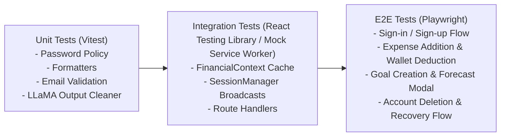

# QA_Report.md: Code Quality, Defect Backlog & Test Strategy

This document tracks identified bugs, architectural discrepancies, security vulnerabilities, technical debt, and test strategies across the **Buck Budget Tracker Web Application**.

---

## 1. Executive QA Summary & Codebase Health

| Metric | Assessment | Notes |
|---|---|---|
| **Overall Code Health** | ⚠️ **Moderate (Action Required)** | Core frontend UI and Supabase database architecture are robust; significant discrepancies exist in AI microservice integration. |
| **Authentication & RLS** | 🟢 **Strong** | Strict PostgreSQL Row-Level Security, HMAC-SHA256 session activity cookies, 30m idle timeouts, and rate-limited reset flow. |
| **Frontend State & Motion** | 🟢 **Strong** | High-performance in-memory cache in `FinancialContext`, clean Framer Motion integration, smooth modal glow math. |
| **AI Microservice Integrity** | 🔴 **Critical Deficiencies** | Dead endpoints, URL mismatches, ephemeral in-memory storage, and stubbed API routes. |
| **Automated Test Coverage** | 🔴 **0% (No Test Runner)** | No unit, integration, or E2E test runner configured in `package.json`. |

---

## 2. Defect & Discrepancy Backlog

### 🔴 Critical Severity

#### BUG-001: Dead Endpoint Invocation in `aiApi.ts`
- **Location**: [`buck/src/utils/aiApi.ts:17-28`](file:///d:/VS%20Code/Buck-Budget-Tracker/Buck-Web-Application/buck/src/utils/aiApi.ts#L17-L28)
- **Impact**: Any invocation of `processExpense()` fails with an HTTP 404 error.
- **Root Cause**: `aiApi.ts` targets `https://buck-web-application.onrender.com/process_expense/`. In the FastAPI backend ([`buck/BuckAI_Backend/main.py`](file:///d:/VS%20Code/Buck-Budget-Tracker/Buck-Web-Application/buck/BuckAI_Backend/main.py)), the route is named `/ai/categorize_expense/` or `/expenses/`. Route `/process_expense/` does not exist.
- **Remediation**: Align the API endpoint naming between `aiApi.ts` and `main.py`.

---

### 🟠 High Severity

#### BUG-002: Inconsistent Backend Host Domains Across Frontend Modules
- **Location**: [`buck/src/utils/aiApi.ts:17,20`](file:///d:/VS%20Code/Buck-Budget-Tracker/Buck-Web-Application/buck/src/utils/aiApi.ts#L17) vs [`buck/src/app/dashboard/goals/page.tsx:524`](file:///d:/VS%20Code/Buck-Budget-Tracker/Buck-Web-Application/buck/src/app/dashboard/goals/page.tsx#L524)
- **Impact**: AI forecast and AI saving tip requests are routed to different Render deployment instances (`buck-web-application` vs `buck-web-application-1`).
- **Root Cause**: Hardcoded URLs in source files instead of utilizing a unified `NEXT_PUBLIC_AI_BACKEND_URL` environment variable.
- **Remediation**: Create a centralized environment configuration `process.env.NEXT_PUBLIC_AI_BACKEND_URL` and reference it everywhere.

#### BUG-003: FastAPI In-Memory Storage Desynchronization & Data Loss
- **Location**: [`buck/BuckAI_Backend/main.py:19-20, 114-128`](file:///d:/VS%20Code/Buck-Budget-Tracker/Buck-Web-Application/buck/BuckAI_Backend/main.py#L19-L20)
- **Impact**: The AI forecast endpoint `/ai/forecast/` calculates historical spending trends from `expenses_db.get(key, [])`, which is always empty.
- **Root Cause**: Expenses are inserted directly into Supabase PostgreSQL from the Next.js frontend via [`supabaseData.ts`](file:///d:/VS%20Code/Buck-Budget-Tracker/Buck-Web-Application/buck/src/utils/supabaseData.ts). The FastAPI backend maintains an isolated in-memory Python dictionary `expenses_db: Dict[str, List[dict]] = {}` that is never populated and resets on every server spin-down.
- **Remediation**: Pass historical expense records directly in the `/ai/forecast/` request payload from the frontend or connect FastAPI directly to Supabase using a service client.

---

### 🟡 Medium Severity

#### BUG-004: [RESOLVED] Stubbed Next.js AI Route Handlers
- **Location**: [`buck/src/app/api/advisor/route.ts`](file:///d:/VS%20Code/Buck-Budget-Tracker/Buck-Web-Application/buck/src/app/api/advisor/route.ts) and [`buck/src/app/api/forecast/route.ts`](file:///d:/VS%20Code/Buck-Budget-Tracker/Buck-Web-Application/buck/src/app/api/forecast/route.ts)
- **Resolution**: Fully implemented cache-first route handlers connected to Supabase tables `ai_advisories` and `ai_forecasts`. Handlers execute context generation via [`aiInsightsGenerator.ts`](file:///d:/VS%20Code/Buck-Budget-Tracker/Buck-Web-Application/buck/src/utils/aiInsightsGenerator.ts), calculating burn rates, financial health scores, projected savings in PHP, and persistent database storage with user-level RLS. Vercel Cron endpoint [`/api/cron/generate-insights`](file:///d:/VS%20Code/Buck-Budget-Tracker/Buck-Web-Application/buck/src/app/api/cron/generate-insights/route.ts) provides automated weekly batch computation.

#### BUG-008: [RESOLVED] Home Category Breakdown Pie Card Overflow & Truncated Category Names
- **Location**: [`buck/src/app/dashboard/home/WeeklyPieChart.tsx`](file:///d:/VS%20Code/Buck-Budget-Tracker/Buck-Web-Application/buck/src/app/dashboard/home/WeeklyPieChart.tsx), [`buck/src/app/dashboard/home/style.css`](file:///d:/VS%20Code/Buck-Budget-Tracker/Buck-Web-Application/buck/src/app/dashboard/home/style.css)
- **Symptoms (measured at 1280px viewport, card content 410px)**:
  - The header needed 555px, so the "This Week" toggle was clipped.
  - The pie row needed 461px, so the canvas overflowed the card.
  - Fixed 70px chart padding left a ~160px pie, and callout names were ellipsized ("Tra…", "Vide…").
  - Legend pills cut long names.
- **Root Cause**: Fixed-width header, legend and chart padding sized for a wider card, plus viewport media queries applied to a card that occupies only ~47% of the content row.
- **Resolution**: Wrapping header, a card-width container query that stacks pie over legend at `<= 560px`, chart padding measured from the labels, 2-line wrapped callout and legend names, and % shown in legend pills. `HomeSkeleton` was updated for 1:1 parity. See ADR-032 in `Design.md`.
- **Verification**:
  - Checked in a temporary harness route (since removed) with worst-case data: Transportation, Entertainment, Electronics, Video Games, Others, and an "Others" child selection.
  - Viewports: 1920, 1680, 1440, 1280, 1024, 880 and 375px; dark and light theme.
  - Zero elements overflow the card, and there is no document horizontal scroll.
  - `tsc --noEmit` passes.

#### BUG-013: [RESOLVED] Expenses-by-day Bar Graph: Tiny Bars Hard to Click & Jitter on ₱0 Days
- **Location**: [`buck/src/app/dashboard/home/WeeklyBarChart.tsx`](file:///d:/VS%20Code/Buck-Budget-Tracker/Buck-Web-Application/buck/src/app/dashboard/home/WeeklyBarChart.tsx) (extracted from `home/page.tsx`), [`home/style.css`](file:///d:/VS%20Code/Buck-Budget-Tracker/Buck-Web-Application/buck/src/app/dashboard/home/style.css)
- **Symptoms**:
  - The click target was the visual bar itself (`min-height: 4px`), so low-spend days were almost impossible to click.
  - A 0.75rem gap between bars was a dead zone.
  - Clicking a ₱0 day (e.g. Thursday) made the page jitter.
  - When the card was taller than 250px, a large empty gap sat above the chart.
- **Root Cause (jitter)**:
  - The `useEffect` in `home/page.tsx` clears `selectedDay` when the day has no expenses.
  - Selecting a ₱0 day therefore rendered one filtered frame (badges, empty pie, layout shift), then reverted.
- **Resolution**:
  - **Full-column targets**: each day is now a full-height `<button class="graph-col">` that includes its day label, and the spacing moved into column padding (no dead zones).
  - **Minimum heights**: non-zero bars are at least 6px tall, and ₱0 days show a 3px stub.
  - **₱0 days**: these columns are `disabled`, so the select-then-revert jitter can't happen.
  - **Feedback**: hovering highlights the whole column, the selected day keeps its amount shown, and keyboard users get `:focus-visible` plus the tooltip.
  - **Fill and alignment**: the plot fills the card height, and y-axis ticks align with the grid lines (measured within 2px).
- **Verification**:
  - Harness with tiny Mon and ₱0 Thu: clicking Thu does nothing (`disabled`), and clicking Mon's label selects Mon.
  - Column hit area is 408px tall vs a 12px bar.
  - No overflow at 375px.

#### BUG-014: [RESOLVED] Skeleton Loading Layout Shift Across All Tabs
- **Root Causes**:
  1. A route's `loading.tsx` renders before `page.tsx` has loaded its stylesheet. Skeletons that used real page classes (`GoalsPage`, `settings-page`, `advisor-page`) therefore had no styles while loading.
  2. `component/dashboard.css` carried a legacy `.dashboard-skeleton …` override block with stale geometry. For example, `.dashboard-skeleton .dashboard-content` forced `0.8fr/1.7fr` columns and `.dashboard-skeleton .spending-card` forced a centered grid.
  3. The remaining skeleton geometry was hand-copied inline values that had drifted from the pages (paddings, grid tracks, breakpoints, control heights).
- **Resolution**:
  - **Shared classes**: every skeleton (Home, Expenses, Wallet, Goals, Statistics, Settings, Financial Advisor, Forecast, Admin) now imports its page stylesheet(s) and renders the page's own layout classes with shimmer placeholders.
  - **Exact text and controls**: static labels use a new `.skeleton-text` primitive (the real text, invisible over shimmer) for exact line boxes. Real disabled `CustomSelect`, `CustomDatePicker` and `<input>` controls keep toolbar and form geometry exact.
  - **Removed legacy CSS**: the `dashboard.css` override block and the unused `expenses-skeleton-*`, `wallet-skeleton-*` and `home-skeleton-*` rules are gone.
- **Verification**: Home skeleton vs real Home at 1440px gave identical sizes for the card, pie layout, legend, canvas box and graph container.

#### BUG-015: [RESOLVED] Forecast Page Missing `advisor-*` Styles on Direct Load
- **Location**: [`buck/src/app/dashboard/forecast/page.tsx`](file:///d:/VS%20Code/Buck-Budget-Tracker/Buck-Web-Application/buck/src/app/dashboard/forecast/page.tsx)
- **Root Cause**: the page renders `.advisor-grid`, `.advisor-card`, `.advisor-score` and `.advisor-icon`, which are defined only in `financial-advisor/style.css`, but never imported that file. The KPI row was unstyled unless the Advisor tab had been visited first.
- **Resolution**: `forecast/page.tsx` now imports `../financial-advisor/style.css`.

#### BUG-016: [RESOLVED] Page Stylesheets Overriding the Dashboard Shell
- **Location**: `goals/style.css`, `home/style.css`, `statistics/style.css`
- **Root Cause**:
  - Each file restyled the global `.dashboard` shell.
  - Statistics added `font-family: "Segoe UI"` and `overflow-y: auto`, and so did Goals for the font. Next.js keeps visited route CSS loaded, so after visiting those tabs every tab changed font and the shell (instead of `<main>`) became the scroll container.
  - Statistics' unscoped `.create-goal-button` also overrode the Goals modal button margin.
- **Resolution**:
  - Removed the three `.dashboard` rules; the shell is owned by `component/dashboard.css`.
  - Scoped the Statistics rules to `.empty-goals-popup .create-goal-button`.

#### BUG-017: [RESOLVED] Admin Toolbar `CustomSelect` Full-Width Rows & Double Chevron
- **Location**: [`buck/src/app/dashboard/admin/page.tsx`](file:///d:/VS%20Code/Buck-Budget-Tracker/Buck-Web-Application/buck/src/app/dashboard/admin/page.tsx), `admin/style.css` `.admin-filter-select`
- **Impact**:
  - `CustomSelect`'s container is `width: 100%`, so each filter wraps onto its own full-width row under the search box.
  - `.admin-filter-select` was written for a native `<select>` and adds right padding plus its own arrow next to `CustomSelect`'s chevron.
- **Resolution**:
  - `.admin-filter-select` is now sizing-only (`flex: 0 0 190px`). It lands on `CustomSelect`'s wrapper div, so the native-select border, padding and background-image arrow were removed, along with a dead `:focus` rule.
  - Below 560px the filters share a row (`flex: 1 1 140px`).
  - `.admin-search-input` gets `min-height: 42px` to match the select trigger.
  - `AdminSkeleton` uses the same classes, so it picks up the fix automatically.
- **Verification**:
  - 1440px: search box 453px plus two 190px filters on one row, all 43px tall, one chevron each.
  - 375px: search box full width, filters side by side underneath, no overflow.

#### BUG-005: Hardcoded Administrator Email Address in Multiple Files
- **Location**:
  - [`buck/src/middleware.ts:378`](file:///d:/VS%20Code/Buck-Budget-Tracker/Buck-Web-Application/buck/src/middleware.ts#L378)
  - [`buck/src/app/api/admin/supabase/route.ts:20`](file:///d:/VS%20Code/Buck-Budget-Tracker/Buck-Web-Application/buck/src/app/api/admin/supabase/route.ts#L20)
  - [`buck/src/app/api/admin/vercel/route.ts:20`](file:///d:/VS%20Code/Buck-Budget-Tracker/Buck-Web-Application/buck/src/app/api/admin/vercel/route.ts#L20)
  - [`buck/docs/admin-backend-caching.md:26`](file:///d:/VS%20Code/Buck-Budget-Tracker/Buck-Web-Application/buck/docs/admin-backend-caching.md#L26)
- **Impact**: Inability to configure or rotate administrator credentials without modifying and redeploying core source code.
- **Remediation**: Migrate admin validation to an environment variable `ADMIN_EMAIL` or implement role-based access control (RBAC) via Supabase custom user claims (`app_metadata.role = 'admin'`).

#### BUG-009: Supabase Migration History Drift (Live `glnuzqmnmzuxgujmxigx` vs Repo)
- **Location**: `supabase_migrations.schema_migrations` (live), [`buck/supabase/migrations/`](file:///d:/VS%20Code/Buck-Budget-Tracker/Buck-Web-Application/buck/supabase/migrations/)
- **Symptoms**: Live history records only `202606130001_strict_deletions` (version `20260904012427`) and `202606140001_security_and_policy_hardening` (version `20260924034657`). Objects from the other migrations exist live, so they were applied outside the migration tracker.
- **Impact**: `supabase db push` would try to re-apply already-present migrations, and the two recorded versions do not match the local file prefixes.
- **Resolution (applied to live 2026-10-11)**: Renamed the two recorded versions to the file prefixes and insert history rows for `202606010001`, `202606100001`, `202606110001`, `202606110002`, `202606120001`, `202606120002`, `202610100001` and `202610110001`.

#### BUG-010: `public.feedback` Table Had No Creating Migration
- **Location**: live `public.feedback` (4 rows); policies in `202606140001_security_and_policy_hardening.sql`
- **Resolution**: Added [`202606120002_feedback_table.sql`](file:///d:/VS%20Code/Buck-Budget-Tracker/Buck-Web-Application/buck/supabase/migrations/202606120002_feedback_table.sql). It uses `create table if not exists` with the live column set, sorted before the hardening migration so a fresh replay works.

#### BUG-011: `transfer_funds_atomic` Required by SRS 3.6 but Missing
- **Location**: live database and repo
- **Resolution (repo)**: Added [`202610110001_transfer_funds_atomic.sql`](file:///d:/VS%20Code/Buck-Budget-Tracker/Buck-Web-Application/buck/supabase/migrations/202610110001_transfer_funds_atomic.sql). The function is `SECURITY INVOKER` with an `auth.uid()` ownership check, ordered row locks, a rounded `numeric(14,2)` amount and an insufficient-funds check, and is executable by `authenticated` only.
- **Applied to live** on 2026-10-11 (existence not yet exercised with a real transfer). No client code calls it yet, since no transfer UI or data-layer function exists in `supabaseData.ts`.

#### BUG-012: Spec/Schema Gaps (Undocumented Fields)
- **Gaps**: `wallets` has no type column (Cash/Bank/E-Wallet), `expenses` has no `is_emergency` (it can only live in `metadata` jsonb), and `profiles` has no `is_deleted` / `grace_period_expires_at` (the grace period is modelled in `account_deletion_requests`).
- **Remediation**: Either align `Claude.md` / SRS with the current schema or add the columns in a new migration.

#### INFO-001: `public.rls_auto_enable()` Is Platform-Managed
- The live-only function and its `ensure_rls` event trigger are a Supabase default that enables RLS on new `public` tables. No migration is needed.

#### INFO-002: Accepted Risk: Leaked Password Protection Disabled
- The Supabase security advisor warns `auth_leaked_password_protection`. The feature requires a paid Supabase plan and the project is on the free plan, so the warning is accepted. Revisit if the project upgrades.

#### BUG-013: Live `categories` Table Lacks the Canonical `Fare` Category
- **Location**: live `public.categories` (all 8 users have 17 rows, including `Uncategorized` but no `Fare`), versus the 17 canonical categories in `Claude.md` 3.2.
- **Impact**: `Fare` expenses cannot be linked by `category_id`. The varied test seed inserts them with `category_id = NULL` and `category_name = 'Fare'`.
- **Remediation**: Decide whether `Uncategorized` replaces or supplements `Fare`, then backfill and fix the new-user category seeding.

#### INFO-003: Varied Test Data Seeded (2026-10-12)
- Additive and tagged `metadata.seed = 'varied-2026-10-12'` (wallets are named `Seed Bank Account`, goals start with `Seed: `). Script and UNDO block: [`buck/supabase/seed_varied_test_data.sql`](file:///d:/VS%20Code/Buck-Budget-Tracker/Buck-Web-Application/buck/supabase/seed_varied_test_data.sql).
- Inserted: 8 wallets, 1,012 expenses, 8 goals, 8 forecasts, 16 advisories across the 8 existing users. No existing rows were changed.

---

### 🟢 Low Severity / Tech Debt

#### BUG-006: Orphaned Root `package.json`
- **Location**: [`package.json:1-6`](file:///d:/VS%20Code/Buck-Budget-Tracker/Buck-Web-Application/package.json#L1-L6)
- **Impact**: Developers running `npm install` at the workspace root do not install the actual application dependencies located in `buck/`.
- **Root Cause**: The workspace contains a bare `package.json` at root without npm workspace configuration pointing to `buck/`.
- **Remediation**: Define `"workspaces": ["buck"]` in the root `package.json` or consolidate project configuration.

#### BUG-007: Unused Dependencies & Dead Imports in `ai_models.py`
- **Location**: [`buck/BuckAI_Backend/ai_models.py:2,13,15`](file:///d:/VS%20Code/Buck-Budget-Tracker/Buck-Web-Application/buck/BuckAI_Backend/ai_models.py#L2)
- **Impact**: Unnecessary dependency bloat and confusion over active LLM providers.
- **Root Cause**: Code imports `openai` and mentions OpenAI embedding model comments, but actually calls the Together AI HTTP endpoint using `requests`.
- **Remediation**: Clean up unused imports and align documentation with the Together AI integration.

---

## 3. Security & Compliance Audit Matrix

| Security Control | Implementation Mechanism | Status | Notes |
|---|---|---|---|
| **Data Isolation (RLS)** | PostgreSQL Row-Level Security on all user tables | 🟢 **PASS** | Strict `(select auth.uid()) = user_id` check across select/insert/update/delete. Duplicate policies consolidated. |
| **Database RPC Exposure Hardening** | `REVOKE EXECUTE` on trigger & `SECURITY DEFINER` functions | 🟢 **PASS** | Revoked direct execute from `PUBLIC, anon, authenticated` across all 9 trigger/definer functions. |
| **Database Search Path Protection** | Fixed `SET search_path = public` on database routines | 🟢 **PASS** | Eliminates role-mutable search path hijacking vulnerability. |
| **RLS Performance & InitPlan** | Subquery wrapper `(select auth.uid())` & `(select auth.jwt())` | 🟢 **PASS** | Auth functions cached in InitPlan once per query rather than evaluated per row. |
| **Foreign Key Covering Indexes** | Covering B-Tree indexes on all foreign keys | 🟢 **PASS** | Covering indexes added for `expenses` (`wallet_id`, `goal_id`, `category_id`), `ai_forecasts` (`goal_id`, `wallet_id`), and `ai_advisories` (`category_id`, `goal_id`, `wallet_id`) eliminating unindexed foreign keys. |
| **Session Activity Verification** | HMAC-SHA256 Signed Cookie (`buck-session-activity`) | 🟢 **PASS** | Prevents cookie tampering; verified on every protected request in `middleware.ts`. |
| **Session Inactivity Expiry** | 30-minute idle threshold with cross-tab Broadcast sync | 🟢 **PASS** | Synchronized across all tabs via `SessionManager.tsx`. |
| **Password Reset Rate Limiting** | SHA-256 HMAC hashed IP/email window in `auth_security_events` | 🟢 **PASS** | Zero plaintext IP/email retention; enforces 8 resets / 15 min per IP. Explicit service-role policy added. |
| **Account Deletion Safeguards** | 10-day recovery window + OTP confirmation token | 🟢 **PASS** | Prevents accidental data destruction with self-service cancellation. |
| **Private File Storage** | Supabase Storage RLS on `profile-avatars` | 🟢 **PASS** | Folders isolated by `auth.uid()`; signed URLs or SSR proxy stream required for access. |
| **API CORS Hardening** | Explicit origin whitelist on FastAPI backend | 🟢 **PASS** | Replaced insecure wildcard `allow_origins=["*"]` with credentialed origin whitelist. |

---

## 4. Testing & Verification Strategy

### 4.1 Recommended Automated Testing Architecture

To achieve enterprise-grade reliability, the repository requires the following testing framework:

### 4.2 Manual QA Regression Test Checklist

1. **Authentication & Session**:
   - [ ] Sign up with valid password matching all 5 policy criteria.
   - [ ] Confirm email redirect flow and automatic category seeding.
   - [ ] Idle for 29 minutes $\rightarrow$ verify 60s warning modal appears $\rightarrow$ click "Stay Signed In" $\rightarrow$ confirm session extension.
   - [ ] Request password reset 9 times from same IP $\rightarrow$ confirm HTTP 429 Rate Limit on 9th attempt.
2. **Financial Operations**:
   - [ ] Create wallet with budget ₱5,000.
   - [ ] Add expense of ₱1,200 under "Food" $\rightarrow$ verify wallet balance reduces to ₱3,800.
   - [ ] Delete expense $\rightarrow$ verify wallet balance restores to ₱5,000.
   - [ ] Soft delete wallet $\rightarrow$ verify wallet is hidden from active list but appears in Wallet History.
3. **Goal Tracking & AI**:
   - [ ] Create goal "Emergency Fund" for ₱20,000 with Moderate attitude.
   - [ ] Open Goal Forecast modal $\rightarrow$ verify time range calculations.
4. **Account Management & Danger Zone**:
   - [ ] Request account deletion $\rightarrow$ verify confirmation email dispatched.
   - [ ] Open confirmation link $\rightarrow$ verify status transitions to "Scheduled for Deletion (10-day recovery)".
   - [ ] Click "Recover Account" $\rightarrow$ verify deletion status is revoked.
5. **Global Toaster Notifications & Feedback Flow**:
   - [ ] Sign up with invalid inputs $\rightarrow$ verify formatted toast warning appears instead of blocking browser `alert()`.
   - [ ] Update display name or avatar in Settings $\rightarrow$ confirm success toast notification with progress bar.
   - [ ] Trigger multiple rapid toasts $\rightarrow$ confirm queue maintains a maximum stack of 4 without overflowing viewport.
   - [ ] Hover cursor over an active toast $\rightarrow$ confirm countdown progress freezes; move cursor away $\rightarrow$ confirm smooth dismissal.
   - [ ] Complete goal progress in Goals screen $\rightarrow$ confirm celebratory completion toast triggers.
6. **Wallet Typography & Spacing**:
   - [ ] Navigate to `/dashboard/wallet` $\rightarrow$ verify title and eyebrow have tight, balanced vertical spacing (`0.15rem` gap) and header icon centers cleanly.
   - [ ] Verify font weights across wallet card names, buttons, and budget amounts appear crisp and semi-bold (`600`–`650`) rather than heavy bold (`850`–`900`).
7. **Expenses KPI Cards & Hydration Parity**:
   - [ ] Navigate to `/dashboard/expenses` $\rightarrow$ inspect Card 2 "Total Tracked" $\rightarrow$ confirm sparkline is replaced by dual-stat grid showing "This Month" and "Daily Average".
   - [ ] Inspect Card 3 "Average Expense" $\rightarrow$ confirm "Mean Velocity" badge and horizontal benchmark range line are removed, replaced by dual-stat grid showing "Lowest Expense" and "Highest Expense".
   - [ ] Reload page on network throttle $\rightarrow$ verify `ExpensesSkeleton` and `WalletSkeleton` match the updated KPI and title geometry with zero CLS upon data hydration.
8. **Home Dashboard Pie Legend, Excel Callouts, Dynamic Filter Eyebrow & AI Advisor Parity**:
   - [ ] Navigate to `/dashboard/home` $\rightarrow$ inspect Category Breakdown card $\rightarrow$ confirm the category legend pills are compact ($290\text{px}$ width) on the left side of the pie chart and do not stretch across the card.
   - [ ] Confirm "All" has the exact same height and neutral styling as other pills without appearing slightly bigger by default.
   - [ ] Click a category legend pill (e.g. "Food") $\rightarrow$ confirm ONLY the clicked category receives the active highlight border, while other pills soften. Confirm the bar chart, pie slice, and summary filter update.
   - [ ] Confirm the pie chart displays Excel-style data callouts: each slice has an anchor dot and a leader pointer line extending to an outside label showing the category name and bold percentage.
   - [ ] Confirm adjacent slices (e.g. Shopping and Others) have no overlapping callout text.
   - [ ] Click "✕ Show All" pill $\rightarrow$ confirm filter clears and all pills return to uniform neutral appearance.
   - [ ] Inspect bottom AI Financial Advisor card $\rightarrow$ confirm all mock telemetry chips (LLaMA 3.3, Prophet, 224 events ingested calibration banner) are completely removed. Confirm header renders `Financial Advisor` eyebrow, `Advice that sounds like a next step.`, `View Full Advisor →` link, Health Score circular meter, and 2 clean side-by-side cards: "AI Suggestion" ("What to do next" with `<FaLightbulb />`) and "AI Advice" ("Detailed Analysis" with `<FaReceipt />`).
   - [ ] When no advisory data exists $\rightarrow$ confirm card renders clean and empty without displaying fabricated numbers or mock telemetry.
   - [ ] Network throttle reload $\rightarrow$ confirm `HomeSkeleton` matches the compact $290\text{px}$ legend pills, callout canvas box, and 2-card AI layout with 1:1 geometry and zero CLS.
9. **Financial Summary Header Eyebrow & "Others" Sub-Category Filtering**:
   - [ ] Navigate to `/dashboard/home` $\rightarrow$ inspect Financial Summary section $\rightarrow$ verify eyebrow displays `Categories` on top, with `Financial Summary` heading below it.
   - [ ] When no category is filtered $\rightarrow$ verify no filter pillbox crowds the title row, keeping the header clean and uncluttered.
   - [ ] Click "Others" in the Pie Chart $\rightarrow$ verify Financial Summary displays the cards included under Others (e.g. Health, Entertainment, Electronics).
   - [ ] Click one of the cards included in Others (e.g. "Health") $\rightarrow$ verify the category stays active (is NOT reset to null), the pillbox appears beside "Financial Summary" (`Category: Health • All Time ✕ Show All`), the Weekly Summary bar graph displays daily expenses for Health, the Pie Chart highlights the "Others" slice while displaying Health (₱800.00, 6%) in the center circle, and the callout leader line highlights `Others (Health)`.
   - [ ] In Financial Summary, verify the card for "Health" displays its financial details and is highlighted with `summary-item--selected`.
   - [ ] Click `← Others` button beside the title $\rightarrow$ verify it smoothly returns to the full Others breakdown.
   - [ ] Click `✕ Show All` $\rightarrow$ verify all categories return to normal.
   - [ ] Reload on network throttle $\rightarrow$ verify `HomeSkeleton` matches the `Categories` eyebrow + `Financial Summary` title geometry with zero CLS.
10. **Weekly Expenses by Day Bar Graph Axis Labels & Palette Configuration**:
    - [ ] Navigate to `/dashboard/home` $\rightarrow$ inspect "Expenses by day" Bar Graph card.
    - [ ] Verify Y-axis contains a vertical, uppercase axis title `AMOUNT (₱)` centered along the height of the y-axis numbers.
    - [ ] Verify X-axis contains a horizontal, centered axis title `DAY OF THE WEEK` placed neatly below the day tick abbreviations (`Mon`–`Sun`).
    - [ ] Verify both axes are legible and responsive across desktop and mobile viewports with no text overlap or clipping.
    - [ ] Inspect [`chartTheme.ts`](file:///d:/VS%20Code/Buck-Budget-Tracker/Buck-Web-Application/buck/src/app/dashboard/home/chartTheme.ts) $\rightarrow$ confirm pie palette colors are cleanly exported as `BUCK_PIE_PALETTE` and `CHART_THEME` for immediate, single-point editing.
    - [ ] Network throttle reload $\rightarrow$ confirm `HomeSkeleton` reflects the bottom x-axis label geometry with zero CLS.
11. **Comprehensive Dashboard Tab Skeletal Loading Parity & Route Boundary Fix**:
    - [ ] Navigate to `/dashboard/expenses` $\rightarrow$ verify `ExpensesSkeleton` renders during route loading and initial hydration (3 KPI cards, allocation bar, form, list toolbar) instead of the Home dashboard skeleton.
    - [ ] Navigate to `/dashboard/wallet` $\rightarrow$ verify `WalletSkeleton` renders during route loading and initial hydration (2-column layout, active wallets, history panel) instead of Settings or Home skeleton.
    - [ ] Navigate to `/dashboard/financial-advisor` $\rightarrow$ verify `FinancialAdvisorSkeleton` renders during route loading and initial hydration (hero with circular health score meter, 3 KPI cards, 2 wide advice cards) instead of Home skeleton.
    - [ ] Navigate to `/dashboard/forecast` $\rightarrow$ verify `ForecastSkeleton` renders during route loading and initial hydration (forecast hero with badge circle, 3 prediction cards, 2 AI forecast cards) instead of Home skeleton or mock bar chart.
    - [ ] Navigate to `/dashboard/admin` $\rightarrow$ verify `AdminSkeleton` renders during route loading (3-tab vertical navigation, search toolbar, card list items).
    - [ ] Inspect [`DashboardClientLayout.tsx`](file:///d:/VS%20Code/Buck-Budget-Tracker/Buck-Web-Application/buck/src/component/DashboardClientLayout.tsx) $\rightarrow$ confirm `getSkeletonVariant` accurately routes all subpaths (`/dashboard/expenses`, `/dashboard/wallet`, `/dashboard/financial-advisor`, `/dashboard/forecast`, `/dashboard/admin`, etc.) without falling back to `home` or mismatched variants.
    - [ ] Confirm route loading boundaries exist for all 9 dashboard tabs (`home`, `expenses`, `wallet`, `financial-advisor`, `forecast`, `goals`, `statistics`, `settings`, `admin`).
12. **Home Pie Chart Legend Left-Alignment, Callout Typography (+2.5px), and Anti-Clipping Geometry**:
    - [ ] Navigate to `/dashboard/home` $\rightarrow$ inspect Category Breakdown card.
    - [ ] Confirm Top 5 Category + Others legend pills are positioned flush on the left of the card, eliminating former large left empty space and giving the Pie Chart maximum breathing room to the right.
    - [ ] Confirm Pie Graph element callout labels (category name and percentage) are larger and clearly legible (category name at $13\text{px}$–$13.5\text{px}$, percentage at $14\text{px}$–$15\text{px}$).
    - [ ] Verify long category descriptions (such as "Transportation" or "Others (Entertainment)") are completely visible and NOT cut off by the canvas boundary on the left, right, top, or bottom.
    - [ ] Confirm top callout (Others/Shopping) has sufficient vertical headroom ($36\text{px}$) and bottom callout (Bills) has sufficient footroom ($36\text{px}$) with zero edge truncation.
    - [ ] Network throttle reload $\rightarrow$ confirm `HomeSkeleton` mirrors the left-aligned legend and expanded $290\text{px}$ canvas box with zero CLS upon hydration.
13. **Anti-Pill-in-Pill Decoupling & Sibling Filter Badge Verification**:
    - [ ] Navigate to `/dashboard/home` $\rightarrow$ click a category slice or legend pill (e.g., Food).
    - [ ] Inspect Category filter pill in Financial Summary header:
      - [ ] Confirm redundant `• All Time` is completely removed.
      - [ ] Confirm distinct whitespace exists between `Category:` prefix and the category name (`Food`).
      - [ ] Confirm `✕ Show All` is rendered as its own separate orange sibling pill button outside the Category badge, with zero nested pill structures.
      - [ ] Click `✕ Show All` $\rightarrow$ verify category filter clears properly.
    - [ ] Inspect Bar Graph card (`Expenses by day`):
      - [ ] Re-select a category $\rightarrow$ confirm the active filter badge renders as two separate sibling pill boxes (`• Category: Food` badge and `✕ Clear` button).
      - [ ] Confirm clean whitespace exists between `Category:` prefix and category name.
      - [ ] Click `✕ Clear` $\rightarrow$ verify filter clears properly.
    - [ ] Drill down into an "Others" subcategory (e.g. Health) $\rightarrow$ confirm sibling `← Others` pill renders cleanly alongside `Category: Health` and `✕ Show All` without overlap.
14. **Modular Skeletal Loading Components & 1:1 Loaded-State Parity (`src/component/skeletons/`)**:
    - [ ] Navigate to `/dashboard/expenses` $\rightarrow$ inspect `ExpensesSkeleton` during loading:
      - [ ] Confirm Top 3 KPI Grid renders with full card anatomy, borders, and surface backgrounds (Wallet Balance with emerald Healthy status pill, Total Tracked with entries count badge & 2-box stat grid, Average Expense with 2-box stat grid).
      - [ ] Confirm Category Spending Allocation card renders with 7-segment multi-color allocation bar and 8 filter chips.
      - [ ] Confirm 2-column main workspace renders Add Spending form (all inputs, quick add chips, submit button) on left, and Expense tracker (toolbar + transaction rows with icons and delete buttons) on right.
      - [ ] Confirm zero layout collapse, zero left-margin line stacking, and zero Cumulative Layout Shift (CLS) when data finishes loading.
    - [ ] Verify all 9 modular skeleton files exist in [`src/component/skeletons/`](file:///d:/VS%20Code/Buck-Budget-Tracker/Buck-Web-Application/buck/src/component/skeletons/) (`ExpensesSkeleton`, `HomeSkeleton`, `WalletSkeleton`, `GoalsSkeleton`, `StatisticsSkeleton`, `SettingsSkeleton`, `FinancialAdvisorSkeleton`, `ForecastSkeleton`, `AdminSkeleton`, `index.tsx`, `skeletons.css`).
    - [ ] Verify [`DashboardSkeletons.tsx`](file:///d:/VS%20Code/Buck-Budget-Tracker/Buck-Web-Application/buck/src/component/DashboardSkeletons.tsx) proxies exports without broken references across the entire app.
15. **Pie Chart Dynamic Slice Zoom Animation, Tooltip True-Color Indicator & Bidirectional Anti-Clipping Verification**:
    - [ ] Navigate to `/dashboard/home` $\rightarrow$ inspect Category Breakdown Pie Chart:
      - [ ] In default unselected state, confirm all slices render with equal $100\%$ outer radius and zero offset.
    - [ ] Click any slice or legend pill (e.g., Food or Shopping):
      - [ ] **Zoom In**: Confirm the selected slice smoothly expands/pops out outward with $14\text{px}$ offset and full/expanded radius ($1.02$).
      - [ ] **Zoom Out**: Confirm all unselected slices smoothly shrink down inward to $85\%$ outer radius with zero offset and dimmed background, creating clear depth of field and immediate visual focus on the active category.
      - [ ] Deselect the slice (by clicking it again or clicking "All") $\rightarrow$ confirm unselected slices smoothly re-expand back to $100\%$ radius and selected slice smoothly returns to center over $380\text{ms}$ with fluid easing.
    - [ ] **Hover Tooltip True-Color Indicator**:
      - [ ] While a category is selected (and other slices are dimmed), hover over any dimmed unselected slice (e.g. hover over Shopping or Bills).
      - [ ] Confirm the square color indicator inside the tooltip displays the true, authentic, 100% opaque category color (e.g., bright amber for Shopping, warm gold for Bills) and does NOT appear white, washed-out, or gray.
    - [ ] **Bidirectional Anti-Clipping**:
      - [ ] Select category at the top (Others/Shopping) $\rightarrow$ confirm the top callout label ("Others 5%") is completely visible with $> 15\text{px}$ headroom, and character baselines are NOT cut off at the top canvas edge.
      - [ ] Select or inspect category on the left ("Transportation 17%") $\rightarrow$ confirm the text begins cleanly at $\ge 8\text{px}$ from the left canvas edge, and leading characters ("Tr") are 100% visible and NOT cut off into "ansportation".
      - [ ] Inspect bottom category ("Bills 32%") $\rightarrow$ confirm the bottom label has $> 14\text{px}$ clearance and does not crowd the container border.
      - [ ] Confirm leader lines attach cleanly to the labels without detaching or overlapping text.
    - [ ] Network throttle reload $\rightarrow$ confirm `HomeSkeleton` mirrors the updated $310\text{px}$ canvas box and $250\text{px}$ legend pills with 1:1 geometry and zero CLS.
16. **Dashboard Card Grid Rebalance, Compact Legend Centering, & Bar Graph Axis Spacing Verification**:
    - [ ] Navigate to `/dashboard/home` $\rightarrow$ inspect top two cards (Category Spending and Expenses by day):
      - [ ] Confirm both cards have equal visual weight and uniform internal padding (`1.5rem`), matching the Financial Summary card below.
      - [ ] **Pie Chart Card**: Confirm the filter pillboxes on the left are centered relative to the Pie Chart itself (both vertically and horizontally as a unified cluster), with compact $220\text{px}$ pill widths.
      - [ ] **Bar Graph Card Breathing Room**: Confirm the Bar Graph card has ample horizontal space ($1.06\text{fr}$ ratio), and the vertical Y-axis title `AMOUNT (₱)` is cleanly spaced (`gap: 0.75rem`) without crowding against tick values or the card edge.
      - [ ] **Lower Graph Position**: Confirm the entire bar graph sits lower in the card, eliminating the upward offset and providing balanced breathing room between the title and the chart.
      - [ ] **X-Axis Spacing**: Confirm the `DAY OF THE WEEK` axis title sits snug and neatly below the day abbreviations (`Mon`–`Sun`) with only a $5\text{px}$–$7\text{px}$ gap, completely eliminating the former $\sim 50\text{px}$ empty void.
      - [ ] Confirm the bottom footer of the Bar Graph (`DAY OF THE WEEK`) aligns on the same horizontal visual baseline as the Pie Chart footer (`TOTAL ALL-TIME`).
    - [ ] Network throttle reload $\rightarrow$ confirm `HomeSkeleton` mirrors the $0.94\text{fr} / 1.06\text{fr}$ grid, centered pie layout, and $250\text{px}$ graph height with 1:1 geometry and zero CLS.
17. **Leftmost Legend Container Spacing Parity & Full-Sized Pie Chart Preservation Verification**:
    - [ ] Navigate to `/dashboard/home` $\rightarrow$ inspect Category Spending card:
      - [ ] **Leftmost Legend Placement**: Confirm the category filter pillboxes (`All`, `Food`, `Bills`, `Transportation`, `Shopping`, `Others`) sit on the leftmost edge of the card, flush with the card's `1.5rem` internal padding, and align vertically with "CATEGORY SPENDING" and "Category Breakdown".
      - [ ] **Container Spacing Parity**: Confirm the left padding and spacing of the Category Spending card matches the Bar Graph, Financial Summary, and AI Advisor cards (no inset void on the left).
      - [ ] **Full-Sized Pie Chart**: Confirm the pie chart is large, prominent, and not shrunken (diameter ~230px–240px, occupying proportional space within the 480px canvas box).
      - [ ] **Callout Legibility**: Confirm callout labels (e.g. "Transportation 17%", "Others 5%", "Food 33%", "Bills 32%") render with leader lines without truncation or text clipping.
      - [ ] **Bar Graph Harmony**: Confirm the Bar Graph card on the right preserves its lower position, 250px bar height, comfortable Y-axis spacing, and snug X-axis title.
    - [ ] Network throttle reload $\rightarrow$ confirm `HomeSkeleton` mirrors the `1.12fr / 1fr` grid, `justify-content: space-between` layout, leftmost legend pills, and $220\text{px}$ skeleton circle with 1:1 geometry and zero CLS.
18. **Bar Chart Fluid Morphing Transitions, Persistent DOM Nodes & Interactive Tooltips Verification**:
    - [ ] Navigate to `/dashboard/home` $\rightarrow$ inspect the "Expenses by day" Bar Chart:
      - [ ] **Category Switching Transitions**: Click between different categories in the Pie Chart (e.g. "Food" $\rightarrow$ "Bills" $\rightarrow$ "All") $\rightarrow$ confirm all 7 weekday bars smoothly glide up and down to their new heights over $420\text{ms}$ with `cubic-bezier(0.16, 1, 0.3, 1)` easing without snapping.
      - [ ] **Synchronized Motion**: Confirm the Bar Chart transitions in harmony with the Pie Chart's $380\text{ms}$ slice zoom and dimming animation.
      - [ ] **Zero-Data Smooth Transition**: Click a category that has no expenses in the selected timeframe $\rightarrow$ confirm the bars smoothly transition down to 0% height (4px baseline) without unmounting, the weekday labels ("Mon"–"Sun") stay visible on the X-axis, and the subtle `.graph-bars-empty-overlay` message fades in cleanly.
      - [ ] **Hover Tooltips**: Hover over any bar with expenses $\rightarrow$ confirm the floating `.graph-bar-tooltip` smoothly animates into view above the bar showing the formatted Philippine Peso amount (`₱...`).
      - [ ] **Active Filter Entrance**: Select and clear category filters $\rightarrow$ confirm the category badge above the bar chart animates in smoothly with `fadeInFilterBadge`.

19. **Bar Graph Y-Axis Header Alignment, Pie Graph Vertical Center Alignment & Callout Clearance Geometry Verification**:
    - [ ] Navigate to `/dashboard/home` $\rightarrow$ inspect the "Expenses by day" Bar Chart:
      - [ ] **Y-Axis Flush Header Alignment**: Verify that the vertical Y-axis title `AMOUNT (₱)` begins flush with the card eyebrow (`ALL-TIME SUMMARY`) and title (`Expenses by day`) at $X=28$, completely eliminating the previous 8px rightward indent.
      - [ ] **Numeric Scale Breathing Room**: Verify that the numeric tick values (e.g. 61,590, 51,325...) maintain comfortable breathing room (`gap: 0.85rem`) between `AMOUNT (₱)` and the axis boundary.
    - [ ] Inspect the "Category Breakdown" Pie Chart Card:
      - [ ] **Pillbox Vertical Centering to Pie Graph**: Verify that the vertical midpoint of the leftmost pillbox filter stack aligns with the exact center of the pie graph circle ($cy = 160\text{px}$), rather than sagging downward toward the bottom summary footer.
      - [ ] **Callout Leader Line Clearance**: Inspect callout labels on all slices. Verify that top callouts ("Others 5%") and bottom callouts ("Bills 32%") maintain at least $15\text{px}$ to $33\text{px}$ of clearance away from the slice borders with zero overlap or border clipping.
      - [ ] **Side Label Breathing Room**: Verify that horizontal callouts ("Transportation 17%", "Food 33%") maintain at least $44\text{px}$ of distance from the outer arc perimeter.
    - [ ] **1:1 Skeletal Loading Parity Verification**:
      - [ ] Refresh `/dashboard/home` and observe the initial skeletal loading phase: confirm `HomeSkeleton.tsx` has `Amount (₱)` aligned at `marginLeft: -8`, and the skeleton pillbox stack is centered at `height: 320px` matching the 220px skeleton circle with 0 Cumulative Layout Shift (CLS).

20. **Excel-Style Horizontal Broken Grid Lines Verification**:
    - [ ] Navigate to `/dashboard/home` $\rightarrow$ inspect the "Expenses by day" Bar Chart:
      - [ ] **Horizontal Dashed Lines**: Verify that 6 horizontal broken/dashed grid lines run across the chart plot area behind the weekday bars, corresponding to each Y-axis tick level (`100%`, `83.333%`, `66.667%`, `50%`, `33.333%`, and `16.667%`).
      - [ ] **Solid Baseline Preservation**: Verify that the bottom baseline at 0% remains a solid line (`border-bottom: 1px solid var(--buck-line)`), creating a crisp visual floor for the bars.
      - [ ] **Layering Depth**: Verify that weekday bars sit cleanly in front of the dashed grid lines (`z-index: 1`), with the broken lines visible through the gaps between bars and across empty days.
      - [ ] **Theme Adaptability**: Toggle between dark and light themes $\rightarrow$ confirm that the broken grid lines seamlessly adapt (`var(--buck-line)` in light mode; subtle warm amber `rgba(255, 211, 154, 0.24)` in dark mode).
      - [ ] **Hover & Overlay Stability**: Hover over bars $\rightarrow$ confirm floating tooltips render with higher stacking (`z-index: 10`). Filter to a zero-data category $\rightarrow$ confirm the empty state overlay sits on top (`z-index: 5`) with full readability.
    - [ ] **1:1 Skeletal Loading Parity**:
      - [ ] Refresh `/dashboard/home` and observe the initial skeleton state: confirm `HomeSkeleton.tsx` renders identical horizontal broken grid lines and axis borders with 0 Cumulative Layout Shift (CLS).

21. **Bar Chart Interactive Day Slicing, Cross-Card Breakdown Synchronization & Enlarged Tooltips Verification**:
    - [ ] Navigate to `/dashboard/home` $\rightarrow$ inspect the "Expenses by day" Bar Chart:
      - [ ] **Enlarged Tooltip Hover**: Hover over any weekday bar with spending $\rightarrow$ confirm the tooltip currency amount is noticeably larger (`font-size: 0.92rem; font-weight: 850;`) and bolder for immediate legibility.
      - [ ] **Interactive Cursor**: Confirm each bar displays `cursor: pointer;` on hover.
      - [ ] **Click to Filter by Day**: Click on any weekday bar (e.g., Thursday):
        - [ ] Confirm the clicked bar elevates ($4\text{px}$ upward shift), receives an active double-ring outline with `var(--buck-orange)`, and gains an elevated drop shadow (`.graph-bar--selected`).
        - [ ] Confirm the remaining weekday bars gently dim (`.graph-bar--dimmed`, `opacity: 0.42`), keeping visual focus on Thursday.
        - [ ] Confirm a clearable badge `Day: Thursday [✕ Clear]` appears directly adjacent to the `Expenses by day` title inside the title row (matching Financial Summary's layout), rather than separated across the far right edge of the card.
      - [ ] **Category Filter Adjacent Placement**:
        - [ ] Click a category in the Pie Chart (e.g. Food) $\rightarrow$ confirm `Category: Food [✕ Clear]` appears directly next to the `Expenses by day` title with clean `0.75rem` spacing.
      - [ ] **Category Breakdown Synchronization**:
        - [ ] Look at the "Category Breakdown" Pie Chart on the left:
        - [ ] Confirm the pie chart slices, amounts, and percentages dynamically update to represent the spending breakdown *specifically for Thursday*.
        - [ ] Confirm the center label updates to `Total on Thursday` with Thursday's total amount.
        - [ ] Confirm a clearable badge `Day: Thursday [✕ All Days]` appears in the Pie Chart card header.
      - [ ] **Financial Summary Synchronization**:
        - [ ] Look at the "Financial Summary" card directly below:
        - [ ] Confirm the displayed category items and amounts reflect the spending breakdown *specifically for Thursday*.
        - [ ] Confirm category descriptions provide contextual day descriptions (e.g., `Spending under Food on Thursday`).
        - [ ] Confirm a clearable pill `Day: Thursday [✕ All Days]` appears in the Financial Summary filter pill group as a sibling element without nesting.
      - [ ] **Toggle Off**:
        - [ ] Click the Thursday bar again (or click `✕ Clear` / `✕ All Days`) $\rightarrow$ confirm the day filter toggles off, all bars return to normal opacity, and the Pie Chart and Financial Summary revert to showing the full timeframe.
      - [ ] **Timeframe Switching**:
        - [ ] Change timeframe from "All Time" to "This Month" or "This Week" $\rightarrow$ confirm day filters safely reset or update without crashing.
      - [ ] **Build & Type Check**:
        - [ ] Verify `npx tsc --noEmit` completes with 0 errors.

22. **Category-Only Pillbox Legend & Interactive "All" UX Animation Verification**:
    - [ ] Navigate to `/dashboard/home` $\rightarrow$ inspect the "Category Breakdown" Pie Chart legend on the left:
      - [ ] **Streamlined Content**: Verify that each pillbox displays only the colored dot and the category name (`All`, `Food`, `Bills`, etc.). Confirm that currency amounts (`₱...`) and percentages (`...%`) are removed from inside the pillboxes.
      - [ ] **Space Optimization**: Confirm the pillbox column is compact (~130px–150px), giving generous horizontal breathing room to the pie chart and outside callout labels.
      - [ ] **Interactive "All" State**:
        - [ ] On default load (no category selected): confirm "All" is active with orange outline, elevated position (`translateX(4px)`), and glowing dot.
        - [ ] Click a category (e.g. "Food"): confirm "Food" becomes active with orange outline and elevated position, while "All" dims to `opacity: 0.45` alongside other unselected categories.
        - [ ] Click "All": confirm the category filter clears, "All" returns to active selected state, and all pie slices smoothly re-expand.
      - [ ] **Micro-Interaction Animations**:
        - [ ] Hover over any pill: confirm smooth `translateX(4px)` slide, border highlight, and soft glow shadow.
        - [ ] Click on a pill: confirm tactile spring compression (`scale(0.97)`).
      - [ ] **1:1 Skeletal Loading Parity**:
        - [ ] Network throttle reload $\rightarrow$ confirm `HomeSkeleton.tsx` renders matching single-line pill placeholders without dual-value lines, preventing Cumulative Layout Shift (CLS).

23. **Uniform Human-Friendly Y-Axis "Nice Scale" & Data Visualization Verification**:
    - [ ] Navigate to `/dashboard/home` $\rightarrow$ inspect the "Expenses by day" Bar Chart Y-axis:
      - [ ] **Uniform Round Intervals**: Verify that the tick amounts increment by clean, human-friendly round numbers (e.g., ₱10,000, ₱20,000, ₱5,000, ₱1,000) rather than unrounded arbitrary numbers like ₱10,265 or ₱3,908.
      - [ ] **Zero Interval Jitter**: Check each adjacent tick: verify that the difference $\text{tick}[i] - \text{tick}[i+1]$ is mathematically uniform across the entire axis with zero fluctuation.
      - [ ] **Grid Line Alignment**: Verify that every horizontal dashed grid line lines up 1:1 with its corresponding Y-axis numeric tick label.
      - [ ] **Proportional Bar Tracing**: Observe the tallest bar (e.g., Thursday at ₱61,590):
        - [ ] Confirm the bar terminates proportionately below the top scale line (e.g. ₱70,000) with visual headroom, and sits just above the ₱60,000 grid line ($85.7\%$).
      - [ ] **Multi-Category & Timeframe Scale Adaptability**: Switch timeframes ("All Time", "This Month", "This Week") and select various categories $\rightarrow$ confirm that the Y-axis smoothly and cleanly re-scales with uniform steps for all amounts.
      - [ ] **Build & Type Check**: Verify `npx tsc --noEmit` completes with 0 errors.

24. **Unified Narrow Outer Edge Spacing & Screen-Size Optimization Verification**:
    - [ ] Navigate across all 9 dashboard sections (`/dashboard/home`, `/dashboard/expenses`, `/dashboard/wallet`, `/dashboard/goals`, `/dashboard/statistics`, `/dashboard/settings`, `/dashboard/financial-advisor`, `/dashboard/forecast`, `/dashboard/admin`):
      - [ ] **Fluid Outer Gutters**: Verify that the outer padding around cards is standardized to `clamp(0.75rem, 1.5vw, 1rem)`:
        - [ ] Desktop screens ($\ge 1080\text{px}$): Confirm outer padding is $16\text{px}$ (`1rem`) rather than the previous $25.6\text{px}$ (`1.6rem`), giving noticeably more breathing room and display width to all charts, tables, and cards.
        - [ ] Mobile screens ($\le 480\text{px}$): Confirm outer padding is $12\text{px}$ (`0.75rem`) for snug mobile boundaries.
      - [ ] **Header & Cards Clearance**:
        - [ ] Confirm `.dashboard-topbar` has a streamlined $58\text{px}$ minimum height (down from $76\text{px}$).
        - [ ] Confirm the vertical separation between the header and cards below is tight and comfortable (~$22\text{px}$–$26\text{px}$, down from $>41\text{px}$).
        - [ ] On `/dashboard/statistics`: Confirm the previous $40\text{px}$ void above the selector card is removed (`marginTop: 0.5rem`).
      - [ ] **Sidebar & Right-Edge Alignment**:
        - [ ] Confirm the spacing between the sidebar and cards beside it is a clean $16\text{px}$ on desktop.
        - [ ] Confirm the spacing between the cards and the right screen edge is a clean $16\text{px}$ on desktop.
        - [ ] Confirm the topbar title ("Welcome back...", "Expenses", etc.) and the active wallet pill on the right align flush in straight vertical lines with the cards below them.
      - [ ] **1:1 Skeletal Loading Parity Across All 9 Tabs (Zero CLS)**:
        - [ ] Inspect skeleton loading state on each tab (`home`, `expenses`, `wallet`, `goals`, `statistics`, `settings`, `financial-advisor`, `forecast`, `admin`):
        - [ ] Confirm skeleton containers share identical `clamp(0.75rem, 1.5vw, 1rem)` outer padding, guaranteeing zero Cumulative Layout Shift (CLS) during page transitions and initial load.
      - [ ] **Build & Type Check**:
        - [ ] Verify `npx tsc --noEmit` completes with 0 errors.

25. **Category Breakdown Day Filter Placement, Timeframe Center Alignment & Zero-CLS Verification**:
    - [ ] Navigate to `/dashboard/home` $\rightarrow$ inspect the "Category Breakdown" card on the left:
      - [ ] **Initial Layout & Center Alignment**:
        - [ ] Verify that `<h2 className="spending-card-title">Category Breakdown</h2>` is displayed on the left.
        - [ ] Verify that the timeframe toggle buttons (`[All Time | This Month | This Week]`) sit on the right side of the card header, horizontally centered directly above the pie graph circle ($X_{\text{toggle}} \equiv X_{\text{pie}}$).
        - [ ] Verify that the timeframe toggle does NOT sit on the far left above the category legend pills.
      - [ ] **Day Filter Selection Underneath Title (Click-to-Filter)**:
        - [ ] Click any weekday bar in the "Expenses by day" Bar Chart (e.g. Monday):
        - [ ] Confirm that `• Day: Monday [✕ All Days]` appears in `.pie-day-filter-slot` **directly below** "Category Breakdown", NOT horizontally beside it.
        - [ ] Confirm that the presence of the filter badge does NOT force the timeframe toggle to wrap onto a second line.
        - [ ] Confirm that the timeframe toggle remains centered directly over the pie graph circle.
      - [ ] **Zero Layout Shift (CLS = 0)**:
        - [ ] Click between different days (e.g., Tuesday, Wednesday) and click `✕ All Days` to clear:
        - [ ] Observe the vertical position of the pie chart and category legend pills:
        - [ ] Confirm that the pie chart, category legend pills, and card height exhibit **0px of vertical movement or jumping** when activating or deactivating the day filter.
      - [ ] **Responsive Stacking ($\le 680\text{px}$)**:
        - [ ] Shrink viewport below $680\text{px}$:
        - [ ] Confirm `.spending-card-header` stacks cleanly into a vertical column, with the timeframe toggle centered across 100% width directly above the centered pie graph circle.
      - [ ] **1:1 Skeletal Loading Parity**:
        - [ ] Network throttle reload $\rightarrow$ confirm `HomeSkeleton.tsx` mirrors `.spending-card-header`, `.card-heading` with `.pie-day-filter-slot`, and `.spending-timeframe-container` with zero hydration shift.
      - [ ] **Build & Type Check**:
        - [ ] Verify `npx tsc --noEmit` completes with 0 errors.

