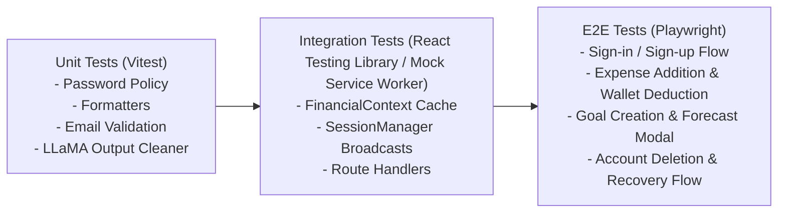

# QA_Report.md: Code Quality, Defect Backlog & Test Strategy

This document tracks identified bugs, architectural discrepancies, security vulnerabilities, technical debt, and test strategies across the **Buck Budget Tracker Web Application**. It is maintained by the Senior QA & Documentation Engineer role defined in [`Agents.md`](../Agents.md).

---

## 1. Executive QA Summary & Codebase Health

| Metric | Assessment | Notes |
|---|---|---|
| **Overall Code Health** | ⚠️ **Moderate (Action Required)** | Core frontend UI and Supabase database architecture are robust; significant discrepancies exist in AI microservice integration. |
| **Authentication & RLS** | 🟢 **Strong** | Strict PostgreSQL Row-Level Security, HMAC-SHA256 session activity cookies, 30m idle timeouts, and rate-limited reset flow. |
| **Frontend State & Motion** | 🟢 **Strong** | High-performance in-memory cache in `FinancialContext`, clean Framer Motion integration, smooth modal glow math. |
| **AI Microservice Integrity** | 🟠 **Improved (auth added, 2026-10-12)** | Now authenticated, rate limited and stateless (SEC-002). Still open: dead `processExpense` route (BUG-001) and web callers not yet sending `expenses` (BUG-003 follow-up). |
| **Automated Test Coverage** | 🟡 **Partial** | Vitest covers cash-flow, income data and security helpers (29 tests); FastAPI has 11 security tests. No E2E and no middleware tests. |

---

## 2. Defect & Discrepancy Backlog

### 🔴 Critical Severity

#### BUG-001: Dead Endpoint Invocation in `aiApi.ts`
- **Location**: [`buck/src/utils/aiApi.ts:17-28`](file:///d:/VS%20Code/Buck-Budget-Tracker/Buck-Web-Application/buck/src/utils/aiApi.ts#L17-L28)
- **Impact**: Any invocation of `processExpense()` fails with an HTTP 404 error.
- **Root Cause**: `aiApi.ts` targets `https://buck-web-application.onrender.com/process_expense/`. In the FastAPI backend ([`buck/BuckAI_Backend/main.py`](file:///d:/VS%20Code/Buck-Budget-Tracker/Buck-Web-Application/buck/BuckAI_Backend/main.py)), the route is named `/ai/categorize_expense/` or `/expenses/`. Route `/process_expense/` does not exist.
- **Remediation**: Align the API endpoint naming between `aiApi.ts` and `main.py`.

---

### 🔐 Backend Security Audit (2026-10-12)

Findings from the backend audit (middleware, `/api/*`, FastAPI). Status reflects code in this branch; none of it is deployed yet.

| ID | Severity | Finding | Status |
|---|---|---|---|
| **SEC-001** | 🔴 Critical | `/api/advisor` and `/api/forecast` trusted `body.userId` and queried with the service-role client (IDOR, RLS bypass; reachable unauthenticated). | **Resolved.** User id comes only from the SSR session via [`getSessionUserId`](file:///d:/VS%20Code/Buck-Budget-Tracker/Buck-Web-Application/buck/src/utils/apiAuth.ts); 401 otherwise; `periodType` whitelisted; `any` removed. |
| **SEC-002** | 🔴 Critical | FastAPI had no authentication, rate limiting or input limits; `GET /expenses/{user_id}/{goal_id}/` was an IDOR; unbounded `expenses_db`; paid LLM endpoints open to anyone. | **Resolved.** [`auth.py`](file:///d:/VS%20Code/Buck-Budget-Tracker/Buck-Web-Application/buck/BuckAI_Backend/auth.py) verifies the Supabase bearer token against `/auth/v1/user` (60 s hashed cache), per-user sliding-window limit (20/60 s, env-tunable), typed/bounded Pydantic models, forecast horizon cap, stateless `/expenses/` endpoints removed, CORS narrowed (no credentials), docs/OpenAPI disabled, generic 502/500 errors. **Deploy needs** `SUPABASE_URL` + `SUPABASE_ANON_KEY` on Render. |
| **SEC-003** | 🟠 High | Cron route ran open when `CRON_SECRET` was unset; sequential per-user loop; insert errors ignored. | **Resolved.** Fails closed via [`isBearerAuthorized`](file:///d:/VS%20Code/Buck-Budget-Tracker/Buck-Web-Application/buck/src/utils/secureCompare.ts) (constant-time); batches of 5 with `Promise.allSettled`; insert errors surfaced; `maxDuration = 300`; no error text in the response. **Cron secrets (2026-10-12):** `CRON_SECRET` and `ACCOUNT_PURGE_SECRET` were added in Vercel (production + preview, sensitive). `vercel.json` now also schedules `/api/account/deletion/purge` daily at 20:00 UTC (04:00 PHT); the route accepts `GET` (Vercel Cron, `CRON_SECRET`) and `POST` (manual, `CRON_SECRET` or `ACCOUNT_PURGE_SECRET`). Effective after the next deploy. Before this, expired accounts were never purged. **Accepted:** `fetchUserFinancialContext` still issues ~5 queries per user (5 users in parallel, so ~25 in flight). Fine at 8 users; batch the queries per user set before the user base grows. |
| **SEC-004** | 🟠 High | Idle timeout bypass: a missing `buck-session-activity` cookie (cleared / browser restart) counted as "not expired", so an old refresh token minted a fresh window. | **Resolved.** A missing cookie is accepted only while `last_sign_in_at` is inside the idle window. |
| **SEC-005** | 🟡 Medium | `/api/*` skipped idle enforcement. | **Resolved.** Session API routes return `401 session-expired` after the window (excluded: `/api/auth/*`, `/api/cron/*`, `/api/account/deletion/purge`). API calls validate but never extend the window. |
| **SEC-006** | 🟡 Medium | Purge set `purge_started_at` before `deleteUser`; a failed delete orphaned the request forever. Bearer compare was not constant-time. | **Resolved.** Claim is released on failure; constant-time compare; generic error text. |
| **SEC-007** | 🟡 Medium | Raw `error.message` returned to clients (`deletion/request`, `deletion/recover`, `purge`, `cron`, FastAPI `str(e)` with HTTP 200). | **Resolved.** Detail is logged server-side only. |
| **SEC-008** | 🟡 Medium | LLM prompts embedded raw user text; no PII scrubbing; `requests` calls had no timeout; `clean_llama_output` kept text *after* `<think>`. | **Resolved.** `sanitize_prompt_field` scrubs emails, PH mobile and 9+ digit numbers, flattens control chars/quotes, caps length; 20 s timeouts; `<think>` blocks removed properly. |
| **SEC-009** | 🟡 Medium | Password reset reveals whether an account exists (404 message); count-then-insert limiter is not atomic; reset link falls back to the request origin if `NEXT_PUBLIC_SITE_URL` is unset. | **Partly open.** Enumeration is a product decision. `NEXT_PUBLIC_SITE_URL` is set for production and preview (verified in Vercel 2026-10-12), so the reset link no longer depends on the request origin. |
| **SEC-010** | 🟢 Low | Middleware deep-imports `@supabase/ssr/dist/module/createServerClient`; `SESSION_IDLE_TIMEOUT_MINUTES=0` disabled the timeout. **Resolved.** Timeout `0` is ignored in production. The deep import was replaced with `from "@supabase/ssr"`; the middleware compiled cleanly under `next build` and the running dev server still redirected `/dashboard/home` to `/sign-in` (307). |
| **SEC-011** | 🟢 Low | `supabaseData.ts` `select("*")` calls and a refresh flood path. | **Resolved.** `getAdminFeedback` is capped at 500 rows (the other `select("*")` sites are `limit(1)` or insert-returning). `forceRefresh` reuses any advisory or forecast younger than 60 s. |

**Database advisors (2026-10-12, project `glnuzqmnmzuxgujmxigx`)**: security has only the accepted INFO-002 (leaked-password protection, free plan). Performance has 15 INFO `unused_index` notices, mostly foreign-key covering indexes on tables with a few thousand rows; keep them. RLS is enabled on all 11 public tables. (`list_tables` reported `public.categories` as 0 rows because it returns planner estimates; a `count(*)` shows 136 rows, so BUG-021's data is accurate.)

**Verification**: `npx tsc --noEmit` clean; `npm test` 29/29 (incl. `securityHelpers.test.ts`); `python -m unittest test_security` 11/11 in `BuckAI_Backend/` (auth, rate limit, input bounds, error leakage, PII scrub, `<think>` stripping). **Not verified:** live middleware behaviour in a browser, the FastAPI service against a real Supabase token, and `next build`.

**Breaking change for other clients**: every `/ai/*` call now needs `Authorization: Bearer <Supabase access token>`. The Flutter app must send it, and `/expenses/` is gone.

### 🔐 Full Re-Audit (2026-10-14)

Scope: server routes, middleware, auth callback, deletion flow, session/state code, live RLS policies, function grants, storage config, `npm audit`. Python files excluded (being redesigned); the uncommitted Ask Buck chat work was read but not edited.

| ID | Severity | Finding | Status |
|---|---|---|---|
| **SEC-012** | 🔴 Critical | `next@15.5.19` carried 11 advisories (unauthenticated RCE on Windows hosts and via AVIF image optimisation, SSRF, cache poisoning/confusion, Server Action DoS). | **Resolved.** Upgraded to `15.5.27`; also patched `nanoid`, `sharp`, `source-map-js`. |
| **SEC-013** | 🟠 High (functional) | Account-deletion confirmation e-mail link (`/auth/callback?next=/account/delete/confirm...`) was rejected by the callback allow-list and sent users to `/dashboard/home`, so deletion could never be confirmed. | **Resolved.** `/account/delete/confirm` added to the allow-list. Needs an end-to-end check with a real e-mail. |
| **SEC-014** | 🟡 Medium | No security headers (clickjacking, MIME sniffing, referrer leakage, HSTS). | **Resolved.** `next.config.ts` sets `frame-ancestors 'none'` CSP, `X-Frame-Options`, `nosniff`, `Referrer-Policy`, `Permissions-Policy`, HSTS; `poweredByHeader` off. **Resolved (follow-up):** `middleware.ts` now issues a per-request nonce CSP (`script-src 'self' 'nonce-…' 'strict-dynamic'`, no `unsafe-eval` in production; `connect-src` limited to Supabase + the AI host; `frame-ancestors 'none'`), built by `utils/csp.ts`; the root layout stamps the nonce on the theme script. Checked on a second dev server: headers present, all scripts nonced, no violations on `/sign-in` and `/forgot-password`. Not checked: logged-in pages, production build. The root layout is now dynamic. |
| **SEC-015** | 🟡 Medium | Admin feedback e-mails and infra logs were persisted to `sessionStorage` with the dashboard cache; stale financial data survived a server-forced idle logout. | **Resolved.** Admin keys are memory-only; the sign-in page clears the cached dashboard data. |
| **SEC-016** | 🟡 Medium | `ensure_income_wallet_owner()` regained EXECUTE for PUBLIC/anon/authenticated after `202610130002` re-created it. | **Resolved.** [`202610140001_revoke_trigger_fn_execute.sql`](file:///d:/VS%20Code/Buck-Budget-Tracker/Buck-Web-Application/buck/supabase/migrations/202610140001_revoke_trigger_fn_execute.sql) applied to live and recorded. |
| **OPT-001** | 🟠 High (correctness) | `listExpenses` was one unpaged query; PostgREST caps responses at 1,000 rows, so users with more expenses silently lost older rows from every page and total. | **Resolved.** Pages of 1,000 with a stable order. |
| **OPT-002** | 🟡 Medium | Every realtime row event triggered a full refetch on each page (a bulk insert meant one refetch per row). | **Resolved.** `subscribeUserTable` coalesces events (300 ms). |
| **OPT-003** | 🟡 Medium | 8-10 pages each call `listExpenses` and keep their own copy; the shared cache is only a start-up seed. | **Resolved.** `utils/dataCache.ts`: list reads (expenses, goals, wallets, categories, incomes) are cached 15 s and invalidated by any mutating REST/RPC request (via the Supabase client's fetch wrapper) or realtime event; concurrent callers share one request. `subscribeUserTable` now shares one realtime channel per table/user across pages. No page code changed. Unit-tested; not exercised in a signed-in browser session. |
| **SEC-017** | 🟢 Low | `.claude/settings.json` (pre-approves SQL on the live project) was untracked and could be committed. | **Resolved.** Git-ignored (root and `buck/`). |
| **SEC-020** | 🟡 Medium | Password reset revealed whether an account existed (404 "No Buck account…", and a distinct error only real accounts could hit). | **Resolved.** Unknown and known addresses both get the same 200 and message; provider errors are logged, not surfaced. Rate limits (429) apply before the lookup to every address. Residual: response time differs slightly (the real path calls the mailer). |
| **SEC-018** | 🟢 Low | `profiles` UPDATE policy allows editing `email`; password-reset lookup trusts `profiles.email`. Impact is limited to account-existence probing. | **Resolved.** [`202610140002_pin_profile_email.sql`](file:///d:/VS%20Code/Buck-Budget-Tracker/Buck-Web-Application/buck/supabase/migrations/202610140002_pin_profile_email.sql): a `BEFORE UPDATE OF email` trigger keeps the old value whenever `auth.uid()` is set (end-user writes); the auth-sync trigger and service role are unaffected. Applied to live. Not exercised with a real e-mail change. |
| **SEC-019** | 🟢 Low | `npm audit` items in `postcss`, `styled-components` and the test tooling (`vitest`/`vite`/`esbuild`/`tinypool`), plus `moment`. | **Resolved.** `npm audit` reports 0 vulnerabilities. Removed unused `styled-components`; `overrides` pins `postcss ^8.5.30`; `vitest 5` + `vite 8` + `@types/node 22`; `npm audit fix` for `moment`. |

**Verified**: `tsc --noEmit` clean; `npm test` 39/39. **Not verified**: `next build` (a build would clobber the running dev server's `.next`), the deletion e-mail round trip, headers in a browser.

### 🔐 Database + Backend Audit (2026-10-16)

Scope: live Supabase (RLS, grants, functions, constraints, storage, advisors), `Buck_AI/`, new web routes. Migration [`202610160001`](file:///d:/VS%20Code/Buck-Budget-Tracker/Buck-Web-Application/buck/supabase/migrations/202610160001_privileges_feedback_retention_ai_limits.sql) applied to live and recorded in history.

| ID | Severity | Finding | Status |
|---|---|---|---|
| **SEC-021** | 🟡 Medium | `Buck_AI` rate limiter was in memory per serverless instance, so one user could spread requests over instances and drain the shared Gemini free quota. | **Resolved.** `ai_rate_limit_take()` (user-scoped, advisory-locked sliding window in `ai_usage_events`, insert/select-only RLS so events cannot be deleted) is called from `shared/rate_limit.py`; the local window runs first and is the fallback if the RPC fails. Live-tested: 2 calls allowed, 3rd blocked with a wait. 3 new Python tests. |
| **SEC-022** | 🟡 Medium | `anon` held full DML/TRUNCATE on 10 public tables; `authenticated` held TRUNCATE/REFERENCES/TRIGGER. RLS was the only barrier. | **Resolved.** All `anon` table privileges revoked (also from default privileges); `authenticated` keeps SELECT/INSERT/UPDATE/DELETE only. Verified: anon 0 privileges. |
| **SEC-023** | 🟢 Low | `feedback` had no length limits and `user_email` was client-supplied (forgeable sender in admin triage). | **Resolved.** CHECK limits (title 200, details 5000, e-mail 254); insert policy requires `user_email` = the caller's JWT e-mail. |
| **SEC-024** | 🟢 Low | No retention: `auth_security_events`, expired `ai_forecasts`, unbounded `ai_advisories`. | **Resolved.** `purge_expired_data()` (service_role only; 30 d events, 1 d usage, 30 d past forecast expiry, newest 50 advisories per user) runs from the daily `/api/account/deletion/purge` cron. First run removed 27 old security events. |
| **SEC-025** | 🟢 Low | `Buck_AI` `GET /` disclosed whether `GEMINI_API_KEY` was set and the model name. | **Resolved.** Returns `{service, ok}` only. |
| **SEC-026** | 🟢 Low | Raw database error text was returned to Gemini (and could reach users) from failed tools. | **Resolved.** Generic tool error; detail only in the log. |
| **SEC-027** | 🟢 Low | `npm audit`: 5 high in the dev-only `eslint-config-next` chain (`braces`/`micromatch`/`fast-glob`); the fix is a downgrade. Python deps not audited (no `pip-audit`). | **Accepted / open.** Add `pip-audit` to CI. Token-verification cache lets a revoked token live up to 60 s (accepted). |

**Verified**: `tsc` clean, `eslint` clean, vitest 44/44, Buck_AI unittest 23/23, live DB checks above. **Not verified**: the shared limiter against a deployed `Buck_AI`, the feedback insert from the signed-in UI after the new e-mail policy, `next build`.

### 📦 Dependency Advisory: Next.js 15.5.27 (2026-10-24)

| ID | Severity | Finding | Status |
|---|---|---|---|
| **SEC-037** | 🔴 Critical | `npm audit --omit=dev` flagged the installed `next@15.5.27`: GHSA-2464-fhr4-w9xw (unauthenticated RCE in the Image Optimization API when SVGs are used) and GHSA-p3m5-59mp-jv5r (DoS in the App Router via Server Actions). | **Resolved.** `next` and `eslint-config-next` bumped to `^15.5.28` (latest 15.x); the lockfile changes only the Next packages. Exposure was lower than the rating: `next.config.ts` has no `images` block, so `dangerouslyAllowSVG` is at its default `false`. |

**Verified**: `npm audit --omit=dev` and full `npm audit` both report 0 vulnerabilities; `eslint`, `tsc` clean; vitest 72/72; `next build` clean. **Not verified**: a deployed preview.

### 📦 Dependency Security Sweep (2026-10-25)

| ID | Severity | Finding | Status |
|---|---|---|---|
| **SEC-038** | 🟠 High | `npm audit` (buck/): `zod@4.6.5` (GHSA-mrhx-c7xc-m3w5, memory exhaustion when validating oversized constrained collections). Python: the previous local venv resolved `certifi 2026.7.22` (PYSEC-2026-4320, fixed in 2026.10.19), a transitive dependency of `httpx`/`requests`. | **Resolved.** `zod` pinned to `4.6.7`; Python requirement floors raised so a fresh install can no longer resolve the old versions (`certifi` is now 2026.10.23 on a clean install). |
| **SEC-039** | ℹ️ Info | `postcss` override still needed: `next@15.5.28` depends on `postcss@8.4.31` (below the patched 8.5.x). | **Kept.** `overrides.postcss ^8.5.30` stays until a Next release moves off 8.4.31. |
| **SEC-040** | ℹ️ Info | Majors not taken: `next` 16.4.3 (15.5.28 is the newest 15.x), `eslint` 10, `eslint-config-next` 16, `typescript` 7, `framer-motion` 14, `@types/node` 26 (runtime is Node 22). None carries an open advisory. | **Deferred.** Next 16 needs its own change (middleware/proxy rename, CSP nonce re-test). |

**Before / after**

| Check | Before | After |
|---|---|---|
| `npm audit` (buck/) | 1 high (zod) | 0 |
| `npm audit` (root) | 0 | 0 |
| `pip-audit` (Buck_AI deps, old venv set) | 1 (certifi, transitive) | 0 |
| `pip-audit` (tooling) | pip 25.1.1: 12 advisories (dev tooling only, not shipped) | 0 after `pip` 26.2.2 |

**Bumped (buck/)**: `zod` 4.6.5 -> 4.6.7, `@modelcontextprotocol/server` 2.3.1 -> 2.4.0, `@supabase/supabase-js` 2.108.1 -> 2.118.0, `@supabase/ssr` 0.12.0 -> 0.12.7, `react`/`react-dom` 19.1.0 -> 19.3.1, `chart.js` 4.5.0 -> 4.6.1, `react-chartjs-2` 5.3.0 -> 5.3.1, `framer-motion` 12.18.1 -> 12.43.0, `react-icons` 5.5.0 -> 5.7.0, `typescript` 5.8.3 -> 5.9.3, `vite` 8.3.4 -> 8.3.5, `vitest` 5.0.4 -> 5.0.5, `@types/react(-dom)` -> 19.3.0. Added `engines.node = 22.x` to match the Vercel project. **Bumped (Buck_AI)**: floors `fastapi>=0.162`, `google-genai>=2.33`, `httpx>=0.28.1`, `pydantic>=2.14.1`, `python-dotenv>=1.2.4` (installed: fastapi 0.162.0, starlette 1.10.0, anyio 4.15.1).

**Platform review (read-only, nothing changed)**
- **PHP**: none. No `composer.json` or `*.php` file exists; the only "PHP" hits are the peso currency code.
- **Vercel** (`buck-web-application`): framework `nextjs`, Node `22.x` (auto-patched by Vercel), latest deployment READY, SSO protection on. Local dev Node is 22.16.0 while 22.23.4 is current; upgrade the workstation.
- **Supabase** (`glnuzqmnmzuxgujmxigx`): Postgres 17.6.1.155 on the GA channel, `ACTIVE_HEALTHY`; installed extensions (`pgcrypto`, `uuid-ossp`, `pg_stat_statements`, `supabase_vault`, `plpgsql`) are all at the offered default versions. Security advisor: **1 WARN, leaked password protection disabled** (dashboard toggle under Auth, needs the Pro plan; not changed here). Performance advisor: 14 INFO unused indexes (no action; the data set is small).

**Verified**: `npm audit` 0, `tsc` clean, `eslint` clean, vitest 114/114, `next build` clean (middleware 97.1 kB), Buck_AI unittest 49/49. **Not verified**: a deployed preview; the signed-in UI and CSP nonce flow in a browser.

### 🔐 Two-Factor Authentication Backend (2026-10-24, ADR-048)

Migrations [`202610240002_mfa_support.sql`](file:///d:/VS%20Code/Buck-Budget-Tracker/Buck-Web-Application/buck/supabase/migrations/202610240002_mfa_support.sql) and [`202610240003_mfa_enforce_rls.sql`](file:///d:/VS%20Code/Buck-Budget-Tracker/Buck-Web-Application/buck/supabase/migrations/202610240003_mfa_enforce_rls.sql) applied live and recorded in history. History drift fixed: `protect_fallback_categories` was stamped `20261023174201`, now `202610240001` like its file.

| ID | Severity | Finding | Status |
|---|---|---|---|
| **SEC-028** | 🟠 High | Passkeys must not count as a second factor. Passkey sign-in is aal1, and if Supabase lets an aal1 session register a passkey, a password-only attacker could add one and skip TOTP. | **Mitigated by design.** The 2FA rule accepts only aal2 (or no verified factor). Re-check when Supabase passkeys leave experimental: if registration then requires aal2, passkey sign-in could be allowed to satisfy 2FA. |
| **SEC-029** | 🟡 Medium | Supabase's MFA Verification Attempt hook is Teams/Enterprise only, so TOTP brute force is throttled only by the project's token-verification rate limit. | **Accepted.** Keep Auth › Rate limits › token verifications at the default (≤ 30 / 5 min / IP). Our own routes (backup codes, email recovery) have their own limits in `auth_security_events`. |
| **SEC-030** | 🟡 Medium | Email recovery would make 2FA only as strong as the inbox. | **Mitigated.** 24 h cool-off after confirmation (production floor), cancel from an aal2 session, pending state shown by `/api/auth/mfa/status`, 3 e-mails per day. |
| **SEC-031** | 🟢 Low | Generating backup codes twice at the same time deletes then inserts in two requests, so both sets could stay valid. | **Accepted.** Same user, both sets are shown to them; regenerate once more to clear. |
| **INFO-006** | — | 2FA UI. Web is built on `feat/2fa-ui` (2026-10-26): Settings › Security two-factor and passkey sections, `/verify-2fa`, the passkey button on `/sign-in`, the deletion step-up and a global `mfa_required` redirect. Flutter verify screen still to do. Web and mobile must release the verify screen together, or a user who enrolls on web gets empty data in an old mobile build. | **Web: ready for production test** (the user runs steps a–e after deploy). **Mobile: open.** Contract in Design.md ADR-048. |

**Verified**: `tsc`, `eslint`, `next build` clean; vitest 70/70 (new: `utils/mfa/mfa.test.ts`, backup-code redeem route, 2FA cases in `apiAuth.test.ts`); Buck_AI unittest 48/48 (new `tests/test_auth.py`); live SQL in rolled-back transactions: `mfa_satisfied()` true/false/true for no-factor aal1 / factor aal1 / factor aal2, and a 2FA user at aal1 reads 0 expenses, wallets and profiles while aal2 reads all 240/4/1; signed-out probes of every new route (401/403/redirect to sign-in). **Not verified**: a real TOTP enroll and sign-in, the e-mail recovery round trip, passkey sign-in and its `amr` value (needs the UI and Supabase dashboard passkey setup).

### 🔐 Two-Factor Web UI (2026-10-26, ADR-048)

Branch `feat/2fa-ui`. No API, middleware or migration changes. New files: `component/mfa/*`, `app/verify-2fa/*`, `utils/mfa/client.ts` (+ test). Changed: Settings page and CSS, `/sign-in`, `DashboardClientLayout`.

**Verified**:
- vitest 191/191 (11 new in `utils/mfa/client.test.ts`: redirect safety, backup-code normalising, TOTP input, status parsing, `mfa_required` detection). `tsc`, `eslint` (0/0) and `next build` clean.
- Dev server, signed out: `/sign-in` shows "Sign in with a passkey" (45 px tall, full width at 375 px, no sideways scroll), the e-mail field has `autocomplete="username webauthn"`, and `?reason=mfa-recovery-sign-in-required` shows its notice. `/verify-2fa` signed out goes to `/sign-in`. No console errors.
- Buck_AI already sends `Access-Control-Expose-Headers: X-Buck-Error` (`Buck_AI/main.py`), so the browser can read `mfa_required` from it. No backend gap found.

**Not verified** (needs a signed-in account; covered by the user's production test a–e, INFO-006):
- Turn on 2FA from Settings, scan the QR, save the backup codes.
- Sign out and in: password, then `/verify-2fa`, then back to the page asked for.
- A backup code on `/verify-2fa` turns 2FA off and offers to set it up again.
- Account deletion asks for a fresh code after 10 minutes.
- Passkey add, rename, delete and sign-in (needs Passkeys on in the Supabase dashboard with the production RP ID).

### 🤖 Buck MCP Server (2026-10-24, ADR-050)

Migration [`202610240005_mcp_access_check.sql`](file:///d:/VS%20Code/Buck-Budget-Tracker/Buck-Web-Application/buck/supabase/migrations/202610240005_mcp_access_check.sql) applied live and recorded.

| ID | Severity | Finding | Status |
|---|---|---|---|
| **SEC-035** | 🟡 Medium | Supabase OAuth tokens carry `aud: authenticated`, not the MCP resource (no RFC 8707), so tokens are not audience-bound to `/api/mcp`. | **Accepted.** Only connected-app tokens are accepted, and all of them are read-only under RLS. |
| **SEC-036** | 🟢 Low | No MCP-specific rate limit; every call does one Supabase Auth check plus its queries. | **Open.** Row caps per tool (100 listed, 10,000 summarized, 2-year range) limit the cost. Add a per-user limit if usage grows. |
| **INFO-008** | — | 2025-era MCP clients get their reply as a short SSE event (stateless fallback); 2026-07-28 clients get JSON. | **By design** (SDK behaviour). |

**Verified**:
- vitest 114/114 (new: 7 protocol tests through the route covering initialize, the read-only tools list, overview totals, merged transactions with escaped search, bad periods, the 2FA reconnect message, and no write calls; plus 7 verifier and Manila-date tests). `tsc` and `eslint` clean.
- Local probes:
  - The metadata document is served at both paths (other paths 404).
  - `/api/mcp` answers 401 + `resource_metadata` for no token, for a Buck session token, and for a forged app token.
  - CORS preflight returns 204.
- Live SQL (rolled back): with app-token claims the user reads every column the tools use (profiles 1, wallets 4, categories 25, expenses 240, incomes 11, goals 2, advice 2), sees 0 rows of other users, and a write changes 0 rows. `current_session_can_read()` returns false for a 2FA user's app without a verified grant and is not executable by `anon`.

**Not verified**: a real MCP client end to end, which needs the dashboard OAuth switch and the consent UI.

### 🖼️ Connected-App Logo Proxy (2026-10-25, ADR-051)

Resolves INFO-009. No migration.

**Verified**:
- vitest 180/180, with 66 new tests (2 of them for the `appLogoPath` and `toAppLogoSrc` helpers):
  - Route (16): bearer 400, signed out 401, no 2FA 401, invalid client id 400, a `url=` in the query never fetched, unknown app 404, no logo 404, and an uncached 404 for each refusal reason.
  - Fetcher (48): private, loopback, link-local, CGNAT and IPv4-in-IPv6 addresses; http, `data:`, `file:`, credentials and non-443 ports; DNS answers with any private address; redirects to http or a private IP; too many redirects; non-200 responses; declared and streamed bodies over 256 KB; SVG and HTML; timeout; and `https://localhost` refused by the real transport.
- `tsc` and `eslint` clean.
- Live probe from the dev machine: a real GitHub PNG was served as `image/png`, and a Wikimedia SVG and an ICO were refused.

**Not verified**: the route behind real middleware and Vercel with a registered app (the OAuth Server is still off, INFO-007). The UI swap shipped the same day; see the frontend entry below for what was checked in the browser.

### 🖼️ Connected-App Logos in the UI (2026-10-25, ADR-051)

The consent page (`AppLogo`) and Settings › Connected apps (`ConnectedAppLogo`) now take their `src` from `toAppLogoSrc(logoUrl)`, so only Buck's proxy path for a uuid is ever loaded. `toSafeHttpUrl` still guards the website links. A `404` from the proxy swaps to the initial in the same 56 px / 40 px box (ADR-012). No API, middleware or migration changes.

**Verified**: vitest 180/180, `tsc` and `eslint` clean. The dev server's `/api/oauth/app-logo` returns `401` signed out, with or without a `url=` parameter. The live project has 1 registered OAuth client and it has no `logo_uri`. Signed in on the dev server, Settings › Security › Connected apps shows that app ("Buck QA INFO-007") with its initial in a 40×40 box. The page made no logo request and contacted only `localhost:3000` and Supabase. Signed in, the proxy returns an uncached `404` for that app and for an unknown uuid, and `400` for a bad id or a `url=` parameter.

Real logo, end to end:
- I registered a throwaway test app, "Buck QA ADR-051", through dynamic registration, with a public GitHub PNG (96×96, 2,397 bytes) as `logo_uri`, and started a PKCE authorization.
- On `/oauth/consent`, the logo is an `` with `src=/api/oauth/app-logo?client_id=…`, loaded as `200` with the same 2,397 bytes, in the 56×56 box. The page made no request to GitHub and contacted only `localhost:3000`. The Buck look-alike warning also showed.
- After Allow, Settings › Connected apps showed the same proxied `` in the 40×40 box, again with no GitHub request.
- I then disconnected the app through the three-step dialog and deleted the test client (admin API, `204`).
- Supabase sends `/oauth/authorize` to the Site URL (`bucktbt.vercel.app/oauth/consent`). To test locally, open the same `authorization_id` on `localhost:3000`.

**Not verified**: the `onError` fallback with a real proxy `404` for an app whose logo fails (for example an SVG). The initial path itself showed for the no-logo app.

### 🔗 Connected Apps / OAuth 2.1 Server Backend (2026-10-24, ADR-049)

Migration [`202610240004_oauth_apps.sql`](file:///d:/VS%20Code/Buck-Budget-Tracker/Buck-Web-Application/buck/supabase/migrations/202610240004_oauth_apps.sql) applied live and recorded.

| ID | Severity | Finding | Status |
|---|---|---|---|
| **SEC-032** | 🟠 High | Supabase gives OAuth app tokens the user's full data access, including writes. | **Mitigated.** Restrictive insert/update/delete policies reject tokens with `client_id`; Buck routes (`getRequestAuth`) and Buck_AI refuse them. |
| **SEC-033** | 🟠 High | Supabase's consent endpoint accepts aal1, so a password-only attacker could connect an app to a 2FA account. Consents are one row per user and app, so a re-approval reuses the row. | **Mitigated.** Approval via Buck's route records the active consent with `mfa_verified`; `mfa_satisfied()` requires it for app tokens of 2FA users; trigger `buck_forget_oauth_app_grant` drops the record on any change to the consent row. |
| **SEC-034** | 🟡 Medium | Dynamic client registration (needed by MCP clients) lets anyone register an app under any name: phishing risk on the consent screen. | **Partly mitigated.** Apps are read-only; the details route returns `registration: "dynamic"` and `redirectHost` for an "unreviewed app" warning. Keep dynamic registration off unless MCP is in use. The consent page shows the amber warning for unreviewed apps and a coral "isn't made by Buck" warning when one calls itself Buck, and always shows the redirect host. |
| **INFO-007** | — | OAuth Server is still off in the dashboard. | **Mostly verified 2026-10-26; stays open for 2FA.** The dashboard is set (asymmetric JWT keys with the legacy secret kept, Site URL `https://bucktbt.vercel.app`, OAuth Server on with `/oauth/consent`, dynamic registration on). Discovery, consent, the 7 tools, read-only writes, token refusal and disconnect were tested end to end on production (see "Connected Apps End to End on Production" below). Still open: the real 2FA approval and reconnect flow, which needs the 2FA UI (INFO-006); handed to Buck | Frontend 2026-10-26 with the test steps. That test also found SEC-041 (resolved and applied live 2026-10-26) and SEC-042 (open). |
| **INFO-009** | — | The CSP `img-src` allows only self, `data:`, `blob:` and Supabase, so third-party app logos (`logo_uri`) are blocked on the consent page and in Settings. | **Resolved 2026-10-25 (ADR-051).** `img-src` is unchanged (adding `https:` would let any self-registered app track users by IP). Logos now come from the same-origin proxy `GET /api/oauth/app-logo?client_id=<uuid>`: URL looked up server-side by client id, https and public IPs only (checked at connect time), PNG/JPEG/WebP/GIF sniffed from bytes (no SVG), 256 KB, 5 s, `nosniff`, private 1-day cache, signed-in 2FA web session only. `logoUrl` in both APIs now points at the proxy. **UI follow-up: done 2026-10-25.** The consent page and Settings › Connected apps render the logo through `toAppLogoSrc` (only the exact proxy path), keep `toSafeHttpUrl` for website links, and show the initial on a `404` in the same box. |

**Verified**: live SQL in rolled-back transactions. For a user without 2FA, an app token reads 240 expenses while insert, update and `transfer_funds_atomic` are blocked. For a 2FA user the app reads 0 without a grant, 0 with an unverified grant, 240 with a verified grant (still read-only), 0 for another app, and 0 again after the consent row is revoked and re-approved outside Buck. Normal sessions are unchanged. `record_oauth_app_grant` refuses when there is no consent and cannot be called by `authenticated`. vitest 81/81 (consent route, connected-app bearer refusal), Buck_AI unittest 49/49, `tsc` and `eslint` clean. Signed-out probes: the consent page redirects to sign-in keeping `authorization_id`, the APIs return 401, a bad id returns 400. **Not verified**: a real end-to-end OAuth flow (needs the dashboard switch and the consent UI). Done on production 2026-10-25/26, see below.

### 🔗 Connected Apps End to End on Production (2026-10-25/26, INFO-007)

Run against `https://bucktbt.vercel.app` (release #209) and `buck-web-ai.vercel.app`, Supabase `glnuzqmnmzuxgujmxigx`, after the dashboard steps in ADR-049. The client was a small script acting as an MCP client: discovery, dynamic registration, PKCE (S256) with `resource=https://bucktbt.vercel.app/api/mcp`, a `localhost:8765` redirect, the code exchange, then JSON-RPC calls to `/api/mcp`. It registered as "Buck QA INFO-007" (`cbb08fbb-1ce0-4997-8247-982714f54ad8`). Account: Buck Admin, 2FA off.

| ID | Severity | Finding | Status |
|---|---|---|---|
| **SEC-041** | 🟠 High | After **Disconnect**, the app's last access token still read data through the Supabase REST API (`GET /rest/v1/wallets` → `200` with rows) until it expired (1 hour). PostgREST only checks the JWT signature and expiry. Buck's MCP server was not affected: it asks Supabase Auth, which answered `session_not_found`, so `/api/mcp` returned `401`. Refresh also failed (`refresh_token_not_found`). | **Resolved 2026-10-26.** [`202610250001_connected_app_live_session.sql`](file:///d:/VS%20Code/Buck-Budget-Tracker/Buck-Web-Application/buck/supabase/migrations/202610250001_connected_app_live_session.sql) adds `private.app_session_live()`: true for non-app callers, and for an app token only while `auth.sessions` still has its `session_id` for the same user and `oauth_client_id`. It is added as a RESTRICTIVE policy on the same 11 tables and on the avatar bucket as the 2FA policy. It was applied live with the owner's go-ahead and recorded as version `202610250001`. Recheck on production: a connected app read 6 wallets, 160 expenses, 2 goals and 1 profile through REST, and the MCP tools worked. After Disconnect, the same token, with 58 minutes left before it expired, read 0 rows from all four tables; `/api/mcp` returned `401` and refresh failed. Buck Admin's own web session still loads its wallets. The security advisor shows nothing new (only INFO-002). |
| **SEC-042** | 🟠 High | Supabase Auth accepts a connected app's token on its own account endpoints: `PUT /auth/v1/user` with `{"data":{}}` returned `200`. Supabase documents that OAuth scopes only shape OIDC claims and do not limit API access, and RLS cannot reach Auth. So an app can change `user_metadata`, which the `on_auth_user_updated` trigger copies into `profiles.username`, bypassing the read-only profile policy. Admin rights are not reachable this way: they come only from `app_metadata.role` or `ADMIN_EMAIL`. | **Open (platform).** Not verified: whether an app token can also change the password or enroll a 2FA factor. A non-destructive probe for both (a 1-character password, and an unverified factor removed at once) was blocked in this session and needs the owner's go-ahead. Mitigations: (1) **Secure email change** is on, and the owner turned on **Secure password change** (reauthentication) on 2026-10-26; (2) the consent page copy says apps can't change "anything", so it should say "your Buck data" (Frontend handoff [`SEC-042_Frontend_Consent_Copy_Prompt.md`](handoffs/SEC-042_Frontend_Consent_Copy_Prompt.md), sent to Buck | Frontend 2026-10-26); (3) raise it with Supabase (no way to limit app tokens on `/auth/v1/*`). |
| **SEC-043** | 🟡 Medium | Open redirect after 2FA: `getSafeMfaRedirect` (`utils/mfa/client.ts`) judged the raw input but returned the URL-normalised path. `/verify-2fa?redirectTo=/.//evil.example` collapsed to `//evil.example`, which `window.location.replace` treats as another host, so a crafted link could send a user to an attacker site right after they verified 2FA. | **Resolved in code (found in the dev→main review 2026-10-27).** The normalised result must start with a single `/` (not `//`, not `/\`), otherwise the default is used. Tests added for `/.//`, `/a/..//`, `/./\` and `/dashboard/..//`; `npm test` 192/192. The sign-in page's `getSafeRedirectPath` already requires a `/dashboard` or consent prefix, so it was not affected. |

**Verified**:
- **Release gate**: before the switches, production served the new routes and Buck_AI answered a forged app token with `403` and `X-Buck-Error: connected_app` (it gave `401` before #209).
- **a. Discovery**: `/api/mcp` without a token returns `401` with `WWW-Authenticate: … resource_metadata="https://bucktbt.vercel.app/.well-known/oauth-protected-resource/api/mcp"`. That document names the resource and `…supabase.co/auth/v1`. Supabase's metadata lists a registration endpoint and S256. Dynamic registration returned `201`.
- **b. Consent**: signed out, the authorize URL lands on `/sign-in?redirectTo=…`, then on `/oauth/consent`. That page shows the app name, the coral "isn't made by Buck" warning, the three scopes, the read-only note and "You'll be sent back to an app running on this computer". **Deny** sent `error=access_denied&error_description=User+denied+the+request` with the right `state`. **Allow** sent a `code` with the right `state`, and the exchange returned `200` (claims: `client_id`, `aal1`, `role: authenticated`, `scope: openid email profile`, with a refresh token). A link opened about an hour earlier was already expired: the page showed "Start again from the app", which is correct.
- **c. Tools**: `initialize` and `tools/list` list 7 tools, all with `readOnlyHint: true`. All 7 (`get_overview`, `list_wallets`, `list_categories`, `list_transactions`, `spending_summary`, `list_goals`, `get_saved_advice`) returned data matching the user's own rows in SQL: 4 active wallets (2 archived left out), 2 goals, 12 October expenses totalling ₱11,216.32. None of the other 8 users' data appeared. Calling an unknown `add_expense` gave `-32602 Tool add_expense not found`. The server answers 2025-06-18 clients with SSE (INFO-008).
- **c. Writes** with the app token:
  - REST insert into `expenses` returned `403` (`expenses: apps read-only (insert)`), and a profile update changed 0 rows.
  - In SQL (rolled back), deletes from `expenses`, `wallets` and `goals` and an update of `wallets` all changed 0 rows; the same user's own session updated 6.
  - An avatar insert into `storage.objects` was refused (`Avatar files: apps read-only (insert)`).
  - Every RPC callable by `authenticated` is `SECURITY INVOKER`, so the same policies apply.
  - Exception: SEC-042.
- **d. Refusal**: with the real app token, `GET /api/auth/mfa/status`, `POST /api/forecast` and `POST /api/auth/mfa/recovery-codes/redeem` returned `401`. Buck_AI `GET /advisor/insight`, `GET /advisor/history` and `POST /advisor/chat` returned `403` with `X-Buck-Error: connected_app` ("Connected apps can't use Buck AI.").
- **e. Disconnect**: Settings › Security › Connected apps listed the app with its scopes. The three-step dialog (slide, "I understand, continue", type the name) disconnected it with a toast. Right after, `/api/mcp` returned `401` ("This token has expired or the app was disconnected"), refresh failed, and Supabase Auth reported `session_not_found`. Exception: SEC-041.
- **f. 2FA (database only)**: on the real consent `34bfc5ac…` (recorded with `mfa_verified = false`), with a verified TOTP factor added inside a rolled-back transaction:
  - `current_session_can_read()` for the app is true before 2FA and false after, and the app sees 0 wallets. That false result is what makes the MCP tools return the reconnect message.
  - It is true again once the grant is marked 2FA-verified.
  - A normal session needs aal2.

**Not verified**:
- The real 2FA flow (step f), because production has no way to turn 2FA on: Settings › Security has no 2FA section, there is no `/verify-2fa` page, and `auth.mfa_factors` is empty (INFO-006). For a 2FA user, the consent route would send them to `/verify-2fa`, which doesn't exist yet. Run step f once the 2FA UI ships.
- MCP Inspector or a Claude custom connector, which would also show the client side of discovery.

**Test data**: none left. After the SEC-041 recheck the "Buck QA INFO-007" app was disconnected (0 consents, sessions and grants remain) and the client was deleted (`auth.oauth_clients.deleted_at` set, the same as the admin API's delete). Its authorize URL now returns `400 oauth_client_not_found`. Buck Admin has no 2FA factor; the 2FA setup in Settings didn't exist to run (INFO-006).

### 🟠 High Severity

#### BUG-002: [RESOLVED 2026-10-12] Inconsistent Backend Host Domains Across Frontend Modules
- **Location**: [`buck/src/utils/aiApi.ts:17,20`](file:///d:/VS%20Code/Buck-Budget-Tracker/Buck-Web-Application/buck/src/utils/aiApi.ts#L17) vs [`buck/src/app/dashboard/goals/page.tsx:524`](file:///d:/VS%20Code/Buck-Budget-Tracker/Buck-Web-Application/buck/src/app/dashboard/goals/page.tsx#L524)
- **Impact**: AI forecast and AI saving tip requests are routed to different Render deployment instances (`buck-web-application` vs `buck-web-application-1`).
- **Root Cause**: Hardcoded URLs in source files instead of utilizing a unified `NEXT_PUBLIC_AI_BACKEND_URL` environment variable.
- **Remediation**: Create a centralized environment configuration `process.env.NEXT_PUBLIC_AI_BACKEND_URL` and reference it everywhere.
- **Resolution**: every browser call now goes through [`buck/src/utils/aiBackend.ts`](file:///d:/VS%20Code/Buck-Budget-Tracker/Buck-Web-Application/buck/src/utils/aiBackend.ts) (`AI_BACKEND_URL`, falls back to `buck-web-application-1`). Set `NEXT_PUBLIC_AI_BACKEND_URL` on Vercel to override.

#### BUG-003: [RESOLVED 2026-10-12] FastAPI In-Memory Storage Desynchronization & Data Loss
- **Location**: [`buck/BuckAI_Backend/main.py:19-20, 114-128`](file:///d:/VS%20Code/Buck-Budget-Tracker/Buck-Web-Application/buck/BuckAI_Backend/main.py#L19-L20)
- **Impact**: The AI forecast endpoint `/ai/forecast/` calculates historical spending trends from `expenses_db.get(key, [])`, which is always empty.
- **Root Cause**: Expenses are inserted directly into Supabase PostgreSQL from the Next.js frontend via [`supabaseData.ts`](file:///d:/VS%20Code/Buck-Budget-Tracker/Buck-Web-Application/buck/src/utils/supabaseData.ts). The FastAPI backend maintains an isolated in-memory Python dictionary `expenses_db: Dict[str, List[dict]] = {}` that is never populated and resets on every server spin-down.
- **Remediation**: Pass historical expense records directly in the `/ai/forecast/` request payload from the frontend or connect FastAPI directly to Supabase using a service client.
- **Resolution**: `expenses_db` and the `/expenses/` endpoints were removed (see SEC-002). `/ai/forecast/` now takes an optional `expenses: [{date, amount}]` list (max 2,000). **Follow-up:** web callers do not send `expenses` yet, so `spent` is still `0` until they do.

---

### 🟡 Medium Severity

#### BUG-004: [RESOLVED] Stubbed Next.js AI Route Handlers
- **Location**: [`buck/src/app/api/advisor/route.ts`](file:///d:/VS%20Code/Buck-Budget-Tracker/Buck-Web-Application/buck/src/app/api/advisor/route.ts) and [`buck/src/app/api/forecast/route.ts`](file:///d:/VS%20Code/Buck-Budget-Tracker/Buck-Web-Application/buck/src/app/api/forecast/route.ts)
- **Resolution**: Fully implemented cache-first route handlers connected to Supabase tables `ai_advisories` and `ai_forecasts`. Handlers execute context generation via [`aiInsightsGenerator.ts`](file:///d:/VS%20Code/Buck-Budget-Tracker/Buck-Web-Application/buck/src/utils/aiInsightsGenerator.ts), calculating burn rates, financial health scores, projected savings in PHP, and persistent database storage with user-level RLS. Vercel Cron endpoint [`/api/cron/generate-insights`](file:///d:/VS%20Code/Buck-Budget-Tracker/Buck-Web-Application/buck/src/app/api/cron/generate-insights/route.ts) provides automated weekly batch computation.

#### BUG-008: [RESOLVED] Home Category Breakdown Pie Card Overflow & Truncated Category Names
- **Location**: [`buck/src/app/dashboard/home/WeeklyPieChart.tsx`](file:///d:/VS%20Code/Buck-Budget-Tracker/Buck-Web-Application/buck/src/app/dashboard/home/WeeklyPieChart.tsx), [`buck/src/app/dashboard/home/style.css`](file:///d:/VS%20Code/Buck-Budget-Tracker/Buck-Web-Application/buck/src/app/dashboard/home/style.css)
- **Symptoms (measured at 1280px viewport, card content 410px)**:
  - The header needed 555px, so the "This Week" toggle was clipped.
  - The pie row needed 461px, so the canvas overflowed the card.
  - Fixed 70px chart padding left a ~160px pie, and callout names were ellipsized ("Tra…", "Vide…").
  - Legend pills cut long names.
- **Root Cause**: Fixed-width header, legend and chart padding sized for a wider card, plus viewport media queries applied to a card that occupies only ~47% of the content row.
- **Resolution**: Wrapping header, a card-width container query that stacks pie over legend at `<= 560px`, chart padding measured from the labels, 2-line wrapped callout and legend names, and % shown in legend pills. `HomeSkeleton` was updated for 1:1 parity. See ADR-032 in `Design.md`.
- **Verification**:
  - Checked in a temporary harness route (since removed) with worst-case data: Transportation, Entertainment, Electronics, Video Games, Others, and an "Others" child selection.
  - Viewports: 1920, 1680, 1440, 1280, 1024, 880 and 375px; dark and light theme.
  - Zero elements overflow the card, and there is no document horizontal scroll.
  - `tsc --noEmit` passes.

#### BUG-013: [RESOLVED] Expenses-by-day Bar Graph: Tiny Bars Hard to Click & Jitter on ₱0 Days
- **Location**: [`buck/src/app/dashboard/home/WeeklyBarChart.tsx`](file:///d:/VS%20Code/Buck-Budget-Tracker/Buck-Web-Application/buck/src/app/dashboard/home/WeeklyBarChart.tsx) (extracted from `home/page.tsx`), [`home/style.css`](file:///d:/VS%20Code/Buck-Budget-Tracker/Buck-Web-Application/buck/src/app/dashboard/home/style.css)
- **Symptoms**:
  - The click target was the visual bar itself (`min-height: 4px`), so low-spend days were almost impossible to click.
  - A 0.75rem gap between bars was a dead zone.
  - Clicking a ₱0 day (e.g. Thursday) made the page jitter.
  - When the card was taller than 250px, a large empty gap sat above the chart.
- **Root Cause (jitter)**:
  - The `useEffect` in `home/page.tsx` clears `selectedDay` when the day has no expenses.
  - Selecting a ₱0 day therefore rendered one filtered frame (badges, empty pie, layout shift), then reverted.
- **Resolution**:
  - **Full-column targets**: each day is now a full-height `<button class="graph-col">` that includes its day label, and the spacing moved into column padding (no dead zones).
  - **Minimum heights**: non-zero bars are at least 6px tall, and ₱0 days show a 3px stub.
  - **₱0 days**: these columns are `disabled`, so the select-then-revert jitter can't happen.
  - **Feedback**: hovering highlights the whole column, the selected day keeps its amount shown, and keyboard users get `:focus-visible` plus the tooltip.
  - **Fill and alignment**: the plot fills the card height, and y-axis ticks align with the grid lines (measured within 2px).
- **Verification**:
  - Harness with tiny Mon and ₱0 Thu: clicking Thu does nothing (`disabled`), and clicking Mon's label selects Mon.
  - Column hit area is 408px tall vs a 12px bar.
  - No overflow at 375px.

#### BUG-014: [RESOLVED] Skeleton Loading Layout Shift Across All Tabs
- **Root Causes**:
  1. A route's `loading.tsx` renders before `page.tsx` has loaded its stylesheet. Skeletons that used real page classes (`GoalsPage`, `settings-page`, `advisor-page`) therefore had no styles while loading.
  2. `component/dashboard.css` carried a legacy `.dashboard-skeleton …` override block with stale geometry. For example, `.dashboard-skeleton .dashboard-content` forced `0.8fr/1.7fr` columns and `.dashboard-skeleton .spending-card` forced a centered grid.
  3. The remaining skeleton geometry was hand-copied inline values that had drifted from the pages (paddings, grid tracks, breakpoints, control heights).
- **Resolution**:
  - **Shared classes**: every skeleton (Home, Expenses, Wallet, Goals, Statistics, Settings, Financial Advisor, Forecast, Admin) now imports its page stylesheet(s) and renders the page's own layout classes with shimmer placeholders.
  - **Exact text and controls**: static labels use a new `.skeleton-text` primitive (the real text, invisible over shimmer) for exact line boxes. Real disabled `CustomSelect`, `CustomDatePicker` and `<input>` controls keep toolbar and form geometry exact.
  - **Removed legacy CSS**: the `dashboard.css` override block and the unused `expenses-skeleton-*`, `wallet-skeleton-*` and `home-skeleton-*` rules are gone.
- **Verification**: Home skeleton vs real Home at 1440px gave identical sizes for the card, pie layout, legend, canvas box and graph container.

#### BUG-015: [RESOLVED] Forecast Page Missing `advisor-*` Styles on Direct Load
- **Location**: [`buck/src/app/dashboard/forecast/page.tsx`](file:///d:/VS%20Code/Buck-Budget-Tracker/Buck-Web-Application/buck/src/app/dashboard/forecast/page.tsx)
- **Root Cause**: the page renders `.advisor-grid`, `.advisor-card`, `.advisor-score` and `.advisor-icon`, which are defined only in `financial-advisor/style.css`, but never imported that file. The KPI row was unstyled unless the Advisor tab had been visited first.
- **Resolution**: `forecast/page.tsx` now imports `../financial-advisor/style.css`.

#### BUG-016: [RESOLVED] Page Stylesheets Overriding the Dashboard Shell
- **Location**: `goals/style.css`, `home/style.css`, `statistics/style.css`
- **Root Cause**:
  - Each file restyled the global `.dashboard` shell.
  - Statistics added `font-family: "Segoe UI"` and `overflow-y: auto`, and so did Goals for the font. Next.js keeps visited route CSS loaded, so after visiting those tabs every tab changed font and the shell (instead of `<main>`) became the scroll container.
  - Statistics' unscoped `.create-goal-button` also overrode the Goals modal button margin.
- **Resolution**:
  - Removed the three `.dashboard` rules; the shell is owned by `component/dashboard.css`.
  - Scoped the Statistics rules to `.empty-goals-popup .create-goal-button`.

#### BUG-017: [RESOLVED] Admin Toolbar `CustomSelect` Full-Width Rows & Double Chevron
- **Location**: [`buck/src/app/dashboard/admin/page.tsx`](file:///d:/VS%20Code/Buck-Budget-Tracker/Buck-Web-Application/buck/src/app/dashboard/admin/page.tsx), `admin/style.css` `.admin-filter-select`
- **Impact**:
  - `CustomSelect`'s container is `width: 100%`, so each filter wraps onto its own full-width row under the search box.
  - `.admin-filter-select` was written for a native `<select>` and adds right padding plus its own arrow next to `CustomSelect`'s chevron.
- **Resolution**:
  - `.admin-filter-select` is now sizing-only (`flex: 0 0 190px`). It lands on `CustomSelect`'s wrapper div, so the native-select border, padding and background-image arrow were removed, along with a dead `:focus` rule.
  - Below 560px the filters share a row (`flex: 1 1 140px`).
  - `.admin-search-input` gets `min-height: 42px` to match the select trigger.
  - `AdminSkeleton` uses the same classes, so it picks up the fix automatically.
- **Verification**:
  - 1440px: search box 453px plus two 190px filters on one row, all 43px tall, one chevron each.
  - 375px: search box full width, filters side by side underneath, no overflow.

#### BUG-018: [RESOLVED] Statistics Tab Layout Out of Proportion and Overloaded
- **Location**: [`buck/src/app/dashboard/statistics/page.tsx`](file:///d:/VS%20Code/Buck-Budget-Tracker/Buck-Web-Application/buck/src/app/dashboard/statistics/page.tsx), `statistics/style.css`
- **Impact**:
  - Everything sat in a centred 900px column built from inline styles. The chart row used fixed 36% / 62% widths at 340px height, while the chart cards inside had their own 340px / 400px minimum widths, so they overflowed or left gaps.
  - The category bar chart drew every category (17+) as a vertical bar with a 7-colour cycle.
  - A "Y Max" number input was exposed to users but its value was never used.
  - `excess-pie.tsx` and `spending-bar.tsx` fell back to hard-coded `testData.ts` figures, the page pushed a test-data `totalSaved` into `FinancialContext` (nothing reads it), and the budget fell back to an invented ₱35,000 when no wallet was set.
  - With no goals, all statistics were hidden behind a "create a goal" prompt, although only the AI forecast needs a goal.
  - The Add Expense dialog had no `justify-content` on its backdrop, so it sat at the left edge, and it silently did nothing when the user had no goals.
- **Resolution**: Rebuilt per ADR-034.
  - Cash-flow card, a period toolbar (segmented mode control plus previous/next stepper), then a 3-column card grid: Budget | Categories, Trend | Latest expenses, AI forecast.
  - Categories render as ranked horizontal bars (top 5 plus "Others").
  - The trend chart shows spending per bucket against a dashed limit line.
  - Test data, the Y Max input and the ₱35,000 fallback were removed. With no wallet budget the page says so and links to Wallet.
  - The Add Expense dialog moved to `AddExpenseModal.tsx`; it is centred, uses the modal bounds, and no longer requires a goal.
- **Verification**: Design-preview harness at 1440px and 390px; no horizontal overflow; `tsc --noEmit` clean.

#### BUG-019: [RESOLVED] Week Ranges Started on Sunday in UTC+8 (Statistics & Goals)
- **Location**: `statistics/page.tsx`, `goals/page.tsx` (range builders), now [`buck/src/utils/periods.ts`](file:///d:/VS%20Code/Buck-Budget-Tracker/Buck-Web-Application/buck/src/utils/periods.ts)
- **Impact**: Week and month ranges were keyed with `toISOString().slice(0, 10)`. In UTC+8 local midnight is the previous day in UTC, so every "Monday" week start became Sunday and month ends shifted by a day. The ranges and the expenses they filtered were off by one day.
- **Resolution**: Shared `utils/periods.ts` builds local `YYYY-MM-DD` keys (`toDayKey`, `storedDayKey`), Monday-based weeks and calendar months. Both tabs use it.

#### BUG-020: [RESOLVED] Goals Tab Cluttered Detail Panel & Misleading Forecast Progress
- **Location**: [`buck/src/app/dashboard/goals/page.tsx`](file:///d:/VS%20Code/Buck-Budget-Tracker/Buck-Web-Application/buck/src/app/dashboard/goals/page.tsx), `goals/style.css`, `ProgressBarCard.tsx`
- **Impact**:
  - The details panel stacked six bordered fact tiles that shifted on hover, then a progress card, then buttons, then an inline-styled expense list. "- Delete Goal" sat in the goal list, away from the goal it deleted.
  - The forecast dialog was inline-styled with `minWidth: 400`, which overflowed phones. Its "Goal progress" bar showed the **wallet balance** as saved money instead of `currentAmount`.
  - The progress card printed "Goal Progress" twice.
- **Resolution**: Rebuilt per ADR-034.
  - Goal list items show name, status pill, mini progress bar, saved/target and due date.
  - The detail header holds the name, status, "Set as active" and Delete.
  - Progress card beside four facts: target date, time left, save per day, attitude.
  - Then the AI recommendation, actions, and the 5 latest linked expenses.
  - The forecast dialog uses classes and the CLAUDE.md modal bounds, and its progress bar uses `currentAmount`.
- **Verification**: Design-preview harness at 1440px and 390px; no horizontal overflow.

#### INFO-005: Pre-existing Hydration Warning on Hard Reload with Warm Cache
- **Location**: [`buck/src/context/FinancialProvider.tsx`](file:///d:/VS%20Code/Buck-Budget-Tracker/Buck-Web-Application/buck/src/context/FinancialProvider.tsx)
- **Observation**: The provider reads `sessionStorage` during its first render. On a hard reload with a warm cache the server renders the skeleton but the client renders the loaded page, so React logs a hydration mismatch (seen on Statistics while testing BUG-018). This is not caused by the redesign. Fix: hydrate the cache in an effect after mount.

#### BUG-022: [RESOLVED] Cash-Flow Card on Home, Split Wallet/Income Logs, Off-Centre Topbar
- **Location**: [`buck/src/app/dashboard/wallet/page.tsx`](file:///d:/VS%20Code/Buck-Budget-Tracker/Buck-Web-Application/buck/src/app/dashboard/wallet/page.tsx), `home/page.tsx`, `component/income/*`, `settings/style.css` (wallet section), `component/dashboard.css` `.dashboard-topbar`
- **Impact**:
  - The Monthly cash flow card sat on Home, a spending overview, while the Wallet tab had no KPI.
  - The Wallet tab had a "History of Wallets" card and a separate full-width "Recent income" card. The two used different header styles: the income card had no icon, weight 900 and a gradient button.
  - Wallet rows used two full-width Edit/Delete buttons each, making every row about 140px tall.
  - The topbar padding was 13.6px top and 20px bottom (ADR-035), so the title block and wallet pill sat about 3px above centre.
- **Resolution** (ADR-036):
  - The cash-flow card moved from Home to the top of Wallet. Home was restored to its committed version.
  - Wallet loads expenses itself (with a realtime subscription), so the card is correct when Wallet is the first tab opened.
  - One "Log" card with Wallet history / Income history tabs. `IncomeList` gained `embedded` and `query` props.
  - Wallet rows are compact: name, active badge, share-of-total bar, balance and icon actions. A total-balance strip sits above the list.
  - Income rows, buttons and type weights now match the wallet rows.
  - Topbar padding is symmetric at every breakpoint.
- **Verification**:
  - Design-preview harness at 1440px and 390px; no horizontal overflow.
  - Topbar measured 84px tall with 18px above and 18px below its content at 1655px; it was previously 14px / 21px, then still felt cramped after the first fix.
  - `tsc --noEmit` clean.

#### BUG-025: [RESOLVED] Financial Summary Dropdowns Stacked & Filter Pill Misplaced
- **Location**: [`buck/src/app/dashboard/home/FinancialSummaryTable.tsx`](file:///d:/VS%20Code/Buck-Budget-Tracker/Buck-Web-Application/buck/src/app/dashboard/home/FinancialSummaryTable.tsx), `home/style.css` (`.summary-table-controls-group`), `component/skeletons/HomeSkeleton.tsx`
- **Impact**:
  - The category filter and sort `CustomSelect`s stacked vertically at the right edge of the toolbar. The `CustomSelect` CSS-module container is `width: 100%`, the page's `width: auto` lost on specificity, and the controls group was `flex-wrap: wrap`.
  - Selecting a category on the pie or bar inserted the "Category: X / ✕ Show All" pill group between the search box and the dropdowns, so the whole toolbar reflowed and shrank the search box.
- **Resolution** (amends ADR-037):
  - The controls group no longer wraps. The dropdowns are sized with a parent-qualified selector: filter 200px, sort 180px. At 720px and below the search box takes the first row and the two dropdowns share the second.
  - The active pie/bar filter pills sit inline between the search box and the category dropdown, as the user asked (`.summary-table-active-filters`, `role="status"`). The search box (`flex: 1 1 220px`) shrinks to make room and the dropdowns stay where they are. A first attempt that put the pills on their own row under the toolbar was rejected.
  - The `HomeSkeleton` dropdown placeholders use the same classes, so their widths match.
- **Verification**: Design-preview harness.
  - 1500px: search 769px with the dropdowns at 200px and 180px. Selecting "Bills" shrinks the search box to 531px and inserts the 227px pill group before the dropdowns, which do not move.
  - 390px: search full width, then the pills, then both dropdowns side by side (167px each), no horizontal overflow.
  - `tsc --noEmit` clean.

#### BUG-026: [RESOLVED] Statistics Audit: Unlabelled Budget Line, Unfair Partial Periods, Opaque Budget Source
- **Location**: [`buck/src/app/dashboard/statistics/SpendingTrendChart.tsx`](file:///d:/VS%20Code/Buck-Budget-Tracker/Buck-Web-Application/buck/src/app/dashboard/statistics/SpendingTrendChart.tsx), `statistics/page.tsx`, `statistics/style.css`, `component/skeletons/StatisticsSkeleton.tsx`
- **Findings**:
  1. **Floating dashed line**: the trend chart's budget line was drawn over the bars, with no label on the chart. It was explained only by a small "Limit ₱152.86/day" legend item in the corner, so users read it as a stray line.
  2. **Unfair partial periods**: the monthly view compared every 7-day block, including the 2–3 day end-of-month block (e.g. "Jun 29–30"), against a full week's budget.
  3. **Two-state bars**: bars were orange or red only, ignoring the SRS 3.7 amber caution threshold at 80%.
  4. **Opaque budget**: nothing said the budget is derived from the active wallet (¼ per week, the whole wallet per month or overall).
  5. **Meaningless week titles**: past weeks were titled "Week N", counted from the earliest expense or goal.
  6. **Dead-end forecast error**: the "forecast service unavailable" state had no retry.
  7. **Empty-state noise**: with no spending, the trend card still showed its full budget legend over the empty message.
- **Resolution**:
  - The budget is drawn **behind** the bars as a dashed reference. It has an inline label (`Budget ₱152.86/day`) that flips below the line near the top edge.
  - Per-bar budgets: the monthly view pro-rates each block by its length (`budget / monthDays × blockDays`) and draws one dashed segment per bar. The label shows the full-week value at the end of its last full segment.
  - Bars use the `getBudgetLevel` colours: orange within budget, amber at 80%+, crimson over. The legend reads "Within budget · 80%+ of budget · Over budget · Budget" and only shows when there is spending.
  - A caption under the chart and a note under the donut give the budget source, e.g. "Weekly budget ₱1,070 = ¼ of your active wallet (₱4,280)".
  - Past weeks are titled "Week of Jun 1".
  - The forecast error has a "Try again" button that bumps `forecastAttempt` to re-run the request.
  - `StatisticsSkeleton` mirrors the new note, legend and caption.
- **Verification**:
  - Design-preview harness at 1500px, weekly (Jun 1–7) and monthly (June) views: the line sits behind the bars and the Jun 29–30 block gets ₱285.33 instead of ₱998.67.
  - 390px: no horizontal overflow.
  - `tsc --noEmit` clean.

#### BUG-027: [RESOLVED] Bold Dropdown Items, Truncated Filter Labels, Wallet/Income Mixed on Wallet Tab
- **Location**: [`buck/src/component/CustomSelect.tsx`](file:///d:/VS%20Code/Buck-Budget-Tracker/Buck-Web-Application/buck/src/component/CustomSelect.tsx), `CustomSelect.module.css`, `app/dashboard/wallet/page.tsx`, `settings/style.css` (wallet section), `expenses/page.tsx` + `style.css`, `home/FinancialSummaryTable.tsx` + `style.css`, skeletons `Wallet`, `Expenses`, `Home`
- **Impact**:
  - Every dropdown's option items were bold (700, or 650 in the small size) and triggers were 850.
  - Fixed-width filter containers cut labels off with "…".
  - The Wallet tab mixed wallet and income content.
  - The total-balance strip looked out of place inside "Your Wallets".
- **Resolution** (ADR-040, a standing rule for all agents):
  - Options are weight 400, the selected option 500 with colour and background, and triggers 600.
  - New `CustomSelect fit` prop sizes the trigger to the longest option. It is used by every toolbar filter and sort except the Admin filters, whose fixed 190px already fits every label.
  - Wallet tab has a Wallets | Income navigator. Total balance moved into a Wallets overview KPI (total, active wallet, archived).
  - Dead `.wallet-summary` and `.wallet-tab*` CSS removed.
- **Verification**:
  - Design-preview harness at 1500px: option weights measured as 500 (selected) and 400 (others). Wallet sort and history dropdowns are 169px and 157px with no label overflow. Both navigator views render.
  - 390px: no horizontal overflow in either view.
  - `tsc --noEmit` clean.

#### BUG-028: [RESOLVED] Unsafe / Inconsistent Delete Confirmations; Wallet Navigator & Row Actions
- **Location**: `buck/src/app/dashboard/{expenses,goals,wallet}/page.tsx`, `wallet/WalletModal.tsx`, `statistics/AddExpenseModal.tsx`, `component/income/IncomeList.tsx`, `settings/style.css` (wallet section), `component/skeletons/WalletSkeleton.tsx`
- **Impact**:
  - **Expenses** were deleted with one click and no confirmation; the amount was also returned to the wallet.
  - **Goals and categories** used the browser's `window.confirm`.
  - **Wallets and income** used a single confirm click.
  - **Wallet tab**: the navigator floated outside any card, rows carried an unneeded share bar, and the action buttons were small with a non-red Delete.
- **Resolution** (ADR-041, a standing rule for all agents):
  - New `DangerDeleteDialog` with three steps: slide-to-delete with a warning, then a red "I understand" button or Cancel, then type the exact name to enable Delete. It is applied to every delete above.
  - The Wallet navigator moved into a page-header card. Share bars were removed, and row actions are now labelled 36px buttons with a red Delete.
  - The income delete button is red-tinted and 36px.
  - Dead `.wallet-icon-btn` and `.wallet-row-share*` CSS removed.
- **Verification**: Design-preview harness, 1500px:
  - The slide advanced to step 2, and "I understand" advanced to step 3.
  - In step 3, Delete stayed disabled when the field was empty and for "savings buffer" (wrong case), and enabled only for the exact "Savings Buffer".
  - The final click deleted the wallet and showed the "Wallet deleted successfully" toast.
  - 390px: no overflow, dialog 358px wide with a 16px gutter.
  - `tsc --noEmit` clean.

#### BUG-029: [OPEN: backend + DB handoff] Categories Not User-Manageable; Income Uncategorizable; AI Ignores User Categories
- **Location**: `buck/src/utils/supabaseData.ts`, `utils/aiApi.ts`, `app/dashboard/categories/*` (new), `component/income/IncomeList.tsx`, `AddIncomeModal.tsx`, `supabase/migrations/202610130002_income_categories.sql` (new), `BuckAI_Backend/main.py` + `ai_models.py`
- **Impact**:
  - Users had no real place to manage categories; expense category editing lived inside the Statistics "Add Expense" dialog.
  - Income could only use 7 hard-coded sources.
  - The AI categorizer only knows the 17 canonical names, so custom categories were never chosen.
  - Income history was a plain list with little information.
- **Resolved (web, ADR-042)**:
  - New Categories tab (Expense | Income) with add, rename, delete (three-step dialog) and protected fallbacks.
  - Kind-aware data layer.
  - `categorizeItem()` hook and an "Auto-categorize with AI" action.
  - Income history as a sortable table with a summary strip.
  - Add Income lists the user's income categories.
- **Open / handoff**:
  1. ~~Apply migration~~ **Done 2026-10-12**: `202610130002_income_categories.sql` applied to live Supabase. 56 income categories were seeded (8 profiles × 7) and all 77 existing incomes were linked to a category. The migration also adds a kind check to `ensure_expense_relations_owner()`. The security advisor shows no new findings.
  2. **Backend & ML Engineer**:
     - Extend `CategorizeInput` with optional `kind: Literal['expense','income']` and `categories: list[str]` (max about 60 names, each 1–40 characters, PII-scrubbed).
     - In `get_expense_category`, prompt with the supplied `categories` (falling back to `REFERENCE_CATEGORIES` when absent). Return exactly one supplied name, or "Uncategorized" / "Other".
     - Today the endpoint ignores these fields (Pydantic drops them), so the client accepts only answers that match a user category.
     - Optional: a batch endpoint for uncategorized items, to replace the client's 25-at-a-time loop.
  3. Mobile app: read `categories.kind` and `incomes.category_id` after the migration so both clients share user categories.
- **Verification (web)**:
  - Design-preview harness, 1500px: Categories Expense and Income tabs render (Income shows the 7 defaults, with "Other" marked Fallback). The Income history table renders sortable columns and the summary strip.
  - 390px: no page overflow (the tables scroll inside their frames).
  - `tsc --noEmit` clean.

#### BUG-005: [RESOLVED 2026-10-12] Hardcoded Administrator Email Address in Multiple Files
- **Impact**: Inability to configure or rotate administrator credentials without modifying and redeploying core source code.
- **Resolution**:
  - All server checks (middleware, `/api/admin/*`, new `dashboard/admin/layout.tsx`) use [`isAdminUser`](file:///d:/VS%20Code/Buck-Budget-Tracker/Buck-Web-Application/buck/src/utils/adminAccess.ts): confirmed account AND (`app_metadata.role = 'admin'` OR email equals `ADMIN_EMAIL`). The source fallback was deleted, so it fails closed when neither is configured (unit-tested).
  - The client-side email checks were removed. The Admin sidebar tab stays, shown only when `user.isAdmin`, a flag computed server-side in `dashboard/layout.tsx` via `isAdminUser` (UI hint only; middleware, `admin/layout.tsx`, the API routes and RLS enforce access).
  - `feedback` RLS now checks the JWT role claim: [`202610120002_admin_rls_role_claim.sql`](file:///d:/VS%20Code/Buck-Budget-Tracker/Buck-Web-Application/buck/supabase/migrations/202610120002_admin_rls_role_claim.sql), applied to live and recorded in the migration history. `raw_app_meta_data.role = 'admin'` was set on the one admin account; the admin must sign in again (or wait for a token refresh) before feedback is visible. No live policy references an email any more.
  - The stray tracked duplicate `src/app/api/admin/supabase/route.ts` (outside the Next.js root, never served) was deleted. It used the Management API path `.../endpoints/logs` while the live route uses `.../endpoints/logs.all`; the commit message suggested `logs` is the newer path. **Unverified**, so the live route was left on `logs.all`; confirm against the Supabase Management API docs.
  - Remaining by design: the public contact address on the landing page.

#### BUG-009: Supabase Migration History Drift (Live `glnuzqmnmzuxgujmxigx` vs Repo)
- **Location**: `supabase_migrations.schema_migrations` (live), [`buck/supabase/migrations/`](file:///d:/VS%20Code/Buck-Budget-Tracker/Buck-Web-Application/buck/supabase/migrations/)
- **Symptoms**: Live history records only `202606130001_strict_deletions` (version `20260904012427`) and `202606140001_security_and_policy_hardening` (version `20260924034657`). Objects from the other migrations exist live, so they were applied outside the migration tracker.
- **Impact**: `supabase db push` would try to re-apply already-present migrations, and the two recorded versions do not match the local file prefixes.
- **Resolution (applied to live 2026-10-11)**: Renamed the two recorded versions to the file prefixes and insert history rows for `202606010001`, `202606100001`, `202606110001`, `202606110002`, `202606120001`, `202606120002`, `202610100001` and `202610110001`.

#### BUG-010: `public.feedback` Table Had No Creating Migration
- **Location**: live `public.feedback` (4 rows); policies in `202606140001_security_and_policy_hardening.sql`
- **Resolution**: Added [`202606120002_feedback_table.sql`](file:///d:/VS%20Code/Buck-Budget-Tracker/Buck-Web-Application/buck/supabase/migrations/202606120002_feedback_table.sql). It uses `create table if not exists` with the live column set, sorted before the hardening migration so a fresh replay works.

#### BUG-011: `transfer_funds_atomic` Required by SRS 3.6 but Missing
- **Location**: live database and repo
- **Resolution (repo)**: Added [`202610110001_transfer_funds_atomic.sql`](file:///d:/VS%20Code/Buck-Budget-Tracker/Buck-Web-Application/buck/supabase/migrations/202610110001_transfer_funds_atomic.sql). The function is `SECURITY INVOKER` with an `auth.uid()` ownership check, ordered row locks, a rounded `numeric(14,2)` amount and an insufficient-funds check, and is executable by `authenticated` only.
- **Applied to live** on 2026-10-11 (existence not yet exercised with a real transfer). No client code calls it yet, since no transfer UI or data-layer function exists in `supabaseData.ts`.

#### BUG-012: Spec/Schema Gaps (Undocumented Fields)
- **Gaps**: `wallets` has no type column (Cash/Bank/E-Wallet), `expenses` has no `is_emergency` (it can only live in `metadata` jsonb), and `profiles` has no `is_deleted` / `grace_period_expires_at` (the grace period is modelled in `account_deletion_requests`).
- **Remediation**: Either align `Claude.md` / SRS with the current schema or add the columns in a new migration.

#### INFO-001: `public.rls_auto_enable()` Is Platform-Managed
- The live-only function and its `ensure_rls` event trigger are a Supabase default that enables RLS on new `public` tables. No migration is needed.

#### INFO-002: Accepted Risk: Leaked Password Protection Disabled
- The Supabase security advisor warns `auth_leaked_password_protection`. The feature requires a paid Supabase plan and the project is on the free plan, so the warning is accepted. Revisit if the project upgrades.

#### BUG-021: [RESOLVED 2026-10-12] Live `categories` Table Lacked the Canonical `Fare` Category
- **Cause (verified with `count(*)`)**: 136 rows = 8 users x 17 names, with `Uncategorized` but no `Fare`; `handle_new_user()` also omitted `Fare`; 134 expenses were stored as `Fare` with no `category_id`. (`list_tables` shows planner estimates, so its 0-row figure was wrong.)
- **Decision**: supplement. `Uncategorized` stays because `ensure_expense_relations_owner()` and the AI classifier fall back to it: 17 canonical categories plus the fallback.
- **Resolution**: [`202610120001_fare_category.sql`](file:///d:/VS%20Code/Buck-Budget-Tracker/Buck-Web-Application/buck/supabase/migrations/202610120001_fare_category.sql), applied to live and recorded in the migration history. Verified afterwards: 144 category rows, 8 `Fare`, 0 unlinked `Fare` expenses, `handle_new_user()` contains `Fare`, EXECUTE grants unchanged (`postgres`, `service_role`).

#### INFO-003: Varied Test Data Seeded (2026-10-12)
- Additive and tagged `metadata.seed = 'varied-2026-10-12'` (wallets are named `Seed Bank Account`, goals start with `Seed: `). Script and UNDO block: [`buck/supabase/seed_varied_test_data.sql`](file:///d:/VS%20Code/Buck-Budget-Tracker/Buck-Web-Application/buck/supabase/seed_varied_test_data.sql).
- Inserted: 8 wallets, 1,012 expenses, 8 goals, 8 forecasts, 16 advisories across the 8 existing users. No existing rows were changed.

#### INFO-004: Income Tracking Added (2026-10-12)
- Migration `202610110002_incomes.sql` (identical to the mobile repo copy) is applied to live and recorded in the migration history. The security advisor shows no new findings for `incomes`.
- Web uses `add_income_atomic` / `delete_income_atomic` only (`supabaseData.ts`: `listIncomes`, `addIncome`, `deleteIncome`). Cash-flow formulas live in `src/utils/cashFlow.ts` and mirror mobile `FinanceSnapshot`.
- RPC check on live, rolled back: add credited the wallet by exactly the amount (60,000.00 to 61,234.57), delete restored it, and a zero amount was rejected.
- Not verified: the browser UI and the mobile live-update round trip. `npm run lint` is not configured in the repo (`next lint` prompts for setup).

#### INFO-005: Cash-Flow Reseed (2026-10-12)
- Script: [`buck/supabase/seed_cashflow_reseed.sql`](file:///d:/VS%20Code/Buck-Budget-Tracker/Buck-Web-Application/buck/supabase/seed_cashflow_reseed.sql) supersedes `seed_varied_test_data.sql`. It deleted all earlier seed data (every expense, all AI forecasts and advisories, the `Seed Bank Account` wallets, the seeded goals) and inserted May to Oct 2026 expenses and incomes for the 8 users, tagged `metadata.seed = 'cashflow-2026-10-12'`.
- Wallet balances were rebuilt as opening + incomes - expenses. Persona 3 (overspender) is net-negative in Aug and Sep. Persona 2 has no income yet in Oct (paydays on the 15th and 30th), which exercises the no-income state.
- `.claude/settings.json` now allows `mcp__supabase-buck__execute_sql` for this project.

#### BUG-024: [RESOLVED 2026-10-12] Non-Atomic Expense Insert + Wallet Debit
- **Cause**: `addExpenseWithWalletDeduction` read the wallet, inserted the expense, then wrote `budget - amount` in a separate call. A failed second call left an un-debited expense, and concurrent web/mobile writers could overwrite each other's balance (last write wins).
- **Resolution**: [`202610130001_add_expense_atomic.sql`](file:///d:/VS%20Code/Buck-Budget-Tracker/Buck-Web-Application/buck/supabase/migrations/202610130001_add_expense_atomic.sql) (`security invoker`, `search_path = ''`, EXECUTE for `authenticated` only), applied to live project `glnuzqmnmzuxgujmxigx`. Verified: `prosecdef = false`, `anon` cannot execute, `authenticated` can. The data layer now calls the RPC.
- **Related fixes in `AddExpenseModal.tsx`**: field reset only on open (category refreshes no longer wipe input), save vs list-refresh failures separated (no duplicate expense on retry), strict `numeric(14,2)` amount validation, UTC to local date, focus management.
- **Live RPC check (rolled back)**: a debit of 10.005 reduced a wallet from 60000.00 to 59989.99 and stored amount 10.01 (rounded); an amount above the balance was rejected with "Expense exceeds your wallet balance."; a zero amount was rejected.
- **Not verified**: the browser UI and the mobile round trip.

#### BUG-035: [RESOLVED] Buck_AI Reads Capped at 1,000 Rows (Silent Truncation)
- **Location**: `Buck_AI/shared/supabase.py`, `BuckAI_Advisor/snapshot.py`, `BuckAI_Advisor/tools.py`.
- **Cause**: `expenses` and `incomes` were read with one PostgREST request and no paging. PostgREST answers at most `max_rows` (Supabase default 1000) and does not flag a cut-off, so users with more rows in the window got wrong totals, health scores, fingerprints and advice. The web client (`fetchListExpenses`) already paged; Buck_AI did not.
- **Resolution**: `UserDb.select_all` pages with `Range` headers (page 1000), adds an `id` tie-break to the order so pages never overlap or skip, and raises `DbError` past 20,000 rows instead of returning partial data. Snapshot and tools use it for expenses and incomes (an explicit `limit` stays a single page). `Buck_AI/tests/test_supabase.py`: 2,500 rows, exact page multiples, ordering and a 1,500-expense snapshot total; `unittest` is 43/43.
- **Assumption**: `PAGE_SIZE` (1000) must not exceed the project's `max_rows`, or paging would stop early.

#### BUG-036: [RESOLVED in code; migration pending apply] Fallback Categories Protected Only in the UI
- **Cause**: `Uncategorized` (expense) and `Other` (income) were hidden from the Categories page's edit buttons, but a direct API call could delete or rename them, breaking the AI categorizer and `ensure_expense_relations_owner()`.
- **Resolution**: [`202610240001_protect_fallback_categories.sql`](file:///d:/VS%20Code/Buck-Budget-Tracker/Buck-Web-Application/buck/supabase/migrations/202610240001_protect_fallback_categories.sql). Row trigger with a `WHEN` clause (runs only for the ~2 fallback rows per user, no overhead for other categories) rejects deleting or renaming/re-kinding a fallback (`23514`); colour, icon and sort order stay editable. A delete is allowed once the owning `auth.users` row is gone, so account purge still cascades. `SECURITY DEFINER` with `search_path = ''`, EXECUTE revoked from API roles. Includes an idempotent backfill for users missing a fallback (live: 0 missing).
- **Verification (live, rolled back)**: new user seeded 25 categories; deleting either fallback, renaming one and changing its kind were blocked; editing a fallback's colour, renaming and deleting a normal category worked; deleting the auth user cascaded to 0 categories.
- **Related**: live also has `trg_check_category_deletion` (from `202606130001`), which blocks deleting a category still used by expenses. `deleteCategoryAndReassign` moves items first, so the two triggers agree.

#### BUG-037: [RESOLVED 2026-10-24] Password Reset Link Stuck on "Redirecting..."
- **Location**: [`buck/src/app/auth/callback/route.ts`](file:///d:/VS%20Code/Buck-Budget-Tracker/Buck-Web-Application/buck/src/app/auth/callback/route.ts), hash fallback page.
- **Cause**: The reset e-mail uses the implicit flow, so Supabase sends the user to `/auth/callback?next=/forgot-password?type=recovery#access_token=…`. The server can't see the hash, so the route returns a small HTML page whose inline `<script>` forwards the hash. Since the CSP nonce change (`161127d`), middleware sends `script-src 'self' 'nonce-…' 'strict-dynamic'` on every response; that script had no nonce, so the browser blocked it and the reset never reached the new-password form. Production auth logs (2026-10-23 20:09 UTC) show a verified recovery that went no further. Magic links in the implicit flow were affected the same way.
- **Resolution**: The route reads the `x-nonce` request header that middleware forwards and stamps it (HTML-escaped) on the script. Test: `app/auth/callback/route.test.ts`. Verified on localhost: the callback now forwards to `/forgot-password?type=recovery`, and a fake token shows "invalid or expired" with no CSP errors.

#### BUG-038: [RESOLVED 2026-10-27] Advisor Chat Fails When a Model Accepts the Request but Never Answers
- **Location**: [`Buck_AI/shared/gemini.py`](file:///d:/VS%20Code/Buck-Budget-Tracker/Buck-Web-Application/Buck_AI/shared/gemini.py) `stream_with_tools`, [`Buck_AI/BuckAI_Advisor/service.py`](file:///d:/VS%20Code/Buck-Budget-Tracker/Buck-Web-Application/Buck_AI/BuckAI_Advisor/service.py) `chat_events`.
- **Symptom**: On main and dev, chat logged `Advisor chat failed:` with nothing after the colon and the user got the offline answer.
- **Cause**: The 8 s per-model cap only covered opening the stream. A model that opened it and then sent nothing (seen live on `gemini-3.7-flash` and `3.8-flash`) held the request until the chat's 20 s first-text limit, so the chain never reached the next model. The empty text was `TimeoutError`, whose message is blank.
- **Resolution**: One 8 s budget now covers opening the stream and its first chunk, so a silent model is skipped. The chat's first-text limit is 30 s, enough for a tool round plus a few skips. Logs name the error type when the message is empty. Test: `test_stream_skips_a_model_that_opens_but_never_answers`. Live check: 3.8 and 3.7 timed out, 3.6 answered at about 21 s.
- **Follow-up (same day)**: to cut the wait, chat now races the next model if the current one is silent after 4 s (at most two in flight, first answer wins), and a model that times out or loses a race is skipped for 5 minutes on that instance. Tests: `test_slow_model_is_raced_and_the_first_answer_wins`, `test_race_keeps_going_when_the_raced_model_fails`. Live, on a day when 3.8, 3.7 and 3.5 stalled: first chat 15 s, the next ones 4.5–10 s.

---

### 🟢 Low Severity / Tech Debt

#### BUG-006: Orphaned Root `package.json`
- **Location**: [`package.json:1-6`](file:///d:/VS%20Code/Buck-Budget-Tracker/Buck-Web-Application/package.json#L1-L6)
- **Impact**: Developers running `npm install` at the workspace root do not install the actual application dependencies located in `buck/`.
- **Root Cause**: The workspace contains a bare `package.json` at root without npm workspace configuration pointing to `buck/`.
- **Remediation**: Define `"workspaces": ["buck"]` in the root `package.json` or consolidate project configuration.

#### BUG-007: Unused Dependencies & Dead Imports in `ai_models.py`
- **Location**: [`buck/BuckAI_Backend/ai_models.py:2,13,15`](file:///d:/VS%20Code/Buck-Budget-Tracker/Buck-Web-Application/buck/BuckAI_Backend/ai_models.py#L2)
- **Impact**: Unnecessary dependency bloat and confusion over active LLM providers.
- **Root Cause**: Code imports `openai` and mentions OpenAI embedding model comments, but actually calls the Together AI HTTP endpoint using `requests`.
- **Remediation**: Clean up unused imports and align documentation with the Together AI integration.

#### BUG-023: [PARTIALLY RESOLVED 2026-10-12] `Skills.md` Route Tables Drifted from Code
- **Location**: [`Skills.md`](file:///d:/VS%20Code/Buck-Budget-Tracker/Buck-Web-Application/docs/Skills.md) sections 2 and 3, found while reconciling the `buck/docs/` mirrors.
- **Discrepancies (code wins)**:
  - [`/api/cron/generate-insights`](file:///d:/VS%20Code/Buck-Budget-Tracker/Buck-Web-Application/buck/src/app/api/cron/generate-insights/route.ts) (`GET`, `POST`; Bearer `CRON_SECRET` via `isBearerAuthorized`, fails closed) has no row in section 2.
  - `/api/advisor` and `/api/forecast` are described as "Currently stubbed mock output". Both now resolve the user with `getSessionUserId` and read/write `ai_advisories` / `ai_forecasts` through `generateAdvisoryInsights` / `generateForecastInsights` (see BUG-004, SEC-001).
  - `/api/admin/supabase` and `/api/admin/vercel` list "Admin Email Check". Both call [`isAdminUser`](file:///d:/VS%20Code/Buck-Budget-Tracker/Buck-Web-Application/buck/src/utils/adminAccess.ts): a confirmed account with `app_metadata.role = 'admin'` or an email matching `ADMIN_EMAIL`.
  - Section 3 (FastAPI): the endpoint set matches `main.py` (4 `POST` routes), but the `#L55`, `#L70`, `#L101`, `#L162` anchors are stale (decorators are at lines 83, 97, 106, 179). Left unedited because the Python service is being redesigned.
- **Remediation**: Update the section 2 rows; refresh section 3 after the FastAPI redesign.
- **Resolution (section 2)**: Rows rewritten from the route handlers: cron row added, advisor/forecast and admin auth described as implemented, line anchors refreshed. Section 3 stays open until the FastAPI redesign lands.

#### BUG-030: [OPEN: follow-ups] Buck_AI Rollout Items (ADR-043)
- **Location**: [`Buck_AI/`](file:///d:/VS%20Code/Buck-Budget-Tracker/Buck-Web-Application/Buck_AI/), [`buck/src/utils/buckAi.ts`](file:///d:/VS%20Code/Buck-Budget-Tracker/Buck-Web-Application/buck/src/utils/buckAi.ts)
- **Items**:
  - **Deploy**: create the Buck_AI Vercel project (root `Buck_AI`) and set `GEMINI_API_KEY`, `SUPABASE_URL`, `SUPABASE_ANON_KEY` and `ALLOWED_ORIGINS`. Set `NEXT_PUBLIC_BUCK_AI_URL` on the web project. Until then the web Advisor cannot reach the service in production.
  - **Mobile**: no AI screens yet (by request). When added, call Buck_AI `/advisor/*` with the Supabase access token; no CORS is needed.
  - **Paused features**: AI forecast wording and the Forecaster chat return with BuckAI_Forecast. Auto-categorize stays live as part of the AI Financial Advisor.
  - **Cost**: Zero cost: Gemini API free tier with no billing account (over-quota calls get 429 and the Advisor serves rule-based advice), Vercel Hobby for both projects, Supabase Free. On the free tier Google may use prompts to improve its products; Buck_AI sends only PII-scrubbed numbers.
  - **Rate limits** are in-memory per serverless instance.
  - **Old data**: `ai_advisories` rows written by the previous stack (`weekly_review` from the cron, older `monthly_strategy` rows without a fingerprint) are treated as changed data and replaced on the next read after the cooldown.
  - **Verification gap**: end-to-end with a real Gemini key and a signed-in user not yet run.

#### BUG-031: [OPEN] `is_emergency` Exclusion Documented but Not in Schema
- **Location**: `Claude.md` §6.4, `public.expenses` ([`202606010001_initial_buck_schema.sql`](file:///d:/VS%20Code/Buck-Budget-Tracker/Buck-Web-Application/buck/supabase/migrations/202606010001_initial_buck_schema.sql))
- **Impact**: Forecasts cannot exclude emergency spending because `expenses` has no `is_emergency` column and nothing sets one.
- **Remediation**: Add `is_emergency boolean not null default false` with a UI toggle, then filter it in `data.ts#getDailySpending` and the rule engine.

#### BUG-032: [RESOLVED] Modals Without Dialog Semantics; Unlabelled Icon Buttons
- **Location**: `goals/CreateGoalModal.tsx`, `goals/page.tsx` (add-expense and "Action Not Allowed" modals), `statistics/AddExpenseModal.tsx`, `wallet/WalletModal.tsx`, `component/CustomDatePicker.tsx`
- **Impact (WCAG 4.1.2 Name, Role, Value)**:
  - Screen readers did not announce these overlays as modal dialogs: they had no `role="dialog"` and no `aria-modal`.
  - The `×` close buttons were read aloud as "times" or "multiplication sign".
  - The date picker's month arrows had no accessible name.
- **Source**: an automated frontend check (Antigravity) suggested this. Its report named `Modal.tsx`, `Footer.tsx` and `OrderTracker.tsx`, which do not exist in this repo. The audit was therefore re-run against Buck's real components.
- **Fix**:
  - The inner panel (not the backdrop) now has `role="dialog"` (`alertdialog` for the error modal), `aria-modal="true"` and an `aria-label`.
  - Close buttons have `type="button"` and `aria-label="Close dialog"`, with the glyph wrapped in `aria-hidden`.
  - The month arrows are labelled "Previous month" and "Next month".
- **Verification (2026-10-15)**: `tsc --noEmit` is clean and `npm test` passes 44/44. Every other overlay already had dialog semantics, and every other icon-only button already had an `aria-label`. ESLint now enforces these rules (ADR-044, BUG-033).

#### BUG-033: [RESOLVED] First ESLint Run: 53 Errors, 35 Warnings
- **Location**: `buck/src/**` (first run after ADR-044 installed ESLint)
- **Impact**: The lint script had never run. Its first pass reported 33 `no-explicit-any`, 23 unused variables, 8 `exhaustive-deps`, 13 jsx-a11y findings and some smaller rules. Real defects among them:
  - `CreateGoalModal` could pass an `undefined` goal to the page, which then added it to the goal list.
  - The admin Supabase log dates read epoch microseconds as milliseconds and showed far-future years.
  - The `CustomDatePicker` trigger was a focusable `div` with no role.
  - The `CustomSelect` combobox had no `aria-controls` pointing at its listbox.
  - The Statistics "Category:" label pointed at nothing, and the Settings feedback-type label was not tied to its button group.
  - Dead code on the Wallet page: an unused `handleAddWallet` and its `name`/`budget` state.
- **Fix**:
  - Real types replace `any`: `AdminSupabaseLog` and `AdminVercelDeployment` in `FinancialContext`, `GoalForecast`, Chart.js `ActiveElement`/`ChartEvent`/`TooltipItem`, and a typed `PieController` patch.
  - Unused imports and variables removed; `catch {}` where the error is unused.
  - Accessibility fixes as listed above.
  - Intentional effect dependency lists keep a commented `eslint-disable-next-line`.
- **Verification (2026-10-15)**: `npm run lint -- --max-warnings=0` reports 0 problems across 138 files. `npm run typecheck` is clean, `npm test` passes 44/44, `npm run build` passes (lint included), and `npm audit --omit=dev` finds 0 vulnerabilities.

#### BUG-034: [RESOLVED] Advisor Ran Out of Gemini Models Within a Day
- **Location**: `Buck_AI/shared/gemini.py`, `Buck_AI/shared/config.py`
- **Impact**: The Gemini free tier allows about 20 requests a day per model, and one chat question can use 2–3 (tool rounds). By 2026-10-23, `gemini-3.8-flash` and `gemini-3.7-flash` were out of quota for the day, and `gemini-3.6-flash` was intermittently overloaded (503). Every request still tried the exhausted models first, a model that hung used up the whole time budget without moving on, and once 3.6 failed nothing was left, so users got the offline fallback instead of AI answers.
- **Fix**: The default chain grows to 11 models: 9 Gemini Flash models that answered live with the Advisor config (3.8, 3.7, 3.6, 3.5-flash, 3-flash-preview, 3.5-flash-lite, 3.1-flash-lite, 3.1-flash-lite-preview, flash-lite-latest), then Gemma 4 26B and 31B as a last resort (sent without thinking settings, which Gemma rejects). `gemini-flash-latest` is an alias that shares 3.8's quota, and the Pro and Omni models have no free quota, so they are left out. A model that hits its daily quota (429) or is retired (404) is benched per instance until Google's retry delay passes (capped at 1 hour); if every model is benched, all are tried anyway. A model that doesn't answer within 8 s counts as busy and the next one is tried.
- **Verification (2026-10-23)**: `python -m unittest` passes 37/37 (new tests for benching, slow models and Gemma config). Gemma alone returned 500 on most real Advisor prompts, so it stays last. Live run with the real key and fake Supabase: the insight was answered by 3.6 after 3.8 and 3.7 returned 429; the chat then skipped the benched models and streamed an AI answer in 7 s.

---

## 3. Security & Compliance Audit Matrix

| Security Control | Implementation Mechanism | Status | Notes |
|---|---|---|---|
| **Data Isolation (RLS)** | PostgreSQL Row-Level Security on all user tables | 🟢 **PASS** | Strict `(select auth.uid()) = user_id` check across select/insert/update/delete. Duplicate policies consolidated. |
| **Database RPC Exposure Hardening** | `REVOKE EXECUTE` on trigger & `SECURITY DEFINER` functions | 🟢 **PASS** | Revoked direct execute from `PUBLIC, anon, authenticated` across all 9 trigger/definer functions. |
| **Database Search Path Protection** | Fixed `SET search_path = public` on database routines | 🟢 **PASS** | Eliminates role-mutable search path hijacking vulnerability. |
| **RLS Performance & InitPlan** | Subquery wrapper `(select auth.uid())` & `(select auth.jwt())` | 🟢 **PASS** | Auth functions cached in InitPlan once per query rather than evaluated per row. |
| **Foreign Key Covering Indexes** | Covering B-Tree indexes on all foreign keys | 🟢 **PASS** | Covering indexes added for `expenses` (`wallet_id`, `goal_id`, `category_id`), `ai_forecasts` (`goal_id`, `wallet_id`), and `ai_advisories` (`category_id`, `goal_id`, `wallet_id`) eliminating unindexed foreign keys. |
| **Session Activity Verification** | HMAC-SHA256 Signed Cookie (`buck-session-activity`) | 🟢 **PASS** (re-audited 2026-10-12) | Tamper-proof, and now enforced on `/dashboard/*` pages and session API routes. Previously a missing cookie bypassed the idle check (SEC-004/005). |
| **Session Inactivity Expiry** | 30-minute idle threshold with cross-tab Broadcast sync | 🟢 **PASS** (server side fixed 2026-10-12) | Synchronized across all tabs via `SessionManager.tsx`. |
| **Password Reset Rate Limiting** | SHA-256 HMAC hashed IP/email window in `auth_security_events` | 🟢 **PASS** | Zero plaintext IP/email retention; enforces 8 resets / 15 min per IP. Explicit service-role policy added. |
| **Account Deletion Safeguards** | 10-day recovery window + OTP confirmation token | 🟢 **PASS** | Prevents accidental data destruction with self-service cancellation. |
| **AI Service Authentication** | Supabase bearer-token verification + per-user rate limit in FastAPI | 🟢 **PASS** (new, unit-tested only) | SEC-002. Needs `SUPABASE_URL`/`SUPABASE_ANON_KEY` on the host. |
| **Privileged Route Authorization** | Fail-closed bearer secrets (`CRON_SECRET`, `ACCOUNT_PURGE_SECRET`), constant-time compare; session-derived user ids | 🟢 **PASS** | SEC-001/003/006. |
| **Private File Storage** | Supabase Storage RLS on `profile-avatars` | 🟢 **PASS** | Folders isolated by `auth.uid()`; signed URLs or SSR proxy stream required for access. |
| **API CORS Hardening** | Explicit origin whitelist on FastAPI backend | 🟢 **PASS** | Replaced insecure wildcard `allow_origins=["*"]` with credentialed origin whitelist. |

---

## 4. Testing & Verification Strategy

### 4.1 Recommended Automated Testing Architecture

To achieve enterprise-grade reliability, the repository requires the following testing framework:

### 4.2 Manual QA Regression Test Checklist

1. **Authentication & Session**:
   - [ ] Sign up with valid password matching all 5 policy criteria.
   - [ ] Confirm email redirect flow and automatic category seeding.
   - [ ] Idle for 29 minutes $\rightarrow$ verify 60s warning modal appears $\rightarrow$ click "Stay Signed In" $\rightarrow$ confirm session extension.
   - [ ] Request password reset 9 times from same IP $\rightarrow$ confirm HTTP 429 Rate Limit on 9th attempt.
2. **Financial Operations**:
   - [ ] Create wallet with budget ₱5,000.
   - [ ] Add expense of ₱1,200 under "Food" $\rightarrow$ verify wallet balance reduces to ₱3,800.
   - [ ] Delete expense $\rightarrow$ verify wallet balance restores to ₱5,000.
   - [ ] Soft delete wallet $\rightarrow$ verify wallet is hidden from active list but appears in Wallet History.
3. **Goal Tracking & AI**:
   - [ ] Create goal "Emergency Fund" for ₱20,000 with Moderate attitude.
   - [ ] Open Goal Forecast modal $\rightarrow$ verify time range calculations.
4. **Account Management & Danger Zone**:
   - [ ] Request account deletion $\rightarrow$ verify confirmation email dispatched.
   - [ ] Open confirmation link $\rightarrow$ verify status transitions to "Scheduled for Deletion (10-day recovery)".
   - [ ] Click "Recover Account" $\rightarrow$ verify deletion status is revoked.
5. **Global Toaster Notifications & Feedback Flow**:
   - [ ] Sign up with invalid inputs $\rightarrow$ verify formatted toast warning appears instead of blocking browser `alert()`.
   - [ ] Update display name or avatar in Settings $\rightarrow$ confirm success toast notification with progress bar.
   - [ ] Trigger multiple rapid toasts $\rightarrow$ confirm queue maintains a maximum stack of 4 without overflowing viewport.
   - [ ] Hover cursor over an active toast $\rightarrow$ confirm countdown progress freezes; move cursor away $\rightarrow$ confirm smooth dismissal.
   - [ ] Complete goal progress in Goals screen $\rightarrow$ confirm celebratory completion toast triggers.
6. **Wallet Typography & Spacing**:
   - [ ] Navigate to `/dashboard/wallet` $\rightarrow$ verify title and eyebrow have tight, balanced vertical spacing (`0.15rem` gap) and header icon centers cleanly.
   - [ ] Verify font weights across wallet card names, buttons, and budget amounts appear crisp and semi-bold (`600`–`650`) rather than heavy bold (`850`–`900`).
7. **Expenses KPI Cards & Hydration Parity**:
   - [ ] Navigate to `/dashboard/expenses` $\rightarrow$ inspect Card 2 "Total Tracked" $\rightarrow$ confirm sparkline is replaced by dual-stat grid showing "This Month" and "Daily Average".
   - [ ] Inspect Card 3 "Average Expense" $\rightarrow$ confirm "Mean Velocity" badge and horizontal benchmark range line are removed, replaced by dual-stat grid showing "Lowest Expense" and "Highest Expense".
   - [ ] Reload page on network throttle $\rightarrow$ verify `ExpensesSkeleton` and `WalletSkeleton` match the updated KPI and title geometry with zero CLS upon data hydration.
8. **Home Dashboard Pie Legend, Excel Callouts, Dynamic Filter Eyebrow & AI Advisor Parity**:
   - [ ] Navigate to `/dashboard/home` $\rightarrow$ inspect Category Breakdown card $\rightarrow$ confirm the category legend pills are compact ($290\text{px}$ width) on the left side of the pie chart and do not stretch across the card.
   - [ ] Confirm "All" has the exact same height and neutral styling as other pills without appearing slightly bigger by default.
   - [ ] Click a category legend pill (e.g. "Food") $\rightarrow$ confirm ONLY the clicked category receives the active highlight border, while other pills soften. Confirm the bar chart, pie slice, and summary filter update.
   - [ ] Confirm the pie chart displays Excel-style data callouts: each slice has an anchor dot and a leader pointer line extending to an outside label showing the category name and bold percentage.
   - [ ] Confirm adjacent slices (e.g. Shopping and Others) have no overlapping callout text.
   - [ ] Click "✕ Show All" pill $\rightarrow$ confirm filter clears and all pills return to uniform neutral appearance.
   - [ ] Inspect bottom AI Financial Advisor card $\rightarrow$ confirm all mock telemetry chips (LLaMA 3.3, Prophet, 224 events ingested calibration banner) are completely removed. Confirm header renders `Financial Advisor` eyebrow, `Advice that sounds like a next step.`, `View Full Advisor →` link, Health Score circular meter, and 2 clean side-by-side cards: "AI Suggestion" ("What to do next" with `<FaLightbulb />`) and "AI Advice" ("Detailed Analysis" with `<FaReceipt />`).
   - [ ] When no advisory data exists $\rightarrow$ confirm card renders clean and empty without displaying fabricated numbers or mock telemetry.
   - [ ] Network throttle reload $\rightarrow$ confirm `HomeSkeleton` matches the compact $290\text{px}$ legend pills, callout canvas box, and 2-card AI layout with 1:1 geometry and zero CLS.
9. **Financial Summary Header Eyebrow & "Others" Sub-Category Filtering**:
   - [ ] Navigate to `/dashboard/home` $\rightarrow$ inspect Financial Summary section $\rightarrow$ verify eyebrow displays `Categories` on top, with `Financial Summary` heading below it.
   - [ ] When no category is filtered $\rightarrow$ verify no filter pillbox crowds the title row, keeping the header clean and uncluttered.
   - [ ] Click "Others" in the Pie Chart $\rightarrow$ verify Financial Summary displays the cards included under Others (e.g. Health, Entertainment, Electronics).
   - [ ] Click one of the cards included in Others (e.g. "Health") $\rightarrow$ verify the category stays active (is NOT reset to null), the pillbox appears beside "Financial Summary" (`Category: Health • All Time ✕ Show All`), the Weekly Summary bar graph displays daily expenses for Health, the Pie Chart highlights the "Others" slice while displaying Health (₱800.00, 6%) in the center circle, and the callout leader line highlights `Others (Health)`.
   - [ ] In Financial Summary, verify the card for "Health" displays its financial details and is highlighted with `summary-item--selected`.
   - [ ] Click `← Others` button beside the title $\rightarrow$ verify it smoothly returns to the full Others breakdown.
   - [ ] Click `✕ Show All` $\rightarrow$ verify all categories return to normal.
   - [ ] Reload on network throttle $\rightarrow$ verify `HomeSkeleton` matches the `Categories` eyebrow + `Financial Summary` title geometry with zero CLS.
10. **Weekly Expenses by Day Bar Graph Axis Labels & Palette Configuration**:
    - [ ] Navigate to `/dashboard/home` $\rightarrow$ inspect "Expenses by day" Bar Graph card.
    - [ ] Verify Y-axis contains a vertical, uppercase axis title `AMOUNT (₱)` centered along the height of the y-axis numbers.
    - [ ] Verify X-axis contains a horizontal, centered axis title `DAY OF THE WEEK` placed neatly below the day tick abbreviations (`Mon`–`Sun`).
    - [ ] Verify both axes are legible and responsive across desktop and mobile viewports with no text overlap or clipping.
    - [ ] Inspect [`chartTheme.ts`](file:///d:/VS%20Code/Buck-Budget-Tracker/Buck-Web-Application/buck/src/app/dashboard/home/chartTheme.ts) $\rightarrow$ confirm pie palette colors are cleanly exported as `BUCK_PIE_PALETTE` and `CHART_THEME` for immediate, single-point editing.
    - [ ] Network throttle reload $\rightarrow$ confirm `HomeSkeleton` reflects the bottom x-axis label geometry with zero CLS.
11. **Comprehensive Dashboard Tab Skeletal Loading Parity & Route Boundary Fix**:
    - [ ] Navigate to `/dashboard/expenses` $\rightarrow$ verify `ExpensesSkeleton` renders during route loading and initial hydration (3 KPI cards, allocation bar, form, list toolbar) instead of the Home dashboard skeleton.
    - [ ] Navigate to `/dashboard/wallet` $\rightarrow$ verify `WalletSkeleton` renders during route loading and initial hydration (2-column layout, active wallets, history panel) instead of Settings or Home skeleton.
    - [ ] Navigate to `/dashboard/financial-advisor` $\rightarrow$ verify `FinancialAdvisorSkeleton` renders during route loading and initial hydration (hero with circular health score meter, 3 KPI cards, 2 wide advice cards) instead of Home skeleton.
    - [ ] Navigate to `/dashboard/forecast` $\rightarrow$ verify `ForecastSkeleton` renders during route loading and initial hydration (forecast hero with badge circle, 3 prediction cards, 2 AI forecast cards) instead of Home skeleton or mock bar chart.
    - [ ] Navigate to `/dashboard/admin` $\rightarrow$ verify `AdminSkeleton` renders during route loading (3-tab vertical navigation, search toolbar, card list items).
    - [ ] Inspect [`DashboardClientLayout.tsx`](file:///d:/VS%20Code/Buck-Budget-Tracker/Buck-Web-Application/buck/src/component/DashboardClientLayout.tsx) $\rightarrow$ confirm `getSkeletonVariant` accurately routes all subpaths (`/dashboard/expenses`, `/dashboard/wallet`, `/dashboard/financial-advisor`, `/dashboard/forecast`, `/dashboard/admin`, etc.) without falling back to `home` or mismatched variants.
    - [ ] Confirm route loading boundaries exist for all 9 dashboard tabs (`home`, `expenses`, `wallet`, `financial-advisor`, `forecast`, `goals`, `statistics`, `settings`, `admin`).
12. **Home Pie Chart Legend Left-Alignment, Callout Typography (+2.5px), and Anti-Clipping Geometry**:
    - [ ] Navigate to `/dashboard/home` $\rightarrow$ inspect Category Breakdown card.
    - [ ] Confirm Top 5 Category + Others legend pills are positioned flush on the left of the card, eliminating former large left empty space and giving the Pie Chart maximum breathing room to the right.
    - [ ] Confirm Pie Graph element callout labels (category name and percentage) are larger and clearly legible (category name at $13\text{px}$–$13.5\text{px}$, percentage at $14\text{px}$–$15\text{px}$).
    - [ ] Verify long category descriptions (such as "Transportation" or "Others (Entertainment)") are completely visible and NOT cut off by the canvas boundary on the left, right, top, or bottom.
    - [ ] Confirm top callout (Others/Shopping) has sufficient vertical headroom ($36\text{px}$) and bottom callout (Bills) has sufficient footroom ($36\text{px}$) with zero edge truncation.
    - [ ] Network throttle reload $\rightarrow$ confirm `HomeSkeleton` mirrors the left-aligned legend and expanded $290\text{px}$ canvas box with zero CLS upon hydration.
13. **Anti-Pill-in-Pill Decoupling & Sibling Filter Badge Verification**:
    - [ ] Navigate to `/dashboard/home` $\rightarrow$ click a category slice or legend pill (e.g., Food).
    - [ ] Inspect Category filter pill in Financial Summary header:
      - [ ] Confirm redundant `• All Time` is completely removed.
      - [ ] Confirm distinct whitespace exists between `Category:` prefix and the category name (`Food`).
      - [ ] Confirm `✕ Show All` is rendered as its own separate orange sibling pill button outside the Category badge, with zero nested pill structures.
      - [ ] Click `✕ Show All` $\rightarrow$ verify category filter clears properly.
    - [ ] Inspect Bar Graph card (`Expenses by day`):
      - [ ] Re-select a category $\rightarrow$ confirm the active filter badge renders as two separate sibling pill boxes (`• Category: Food` badge and `✕ Clear` button).
      - [ ] Confirm clean whitespace exists between `Category:` prefix and category name.
      - [ ] Click `✕ Clear` $\rightarrow$ verify filter clears properly.
    - [ ] Drill down into an "Others" subcategory (e.g. Health) $\rightarrow$ confirm sibling `← Others` pill renders cleanly alongside `Category: Health` and `✕ Show All` without overlap.
14. **Modular Skeletal Loading Components & 1:1 Loaded-State Parity (`src/component/skeletons/`)**:
    - [ ] Navigate to `/dashboard/expenses` $\rightarrow$ inspect `ExpensesSkeleton` during loading:
      - [ ] Confirm Top 3 KPI Grid renders with full card anatomy, borders, and surface backgrounds (Wallet Balance with emerald Healthy status pill, Total Tracked with entries count badge & 2-box stat grid, Average Expense with 2-box stat grid).
      - [ ] Confirm Category Spending Allocation card renders with 7-segment multi-color allocation bar and 8 filter chips.
      - [ ] Confirm 2-column main workspace renders Add Spending form (all inputs, quick add chips, submit button) on left, and Expense tracker (toolbar + transaction rows with icons and delete buttons) on right.
      - [ ] Confirm zero layout collapse, zero left-margin line stacking, and zero Cumulative Layout Shift (CLS) when data finishes loading.
    - [ ] Verify all 9 modular skeleton files exist in [`src/component/skeletons/`](file:///d:/VS%20Code/Buck-Budget-Tracker/Buck-Web-Application/buck/src/component/skeletons/) (`ExpensesSkeleton`, `HomeSkeleton`, `WalletSkeleton`, `GoalsSkeleton`, `StatisticsSkeleton`, `SettingsSkeleton`, `FinancialAdvisorSkeleton`, `ForecastSkeleton`, `AdminSkeleton`, `index.tsx`, `skeletons.css`).
    - [ ] Verify [`DashboardSkeletons.tsx`](file:///d:/VS%20Code/Buck-Budget-Tracker/Buck-Web-Application/buck/src/component/DashboardSkeletons.tsx) proxies exports without broken references across the entire app.
15. **Pie Chart Dynamic Slice Zoom Animation, Tooltip True-Color Indicator & Bidirectional Anti-Clipping Verification**:
    - [ ] Navigate to `/dashboard/home` $\rightarrow$ inspect Category Breakdown Pie Chart:
      - [ ] In default unselected state, confirm all slices render with equal $100\%$ outer radius and zero offset.
    - [ ] Click any slice or legend pill (e.g., Food or Shopping):
      - [ ] **Zoom In**: Confirm the selected slice smoothly expands/pops out outward with $14\text{px}$ offset and full/expanded radius ($1.02$).
      - [ ] **Zoom Out**: Confirm all unselected slices smoothly shrink down inward to $85\%$ outer radius with zero offset and dimmed background, creating clear depth of field and immediate visual focus on the active category.
      - [ ] Deselect the slice (by clicking it again or clicking "All") $\rightarrow$ confirm unselected slices smoothly re-expand back to $100\%$ radius and selected slice smoothly returns to center over $380\text{ms}$ with fluid easing.
    - [ ] **Hover Tooltip True-Color Indicator**:
      - [ ] While a category is selected (and other slices are dimmed), hover over any dimmed unselected slice (e.g. hover over Shopping or Bills).
      - [ ] Confirm the square color indicator inside the tooltip displays the true, authentic, 100% opaque category color (e.g., bright amber for Shopping, warm gold for Bills) and does NOT appear white, washed-out, or gray.
    - [ ] **Bidirectional Anti-Clipping**:
      - [ ] Select category at the top (Others/Shopping) $\rightarrow$ confirm the top callout label ("Others 5%") is completely visible with $> 15\text{px}$ headroom, and character baselines are NOT cut off at the top canvas edge.
      - [ ] Select or inspect category on the left ("Transportation 17%") $\rightarrow$ confirm the text begins cleanly at $\ge 8\text{px}$ from the left canvas edge, and leading characters ("Tr") are 100% visible and NOT cut off into "ansportation".
      - [ ] Inspect bottom category ("Bills 32%") $\rightarrow$ confirm the bottom label has $> 14\text{px}$ clearance and does not crowd the container border.
      - [ ] Confirm leader lines attach cleanly to the labels without detaching or overlapping text.
    - [ ] Network throttle reload $\rightarrow$ confirm `HomeSkeleton` mirrors the updated $310\text{px}$ canvas box and $250\text{px}$ legend pills with 1:1 geometry and zero CLS.
16. **Dashboard Card Grid Rebalance, Compact Legend Centering, & Bar Graph Axis Spacing Verification**:
    - [ ] Navigate to `/dashboard/home` $\rightarrow$ inspect top two cards (Category Spending and Expenses by day):
      - [ ] Confirm both cards have equal visual weight and uniform internal padding (`1.5rem`), matching the Financial Summary card below.
      - [ ] **Pie Chart Card**: Confirm the filter pillboxes on the left are centered relative to the Pie Chart itself (both vertically and horizontally as a unified cluster), with compact $220\text{px}$ pill widths.
      - [ ] **Bar Graph Card Breathing Room**: Confirm the Bar Graph card has ample horizontal space ($1.06\text{fr}$ ratio), and the vertical Y-axis title `AMOUNT (₱)` is cleanly spaced (`gap: 0.75rem`) without crowding against tick values or the card edge.
      - [ ] **Lower Graph Position**: Confirm the entire bar graph sits lower in the card, eliminating the upward offset and providing balanced breathing room between the title and the chart.
      - [ ] **X-Axis Spacing**: Confirm the `DAY OF THE WEEK` axis title sits snug and neatly below the day abbreviations (`Mon`–`Sun`) with only a $5\text{px}$–$7\text{px}$ gap, completely eliminating the former $\sim 50\text{px}$ empty void.
      - [ ] Confirm the bottom footer of the Bar Graph (`DAY OF THE WEEK`) aligns on the same horizontal visual baseline as the Pie Chart footer (`TOTAL ALL-TIME`).
    - [ ] Network throttle reload $\rightarrow$ confirm `HomeSkeleton` mirrors the $0.94\text{fr} / 1.06\text{fr}$ grid, centered pie layout, and $250\text{px}$ graph height with 1:1 geometry and zero CLS.
17. **Leftmost Legend Container Spacing Parity & Full-Sized Pie Chart Preservation Verification**:
    - [ ] Navigate to `/dashboard/home` $\rightarrow$ inspect Category Spending card:
      - [ ] **Leftmost Legend Placement**: Confirm the category filter pillboxes (`All`, `Food`, `Bills`, `Transportation`, `Shopping`, `Others`) sit on the leftmost edge of the card, flush with the card's `1.5rem` internal padding, and align vertically with "CATEGORY SPENDING" and "Category Breakdown".
      - [ ] **Container Spacing Parity**: Confirm the left padding and spacing of the Category Spending card matches the Bar Graph, Financial Summary, and AI Advisor cards (no inset void on the left).
      - [ ] **Full-Sized Pie Chart**: Confirm the pie chart is large, prominent, and not shrunken (diameter ~230px–240px, occupying proportional space within the 480px canvas box).
      - [ ] **Callout Legibility**: Confirm callout labels (e.g. "Transportation 17%", "Others 5%", "Food 33%", "Bills 32%") render with leader lines without truncation or text clipping.
      - [ ] **Bar Graph Harmony**: Confirm the Bar Graph card on the right preserves its lower position, 250px bar height, comfortable Y-axis spacing, and snug X-axis title.
    - [ ] Network throttle reload $\rightarrow$ confirm `HomeSkeleton` mirrors the `1.12fr / 1fr` grid, `justify-content: space-between` layout, leftmost legend pills, and $220\text{px}$ skeleton circle with 1:1 geometry and zero CLS.
18. **Bar Chart Fluid Morphing Transitions, Persistent DOM Nodes & Interactive Tooltips Verification**:
    - [ ] Navigate to `/dashboard/home` $\rightarrow$ inspect the "Expenses by day" Bar Chart:
      - [ ] **Category Switching Transitions**: Click between different categories in the Pie Chart (e.g. "Food" $\rightarrow$ "Bills" $\rightarrow$ "All") $\rightarrow$ confirm all 7 weekday bars smoothly glide up and down to their new heights over $420\text{ms}$ with `cubic-bezier(0.16, 1, 0.3, 1)` easing without snapping.
      - [ ] **Synchronized Motion**: Confirm the Bar Chart transitions in harmony with the Pie Chart's $380\text{ms}$ slice zoom and dimming animation.
      - [ ] **Zero-Data Smooth Transition**: Click a category that has no expenses in the selected timeframe $\rightarrow$ confirm the bars smoothly transition down to 0% height (4px baseline) without unmounting, the weekday labels ("Mon"–"Sun") stay visible on the X-axis, and the subtle `.graph-bars-empty-overlay` message fades in cleanly.
      - [ ] **Hover Tooltips**: Hover over any bar with expenses $\rightarrow$ confirm the floating `.graph-bar-tooltip` smoothly animates into view above the bar showing the formatted Philippine Peso amount (`₱...`).
      - [ ] **Active Filter Entrance**: Select and clear category filters $\rightarrow$ confirm the category badge above the bar chart animates in smoothly with `fadeInFilterBadge`.

19. **Bar Graph Y-Axis Header Alignment, Pie Graph Vertical Center Alignment & Callout Clearance Geometry Verification**:
    - [ ] Navigate to `/dashboard/home` $\rightarrow$ inspect the "Expenses by day" Bar Chart:
      - [ ] **Y-Axis Flush Header Alignment**: Verify that the vertical Y-axis title `AMOUNT (₱)` begins flush with the card eyebrow (`ALL-TIME SUMMARY`) and title (`Expenses by day`) at $X=28$, completely eliminating the previous 8px rightward indent.
      - [ ] **Numeric Scale Breathing Room**: Verify that the numeric tick values (e.g. 61,590, 51,325...) maintain comfortable breathing room (`gap: 0.85rem`) between `AMOUNT (₱)` and the axis boundary.
    - [ ] Inspect the "Category Breakdown" Pie Chart Card:
      - [ ] **Pillbox Vertical Centering to Pie Graph**: Verify that the vertical midpoint of the leftmost pillbox filter stack aligns with the exact center of the pie graph circle ($cy = 160\text{px}$), rather than sagging downward toward the bottom summary footer.
      - [ ] **Callout Leader Line Clearance**: Inspect callout labels on all slices. Verify that top callouts ("Others 5%") and bottom callouts ("Bills 32%") maintain at least $15\text{px}$ to $33\text{px}$ of clearance away from the slice borders with zero overlap or border clipping.
      - [ ] **Side Label Breathing Room**: Verify that horizontal callouts ("Transportation 17%", "Food 33%") maintain at least $44\text{px}$ of distance from the outer arc perimeter.
    - [ ] **1:1 Skeletal Loading Parity Verification**:
      - [ ] Refresh `/dashboard/home` and observe the initial skeletal loading phase: confirm `HomeSkeleton.tsx` has `Amount (₱)` aligned at `marginLeft: -8`, and the skeleton pillbox stack is centered at `height: 320px` matching the 220px skeleton circle with 0 Cumulative Layout Shift (CLS).

20. **Excel-Style Horizontal Broken Grid Lines Verification**:
    - [ ] Navigate to `/dashboard/home` $\rightarrow$ inspect the "Expenses by day" Bar Chart:
      - [ ] **Horizontal Dashed Lines**: Verify that 6 horizontal broken/dashed grid lines run across the chart plot area behind the weekday bars, corresponding to each Y-axis tick level (`100%`, `83.333%`, `66.667%`, `50%`, `33.333%`, and `16.667%`).
      - [ ] **Solid Baseline Preservation**: Verify that the bottom baseline at 0% remains a solid line (`border-bottom: 1px solid var(--buck-line)`), creating a crisp visual floor for the bars.
      - [ ] **Layering Depth**: Verify that weekday bars sit cleanly in front of the dashed grid lines (`z-index: 1`), with the broken lines visible through the gaps between bars and across empty days.
      - [ ] **Theme Adaptability**: Toggle between dark and light themes $\rightarrow$ confirm that the broken grid lines seamlessly adapt (`var(--buck-line)` in light mode; subtle warm amber `rgba(255, 211, 154, 0.24)` in dark mode).
      - [ ] **Hover & Overlay Stability**: Hover over bars $\rightarrow$ confirm floating tooltips render with higher stacking (`z-index: 10`). Filter to a zero-data category $\rightarrow$ confirm the empty state overlay sits on top (`z-index: 5`) with full readability.
    - [ ] **1:1 Skeletal Loading Parity**:
      - [ ] Refresh `/dashboard/home` and observe the initial skeleton state: confirm `HomeSkeleton.tsx` renders identical horizontal broken grid lines and axis borders with 0 Cumulative Layout Shift (CLS).

21. **Bar Chart Interactive Day Slicing, Cross-Card Breakdown Synchronization & Enlarged Tooltips Verification**:
    - [ ] Navigate to `/dashboard/home` $\rightarrow$ inspect the "Expenses by day" Bar Chart:
      - [ ] **Enlarged Tooltip Hover**: Hover over any weekday bar with spending $\rightarrow$ confirm the tooltip currency amount is noticeably larger (`font-size: 0.92rem; font-weight: 850;`) and bolder for immediate legibility.
      - [ ] **Interactive Cursor**: Confirm each bar displays `cursor: pointer;` on hover.
      - [ ] **Click to Filter by Day**: Click on any weekday bar (e.g., Thursday):
        - [ ] Confirm the clicked bar elevates ($4\text{px}$ upward shift), receives an active double-ring outline with `var(--buck-orange)`, and gains an elevated drop shadow (`.graph-bar--selected`).
        - [ ] Confirm the remaining weekday bars gently dim (`.graph-bar--dimmed`, `opacity: 0.42`), keeping visual focus on Thursday.
        - [ ] Confirm a clearable badge `Day: Thursday [✕ Clear]` appears directly adjacent to the `Expenses by day` title inside the title row (matching Financial Summary's layout), rather than separated across the far right edge of the card.
      - [ ] **Category Filter Adjacent Placement**:
        - [ ] Click a category in the Pie Chart (e.g. Food) $\rightarrow$ confirm `Category: Food [✕ Clear]` appears directly next to the `Expenses by day` title with clean `0.75rem` spacing.
      - [ ] **Category Breakdown Synchronization**:
        - [ ] Look at the "Category Breakdown" Pie Chart on the left:
        - [ ] Confirm the pie chart slices, amounts, and percentages dynamically update to represent the spending breakdown *specifically for Thursday*.
        - [ ] Confirm the center label updates to `Total on Thursday` with Thursday's total amount.
        - [ ] Confirm a clearable badge `Day: Thursday [✕ All Days]` appears in the Pie Chart card header.
      - [ ] **Financial Summary Synchronization**:
        - [ ] Look at the "Financial Summary" card directly below:
        - [ ] Confirm the displayed category items and amounts reflect the spending breakdown *specifically for Thursday*.
        - [ ] Confirm category descriptions provide contextual day descriptions (e.g., `Spending under Food on Thursday`).
        - [ ] Confirm a clearable pill `Day: Thursday [✕ All Days]` appears in the Financial Summary filter pill group as a sibling element without nesting.
      - [ ] **Toggle Off**:
        - [ ] Click the Thursday bar again (or click `✕ Clear` / `✕ All Days`) $\rightarrow$ confirm the day filter toggles off, all bars return to normal opacity, and the Pie Chart and Financial Summary revert to showing the full timeframe.
      - [ ] **Timeframe Switching**:
        - [ ] Change timeframe from "All Time" to "This Month" or "This Week" $\rightarrow$ confirm day filters safely reset or update without crashing.
      - [ ] **Build & Type Check**:
        - [ ] Verify `npx tsc --noEmit` completes with 0 errors.

22. **Category-Only Pillbox Legend & Interactive "All" UX Animation Verification**:
    - [ ] Navigate to `/dashboard/home` $\rightarrow$ inspect the "Category Breakdown" Pie Chart legend on the left:
      - [ ] **Streamlined Content**: Verify that each pillbox displays only the colored dot and the category name (`All`, `Food`, `Bills`, etc.). Confirm that currency amounts (`₱...`) and percentages (`...%`) are removed from inside the pillboxes.
      - [ ] **Space Optimization**: Confirm the pillbox column is compact (~130px–150px), giving generous horizontal breathing room to the pie chart and outside callout labels.
      - [ ] **Interactive "All" State**:
        - [ ] On default load (no category selected): confirm "All" is active with orange outline, elevated position (`translateX(4px)`), and glowing dot.
        - [ ] Click a category (e.g. "Food"): confirm "Food" becomes active with orange outline and elevated position, while "All" dims to `opacity: 0.45` alongside other unselected categories.
        - [ ] Click "All": confirm the category filter clears, "All" returns to active selected state, and all pie slices smoothly re-expand.
      - [ ] **Micro-Interaction Animations**:
        - [ ] Hover over any pill: confirm smooth `translateX(4px)` slide, border highlight, and soft glow shadow.
        - [ ] Click on a pill: confirm tactile spring compression (`scale(0.97)`).
      - [ ] **1:1 Skeletal Loading Parity**:
        - [ ] Network throttle reload $\rightarrow$ confirm `HomeSkeleton.tsx` renders matching single-line pill placeholders without dual-value lines, preventing Cumulative Layout Shift (CLS).

23. **Uniform Human-Friendly Y-Axis "Nice Scale" & Data Visualization Verification**:
    - [ ] Navigate to `/dashboard/home` $\rightarrow$ inspect the "Expenses by day" Bar Chart Y-axis:
      - [ ] **Uniform Round Intervals**: Verify that the tick amounts increment by clean, human-friendly round numbers (e.g., ₱10,000, ₱20,000, ₱5,000, ₱1,000) rather than unrounded arbitrary numbers like ₱10,265 or ₱3,908.
      - [ ] **Zero Interval Jitter**: Check each adjacent tick: verify that the difference $\text{tick}[i] - \text{tick}[i+1]$ is mathematically uniform across the entire axis with zero fluctuation.
      - [ ] **Grid Line Alignment**: Verify that every horizontal dashed grid line lines up 1:1 with its corresponding Y-axis numeric tick label.
      - [ ] **Proportional Bar Tracing**: Observe the tallest bar (e.g., Thursday at ₱61,590):
        - [ ] Confirm the bar terminates proportionately below the top scale line (e.g. ₱70,000) with visual headroom, and sits just above the ₱60,000 grid line ($85.7\%$).
      - [ ] **Multi-Category & Timeframe Scale Adaptability**: Switch timeframes ("All Time", "This Month", "This Week") and select various categories $\rightarrow$ confirm that the Y-axis smoothly and cleanly re-scales with uniform steps for all amounts.
      - [ ] **Build & Type Check**: Verify `npx tsc --noEmit` completes with 0 errors.

24. **Unified Narrow Outer Edge Spacing & Screen-Size Optimization Verification**:
    - [ ] Navigate across all 9 dashboard sections (`/dashboard/home`, `/dashboard/expenses`, `/dashboard/wallet`, `/dashboard/goals`, `/dashboard/statistics`, `/dashboard/settings`, `/dashboard/financial-advisor`, `/dashboard/forecast`, `/dashboard/admin`):
      - [ ] **Fluid Outer Gutters**: Verify that the outer padding around cards is standardized to `clamp(0.75rem, 1.5vw, 1rem)`:
        - [ ] Desktop screens ($\ge 1080\text{px}$): Confirm outer padding is $16\text{px}$ (`1rem`) rather than the previous $25.6\text{px}$ (`1.6rem`), giving noticeably more breathing room and display width to all charts, tables, and cards.
        - [ ] Mobile screens ($\le 480\text{px}$): Confirm outer padding is $12\text{px}$ (`0.75rem`) for snug mobile boundaries.
      - [ ] **Header & Cards Clearance**:
        - [ ] Confirm `.dashboard-topbar` has a streamlined $58\text{px}$ minimum height (down from $76\text{px}$).
        - [ ] Confirm the vertical separation between the header and cards below is tight and comfortable (~$22\text{px}$–$26\text{px}$, down from $>41\text{px}$).
        - [ ] On `/dashboard/statistics`: Confirm the previous $40\text{px}$ void above the selector card is removed (`marginTop: 0.5rem`).
      - [ ] **Sidebar & Right-Edge Alignment**:
        - [ ] Confirm the spacing between the sidebar and cards beside it is a clean $16\text{px}$ on desktop.
        - [ ] Confirm the spacing between the cards and the right screen edge is a clean $16\text{px}$ on desktop.
        - [ ] Confirm the topbar title ("Welcome back...", "Expenses", etc.) and the active wallet pill on the right align flush in straight vertical lines with the cards below them.
      - [ ] **1:1 Skeletal Loading Parity Across All 9 Tabs (Zero CLS)**:
        - [ ] Inspect skeleton loading state on each tab (`home`, `expenses`, `wallet`, `goals`, `statistics`, `settings`, `financial-advisor`, `forecast`, `admin`):
        - [ ] Confirm skeleton containers share identical `clamp(0.75rem, 1.5vw, 1rem)` outer padding, guaranteeing zero Cumulative Layout Shift (CLS) during page transitions and initial load.
      - [ ] **Build & Type Check**:
        - [ ] Verify `npx tsc --noEmit` completes with 0 errors.

25. **Category Breakdown Day Filter Placement, Timeframe Center Alignment & Zero-CLS Verification**:
    - [ ] Navigate to `/dashboard/home` $\rightarrow$ inspect the "Category Breakdown" card on the left:
      - [ ] **Initial Layout & Center Alignment**:
        - [ ] Verify that `<h2 className="spending-card-title">Category Breakdown</h2>` is displayed on the left.
        - [ ] Verify that the timeframe toggle buttons (`[All Time | This Month | This Week]`) sit on the right side of the card header, horizontally centered directly above the pie graph circle ($X_{\text{toggle}} \equiv X_{\text{pie}}$).
        - [ ] Verify that the timeframe toggle does NOT sit on the far left above the category legend pills.
      - [ ] **Day Filter Selection Underneath Title (Click-to-Filter)**:
        - [ ] Click any weekday bar in the "Expenses by day" Bar Chart (e.g. Monday):
        - [ ] Confirm that `• Day: Monday [✕ All Days]` appears in `.pie-day-filter-slot` **directly below** "Category Breakdown", NOT horizontally beside it.
        - [ ] Confirm that the presence of the filter badge does NOT force the timeframe toggle to wrap onto a second line.
        - [ ] Confirm that the timeframe toggle remains centered directly over the pie graph circle.
      - [ ] **Zero Layout Shift (CLS = 0)**:
        - [ ] Click between different days (e.g., Tuesday, Wednesday) and click `✕ All Days` to clear:
        - [ ] Observe the vertical position of the pie chart and category legend pills:
        - [ ] Confirm that the pie chart, category legend pills, and card height exhibit **0px of vertical movement or jumping** when activating or deactivating the day filter.
      - [ ] **Responsive Stacking ($\le 680\text{px}$)**:
        - [ ] Shrink viewport below $680\text{px}$:
        - [ ] Confirm `.spending-card-header` stacks cleanly into a vertical column, with the timeframe toggle centered across 100% width directly above the centered pie graph circle.
      - [ ] **1:1 Skeletal Loading Parity**:
        - [ ] Network throttle reload $\rightarrow$ confirm `HomeSkeleton.tsx` mirrors `.spending-card-header`, `.card-heading` with `.pie-day-filter-slot`, and `.spending-timeframe-container` with zero hydration shift.
      - [ ] **Build & Type Check**:
        - [ ] Verify `npx tsc --noEmit` completes with 0 errors.

26. **Dashboard Topbar Bottom Spacing Relaxation & Typography Clearance Verification**:
    - [ ] Navigate to `/dashboard/expenses` (and across all 9 dashboard routes: `/dashboard/home`, `/dashboard/wallet`, `/dashboard/goals`, `/dashboard/statistics`, `/dashboard/settings`, `/dashboard/financial-advisor`, `/dashboard/forecast`, `/dashboard/admin`):
      - [ ] **Bottom Spacing Relaxation**:
        - [ ] Inspect `.dashboard-topbar` header:
        - [ ] Confirm bottom padding is increased to `clamp(0.95rem, 1.5vw, 1.25rem)` ($20\text{px}$ on desktop, up from $10.4\text{px}$).
        - [ ] Verify that letters with descenders (such as 'p' in "Expenses", 'g' in "Settings", 'y' in "Summary") have ample breathing room ($15\text{px}+$ of clear space) above the bottom border and scroll indicator track.
        - [ ] Confirm that the header no longer appears crunched, squeezed, or crowded against the bottom edge.
      - [ ] **Wallet Pill & Action Group Clearance**:
        - [ ] Confirm the right-hand action group (description text and `.dashboard-wallet-pill`) maintains balanced vertical padding above and below.
        - [ ] Verify the wallet pill sits comfortably centered within the topbar height without crowding the bottom border.
      - [ ] **Eyebrow-Title Separation**:
        - [ ] Confirm a clean ~3px separation exists between the uppercase orange eyebrow (`TRACK THE MONEY TRAIL`) and the title `h1` (`Expenses`).
      - [ ] **Flush Alignment with Cards**:
        - [ ] Confirm horizontal padding remains locked to `clamp(0.75rem, 1.5vw, 1rem)`, keeping the header title and wallet pill flush with card boundaries below.
      - [ ] **Responsive Breakpoint Verification**:
        - [ ] Tablet viewport ($\le 980\text{px}$): Verify padding is `0.75rem clamp(0.75rem, 1.5vw, 1rem) 1rem;` with comfortable bottom clearance.
        - [ ] Mobile viewport ($\le 680\text{px}$): Verify padding is `0.65rem 0.75rem 0.85rem;` without text wrapping collision.
      - [ ] **Build & Type Check**:
        - [ ] Verify `npx tsc --noEmit` completes with 0 errors.

27. **Financial Summary Tabular Presentation, Search, Filters, & Pagination Verification**:
    - [ ] Navigate to `/dashboard/home` $\rightarrow$ inspect the "Financial Summary" section:
      - [ ] **Tabular Geometry & High-Density Optimization**:
        - [ ] Verify that category items render in a clean, high-density data table (`<table>`) rather than sprawling card blocks.
        - [ ] Verify the table displays six distinct columns: **Category** (with dot indicator & active badge), **Description**, **Entries** (count badge), **Share %** (visual track & text), **Total Spent** (bold tabular currency), and **Action** (`Filter` / `Active ✓`).
        - [ ] Check horizontal scrolling: verify `.summary-table-wrapper` scrolls smoothly on smaller screens without text wrapping distortion (`min-width: 660px`).
      - [ ] **Contained Height & Client-Side Pagination**:
        - [ ] Verify that exactly 5 items display per page (`PAGE_SIZE = 5`), keeping the table height strictly bounded (~260px–290px).
        - [ ] Confirm the table does NOT stretch the home dashboard vertically, even with 15+ user categories.
        - [ ] Verify bottom pagination displays `Showing 1–5 of X categories`.
        - [ ] Test pagination navigation: click page numbers (`1`, `2`, `3`), `Next ›`, and `‹ Prev`. Confirm smooth page transitions with proper disabled states on boundaries.
      - [ ] **Top Toolbar: Search & Dropdown Filters**:
        - [ ] **Stretched Search Input**:
          - [ ] Verify search input stretches dynamically across available toolbar width (`flex: 1 1 200px`) up to the pills and dropdowns, with ZERO dead space.
          - [ ] Type category name (e.g., "Food" or "Shop") into the search box: confirm instant real-time filtering of matching rows.
          - [ ] Click the clear button (`✕`): confirm search clears and page resets to 1.
        - [ ] **Active Filter Pills Placement Beside Search Bar & Clean UI/UX Physics**:
          - [ ] Filter by a day or category: confirm pills (`• Day: [Day] [✕ All Days]`, `• Category: [Name] [✕ Show All]`) render directly in the toolbar beside the search input, keeping the card header uncluttered.
          - [ ] **Spring Mount/Unmount Physics**: Verify that when a filter is applied or cleared, the pill springs in/out smoothly via Framer Motion (`popLayout`) with scale and opacity interpolation, smoothly sliding adjacent search and dropdown controls without visual jumping.
          - [ ] **Clean Static Aesthetics (No Blinking / Halo Artifacts)**: Verify that active pills display a crisp, static orange accent border and subtle background with a solid, sharp 8px color indicator dot, with zero looping blinking animations, pulsating keyframes, or fuzzy halos.
          - [ ] **Tactile Clear Action Buttons**: Hover over `✕ Show All` / `✕ All Days` $\rightarrow$ confirm button lifts slightly (`-1.5px`) with enhanced orange shadow; click $\rightarrow$ confirm tactile scale-down compression (`0.95`).
        - [ ] **Design-System CustomSelect Dropdowns**:
          - [ ] Open the Filter and Sort dropdowns in dark theme: confirm they render with the authentic Buck dark theme popup (`#17100c` background, `#fff8ed` cream text, soft orange hover) and Framer Motion animation.
          - [ ] Confirm no native OS white-box popup appears and text is 100% readable.
        - [ ] **Sort Options**: Test each sort option:
          - [ ] "Highest Amount" $\rightarrow$ descending by amount (default).
          - [ ] "Lowest Amount" $\rightarrow$ ascending by amount.
          - [ ] "Name (A–Z)" and "Name (Z–A)" $\rightarrow$ alphabetical sorting.
          - [ ] "Most Entries" $\rightarrow$ sorted by transaction count.
          - [ ] "Highest Share %" $\rightarrow$ sorted by share percentage.
        - [ ] **Filter Options**:
          - [ ] Test "With Expenses Only" $\rightarrow$ hides ₱0 categories.
          - [ ] Test "Top 5 Spending" $\rightarrow$ isolates top 5 categories.
          - [ ] When a category is active: select "Selected Only" $\rightarrow$ isolates that category.
      - [ ] **Interactive Two-Way Synchronization with Pie & Bar Charts**:
        - [ ] Click any category row (or the "Filter" button):
          - [ ] Confirm the row is highlighted (`summary-table-row--selected`) with an "Active" badge.
          - [ ] Confirm `WeeklyPieChart` zooms and highlights that category slice.
          - [ ] Confirm `WeeklyBarChart` updates to show that category's daily breakdown.
          - [ ] Confirm sibling badge `Category: [Name] [✕ Show All]` appears directly in the toolbar beside the search input.
          - [ ] Click "✕ Show All" in the toolbar or click the row again: confirm category selection clears and pie/bar charts return to all categories.
        - [ ] Select a category on the Pie Chart (e.g., "Food"):
          - [ ] Confirm the corresponding row in `FinancialSummaryTable` highlights automatically without unmounting other table rows.
      - [ ] **1:1 Skeletal Loading Parity (Zero CLS)**:
        - [ ] Network throttle reload $\rightarrow$ confirm `HomeSkeleton.tsx` renders matching tabular structure (stretched search box, dropdowns, 5 row placeholders, and pagination bar) with zero layout shift during hydration.
      - [ ] **Build & Type Check**:
        - [ ] Verify `npx tsc --noEmit` completes with 0 errors.

28. **Goal Progress Gauge Dual-Layer Liquid Wave Effect Verification**:
    - [ ] Navigate to `/dashboard/goals` $\rightarrow$ select an active goal (e.g., "Emergency Fund", "Savings", etc.):
      - [ ] **Dual-Layer Seamless Sine Wave Surface**:
        - [ ] Verify that the liquid progress gauge displays a natural, undulating wavy liquid surface rather than a flat line or awkward static ellipse.
        - [ ] Verify that two wave layers are visible: a bright foreground wave (`#ffb03a` $\rightarrow$ `#f47536` $\rightarrow$ `#d9381e`) and a translucent, darker background wave with offset phase sloshing behind it.
        - [ ] Verify the delicate white surface crest line (`stroke-width: 1.5`) simulating glass/liquid surface tension.
      - [ ] **Continuous Organic Parallax Sloshing**:
        - [ ] Verify that the front wave sloshes leftward and the back wave sloshes rightward at differential speeds (3.1s vs 4.6s), producing lifelike fluid dynamics with zero jitter, stutter, or seams.
      - [ ] **Framer Motion Dynamic Level Physics**:
        - [ ] Click "+ Add Progress" and submit an amount $\rightarrow$ verify that the liquid level smoothly rises vertically via Framer Motion spring physics (`type: "spring", stiffness: 65, damping: 16`) to the new percentage without unmounting or snapping.
        - [ ] Verify that at 0% saved, the liquid sits completely below the circular clip ($Y = 148$); at 50% it sits on the exact geometric midline ($Y = 70$); and at 100% it fills the entire gauge ($Y = -8$).
      - [ ] **Typography & Contrast Legibility**:
        - [ ] Confirm "SAVED" and the percentage number (e.g. `57%`) remain crisp, sharp, and 100% readable with multi-tier drop shadows.
        - [ ] Test in both Dark and Light themes $\rightarrow$ verify high contrast and seamless appearance.
      - [ ] **1:1 Skeletal Loading Parity (Zero CLS)**:
        - [ ] Refresh `/dashboard/goals` on network throttling $\rightarrow$ verify `GoalsSkeleton.tsx` mirrors the 140px liquid gauge geometry (`.progress-liquid-container.skeleton-circle`) with 0px Cumulative Layout Shift.
      - [ ] **Build & Type Check**:
        - [ ] Verify `npx tsc --noEmit` completes with 0 errors.
29. **Expenses Dashboard 2-Column Layout, Modal Overlay & Skeletal Parity Verification**:
    - [ ] Navigate to `/dashboard/expenses`:
      - [ ] **2-Column Layout Alignment**:
        - [ ] Verify that KPI Cards (Wallet Balance, Total Tracked, Average Expense) are vertically stacked on the left column (`320px–360px`).
        - [ ] Verify that the Expense Tracker Table occupies the entire right column.
        - [ ] Verify that Category Spending Allocation sits at the very top of the expenses page spanning full-width as the primary top KPI card.
      - [ ] **Add Spending Header Trigger Button**:
        - [ ] Verify that "+ Add Spending" button lives cleanly in the top header of the Expense Tracker card beside the match count badge.
        - [ ] Verify hover lift (`scale(1.02)`) and tap compression (`scale(0.97)`).
      - [ ] **Add Expense Overlay Modal**:
        - [ ] Click "+ Add Spending" $\rightarrow$ verify modal opens with backdrop blur and smooth spring entrance.
        - [ ] Verify all form inputs: Amount, Quick-add chips (+50, +100, etc.), Category CustomSelect, CustomDatePicker, Description.
        - [ ] Verify budget warning displays if entered amount exceeds available wallet balance.
        - [ ] Press `Escape` or click backdrop $\rightarrow$ verify modal closes smoothly.
        - [ ] Fill form and click "Add Expense" $\rightarrow$ verify expense is recorded, active wallet budget decrements, toast appears, and modal closes.
      - [ ] **Design System CustomSelect Sort Dropdown**:
        - [ ] Click Sort dropdown in the Expense Tracker toolbar $\rightarrow$ confirm it opens Buck's animated design system dropdown instead of the native browser/OS white menu.
        - [ ] Verify dark mode: background is `#17100c` with subtle dark border and shadow, text is high-contrast, active item has orange tint (`rgba(244, 117, 54, 0.18)`).
        - [ ] Verify light mode: background is `#fffaf6` with warm border.
        - [ ] Select sort options ("Newest first", "Oldest first", "Highest amount", "Lowest amount") $\rightarrow$ confirm transaction records sort dynamically.
        - [ ] Confirm prefix icon `FaSortAmountDown` and rotating `FaChevronDown` animate cleanly.
      - [ ] **Centered Windowed Pagination Verification**:
        - [ ] Verify entry counter text (`Showing 1–8 of 344 transactions`) sits on the right edge on the same line as the centered pagination buttons, saving vertical space.
        - [ ] Verify responsive behavior: switches to compact format (`1–8 of 344`) on medium viewports, and cleanly stacks on extra-small mobile viewports (< 540px).
        - [ ] Verify that when total pages exceed 7 (e.g. 43 pages), page numbers are dynamically windowed with ellipsis:
          - On page 1: `[‹ Prev (disabled)] [1 (active)] [2] [3] [4] [5] […] [43] [Next ›]`
          - On page 20: `[‹ Prev] [1] […] [19] [20 (active)] [21] […] [43] [Next ›]`
          - On page 43: `[‹ Prev] [1] […] [39] [40] [41] [42] [43 (active)] [Next › (disabled)]`
        - [ ] Click page numbers $\rightarrow$ verify list updates smoothly to show that page's transactions.
        - [ ] Click "Prev" and "Next" arrow buttons $\rightarrow$ verify sequential navigation.
        - [ ] Test filtering or searching $\rightarrow$ verify pagination immediately resets to page 1.
      - [ ] **Responsive Single-Column Collapse**:
        - [ ] Resize viewport below 980px $\rightarrow$ verify layout collapses smoothly into a single column.
      - [ ] **1:1 Skeletal Loading Parity (Zero CLS)**:
        - [ ] Reload `/dashboard/expenses` on network throttle $\rightarrow$ verify `ExpensesSkeleton.tsx` mirrors 2-column geometry and centered pagination skeleton with 0px Cumulative Layout Shift.
      - [ ] **Build & Type Check**:
        - [ ] Verify `npx tsc --noEmit` and `npm test` pass with 0 errors.

30. **Expenses Dashboard Top Category Spending Allocation Visualizer, Thicker Clickable Bar & Chart Legend Verification**:
    - [ ] Navigate to `/dashboard/expenses`:
      - [ ] **Full-Width Top Primary KPI Placement**:
        - [ ] Verify that the `Category Spending Allocation` card sits at the very top of the page, spanning 100% width across both columns (`grid-column: 1 / -1; width: 100%`) above the left KPI cards and right Expense Tracker table.
        - [ ] Verify card styling seamlessly matches Buck surface, border, and shadow tokens.
      - [ ] **Thicker Clickable Segmented Bar Track**:
        - [ ] Verify the segmented bar track has a generous height of 24px (`height: 24px; border-radius: 8px; padding: 2px;`) providing an ergonomic click target.
        - [ ] Hover over any bar segment $\rightarrow$ verify subtle brightness enhancement (`filter: brightness(1.15)`), scale lift (`transform: scaleY(1.08)`), and pointer cursor.
        - [ ] Click a bar segment (e.g., Food) $\rightarrow$ verify:
          - [ ] The selected segment gains an active focus ring (`box-shadow: 0 0 0 2px var(--buck-surface), 0 0 0 4px var(--buck-orange)`).
          - [ ] Other unselected segments dim to 32% opacity with grayscale filter.
          - [ ] An inline clear button `Clear filter (Food)` appears in the header.
          - [ ] The Expense Tracker table below immediately filters to only show Food transactions.
          - [ ] Click the selected segment again $\rightarrow$ filter clears and returns to showing all categories.
      - [ ] **Streamlined Chart Legend (Replaces Heavy Pillbox Filters)**:
        - [ ] Verify that bulky pillbox buttons and counter badges are completely removed.
        - [ ] Verify a clean chart legend renders below the bar with color indicator dot, category name, and percentage share (e.g. `[●] Food 42.5%`).
        - [ ] Click any legend item $\rightarrow$ verify it toggles category filtering in the table below, highlights with orange text and an elevated dot, while unselected legend items dim to 42% opacity.
        - [ ] Click `Clear filter ({category})` in the header or click the active legend item again $\rightarrow$ verify filter resets.
      - [ ] **1:1 Skeletal Loading Parity (Zero CLS)**:
        - [ ] Reload `/dashboard/expenses` on network throttle $\rightarrow$ verify `ExpensesSkeleton.tsx` renders top visualizer skeleton with 24px shimmer bar track and 6-item legend row placeholders matching loaded layout with 0px Cumulative Layout Shift.
      - [ ] **Build & Type Check**:
        - [ ] Verify `npx tsc --noEmit` and `npm run build` pass with 0 errors.

31. **Expenses Pagination Directional Slide Animation, Snug Whitespace Elimination & Layout Stability Verification**:
    - [x] Navigate to `/dashboard/expenses`:
      - [x] **Zero Element Stacking (Count Invariant)**:
        - [x] Inspect `.expenses-list-item` count when shifting pages: confirmed item count remains strictly invariant at 8 items throughout the entire transition ($t = 0\text{ms}$ through $450\text{ms}$) with zero temporary 16-item doubling.
      - [x] **Snug Geometry & Whitespace Removal**:
        - [x] Confirm `.expenses-list-items-container` removed the artificial $674\text{px}$ minimum height void, allowing container to adapt snugly to content ($613.5\text{px}$ for 8 items).
        - [x] Confirm gap from 8th item bottom to pagination border is reduced from $80.5\text{px}$ down to a clean, tight $\sim 19.2\text{px}$ (`margin-top: 0.35rem; padding-top: 0.55rem;`).
      - [x] **Rock-Solid Container Geometry (Anti-Pushup)**:
        - [x] Click through pages 1 $\rightarrow$ 2 $\rightarrow$ 3 $\rightarrow$ 4:
        - [x] Verify that bottom pagination controls NEVER jump up or down by even 1 pixel ($Y$-position sampled identically at $1558\text{px}$ across all timestamps).
        - [x] Verify that incoming items do NOT push up from the bottom or snap vertically into place.
      - [x] **Directional Physics Animation (`PAGE_VARIANTS`)**:
        - [x] Click Page 2 or "Next": confirmed page smoothly pushes/slides in from the right (`x: 18 -> 0, opacity: 0 -> 1`) while the outgoing page exits to the left.
        - [x] Click Page 1 or "Prev": confirmed page smoothly pushes/slides in from the left (`x: -18 -> 0, opacity: 0 -> 1`) while the outgoing page exits to the right.
        - [x] Apply a category or search filter: confirmed the list gently fades up in-place (`y: 8 -> 0, opacity: 0 -> 1`).
      - [x] **Anti-Collision 3-Column Pagination Grid**:
        - [x] Verify pagination controls are formatted into a 3-column grid (`display: grid; grid-template-columns: 1fr auto 1fr;`).
        - [x] Verify navigation buttons remain centered in column 2.
        - [x] Verify transaction range summary (`1–8 of 315`) is right-aligned in column 3 and NEVER overlaps or collides with the `Next ›` button across any viewport width.
      - [x] **Build & Type Check**:
        - [x] Verify `npx tsc --noEmit` and `npm test` pass with 0 errors (29/29 tests passed).

32. **Categories Table Redesign — Windowed Pagination, Consolidated Toolbar with AI Tooltip, Hover Entry Summary, Share Colorization & Animated Inline Rename Verification**:
    - [x] Navigate to `/dashboard/categories`:
      - [x] **Consolidated Toolbar & AI Hover Tooltip**:
        - [x] Confirm standalone "Needs a category" card is removed and replaced by the table toolbar ordered left-to-right: Search bar (`.cat-search`), `+ Add Expense Category` button, and `Auto-categorize with AI` button with count badge.
        - [x] Hover `Auto-categorize with AI` $\rightarrow$ confirm Framer Motion tooltip (`.cat-ai-tooltip`) appears showing uncategorized entry count, total amount, and AI categorization details.
        - [x] Click `+ Add Expense Category` $\rightarrow$ confirm button animates into an inline form (`input` + `Add` + `✕`) via Framer Motion.
      - [x] **Table Organization, Detailed Hover Entries, Non-Bold Total, Share Colorization & Default Badge**:
        - [x] Confirm `Entries`, `Total`, and `Share` columns are left-shifted close to `Category` (`20% / 19% / 11% / 24% / 26%`), giving `Rename` and `Delete` larger button dimensions (`min-height: 38px; padding: 0 1rem; font-size: 0.85rem`).
        - [x] Hover an `Entries` pill (`14 entries · Avg ₱498.45`) $\rightarrow$ confirm Framer Motion summary popover (`.cat-entries-popover`) opens with total, max, and up to 4 recent entries.
        - [x] Confirm `Total` (`.cat-amount`) is non-bold (`font-weight: 400`).
        - [x] Confirm `Share` bar is thicker (`11px`) and colorized by share tier (`dominant` coral-red, `high` orange, `moderate` amber-gold, `low` emerald-green, `minimal` sky-teal, `zero` muted).
        - [x] Navigate to Page 3 $\rightarrow$ confirm `Uncategorized` displays the `Default` badge (instead of `Fallback`).
      - [x] **Animated Inline Rename & Windowed Pagination**:
        - [x] Click `Rename` on a row $\rightarrow$ confirm the inline rename input + Save (`✓`) + Cancel (`✕`) animates in with Framer Motion right in the Actions column where the `Rename` button is located.
        - [x] Confirm table paginates at 8 rows per page (`PAGE_SIZE = 8`) with centered `< Prev`, page numbers, `Next >`, and right-aligned `Showing 1–8 of 18`.
      - [x] **Lint, Type & Unit Test Verification**:
        - [x] Verify `npm run lint` (0 errors, 0 warnings), `npx tsc --noEmit`, and `npm test` (44/44 passed).

